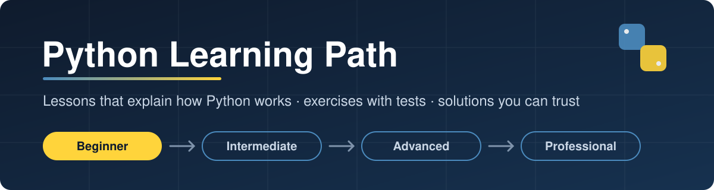
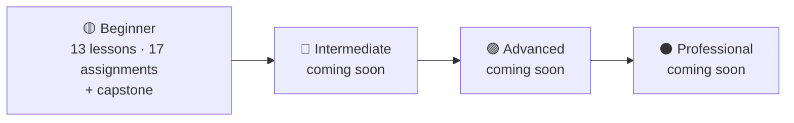
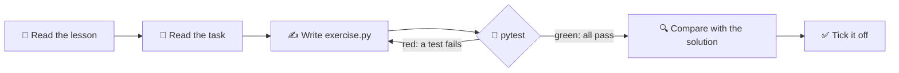

<p align="center">
  
</p>

<p align="center">
  <a href="https://github.com/ExNNeph/python-learning-path/actions/workflows/ci.yml"></a>
  
  
  <a href="LICENSE"></a>
</p>

A free, self-paced path from **your first line of Python** to **professional-grade code**.
Every lesson explains *how Python works under the hood*, not just the syntax. Every assignment comes with
**automatic tests**, so you know right away whether your solution works, and with a **commented template
solution** you can compare against when you are done.

Use it to learn Python from scratch, or come back later to relearn a topic you have forgotten.

---

## Contents

- [Roadmap](#roadmap)
- [How the repo works](#how-the-repo-works)
- [Set up Python, a venv and pytest](#set-up-python-a-venv-and-pytest) · [macOS](#macos) · [Windows](#windows) · [Linux](#linux)
- [How to work through an assignment](#how-to-work-through-an-assignment)
- [Progress checklist](#progress-checklist)
- [License and reuse](#license-and-reuse)

---

## Roadmap

| Level | You will be able to … | Status |
|---|---|---|
| 🟡 **[Beginner](beginner/)** | write small programs with variables, conditions, loops, lists, dicts, functions, exceptions and files, and run them from your own virtual environment | ✅ available: 13 lessons, 17 assignments, 1 capstone |
| 🔵 **Intermediate** | structure larger programs: comprehensions, classes and OOP, iterators and generators, the standard library, testing with pytest, type hints | 🚧 coming soon |
| 🟣 **Advanced** | understand the deeper machinery: decorators, context managers, the data model, concurrency, packaging, performance | 🚧 coming soon |
| ⚫ **Professional** | build and ship like a team: project layout, tooling and linting, CI, logging, APIs, databases, code review habits | 🚧 coming soon |



## How the repo works

Each level is a folder. Each lesson is a folder with the **theory** in its `README.md` and the
**assignments** that practise it right next to it. The template solutions live in a separate
[`solutions/`](solutions/) folder, so you do not see them by accident.

```text
python-learning-path/
├── beginner/
│   ├── README.md                         ← level overview: start here
│   ├── 01-how-python-runs/
│   │   ├── README.md                     ← the lesson (theory, diagrams, examples)
│   │   └── assignments/
│   │       └── 01-first-script/
│   │           ├── README.md             ← the task: goal, examples, hints
│   │           ├── exercise.py           ← YOUR file: fill in the function stubs
│   │           └── test_exercise.py      ← the tests that check your work
│   ├── 02-variables-and-types/
│   ├── …
│   └── capstone-expense-tracker/         ← mini project that combines everything
├── solutions/                            ← commented template solutions (spoilers!)
│   └── beginner/…                        ← mirrors the folders above
├── conftest.py                           ← lets the tests load your file or the solution
└── .github/workflows/ci.yml              ← proves every solution passes its tests
```



> **Why the tests matter:** the same tests run in CI against every template solution on
> Linux, macOS and Windows. When CI is green, every solution in this repo is proven correct,
> and you can trust the tests when they tell you your own code is wrong.

## Set up Python, a venv and pytest

You need **Python 3.10 or newer** and **git**. You set this up once; it takes about ten minutes.
Lesson [13 · venv and pip](beginner/13-venv-and-pip/) explains what each step does.

### macOS

1. Install Python: download the installer from [python.org/downloads](https://www.python.org/downloads/),
   or use Homebrew:
   ```bash
   brew install python
   ```
2. Get the code (see [Fork or clone?](#fork-or-clone) below) and go into the folder:
   ```bash
   git clone https://github.com/ExNNeph/python-learning-path.git
   ```
   ```bash
   cd python-learning-path
   ```
3. Create and activate a virtual environment, then install pytest:
   ```bash
   python3 -m venv .venv
   ```
   ```bash
   source .venv/bin/activate
   ```
   ```bash
   pip install -r requirements.txt
   ```

### Windows

1. Install Python from [python.org/downloads](https://www.python.org/downloads/). In the installer,
   tick **"Add python.exe to PATH"**. Install git from [git-scm.com](https://git-scm.com/download/win).
2. Open **PowerShell**, get the code and go into the folder:
   ```powershell
   git clone https://github.com/ExNNeph/python-learning-path.git
   cd python-learning-path
   ```
3. Create and activate a virtual environment, then install pytest:
   ```powershell
   py -m venv .venv
   .venv\Scripts\Activate.ps1
   pip install -r requirements.txt
   ```
   If PowerShell says that running scripts is disabled, allow it once for your user and try again:
   ```powershell
   Set-ExecutionPolicy -Scope CurrentUser RemoteSigned
   ```
   In the classic Command Prompt (`cmd`), activate with `.venv\Scripts\activate.bat` instead.

### Linux

1. Install Python with your package manager. Debian and Ubuntu:
   ```bash
   sudo apt install python3 python3-venv python3-pip git
   ```
   Fedora:
   ```bash
   sudo dnf install python3 python3-pip git
   ```
2. Get the code and create a virtual environment, exactly like on macOS:
   ```bash
   git clone https://github.com/ExNNeph/python-learning-path.git
   ```
   ```bash
   cd python-learning-path && python3 -m venv .venv && source .venv/bin/activate
   ```
   ```bash
   pip install -r requirements.txt
   ```

### Check that it works

With the venv active (your prompt starts with `(.venv)`), run:

```bash
python --version
```

```bash
pytest tests
```

You should see a Python version of 3.10 or higher and a line that ends with `passed`.

### Fork or clone?

- **Fork** (recommended): click **Fork** at the top of this page, then clone *your* fork.
  You can commit your solutions and tick off the checklist in your own copy.
- **Clone**: fine if you just want to read and try things locally.

## How to work through an assignment

1. **Read the lesson** (`beginner/NN-topic/README.md`). Type the examples into the REPL yourself.
2. **Read the task** (`assignments/NN-name/README.md`): the goal, example input and output, and hints.
3. **Open `exercise.py`.** Every function has a docstring that says what it should do and a
   `raise NotImplementedError` line. Replace that line with your code.
4. **Run the tests** for that assignment only:
   ```bash
   pytest beginner/03-numbers-and-strings/assignments/03-temperature-converter
   ```
   Red means a test failed: read the message, it tells you which input gave which wrong result.
   Add `-v` to see every test by name.
5. **Repeat** until everything is green. Then run your program for real, e.g. `python exercise.py`.
6. **Compare** with the template solution under `solutions/` (same path). Read its comments even if
   your code passed: they explain *why* it is written that way.
7. **Tick it off** in the checklist below.

> **Stuck?** Re-read the hints, then the matching section of the lesson. Add `print()` calls to see what
> your code really does. Peek at the solution only after a real attempt; you learn the most in the struggle.

## Progress checklist

Tick the boxes in your fork as you go (edit this file, change `[ ]` to `[x]`).

### 🟡 Beginner

- [ ] **01 · [How Python runs code](beginner/01-how-python-runs/)**
  - [ ] 01 · [First script](beginner/01-how-python-runs/assignments/01-first-script/)
- [ ] **02 · [Variables and types](beginner/02-variables-and-types/)**
  - [ ] 02 · [Type detective](beginner/02-variables-and-types/assignments/02-type-detective/)
- [ ] **03 · [Numbers and strings](beginner/03-numbers-and-strings/)**
  - [ ] 03 · [Temperature converter](beginner/03-numbers-and-strings/assignments/03-temperature-converter/)
  - [ ] 04 · [String toolkit](beginner/03-numbers-and-strings/assignments/04-string-toolkit/)
- [ ] **04 · [Input and output](beginner/04-input-and-output/)**
  - [ ] 05 · [Receipt printer](beginner/04-input-and-output/assignments/05-receipt-printer/)
- [ ] **05 · [Conditions](beginner/05-conditions/)**
  - [ ] 06 · [Grade calculator](beginner/05-conditions/assignments/06-grade-calculator/)
  - [ ] 07 · [Leap years](beginner/05-conditions/assignments/07-leap-years/)
- [ ] **06 · [Loops](beginner/06-loops/)**
  - [ ] 08 · [FizzBuzz and friends](beginner/06-loops/assignments/08-fizzbuzz/)
  - [ ] 09 · [Guess the number](beginner/06-loops/assignments/09-guess-the-number/)
- [ ] **07 · [Lists and tuples](beginner/07-lists-and-tuples/)**
  - [ ] 10 · [List statistics](beginner/07-lists-and-tuples/assignments/10-list-stats/)
- [ ] **08 · [Dictionaries and sets](beginner/08-dicts-and-sets/)**
  - [ ] 11 · [Word counter](beginner/08-dicts-and-sets/assignments/11-word-counter/)
  - [ ] 12 · [Common friends](beginner/08-dicts-and-sets/assignments/12-common-friends/)
- [ ] **09 · [Functions](beginner/09-functions/)**
  - [ ] 13 · [Password checker](beginner/09-functions/assignments/13-password-checker/)
- [ ] **10 · [Errors and exceptions](beginner/10-errors-and-exceptions/)**
  - [ ] 14 · [Safe calculator](beginner/10-errors-and-exceptions/assignments/14-safe-calculator/)
- [ ] **11 · [Files](beginner/11-files/)**
  - [ ] 15 · [Log analyzer](beginner/11-files/assignments/15-log-analyzer/)
- [ ] **12 · [Modules and imports](beginner/12-modules-and-imports/)**
  - [ ] 16 · [Standard library tour](beginner/12-modules-and-imports/assignments/16-stdlib-tour/)
- [ ] **13 · [venv and pip](beginner/13-venv-and-pip/)**
  - [ ] 17 · [Requirements parser](beginner/13-venv-and-pip/assignments/17-requirements-parser/)
- [ ] 🏁 **[Capstone: expense tracker](beginner/capstone-expense-tracker/)**

### 🔵 Intermediate · 🟣 Advanced · ⚫ Professional

Coming soon.

## License and reuse

The code (starter files, tests, solutions) is released under the [MIT license](LICENSE).
**The lessons may be reused too**: in a class, a study group, a workshop or your own notes. A link back to
this repository is appreciated.

Found a mistake or an unclear explanation? [Open an issue](https://github.com/ExNNeph/python-learning-path/issues).
