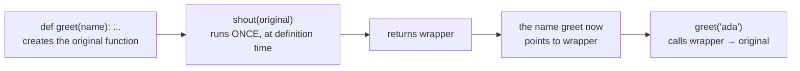
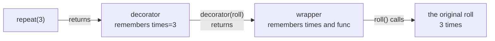
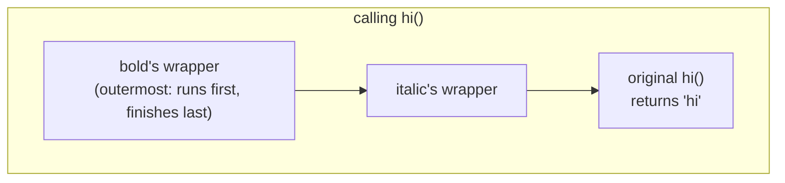
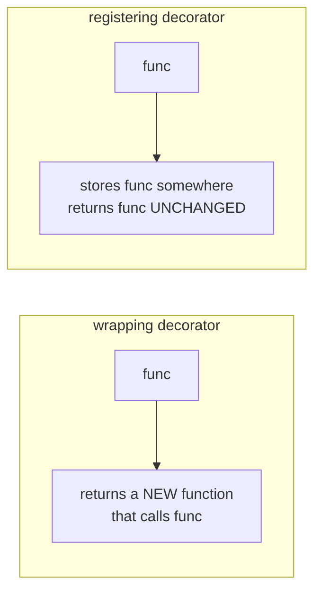

# Lesson 01 · Decorators

> **Level:** 🟣 Advanced · **Time:** ~3 h · **Assignment:** [01 · Decorator kit](assignments/01-decorator-kit/)

You have used decorators since the Intermediate level: `@dataclass`, `@property`, `@classmethod`,
`@pytest.fixture`. They look like magic, but they are built from two things you already know:
**functions are objects** and **closures**. In this lesson you open the box and write your own.

## What you will learn

- what the `@` line really does, and why it is "only" syntax
- writing a wrapper that forwards any arguments and keeps the return value
- why every wrapper needs `functools.wraps`
- decorators **with arguments** (three levels of functions) and how stacked decorators are ordered
- decorators with state, decorators that **register** instead of wrapping, and class decorators
- when a decorator is the right tool, and when it hides too much

---

## 1. A decorator is a function that takes a function

Recall from Intermediate lesson 02: a function can take a function and return a new one.

```python
def shout(func):
    def wrapper(name):
        return func(name).upper()
    return wrapper

def greet(name):
    return f"hello, {name}"

greet = shout(greet)          # replace greet by the wrapped version
greet("ada")                  # → 'HELLO, ADA'
```

That last assignment is the whole idea. Python gives it a shorter spelling: the `@` line above a `def`.

```python
@shout
def greet(name):
    return f"hello, {name}"
```

is **exactly** the same as `def greet(...)` followed by `greet = shout(greet)`. The decorator runs
**once**, when the `def` statement runs (usually at import time), not on every call.



After decoration, the name `greet` points to `wrapper`. The original function still exists: the
wrapper reaches it through the closure variable `func`.

## 2. Forwarding any arguments

The wrapper above only works for functions with exactly one argument. A general decorator does not know
the signature of the function it wraps, so it collects **everything** and forwards **everything**:

```python
import time

def timed(func):
    def wrapper(*args, **kwargs):
        start = time.perf_counter()
        result = func(*args, **kwargs)        # forward all arguments
        elapsed = time.perf_counter() - start
        print(f"{func.__name__} took {elapsed:.3f} s")
        return result                         # do not lose the return value!
    return wrapper

@timed
def slow_add(a, b, *, delay=0.1):
    time.sleep(delay)
    return a + b

slow_add(2, 3, delay=0.2)
# slow_add took 0.200 s
# → 5
```

The wrapper is the place for code that runs **before** the call, **after** it, **instead of** it (a
cache hit), or **around** it (a `try` block). The pattern is always the same:

```python
def decorator(func):
    def wrapper(*args, **kwargs):
        # before
        result = func(*args, **kwargs)
        # after
        return result
    return wrapper
```

## 3. `functools.wraps`: keep the identity

The `shout` decorator has a side effect you did not ask for:

```python
@shout
def greet(name):
    """Return a greeting."""
    return f"hello, {name}"

greet.__name__        # → 'wrapper'
greet.__doc__         # → None
```

The name `greet` now points to `wrapper`, so `help(greet)`, tracebacks, logging and pytest all show
the wrong name and lose the docstring. The fix is a decorator for your wrapper:

```python
import functools

def shout(func):
    @functools.wraps(func)                 # copy name, docstring, module, ... from func
    def wrapper(*args, **kwargs):
        return func(*args, **kwargs).upper()
    return wrapper

greet.__name__        # → 'greet'
greet.__doc__         # → 'Return a greeting.'
greet.__wrapped__     # → <function greet at 0x...>   the original, for tests and introspection
```

**Rule:** every wrapper you write gets `@functools.wraps(func)`. There is no good reason to leave it out.

## 4. Decorators with arguments

`@lru_cache(maxsize=100)` and `@pytest.mark.parametrize(...)` take arguments. How? The expression after
`@` is evaluated first, and **its result** must be the decorator. So you need a function that
**returns a decorator**: three levels of functions.

```python
import functools

def repeat(times):                        # level 1: takes the arguments
    def decorator(func):                  # level 2: takes the function
        @functools.wraps(func)
        def wrapper(*args, **kwargs):     # level 3: takes the call's arguments
            return [func(*args, **kwargs) for _ in range(times)]
        return wrapper
    return decorator

@repeat(3)
def roll():
    return 4

roll()                # → [4, 4, 4]
```

`@repeat(3)` means `roll = repeat(3)(roll)`: first `repeat(3)` builds a decorator that remembers
`times = 3`, then that decorator wraps `roll`.



Each level is a closure over the level above. Read them from the outside in: *configuration → function
→ call*.

### Optional arguments: with or without brackets

`@dataclass` works with and without brackets: `@dataclass` and `@dataclass(frozen=True)`. The trick: if
the decorator is used without brackets, its first argument is the function itself.

```python
def register(func=None, *, name=None):
    def decorator(f):
        COMMANDS[name or f.__name__] = f
        return f
    if func is None:          # used as @register(name="...")
        return decorator
    return decorator(func)    # used as @register

COMMANDS = {}

@register
def hello(): ...

@register(name="bye")
def goodbye(): ...

COMMANDS                       # → {'hello': <function hello ...>, 'bye': <function goodbye ...>}
```

Making the options keyword-only (`*`) is what keeps this unambiguous.

## 5. Stacking decorators

You can put several decorators on one function. They are applied **bottom-up**, the one closest to
the `def` first:

```python
@bold
@italic
def hi():
    return "hi"

# is the same as:  hi = bold(italic(hi))

hi()                  # → '<b><i>hi</i></b>'
```



At **call** time, the outermost wrapper (the top decorator) runs first. Order matters: `@timed` above
`@retry` measures all attempts together; below it, each attempt separately.

## 6. Decorators with state

A wrapper can keep data between calls. The simplest place is an **attribute on the wrapper** (functions
are objects, so they can have attributes):

```python
def count_calls(func):
    @functools.wraps(func)
    def wrapper(*args, **kwargs):
        wrapper.calls += 1
        return func(*args, **kwargs)
    wrapper.calls = 0
    return wrapper

@count_calls
def ping():
    return "pong"

ping(), ping()
ping.calls            # → 2
```

A cache works the same way: a dict in the closure, keyed by the arguments.

```python
def memoize(func):
    cache = {}
    @functools.wraps(func)
    def wrapper(*args):
        if args not in cache:          # args is a tuple: hashable if its items are
            cache[args] = func(*args)
        return cache[args]
    return wrapper

@memoize
def fib(n):
    return n if n < 2 else fib(n - 1) + fib(n - 2)

fib(80)               # → 23416728348467685, instantly
```

Notice that the recursive calls inside `fib` also go through the cache: the name `fib` points to the
wrapper. In real code, use the built-in `@functools.cache` (lesson 09); writing it once yourself shows
you exactly what it does.

## 7. Decorators that do not wrap

A decorator does not have to return a wrapper. It can do something **with** the function and return it
unchanged. That is how registries work: Flask's `@app.route("/")`, pytest's `@pytest.fixture`, and the
`register` example above.



## 8. Decorating methods and classes

**Methods** are plain functions inside a class, so a decorator with `*args, **kwargs` works on them
too: `self` simply arrives as the first positional argument.

```python
class Account:
    @timed
    def report(self, year):
        ...
```

**Classes** can be decorated as well: the decorator receives the class object and returns a class.
`@dataclass` is the famous example. It **adds** methods to the class and returns the same class:

```python
def add_repr(cls):
    def __repr__(self):
        fields = ", ".join(f"{k}={v!r}" for k, v in vars(self).items())
        return f"{cls.__name__}({fields})"
    cls.__repr__ = __repr__
    return cls

@add_repr
class Point:
    def __init__(self, x, y):
        self.x, self.y = x, y

Point(1, 2)           # → Point(x=1, y=2)
```

## 9. When to use one

Decorators are perfect for **cross-cutting concerns**: behaviour that many functions need but that is
not part of what any of them does. Timing, logging, caching, retrying, access checks, registration.

They are a bad fit when they **change what a function means** in surprising ways: a decorator that
silently swallows exceptions or changes the return type makes every reader of the decorated function
wrong about it. If a reader has to open the decorator to understand the function, use a plain call.

---

## Common mistakes

**Forgetting to return the result.** A wrapper that calls `func(*args, **kwargs)` without `return`
turns every decorated function into one that returns `None`.

**Forgetting `functools.wraps`.** Everything still runs, but every decorated function is called
`wrapper` in tracebacks, logs and `help()`.

**Calling the function in the decorator.** `return wrapper()` instead of `return wrapper` runs the code
once at import time and replaces the function by its result.

**Brackets mixed up.** `@repeat` without `(3)` passes the function as `times`. The error appears later,
at the first call, which makes it confusing. Use the optional-brackets pattern or always use brackets.

**Expecting per-call setup at definition time.** The decorator body runs once. Code that should run on
every call belongs in the wrapper.

## Try it yourself

1. Write `shout` without `functools.wraps` and look at `help(greet)`. Add `wraps` and look again.
2. Stack `@bold` and `@italic` in both orders and predict the output before you run it.
3. Write `@repeat(times)` and decorate a function that prints. How often is "decorating" vs "calling" printed?
4. Decorate `fib` with `memoize`, then call `fib.__wrapped__(30)`. Why is that one slow?
5. Write a class decorator that prints the names of all methods in the class body (`vars(cls)`).

## Summary

- `@decorator` above `def f` means `f = decorator(f)`, run **once** when the function is defined.
- A wrapper takes `*args, **kwargs`, forwards them, and **returns** the result.
- Always put `@functools.wraps(func)` on the wrapper. The original stays reachable as `__wrapped__`.
- A decorator with arguments is a function that **returns** a decorator: configuration → function → call.
- Stacked decorators apply bottom-up; at call time the top one runs first.
- Decorators can keep state (closure or attributes), register functions without wrapping them, and decorate classes.

## Assignment

➡️ **[01 · Decorator kit](assignments/01-decorator-kit/)**: build `count_calls`, `memoize`, `retry` and a command registry.

---

<p align="center">
  <a href="../README.md">Advanced overview</a> · <a href="../02-context-managers/">Next: 02 · Context managers →</a>
</p>
