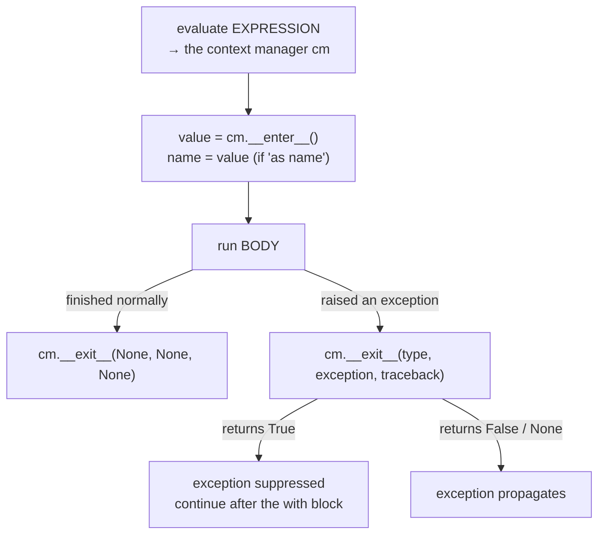
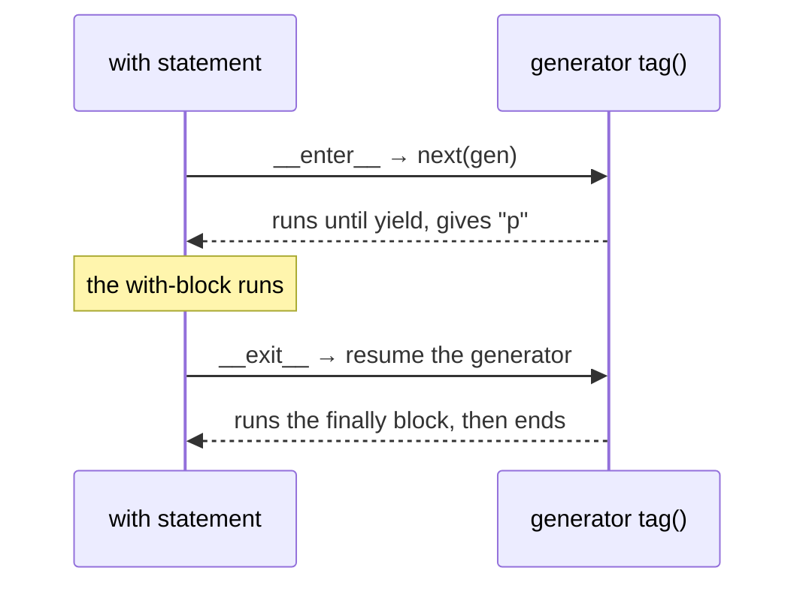
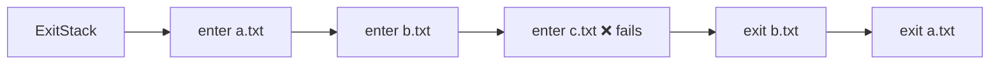

# Lesson 02 · Context managers

> **Level:** 🟣 Advanced · **Time:** ~2.5 h · **Assignment:** [02 · Resource guards](assignments/02-resource-guards/)

Since the Beginner level you have written `with open(path) as file:` and trusted that the file gets
closed. This lesson shows the protocol behind `with`, so you can write your own context managers for
anything that needs a **setup** and a **guaranteed cleanup**: locks, timers, temporary settings,
database transactions, changed directories.

## What you will learn

- the problem `with` solves, and what it does step by step
- the context manager protocol: `__enter__` and `__exit__`
- how `__exit__` sees exceptions, and how it can suppress them
- writing context managers as generators with `@contextlib.contextmanager`
- the toolbox in `contextlib`: `suppress`, `redirect_stdout`, `nullcontext`, `ExitStack`
- context managers that double as decorators

---

## 1. The problem: cleanup that must happen

Some actions come in pairs: open and close, acquire and release, change and restore. The second half
must happen **even if the code in between fails**. Without `with`, that means `try` / `finally`:

```python
lock.acquire()
try:
    update_balance()          # may raise
finally:
    lock.release()            # runs no matter what
```

This is correct, but easy to get wrong: the setup can end up inside the `try`, the cleanup can be
forgotten in one of ten places. A context manager packs both halves into one object, and `with`
guarantees the pairing:

```python
with lock:
    update_balance()
```

## 2. What `with` does

A context manager is any object with two methods, `__enter__` and `__exit__`. The statement

```python
with EXPRESSION as name:
    BODY
```

does this:



Two details matter:

- The name after `as` gets whatever `__enter__` **returns**, not the context manager itself. For files
  that is the same object (`open()` returns a file whose `__enter__` returns `self`), but it does not
  have to be.
- `__exit__` **always** runs once `__enter__` has succeeded: on success, on an exception, on `return`
  or `break` inside the block.

## 3. Writing one as a class

```python
class Demo:
    def __enter__(self):
        print("enter")
        return "resource"

    def __exit__(self, exc_type, exc, tb):
        print("exit", exc_type, exc)
        return False                    # do not suppress exceptions

with Demo() as r:
    print("body", r)
# enter
# body resource
# exit None None

with Demo():
    1 / 0
# enter
# exit <class 'ZeroDivisionError'> division by zero
# ZeroDivisionError: division by zero      ← propagates, because __exit__ returned False
```

`__exit__` receives three arguments: the exception's **type**, the exception **object** and its
**traceback**. All three are `None` when the block finished normally.

A useful real example, a stopwatch:

```python
import time

class Timer:
    def __enter__(self):
        self.start = time.perf_counter()
        return self                     # so that `as t` gives us the timer

    def __exit__(self, exc_type, exc, tb):
        self.elapsed = time.perf_counter() - self.start
        return False

with Timer() as t:
    sum(range(10_000_000))
print(f"{t.elapsed:.2f} s")             # → 0.15 s  (on this machine)
```

Note that `t` is still usable **after** the block: the `with` statement ends the context, it does not
delete the variable.

### Suppressing exceptions

If `__exit__` returns a true value, the exception is swallowed and the program continues after the
`with` block. Use this rarely and narrowly: only for exceptions you **expect** and can safely ignore.

```python
class Ignore:
    def __init__(self, *exceptions):
        self.exceptions = exceptions

    def __enter__(self):
        return self

    def __exit__(self, exc_type, exc, tb):
        return exc_type is not None and issubclass(exc_type, self.exceptions)

with Ignore(FileNotFoundError):
    open("missing.txt")
print("still running")              # → still running
```

## 4. Writing one as a generator: `@contextmanager`

Writing a class with two methods is a lot of ceremony for "do this before, that after". The standard
library turns a **generator** into a context manager: everything before `yield` is the setup, the
yielded value is what `as` receives, everything after is the cleanup.

```python
from contextlib import contextmanager

@contextmanager
def tag(name):
    print(f"<{name}>")
    try:
        yield name                # the with-block runs here
    finally:
        print(f"</{name}>")

with tag("p") as t:
    print("text", t)
# <p>
# text p
# </p>
```



**The `try` / `finally` is not optional.** If the with-block raises, `@contextmanager` re-raises that
exception **at the `yield` line** inside your generator. Without `finally`, the cleanup after `yield`
is skipped. If you want to **suppress** an exception, catch it around the `yield` with `except` and
do not re-raise it.

Lesson 08 shows how `@contextmanager` does this with `gen.throw()`. For now: the generator form is
the default choice; write a class when the context manager needs to keep state that users read
afterwards (like `Timer.elapsed`) or is used in many places.

## 5. The `contextlib` toolbox

```python
from contextlib import suppress, redirect_stdout, nullcontext
import io

with suppress(FileNotFoundError):         # the standard version of Ignore above
    open("missing.txt")

buffer = io.StringIO()
with redirect_stdout(buffer):             # print() goes into the buffer for a while
    print("hidden")
buffer.getvalue()                         # → 'hidden\n'

def process(lock=None):
    with lock or nullcontext():           # a context manager that does nothing
        ...
```

More context managers you already know or will meet: `open()`, `threading.Lock()` (lesson 10),
`tempfile.TemporaryDirectory()`, `decimal.localcontext()`, `unittest.mock.patch()`, `pytest.raises()`,
and `contextlib.chdir()` (Python 3.11+).

### `ExitStack`: a variable number of contexts

`with a, b, c:` works for a fixed number of context managers. When the number is only known at run
time, for example "open all these files", use an `ExitStack`. It collects context managers and exits
all of them, **in reverse order**, when the stack itself exits:

```python
from contextlib import ExitStack

def merge(paths, target):
    with ExitStack() as stack:
        files = [stack.enter_context(open(path)) for path in paths]
        with open(target, "w") as out:
            for file in files:
                out.write(file.read())
    # here every file is closed, even if opening the 7th one failed
```



If opening the third file fails, the two already opened files are closed before the exception leaves
the `with` block. Getting this right by hand needs nested `try` blocks.

## 6. Context managers as decorators

A context manager made with `@contextmanager` can also decorate a function: the whole function body then
runs inside the context.

```python
@tag("div")
def render():
    print("content")

render()
# <div>
# content
# </div>
```

That is handy for things like "run this test with a temporary setting". Class-based context managers
get the same ability by inheriting from `contextlib.ContextDecorator`.

---

## Common mistakes

**No `try` / `finally` around `yield`.** The cleanup only runs when the block succeeds. This is the most
common bug in generator-based context managers.

**Expecting the context manager after `as`.** `as` binds the return value of `__enter__`. If your
`__enter__` forgets `return self`, the name is `None`.

**Returning `True` from `__exit__` by accident.** A truthy return value swallows **every** exception,
including bugs. Return `False` (or nothing) unless you mean to suppress.

**Doing the setup in `__init__`.** `cm = Timer()` should not start anything; `with cm:` should. Some
code creates context managers early and enters them later.

**Yielding twice.** A `@contextmanager` generator must yield **exactly once**; otherwise you get
`RuntimeError: generator didn't stop`.

## Try it yourself

1. Write `Demo` from section 3 and use `return` inside the with-block of a function. Does `exit` print?
2. Change `Demo.__exit__` to return `True`. What happens to `1 / 0` now?
3. Remove the `finally` from `tag` and raise an exception inside `with tag("p"):`. Which tag is missing?
4. Use `ExitStack` to open three files, one of which does not exist. Check `file.closed` on the others.
5. Use `redirect_stdout` to capture the output of `help(len)` into a string.

## Summary

- `with` calls `__enter__` before the block and **always** calls `__exit__` after it.
- `as name` binds what `__enter__` **returns**.
- `__exit__(exc_type, exc, tb)` sees any exception; a true return value suppresses it.
- `@contextmanager` turns a generator into a context manager: setup, `yield value`, cleanup in `finally`.
- `contextlib` has `suppress`, `redirect_stdout`, `nullcontext` and `ExitStack` (any number of contexts, exited in reverse).

## Assignment

➡️ **[02 · Resource guards](assignments/02-resource-guards/)**: a timer, a suppressor, temporary environment variables, a transaction and an `ExitStack` helper.

---

<p align="center">
  <a href="../01-decorators/">← Previous: 01 · Decorators</a> · <a href="../README.md">Advanced overview</a> · <a href="../03-the-data-model/">Next: 03 · The data model →</a>
</p>
