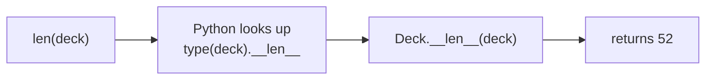
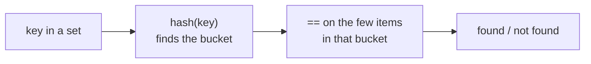
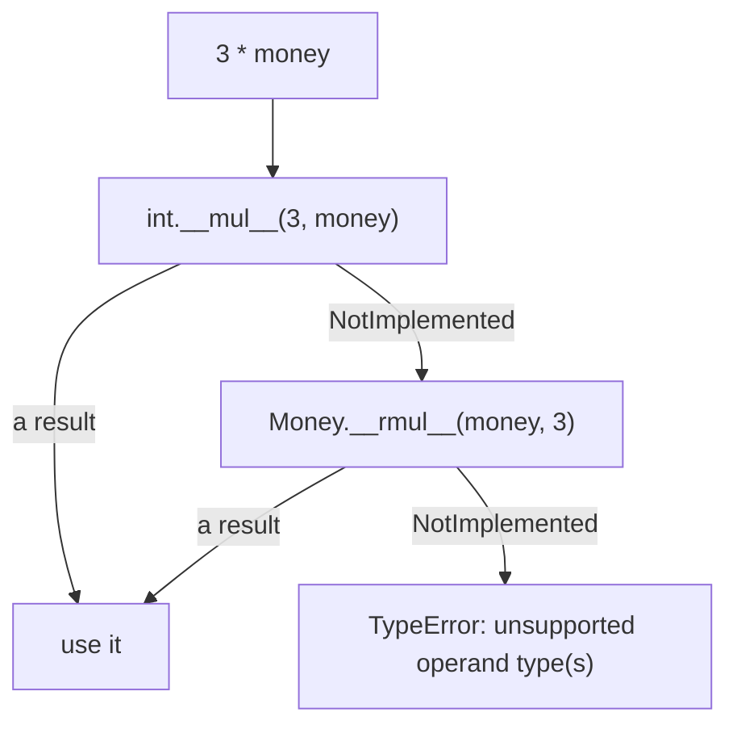

# Lesson 03 · The data model

> **Level:** 🟣 Advanced · **Time:** ~3.5 h · **Assignments:** [03 · Vector](assignments/03-vector/), [04 · Sorted list](assignments/04-sorted-list/)

Why does `len()` work on lists, strings, dicts and your own classes alike? Why can you write `a + b`
for numbers, strings and `Path` objects? Because Python's syntax is a thin layer over **special
methods**, the ones with double underscores ("dunder" methods). The rules for which syntax calls which
method are called the **data model**. Once you know them, your own classes can behave exactly like
built-in types.

## What you will learn

- how syntax like `len(x)`, `a + b`, `x[i]` and `if x:` translates into method calls
- `__repr__`, `__str__` and `__format__`: three ways to turn an object into text
- equality, ordering and hashing, and why they must agree
- arithmetic operators, reflected operators (`__radd__`) and the special value `NotImplemented`
- truthiness with `__bool__` and `__len__`
- container methods: `__len__`, `__getitem__` with slices, `__contains__`, `__iter__`
- callable objects with `__call__`, and free methods from `collections.abc`

---

## 1. Syntax is method calls

You never call `__len__` yourself. You call `len(x)`, and Python calls `type(x).__len__(x)` for you.

| You write | Python calls |
|---|---|
| `repr(x)`, `str(x)`, `f"{x:.2f}"` | `x.__repr__()`, `x.__str__()`, `x.__format__(".2f")` |
| `a == b`, `a < b` | `a.__eq__(b)`, `a.__lt__(b)` |
| `hash(x)`, `{x}`, `d[x]` | `x.__hash__()` |
| `a + b`, `a * b`, `-a`, `abs(a)` | `a.__add__(b)`, `a.__mul__(b)`, `a.__neg__()`, `a.__abs__()` |
| `if x:`, `bool(x)` | `x.__bool__()`, else `x.__len__() != 0` |
| `len(x)`, `x[i]`, `x[i] = v`, `item in x` | `x.__len__()`, `x.__getitem__(i)`, `x.__setitem__(i, v)`, `x.__contains__(item)` |
| `for item in x` | `iter(x)` → `x.__iter__()` |
| `x(...)` | `x.__call__(...)` |
| `with x:` | `x.__enter__()`, `x.__exit__(...)` (lesson 02) |



Two consequences:

- The lookup happens on the **type**, not on the instance. Setting `deck.__len__ = ...` on one object
  does nothing for `len(deck)`.
- You implement the dunder method; users use the normal syntax. **Never** call `x.__len__()` in
  normal code.

Throughout this lesson we build a small `Money` class step by step.

## 2. Turning an object into text

```python
class Money:
    def __init__(self, cents, currency="EUR"):
        self.cents, self.currency = cents, currency

    def __repr__(self):
        return f"Money({self.cents}, {self.currency!r})"

    def __str__(self):
        return f"{self.cents / 100:.2f} {self.currency}"

m = Money(1250)
repr(m)             # → "Money(1250, 'EUR')"
str(m)              # → '12.50 EUR'
print(m)            # 12.50 EUR
[m]                 # → [Money(1250, 'EUR')]      containers always use repr of their items
```

| Method | For whom | Rule of thumb |
|---|---|---|
| `__repr__` | developers: REPL, debugger, logs, containers | unambiguous; ideally valid Python that recreates the object |
| `__str__` | end users: `print`, `str()`, f-strings | readable. If missing, Python uses `__repr__` |
| `__format__(spec)` | f-strings with a format spec: `f"{m:>12}"` | optional; interpret the part after `:` yourself |

**Always write `__repr__`.** It is the one that helps when something goes wrong.

## 3. Equality and hashing

Without `__eq__`, `==` compares **identity** (`is`). For value objects like money that is wrong:

```python
    def __eq__(self, other):
        if not isinstance(other, Money):
            return NotImplemented          # "I don't know how to compare with that"
        return (self.cents, self.currency) == (other.cents, other.currency)

Money(1250) == Money(1250)      # → True
Money(1250) == 1250             # → False
```

`NotImplemented` is a special value (not the exception `NotImplementedError`!). Returning it tells
Python "try the other side". If the other side does not know either, `==` falls back to identity and
gives `False`. That is better than raising, and better than a guess.

### The hash rule

Objects in a `set` or used as `dict` keys are found by their **hash** first, then confirmed with
`==`. So there is one rule you must never break:

> **If `a == b`, then `hash(a) == hash(b)`.**

Python protects you: a class that defines `__eq__` but not `__hash__` becomes **unhashable**:

```python
class Point:
    def __init__(self, x):
        self.x = x
    def __eq__(self, other):
        return self.x == other.x

Point.__hash__          # → None
{Point(1)}              # ❌ TypeError: unhashable type: 'Point'
```

If your objects are **immutable** (they never change after creation), hash the same fields you compare:

```python
    def __hash__(self):
        return hash((self.cents, self.currency))

len({Money(100), Money(100)})       # → 1
```



Mutable objects should stay unhashable: if an object's hash changes while it is in a set, the set can
no longer find it. That is why `list` is unhashable and `tuple` is not. `@dataclass(frozen=True)`
generates a matching `__eq__` and `__hash__` for you.

### Ordering

`<`, `<=`, `>` and `>=` call `__lt__`, `__le__`, `__gt__` and `__ge__`. Defining `__lt__` is enough for
`sorted()` and `min()`. For all four, define `__eq__` and `__lt__` and decorate the class with
`@functools.total_ordering` (lesson 09), or use a dataclass with `order=True`.

## 4. Arithmetic operators

```python
    def __add__(self, other):
        if not isinstance(other, Money):
            return NotImplemented
        if other.currency != self.currency:
            raise ValueError("currency mismatch")
        return Money(self.cents + other.cents, self.currency)

    def __mul__(self, factor):
        if not isinstance(factor, (int, float)):
            return NotImplemented
        return Money(round(self.cents * factor), self.currency)

Money(1250) + Money(50)         # → Money(1300, 'EUR')
Money(1250) * 3                 # → Money(3750, 'EUR')
Money(1250) + 5                 # ❌ TypeError: unsupported operand type(s) for +: 'Money' and 'int'
```

Operators return a **new** object; they do not change `self`. The `TypeError` above was not written by
us: it is what Python raises when every side returned `NotImplemented`.

### Reflected operators

`Money(1250) * 3` works. What about `3 * Money(1250)`? Python first asks the **left** operand:
`int.__mul__(3, money)`, which returns `NotImplemented`. Then it asks the right operand for the
**reflected** method `__rmul__`:



```python
    __rmul__ = __mul__              # multiplication is symmetric, so reuse it

3 * Money(1250)                 # → Money(3750, 'EUR')
```

`sum()` starts with `0 + first_item`, so a class that should work with `sum()` needs an `__radd__`
that accepts `0`:

```python
    def __radd__(self, other):
        if other == 0:
            return self
        return NotImplemented

sum([Money(100), Money(250)])   # → Money(350, 'EUR')
```

Every binary operator has a normal, a reflected and an in-place version: `__add__` / `__radd__` /
`__iadd__` (`+=`), `__sub__`, `__mul__`, `__truediv__` (`/`), `__floordiv__` (`//`), `__mod__`,
`__pow__`, `__matmul__` (`@`), and more. Without `__iadd__`, `a += b` falls back to `a = a + b`, which
is exactly right for immutable objects.

Unary operators take no argument: `__neg__` (`-a`), `__pos__` (`+a`), `__abs__` (`abs(a)`).

## 5. Truthiness

`if x:` calls `bool(x)`, which calls `__bool__`. If there is no `__bool__`, Python uses `__len__` (zero
length is false). If there is neither, every object is true.

```python
    def __bool__(self):
        return self.cents != 0

bool(Money(0))              # → False
```

## 6. Containers

A class becomes a **sequence** with two methods:

```python
class Deck:
    def __init__(self):
        self.cards = [rank + suit for suit in "♠♥" for rank in "AKQ"]

    def __len__(self):
        return len(self.cards)

    def __getitem__(self, index):
        return self.cards[index]        # delegating also handles negative indexes and slices

deck = Deck()
len(deck)           # → 6
deck[0], deck[-1]   # → ('A♠', 'Q♥')
deck[:2]            # → ['A♠', 'K♠']
"K♥" in deck        # → True
list(reversed(deck))[:2]   # → ['Q♥', 'K♥']
for card in deck: ...      # works too
```

With only `__getitem__`, Python can already iterate (it calls `deck[0]`, `deck[1]`, … until
`IndexError`), test `in` and, together with `__len__`, `reversed`. For speed and clarity, implement
the specific methods as well:

| Method | Used by | Fallback if missing |
|---|---|---|
| `__len__` | `len(x)`, `bool(x)` | none |
| `__getitem__(key)` | `x[key]`, `x[a:b]` | none |
| `__iter__` | `for`, `list(x)`, unpacking | `__getitem__(0, 1, 2, …)` |
| `__contains__(item)` | `item in x` | iterate and compare |
| `__reversed__` | `reversed(x)` | `__len__` + `__getitem__` |
| `__setitem__`, `__delitem__` | `x[key] = v`, `del x[key]` | none (read-only) |

**Slices** arrive as a `slice` object: `deck[1:3]` calls `__getitem__(slice(1, 3, None))`. Check with
`isinstance(index, slice)` if a slice should return your own type instead of a list.

## 7. Callable objects

An object with `__call__` can be called like a function. That is useful for functions that need
configuration or state, as an alternative to a closure:

```python
class Multiplier:
    def __init__(self, factor):
        self.factor = factor

    def __call__(self, number):
        return number * self.factor

triple = Multiplier(3)
triple(5)               # → 15
callable(triple)        # → True
```

## 8. Free methods from `collections.abc`

Implementing a full sequence (`index`, `count`, `__contains__`, `__iter__`, `__reversed__`) is
repetitive. The abstract base classes in `collections.abc` do it for you: implement the few
**abstract** methods, inherit the rest.

```python
from collections.abc import Sequence

class Deck(Sequence):
    def __init__(self):
        self.cards = [rank + suit for suit in "♠♥" for rank in "AKQ"]
    def __len__(self):
        return len(self.cards)
    def __getitem__(self, index):
        return self.cards[index]

Deck().index("Q♠"), Deck().count("A♥")      # → (2, 1)
isinstance(Deck(), Sequence)                 # → True
```

`Sequence`, `MutableSequence`, `Mapping`, `MutableMapping`, `Set` and others work the same way. The
documentation of `collections.abc` has a table of which methods you write and which you get.

---

## Common mistakes

**Raising instead of returning `NotImplemented`.** `raise TypeError` in `__eq__` breaks `money == None`;
`raise NotImplementedError` is a different thing entirely. Return `NotImplemented` for unknown types.

**Defining `__eq__` and losing hashability.** Suddenly your objects cannot go into sets. Add a
`__hash__` over the same fields, but only if the object is immutable.

**Hashing mutable fields.** If the fields used in `__hash__` change, the object gets lost inside sets and dicts.

**Changing `self` in `__add__`.** `a + b` must not modify `a`. Return a new object.

**`__repr__` returning something that is not a string**, or `__len__` returning a negative number or a
float: Python raises `TypeError` / `ValueError` at the call site.

**Calling dunder methods directly** (`x.__len__()`) instead of the syntax (`len(x)`).

## Try it yourself

1. Build `Money` step by step and check `[Money(5)]` before and after adding `__repr__`.
2. Remove `__radd__` and run `sum([Money(1), Money(2)])`. Read the error, then add it back.
3. Add `__eq__` to a class without `__hash__` and put an instance into a set.
4. Write a `__getitem__` that prints its argument, then try `x[1]`, `x[1:5]`, `x[::2]` and `x[1, 2]`.
5. Make `Deck` inherit from `Sequence`, but forget `__len__`. What happens when you create one?

## Summary

- Syntax calls special methods on the **type**: `len(x)` → `__len__`, `a + b` → `__add__`, `x[i]` → `__getitem__`.
- Always write `__repr__`; add `__str__` for a user-facing form.
- Return `NotImplemented` (not an exception) for operand types you do not support.
- `a == b` must imply `hash(a) == hash(b)`. Defining `__eq__` removes `__hash__`; hash only immutable objects.
- Reflected methods (`__radd__`, `__rmul__`) handle `3 * money` and `sum()`.
- `__len__` + `__getitem__` make a sequence; `collections.abc` fills in the rest.

## Assignments

➡️ **[03 · Vector](assignments/03-vector/)**: an immutable n-dimensional vector with operators, hashing and formatting.

➡️ **[04 · Sorted list](assignments/04-sorted-list/)**: a container that keeps itself sorted, with slicing, `in` and fast lookups.

---

<p align="center">
  <a href="../02-context-managers/">← Previous: 02 · Context managers</a> · <a href="../README.md">Advanced overview</a> · <a href="../04-attribute-access/">Next: 04 · Attribute access →</a>
</p>
