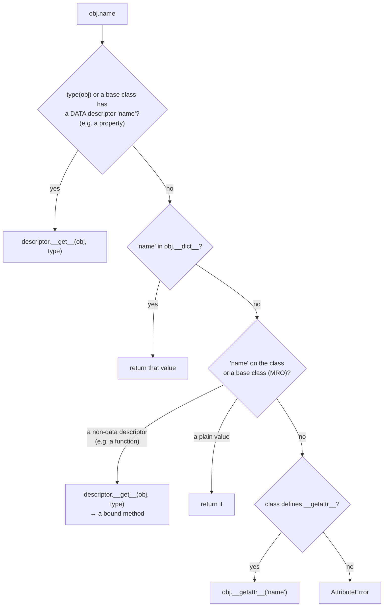
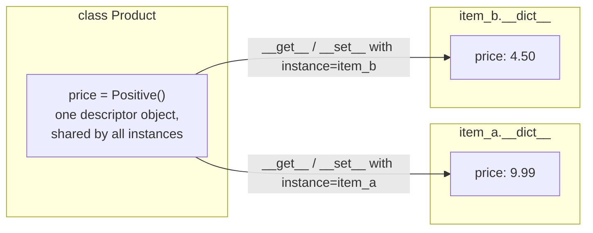

# Lesson 04 · Attribute access

> **Level:** 🟣 Advanced · **Time:** ~3 h · **Assignment:** [05 · Validated fields](assignments/05-validated-fields/)

`obj.name` looks like the simplest thing in Python. Behind the dot, there is a lookup with a precise
order, and every step can be customised. That is how `@property` computes values, how methods know
their `self`, how Django and SQLAlchemy model fields validate data, and how `__slots__` saves memory.
This lesson walks through the dot step by step.

## What you will learn

- where attributes live: the instance `__dict__`, the class, the base classes
- the built-ins `getattr`, `setattr`, `hasattr`, `delattr` and `vars`
- `__getattr__` for missing attributes, and `__setattr__` for controlling assignments
- **descriptors**: `__get__`, `__set__`, `__set_name__`, and why `@property` is one
- data vs non-data descriptors, and how methods get bound to `self`
- `__slots__`: fixed attributes, less memory

---

## 1. Where attributes live

Every ordinary object has a dict for its own attributes. `vars(obj)` (or `obj.__dict__`) shows it. The
class has a dict too, holding methods and class attributes.

```python
class Point:
    kind = "2d"                       # class attribute: lives in Point.__dict__
    def __init__(self, x, y):
        self.x, self.y = x, y         # instance attributes: live in p.__dict__

p = Point(1, 2)
vars(p)                 # → {'x': 1, 'y': 2}
p.kind                  # → '2d'        not in vars(p): found on the class
p.kind = "mine"         # assignment ALWAYS writes into the instance dict...
vars(p)                 # → {'x': 1, 'y': 2, 'kind': 'mine'}
Point.kind              # → '2d'        ...so the class attribute is only shadowed
```

Reading looks in several places; writing goes straight to the instance. That asymmetry is the source of
many surprises (Intermediate lesson 03, "mutable class attributes").

### Attributes by name

When the attribute name is in a variable, use the built-ins:

```python
getattr(p, "x")             # → 1           same as p.x
getattr(p, "z", None)       # → None        a default instead of AttributeError
hasattr(p, "y")             # → True
setattr(p, "x", 10)         # same as p.x = 10
delattr(p, "kind")          # same as del p.kind
```

## 2. The lookup order

Here is what `obj.name` really does. The words "data descriptor" are explained in section 4; for now,
think of `@property`.



All of this is implemented in `object.__getattribute__`, which runs for **every** attribute access.

## 3. Hooks: `__getattr__` and `__setattr__`

### `__getattr__`: only for missing attributes

`__getattr__(self, name)` is called **only when the normal lookup failed**. That makes it safe and
useful for fallbacks, proxies and objects with dynamic attributes:

```python
class Settings:
    def __init__(self, values):
        self._values = values             # found normally: __getattr__ is not involved

    def __getattr__(self, name):          # only for names that do not exist
        try:
            return self._values[name]
        except KeyError:
            raise AttributeError(f"no setting {name!r}") from None

s = Settings({"debug": True, "port": 8080})
s.port              # → 8080
s.timeout           # ❌ AttributeError: no setting 'timeout'
```

**Raise `AttributeError`, never `KeyError`**, for a missing name: `hasattr()`, `getattr(obj, name,
default)` and copy/pickle all rely on it.

Its big brother `__getattribute__` runs for **every** access, existing attributes included. Overriding it
is rarely needed and easy to break: any `self.something` inside it calls it again, recursively.

### `__setattr__`: every assignment

`__setattr__(self, name, value)` runs for **every** `obj.name = value`, including the ones in `__init__`.
To actually store a value inside it, call the default implementation, not `self.name = ...`
(that would call `__setattr__` again, forever):

```python
class Frozen:
    def __init__(self, x):
        object.__setattr__(self, "x", x)          # bypass our own __setattr__ once

    def __setattr__(self, name, value):
        raise AttributeError(f"cannot set {name!r}: Frozen is read-only")

f = Frozen(1)
f.x = 2             # ❌ AttributeError: cannot set 'x': Frozen is read-only
```

This is roughly what `@dataclass(frozen=True)` generates.

## 4. Descriptors

A **descriptor** is an object, stored as a **class attribute**, that controls what happens when that
attribute is read or written on **instances**. It is any object with at least one of these methods:

| Method | Called for | Arguments |
|---|---|---|
| `__get__(self, instance, owner)` | `obj.attr` (and `Class.attr`, with `instance=None`) | the instance, the class |
| `__set__(self, instance, value)` | `obj.attr = value` | the instance, the new value |
| `__delete__(self, instance)` | `del obj.attr` | the instance |
| `__set_name__(self, owner, name)` | once, when the class is created | the class, the attribute name |

A validating field, the pattern behind ORM model fields:

```python
class Positive:
    def __set_name__(self, owner, name):
        self.name = name                          # "price" or "quantity": learnt automatically

    def __get__(self, instance, owner):
        if instance is None:                      # accessed on the class: Product.price
            return self
        return instance.__dict__[self.name]

    def __set__(self, instance, value):
        if value <= 0:
            raise ValueError(f"{self.name} must be positive, got {value}")
        instance.__dict__[self.name] = value      # store on the instance, under the same name

class Product:
    price = Positive()
    quantity = Positive()

    def __init__(self, price, quantity):
        self.price = price                        # → Positive.__set__(price_descriptor, self, price)
        self.quantity = quantity

item = Product(9.99, 3)
item.price              # → 9.99
vars(item)              # → {'price': 9.99, 'quantity': 3}
item.quantity = -1      # ❌ ValueError: quantity must be positive, got -1
```



**The descriptor exists once, on the class.** It must store per-instance data **on the instance**
(here in `instance.__dict__`), never on `self`: `self.value = value` would share one value between all
products.

Why does `item.price` reach the descriptor, although `vars(item)` has a `'price'` key? Because
`Positive` has `__set__`, which makes it a **data descriptor**, and data descriptors come **first** in
the lookup order (section 2).

### Data and non-data descriptors

| | Has | Priority | Examples |
|---|---|---|---|
| **data descriptor** | `__set__` and/or `__delete__` | **before** the instance dict | `property`, validating fields, `__slots__` members |
| **non-data descriptor** | only `__get__` | **after** the instance dict | functions (methods), `functools.cached_property`, `classmethod`, `staticmethod` |

The non-data rule enables a neat trick: compute a value once, then store it in the instance dict under
the same name. The next lookup finds the instance dict **first** and never calls the descriptor again.
That is exactly how `functools.cached_property` works.

### `@property` is a descriptor

`property(fget, fset)` is a data descriptor class written in C. `@property` creates one with your
method as `fget`; `@name.setter` creates a new one with `fset` added. Everything you learnt about
properties in the Intermediate level is the descriptor protocol in a convenient form.

### Methods are descriptors

Functions have a `__get__` method. That is the whole secret of `self`:

```python
p.__init__              # → <bound method Point.__init__ of ...>
Point.__init__          # → <function Point.__init__ at 0x...>
```

`p.move` finds the function `move` on the class, sees a non-data descriptor, and calls
`move.__get__(p, Point)`, which returns a **bound method**: the function with `p` filled in as the first
argument. `p.move(1, 2)` is therefore `Point.move(p, 1, 2)`.

Use a property for one computed attribute; write a descriptor when you need the **same** behaviour on
**many** attributes or classes.

## 5. `__slots__`

A class can declare its attributes up front. Instances then get no `__dict__`; instead, Python reserves
exactly those slots (each slot is a data descriptor on the class):

```python
class Slim:
    __slots__ = ("x", "y")
    def __init__(self, x, y):
        self.x, self.y = x, y

s = Slim(1, 2)
s.z = 3             # ❌ AttributeError: 'Slim' object has no attribute 'z'
```

Two effects: **less memory** per instance (roughly 50 bytes instead of a few hundred for a small
object with a dict) and **protection against typos** like `s.vlaue = 1`. Use it for classes with many
thousands of instances. `@dataclass(slots=True)` does it for dataclasses (Python 3.10+).

---

## Common mistakes

**Storing per-instance data on the descriptor.** `self.value = value` inside `__set__` makes every
instance share one value. Store it in `instance.__dict__` (or a dict keyed by the instance).

**Raising `KeyError` in `__getattr__`.** `hasattr()` and `getattr(obj, name, default)` only handle
`AttributeError`.

**Infinite recursion in `__setattr__` / `__getattribute__`.** Inside them, use `object.__setattr__(self,
...)` / `object.__getattribute__(self, ...)` or `super()`.

**Forgetting `instance is None` in `__get__`.** `Product.price` then crashes instead of returning the
descriptor, which breaks `help()` and introspection.

**Putting a descriptor on an instance.** `self.price = Positive()` in `__init__` stores a plain object;
descriptors only work as **class** attributes.

## Try it yourself

1. Create a `Point`, set `p.kind`, then `del p.kind`. Which `kind` do you see now?
2. Add `print` calls to `Positive.__get__` and `__set__` and follow `Product(9.99, 3)` step by step.
3. Remove `__set__` from `Positive`. Why does validation stop, and why does reading still work?
4. Compare `p.__init__.__func__ is Point.__init__` and `p.__init__.__self__ is p`.
5. Check `sys.getsizeof(obj) + sys.getsizeof(vars(obj))` for a normal class against a `__slots__` class.

## Summary

- Reading `obj.name` checks data descriptors, then the instance dict, then the class (and its bases), then `__getattr__`.
- Writing `obj.name = v` goes to a data descriptor's `__set__`, else into the instance dict.
- `__getattr__` handles **missing** names (raise `AttributeError`); `__setattr__` sees **every** assignment.
- A descriptor is a class attribute with `__get__` / `__set__`; `__set_name__` tells it its name. Store data on the instance.
- `property`, methods, `classmethod`, `staticmethod` and `cached_property` are all descriptors.
- `__slots__` fixes the attributes and saves memory.

## Assignment

➡️ **[05 · Validated fields](assignments/05-validated-fields/)**: build a family of validating descriptors, a cached property and a read-only config object.

---

<p align="center">
  <a href="../03-the-data-model/">← Previous: 03 · The data model</a> · <a href="../README.md">Advanced overview</a> · <a href="../05-class-customization/">Next: 05 · Class customization →</a>
</p>
