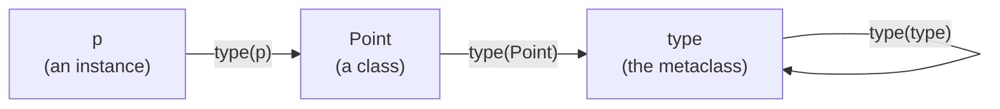
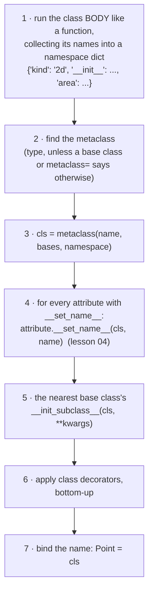
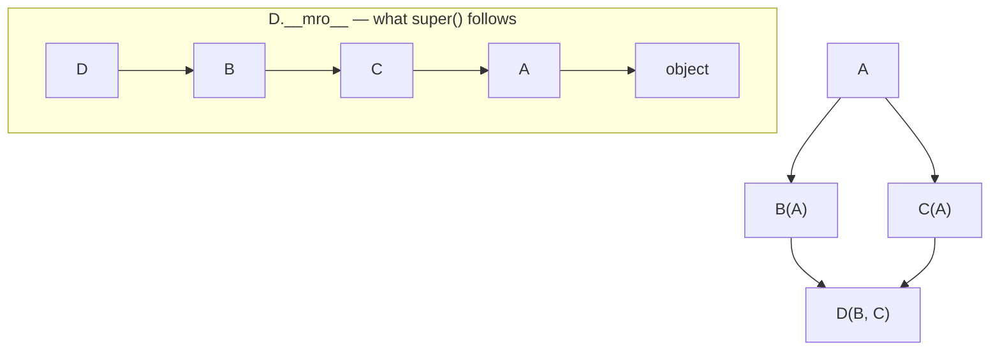
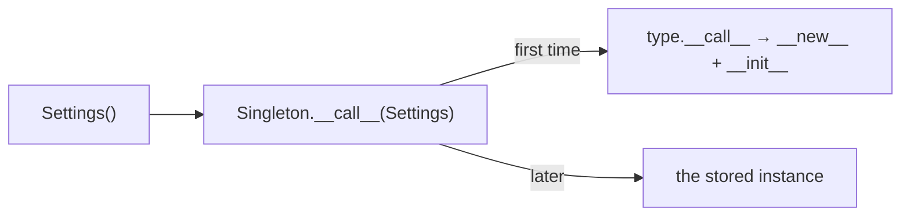

# Lesson 05 · Class customization

> **Level:** 🟣 Advanced · **Time:** ~3 h · **Assignment:** [06 · Plugin registry](assignments/06-plugin-registry/)

So far you customised how **instances** behave. This lesson goes one level up: how **classes** are
created, and how you can hook into that. It is the machinery behind plugin systems, ORMs that turn a
class body into a database table, `@dataclass`, abstract base classes and `Enum`. You will also see why
the simplest hook, `__init_subclass__`, is enough for nearly everything that used to need a metaclass.

## What you will learn

- classes are objects too, created by `type`, and you can create them at run time
- what happens step by step when Python runs a `class` statement
- `__init_subclass__`: react to subclasses, with keyword arguments in the class line
- class decorators vs `__init_subclass__`
- `__new__` vs `__init__`, and subclassing immutable built-ins
- the method resolution order (MRO), cooperative `super()` and mixins
- metaclasses: what they are, and the few cases where you need one

---

## 1. Classes are objects

A class is an ordinary object: you can pass it around, store it in a dict and inspect it. Its type is
`type`:

```python
class Point:
    pass

type(Point)                 # → <class 'type'>
type(3)                     # → <class 'int'>
isinstance(Point, type)     # → True
```



Just as `Point(1, 2)` creates a point, `type(name, bases, namespace)` creates a **class**. The
`class` statement is a convenient way to call it:

```python
def init(self, x, y):
    self.x, self.y = x, y

Point = type("Point", (), {"__init__": init, "kind": "2d"})

p = Point(1, 2)
p.kind, vars(p)             # → ('2d', {'x': 1, 'y': 2})
```

That is how `collections.namedtuple` and `dataclasses.make_dataclass` build classes from a list of field
names at run time.

## 2. What a `class` statement does



Each numbered step is a hook you can use. In order of how often you should reach for them:
**class decorators** (step 6) and **`__init_subclass__`** (step 5) for almost everything, descriptors
with `__set_name__` (step 4) for attributes, and a **metaclass** (step 3) only when nothing else works.

## 3. `__init_subclass__`: a hook for subclasses

A base class can define `__init_subclass__`. Python calls it **every time a subclass is created**,
with the new subclass as the argument. It is implicitly a class method.

A registry, where every subclass registers itself just by existing:

```python
class Shape:
    registry = {}

    def __init_subclass__(cls, **kwargs):
        super().__init_subclass__(**kwargs)          # let other base classes run their hooks
        Shape.registry[cls.__name__.lower()] = cls

class Circle(Shape): ...
class Square(Shape): ...

Shape.registry      # → {'circle': <class 'Circle'>, 'square': <class 'Square'>}
```

### Keyword arguments in the class line

Extra keyword arguments in the class statement go to `__init_subclass__`. That lets each subclass
configure itself declaratively:

```python
class Exporter:
    formats = {}

    def __init_subclass__(cls, *, fmt, **kwargs):
        super().__init_subclass__(**kwargs)
        Exporter.formats[fmt] = cls

class CsvExporter(Exporter, fmt="csv"): ...

Exporter.formats    # → {'csv': <class 'CsvExporter'>}

class Broken(Exporter): ...
# ❌ TypeError: Exporter.__init_subclass__() missing 1 required keyword-only argument: 'fmt'
```

`__init_subclass__` is also the right place to **validate** subclasses early: if a plugin forgot to
implement a required method, raise a `TypeError` when the class is defined, long before anyone calls it.

## 4. Class decorators or `__init_subclass__`?

Both receive a finished class and can register, check or extend it.

| | Class decorator | `__init_subclass__` |
|---|---|---|
| Applied to | exactly the decorated class | every subclass, automatically, at any depth |
| Visible in the code | yes, `@register` above the class | no, inherited silently |
| Typical use | add methods (`@dataclass`, `@total_ordering`), one-off registration | plugin systems, framework base classes, subclass validation |

Rule of thumb: if the behaviour should be **inherited**, use `__init_subclass__`; if it should be
**opt-in per class**, use a decorator.

## 5. `__new__` and `__init__`

Creating an instance takes two steps. `Point(1, 2)` calls:

1. `Point.__new__(Point, 1, 2)`: **creates** the empty object and returns it,
2. `obj.__init__(1, 2)`: **initialises** it (only if `__new__` returned an instance of `Point`).

You almost never need `__new__`. One case where you do: subclassing an **immutable** built-in such as
`str`, `int` or `tuple`. Their value is fixed at creation, so by the time `__init__` runs it is too late:

```python
class Upper(str):
    def __new__(cls, value):
        return super().__new__(cls, value.upper())

Upper("hi")                     # → 'HI'
isinstance(Upper("hi"), str)    # → True
```

## 6. The MRO, `super()` and mixins

With multiple inheritance, Python computes one fixed order in which to search the classes: the
**method resolution order**. `super()` does not mean "my parent", it means **"the next class in the
MRO of the object"**.

```python
class A:
    def hello(self):
        return "A"

class B(A):
    def hello(self):
        return "B>" + super().hello()

class C(A):
    def hello(self):
        return "C>" + super().hello()

class D(B, C):
    def hello(self):
        return "D>" + super().hello()

D().hello()                         # → 'D>B>C>A'
[k.__name__ for k in D.__mro__]     # → ['D', 'B', 'C', 'A', 'object']
```



`B`'s `super()` calls `C`, a class `B` knows nothing about! Every class appears once, children before
parents, and left before right. This design lets classes **cooperate**: each does its part and passes
on with `super()`. That only works if every class in the chain calls `super()` and accepts `**kwargs`
it does not understand, as in the `__init_subclass__` examples above.

A **mixin** is a small class that adds one capability and is meant to be combined with others:

```python
class JsonMixin:
    def to_json(self):
        return json.dumps(vars(self))

class User(JsonMixin, Model): ...
```

Mixins go **left** of the main base class, so their methods come first in the MRO.

## 7. Metaclasses

A metaclass is the **class of a class**. `type` is the default one. A custom metaclass subclasses `type`
and can change how classes are created (`__new__`) or how they create their instances (`__call__`):

```python
class Singleton(type):
    _instances = {}

    def __call__(cls, *args, **kwargs):          # runs for Settings(): it is a call on the class
        if cls not in cls._instances:
            cls._instances[cls] = super().__call__(*args, **kwargs)
        return cls._instances[cls]

class Settings(metaclass=Singleton):
    ...

Settings() is Settings()      # → True
```



You have used metaclasses without noticing: `ABC` uses `ABCMeta` (it refuses to instantiate classes with
abstract methods) and `Enum` uses `EnumMeta` (it turns the class body into members).

**When to write one?** Hardly ever. A metaclass is inherited by all subclasses, and two base classes
with different metaclasses cannot be combined (`TypeError: metaclass conflict`). Since Python 3.6,
`__init_subclass__` and `__set_name__` cover the classic use cases (registration, validation, field
names). Reach for a metaclass only when you must change **how the class object itself is built or
called**, and you know why the simpler hooks are not enough.

> "Metaclasses are deeper magic than 99% of users should ever worry about. If you wonder whether you
> need them, you don't." (Tim Peters)

---

## Common mistakes

**Forgetting `super().__init_subclass__(**kwargs)`.** Other base classes in the MRO never get their hook
called, and unknown keyword arguments are not passed on.

**Registering the base class itself.** `__init_subclass__` only runs for subclasses, but an
intermediate abstract class is a subclass too. Give it a way out (a keyword like `abstract=True`).

**Thinking `super()` means "the parent".** It means "the next class in the MRO of `type(self)`", which
may be a sibling.

**Using a metaclass for registration.** `__init_subclass__` does the same in five lines and does not
cause metaclass conflicts.

**Doing work in `__new__` that belongs in `__init__`.** `__new__` is for choosing or creating the object;
setting attributes belongs in `__init__`.

## Try it yourself

1. Create a class with `type("Dog", (), {"sound": "woof"})` and an instance of it. Check `Dog.__name__`.
2. Add a `print` to `Shape.__init_subclass__`, then define a sub-subclass `class Ring(Circle)`. Is it registered?
3. Reorder `class D(C, B)` and predict the MRO and `D().hello()` before running it.
4. Try `class X(B, A, C)`. Why does Python refuse to create this MRO?
5. Write an `ABC` with an `@abstractmethod` and check `type(YourClass)`.

## Summary

- Classes are objects created by a metaclass, normally `type`; `type(name, bases, ns)` creates one at run time.
- A `class` statement runs the body, calls the metaclass, then `__set_name__`, `__init_subclass__` and class decorators.
- `__init_subclass__` is the go-to hook for registries, validation and per-subclass configuration (`class X(Base, key=...)`).
- `__new__` creates, `__init__` initialises; override `__new__` to subclass immutable built-ins.
- `super()` follows the **MRO**; cooperative classes always call it and pass `**kwargs` on. Mixins go left.
- Metaclasses change how classes are built or called. You rarely need one.

## Assignment

➡️ **[06 · Plugin registry](assignments/06-plugin-registry/)**: a self-registering plugin base class, a `repr` class decorator, a singleton metaclass and classes built at run time.

---

<p align="center">
  <a href="../04-attribute-access/">← Previous: 04 · Attribute access</a> · <a href="../README.md">Advanced overview</a> · <a href="../06-pattern-matching/">Next: 06 · Structural pattern matching →</a>
</p>
