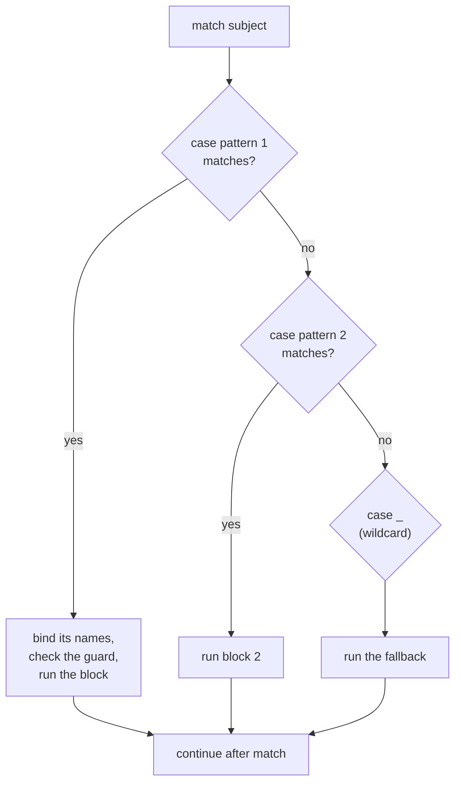
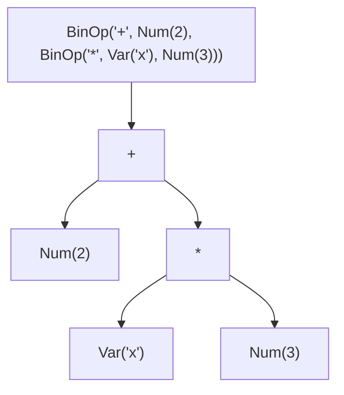

# Lesson 06 · Structural pattern matching

> **Level:** 🟣 Advanced · **Time:** ~2.5 h · **Assignment:** [07 · Expression evaluator](assignments/07-expression-evaluator/)

Python 3.10 added the `match` statement. It looks like the `switch` of other languages, but it is much
more: it checks the **shape** of a value (is it a list of two items? a dict with a `"type"` key? a
`Point` with `x == 0`?) and pulls the parts out into variables in the same step. For parsers,
commands, JSON messages and tree-shaped data it replaces long, fragile `if` / `elif` chains.

## What you will learn

- the `match` / `case` statement and how a case is chosen
- literal, wildcard and OR patterns
- capture patterns, and the trap with plain names
- sequence patterns (`[first, *rest]`), mapping patterns (`{"type": t}`) and class patterns (`Point(x=0)`)
- guards (`if` after a pattern) and `as` to name a sub-pattern
- when `match` is the right tool, and when a dict or `if` is better

---

## 1. The basic form

```python
def http_status(code):
    match code:
        case 200 | 201 | 204:
            return "success"
        case 404:
            return "not found"
        case 500:
            return "server error"
        case _:
            return "something else"

http_status(201)        # → 'success'
http_status(418)        # → 'something else'
```



The subject is evaluated **once**, the cases are tried **top to bottom**, and the **first** case that
matches wins. There is no fall-through, so no `break`. If no case matches and there is no `case _`,
nothing happens (no error).

| Pattern | Matches | Example |
|---|---|---|
| literal | an equal value (`==`; `None`, `True`, `False` by identity) | `case 404:`, `case "quit":` |
| wildcard `_` | anything, binds nothing | `case _:` |
| OR | any of the alternatives | `case "q" \| "quit" \| "exit":` |
| capture | anything, **binds it to the name** | `case x:` |
| value (dotted name) | an equal value | `case Color.RED:`, `case http.HTTPStatus.OK:` |
| sequence | a list/tuple of matching shape | `case [x, y]:`, `case ["go", *rest]:` |
| mapping | a dict with matching keys | `case {"type": "click", "pos": p}:` |
| class | an instance with matching attributes | `case Point(x=0, y=y):`, `case str():` |

## 2. Capture patterns and the plain-name trap

A bare name in a pattern does not compare, it **captures**: it matches anything and assigns it.

```python
RED = "red"
color = "blue"

match color:
    case RED:                     # ⚠️ a capture pattern, not a comparison!
        print("matched", RED)     # → matched blue     (and RED is now "blue")
```

Python even refuses a capture pattern in front of other cases (`SyntaxError: name capture 'RED' makes
remaining patterns unreachable`). To compare with a constant, use a **dotted** name: an enum member,
a module attribute or a class attribute.

```python
class Color(Enum):
    RED = 1
    BLUE = 2

match current:
    case Color.RED:               # dotted: compares with ==
        ...
```

## 3. Sequence patterns

A sequence pattern matches lists, tuples and other sequences (but **not** strings, bytes or iterators)
of the right length, item by item. `*name` collects the rest into a list.

```python
def command(text):
    match text.split():
        case []:
            return "nothing"
        case ["quit" | "exit"]:
            return "bye"
        case ["go", direction]:
            return f"going {direction}"
        case ["take", *items] if items:
            return f"taking {', '.join(items)}"
        case _:
            return f"unknown: {text!r}"

command("go north")         # → 'going north'
command("take lamp key")    # → 'taking lamp, key'
command("take")             # → "unknown: 'take'"    the guard failed: no items
```

Patterns nest: `case ["move", [x, y]]:` matches `["move", [3, 4]]` and binds `x = 3`, `y = 4`.
`[a, b]` and `(a, b)` mean the same in a pattern; both match lists **and** tuples.

## 4. Mapping patterns

A mapping pattern matches a dict that has **at least** the listed keys, with matching values. Extra keys
are ignored, which is what you want for JSON messages that may grow new fields.

```python
def describe(event):
    match event:
        case {"type": "click", "pos": [x, y]}:
            return f"click at {x},{y}"
        case {"type": "key", "key": str(key), **rest}:
            return f"key {key} {rest}"
        case _:
            return "ignored"

describe({"type": "click", "pos": [3, 4], "button": "left"})   # → 'click at 3,4'
describe({"type": "key", "key": "a", "shift": True})           # → "key a {'shift': True}"
describe({"type": "key", "key": 5})                            # → 'ignored'   5 is not a str
```

`**rest` captures the remaining keys. `str(key)` is a class pattern (next section): it checks the type
**and** binds the value. That makes `match` a compact way to **validate** data from outside.

## 5. Class patterns

A class pattern checks `isinstance(subject, Class)` and then compares or captures attributes:

```python
@dataclass
class Point:
    x: float
    y: float

def where(p):
    match p:
        case Point(x=0, y=0):
            return "origin"
        case Point(0, y):
            return f"on the y axis at {y}"
        case Point(x, 0):
            return f"on the x axis at {x}"
        case Point(x, y) if x == y:
            return "on the diagonal"
        case Point():
            return "somewhere else"

where(Point(0, 5))      # → 'on the y axis at 5'
where(Point(2, 2))      # → 'on the diagonal'
```

**Keyword** sub-patterns (`x=0`) work for any class: they read the attribute. **Positional** ones
(`Point(0, y)`) need the class to say which attribute is first, second, … in `__match_args__`.
Dataclasses and named tuples generate it for you:

```python
Point.__match_args__        # → ('x', 'y')
```

Built-in types take one positional pattern that matches the whole value: `int(n)`, `str(s)`,
`list(items)`. `case int() | float():` checks for "any number".

Class patterns shine for **tree-shaped data**, like the expression trees of a calculator or the
syntax tree of a program. Each case handles one kind of node and recursion handles the children:



```python
def evaluate(node, env):
    match node:
        case Num(value):
            return value
        case Var(name):
            return env[name]
        case BinOp("+", left, right):
            return evaluate(left, env) + evaluate(right, env)
        case BinOp("*", left, right):
            return evaluate(left, env) * evaluate(right, env)
```

## 6. Guards and `as`

A **guard** is an `if` after the pattern. The case matches only if the pattern matches **and** the
condition is true. The names captured by the pattern are already available in the guard.

```python
match point:
    case Point(x, y) if x == y:
        ...
```

`as` names a sub-pattern, so you can keep the whole part while still checking its shape:

```python
match [1, [2, 3]]:
    case [a, [b, c] as inner]:
        print(a, b, c, inner)       # 1 2 3 [2, 3]

match command:
    case ["go", ("north" | "south" | "east" | "west") as direction]:
        ...
```

## 7. When to use `match`

**Good fit:** the decision depends on the **structure** of the data: commands split into words, JSON
messages, tokens, trees, tuples returned by other functions. One `case` replaces a type check, a length
check, several key checks and the unpacking.

**Not needed:** comparing one value against a few constants. A dict lookup (Intermediate lesson 02,
dispatch tables) or a short `if` / `elif` is simpler and works on every Python version.

```python
# overkill:                         # enough:
match op:                           OPERATIONS = {"+": operator.add, "-": operator.sub}
    case "+": return a + b          return OPERATIONS[op](a, b)
    case "-": return a - b
```

---

## Common mistakes

**A plain name used as a constant.** `case RED:` captures everything. Use `Color.RED` or a literal.

**Forgetting `case _`.** Without it, unmatched values are silently ignored. Add a fallback that returns
a default or raises a clear error.

**Expecting strings to match sequence patterns.** `case [first, *rest]` does not match `"hello"`. Use
`list(text)` as the subject if you mean characters.

**Positional class patterns without `__match_args__`.** `case Point(0, y)` on a plain class raises
`TypeError: Point() accepts 0 positional sub-patterns (2 given)`. Use keywords or add `__match_args__`.

**Order of cases.** A general case above a specific one hides it: `case Point():` must come last.

## Try it yourself

1. Write `http_status` with a dict instead of `match`. Which version handles `200 | 201 | 204` better?
2. Call `command("go")` and `command("go north east")`. Which case handles them, and why?
3. Add a case for `{"type": "scroll", "delta": int(d)}` to `describe` and test it with `"delta": "5"`.
4. Remove `@dataclass` from `Point` (keep an `__init__`). Which cases in `where` break?
5. Put `case Point():` at the top of `where`. What does Python say?

## Summary

- `match subject:` tries each `case` top to bottom; the first match runs; `case _:` is the fallback.
- Literals and dotted names compare; **plain names capture** anything.
- `[a, *rest]` matches sequences (not strings); `{"key": value, **rest}` matches dicts with at least those keys.
- `Class(attr=pattern)` checks the type and attributes; positional sub-patterns use `__match_args__`.
- `if` guards add conditions; `pattern as name` keeps a matched part.
- Use `match` for **structure**; use a dict or `if` for a few plain values.

## Assignment

➡️ **[07 · Expression evaluator](assignments/07-expression-evaluator/)**: evaluate and simplify expression trees, parse text commands and route JSON events, all with `match`.

---

<p align="center">
  <a href="../05-class-customization/">← Previous: 05 · Class customization</a> · <a href="../README.md">Advanced overview</a> · <a href="../07-protocols-and-generics/">Next: 07 · Protocols and generics →</a>
</p>
