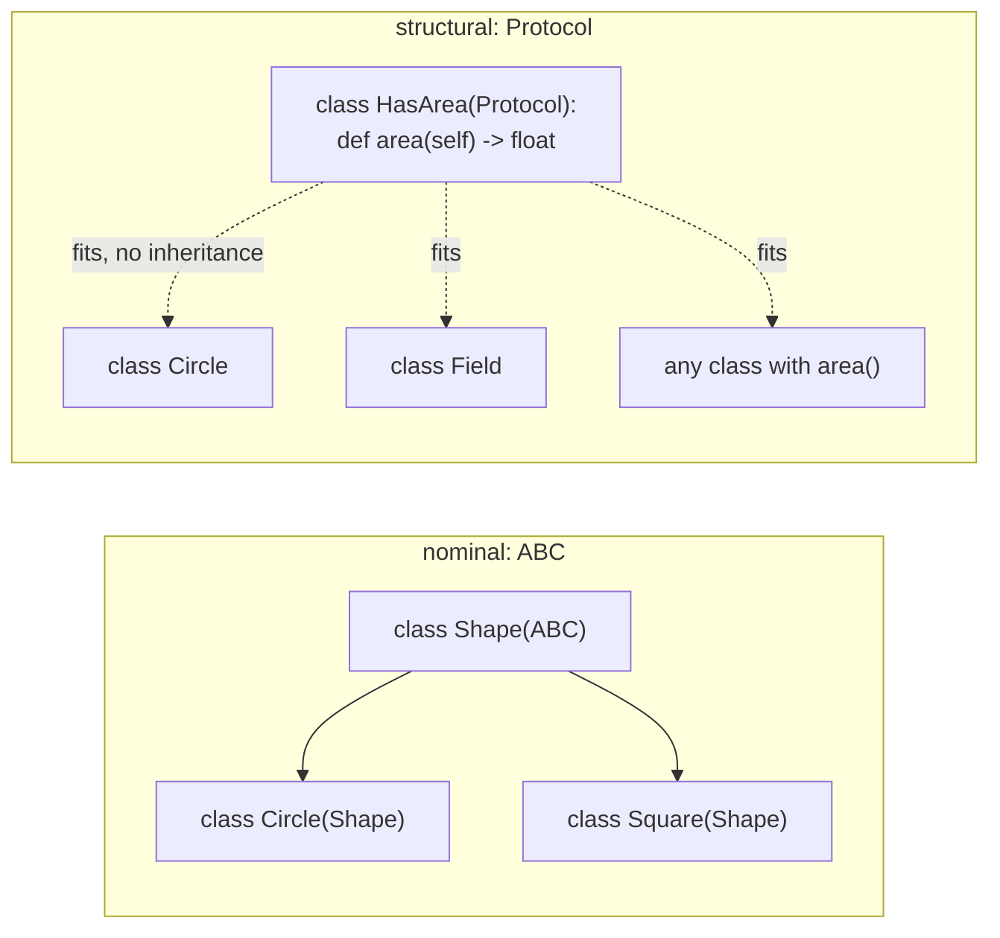
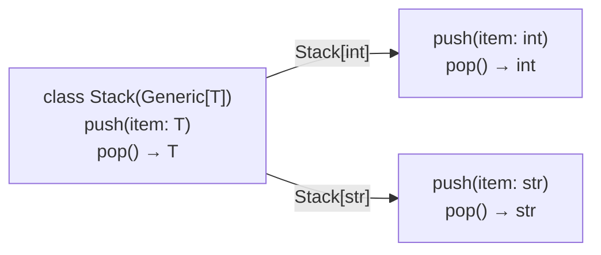
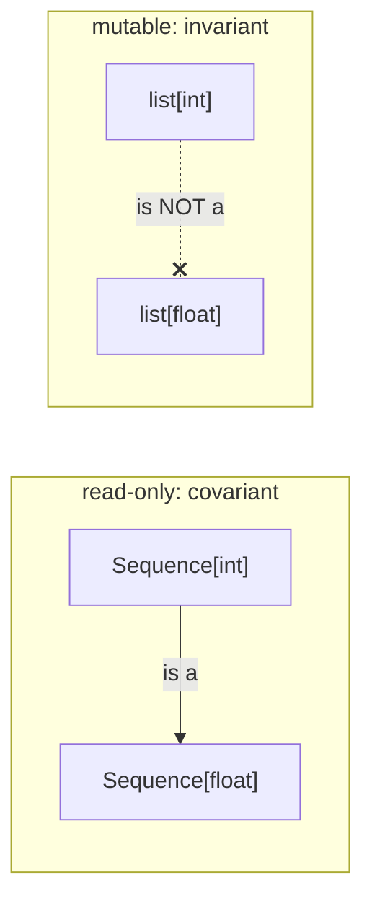

# Lesson 07 · Protocols and generics

> **Level:** 🟣 Advanced · **Time:** ~3 h · **Assignment:** [08 · Typed cache](assignments/08-typed-cache/)

Intermediate lesson 10 taught you to annotate functions and check them with mypy, and it introduced
`Protocol` and `TypeVar`. This lesson goes further: you write **generic classes** like `list[int]`,
constrain type variables, type decorators so they keep the signature of the function they wrap, and
describe functions with several call forms. The goal is library-quality types: precise enough that mypy
catches mistakes in the code that **uses** your classes.

## What you will learn

- nominal vs structural typing, and protocols in depth (`runtime_checkable`, callback protocols)
- generic functions with **bounded** type variables
- generic classes with `Generic[T]` (and the newer `class Stack[T]` syntax)
- typing decorators with `ParamSpec`, so they keep the wrapped signature
- several signatures for one function with `@overload`
- variance: why `list[int]` is not a `list[float]`, but `Sequence[int]` is a `Sequence[float]`
- custom type narrowing with `TypeGuard`

---

## 1. Nominal and structural typing

**Nominal** typing asks "is this object an instance of that class, or of a subclass?". `isinstance`
and ordinary class annotations work this way.

**Structural** typing asks "does this object have the methods I need?". That is Python's duck typing,
and a `Protocol` is how you write it down for the type checker:

```python
from typing import Protocol

class SupportsClose(Protocol):
    def close(self) -> None: ...

def shutdown(resources: list[SupportsClose]) -> None:
    for resource in resources:
        resource.close()
```

Files, sockets, database connections and your own classes all fit, **without inheriting** from
`SupportsClose`. Mypy compares the methods (names, parameters, return types). That makes protocols the
right tool when you do not control the classes, or do not want every user to import your base class.



### Protocols at run time

Protocols are for the type checker. To use one with `isinstance`, decorate it with
`@runtime_checkable`; Python then checks that the **methods exist** (not their signatures):

```python
from typing import runtime_checkable

@runtime_checkable
class SupportsClose(Protocol):
    def close(self) -> None: ...

isinstance(io.StringIO(), SupportsClose)    # → True
isinstance(3, SupportsClose)                # → False
```

### Callback protocols

`Callable[[int, str], bool]` cannot express keyword arguments or defaults. A protocol with `__call__`
can:

```python
class Formatter(Protocol):
    def __call__(self, value: float, *, decimals: int = 2) -> str: ...
```

## 2. Bounded type variables

A `TypeVar` connects types: `def first(items: Sequence[T]) -> T` says "you get back the type you put in".
Plain `T` accepts **any** type, so inside the function you cannot do anything with the items. A **bound**
says "any type, as long as it is a subtype of this":

```python
from typing import Any, Protocol, TypeVar

class SupportsLessThan(Protocol):
    def __lt__(self, other: Any, /) -> bool: ...

C = TypeVar("C", bound=SupportsLessThan)

def biggest(items: Iterable[C]) -> C:
    return max(items)

biggest([3, 1])             # mypy: int
biggest(["a", "b"])         # mypy: str
biggest([object()])         # ❌ mypy: Value of type variable "C" of "biggest" cannot be "object"
```

The bound is what lets `max` compare the items; the type variable is what keeps the result `int` for
ints and `str` for strings. With `items: Iterable[SupportsLessThan]` instead, the result would only be
`SupportsLessThan`, and the caller would lose the precise type.

## 3. Generic classes

Your own container classes can take type parameters too, just like `list[int]` and `dict[str, float]`.
Inherit from `Generic[T]` and use `T` in the methods:

```python
from typing import Generic, TypeVar

T = TypeVar("T")

class Stack(Generic[T]):
    def __init__(self) -> None:
        self._items: list[T] = []

    def push(self, item: T) -> None:
        self._items.append(item)

    def pop(self) -> T:
        return self._items.pop()

numbers = Stack[int]()
numbers.push(1)
reveal_type(numbers.pop())  # mypy: Revealed type is "int"
numbers.push("x")           # ❌ mypy: Argument 1 to "push" of "Stack" has incompatible type "str"; expected "int"
```



Several parameters work the same way: `class Cache(Generic[K, V])` for a mapping-like class. At run time
the parameters disappear: `Stack[int]()` creates an ordinary `Stack`. Only the type checker uses them.

> **Python 3.12+** has a shorter syntax that needs no `TypeVar` and no `Generic`:
> `class Stack[T]: ...` and `def first[T](items: Sequence[T]) -> T: ...`. This course supports
> Python 3.10, so the examples use the classic form, which works everywhere.

## 4. Typing decorators: `ParamSpec`

The decorators from lesson 01 are hard to type. `Callable[..., Any]` works, but then mypy forgets the
wrapped function's parameters: every call is accepted, and the result is `Any`. A `ParamSpec` captures
the **whole parameter list** of a function, so the wrapper can promise "same parameters, same result":

```python
import functools
from collections.abc import Callable
from typing import ParamSpec, TypeVar

P = ParamSpec("P")
R = TypeVar("R")

def logged(func: Callable[P, R]) -> Callable[P, R]:
    @functools.wraps(func)
    def wrapper(*args: P.args, **kwargs: P.kwargs) -> R:
        print("calling", func.__name__)
        return func(*args, **kwargs)
    return wrapper

@logged
def add(a: int, b: int = 0) -> int:
    return a + b

reveal_type(add)        # mypy: def (a: int, b: int =) -> int
add("x")                # ❌ mypy: Argument 1 to "add" has incompatible type "str"; expected "int"
```

`P.args` and `P.kwargs` must be used together, exactly like this, on `*args` and `**kwargs`.

## 5. `@overload`: several signatures

Some functions return different types depending on how they are called. `@overload` lists the call
forms for the type checker; the real implementation comes last and is not decorated:

```python
from typing import overload

D = TypeVar("D")

@overload
def first(items: Sequence[T]) -> T: ...
@overload
def first(items: Sequence[T], default: D) -> T | D: ...
def first(items: Sequence[Any], default: Any = None) -> Any:
    return items[0] if items else default

reveal_type(first([1, 2]))          # mypy: int
reveal_type(first([1, 2], None))    # mypy: int | None
```

The overloads are not run at all; they are documentation that mypy checks. Use them sparingly: when the
return type really depends on the arguments (`open()` returns text or bytes depending on the mode).

## 6. Variance in one picture

Is a `list[int]` a `list[float]`? It feels like yes (every int is acceptable where a float is
expected), but mypy says no:

```python
def total(numbers: list[float]) -> float: ...

ints: list[int] = [1, 2]
total(ints)     # ❌ mypy: "list" is invariant ... Consider using "Sequence" instead, which is covariant
```

The reason: `total` could legally do `numbers.append(0.5)`, which would put a float into the caller's
list of ints. Containers you can **change** must be **invariant**: exactly `list[float]`. Read-only
ones can be **covariant**: a `Sequence[int]` **is** a `Sequence[float]`, because a `Sequence` has no
`append`.



The practical rule from Intermediate lesson 10 has a reason now: **accept the most general type you
need** (`Sequence`, `Iterable`, `Mapping`), not `list` or `dict`.

## 7. Custom narrowing: `TypeGuard`

Mypy narrows types after `isinstance` checks. For your own checks, return `TypeGuard[...]`:

```python
from typing import TypeGuard

def is_str_list(values: list[object]) -> TypeGuard[list[str]]:
    return all(isinstance(v, str) for v in values)

def shout(values: list[object]) -> None:
    if is_str_list(values):
        reveal_type(values)     # mypy: list[str]
        print(" ".join(values).upper())
```

---

## Common mistakes

**Using `Any` to make errors go away.** `Any` switches checking off in both directions. Use a
`TypeVar`, a protocol, or `object` (which accepts anything but allows nothing).

**A `TypeVar` that appears only once.** `def f(x: T) -> None` gives no benefit over `object`. A type
variable is useful when it **links** two places: parameter and result, or two parameters.

**Annotating decorators with `Callable[..., Any]`.** The decorated function loses its signature. Use
`ParamSpec`.

**`list` in parameters.** Callers with a `list[int]` cannot pass it to `list[float]`; use `Sequence` or `Iterable`.

**Expecting run-time checks.** Type hints, generics and overloads do nothing at run time. `Stack[int]()`
accepts strings when the program runs; only mypy complains.

## Try it yourself

1. Write `Stack` and run `mypy --strict` on it. Then call `Stack[int]().push("x")` and read the error.
2. Replace `C` in `biggest` by plain `T` (no bound). What does mypy say about `max(items)`?
3. Type `count_calls` from lesson 01 with `ParamSpec`, and check that `reveal_type` keeps the signature.
4. Give `first` a third overload for an empty tuple `tuple[()]` that returns `D`. Is it worth it?
5. Change `total(numbers: list[float])` to `Sequence[float]` and check that the error disappears.

## Summary

- A `Protocol` describes the methods you need; any class that has them fits, without inheritance.
- `TypeVar("C", bound=X)` accepts any subtype of `X` and keeps the caller's precise type.
- `class Box(Generic[T])` makes a generic class; `Box[int]` is checked by mypy, ignored at run time.
- `ParamSpec` lets a decorator keep the wrapped function's parameters; `@overload` lists several call forms.
- Mutable containers are invariant, read-only ones covariant: accept `Sequence`, not `list`.
- `TypeGuard` turns your own check functions into type narrowing.

## Assignment

➡️ **[08 · Typed cache](assignments/08-typed-cache/)**: a generic LRU cache, a bounded `TypeVar`, a `ParamSpec` decorator and an overloaded function, all passing `mypy --strict`.

---

<p align="center">
  <a href="../06-pattern-matching/">← Previous: 06 · Structural pattern matching</a> · <a href="../README.md">Advanced overview</a> · <a href="../08-generators-in-depth/">Next: 08 · Generators in depth →</a>
</p>
