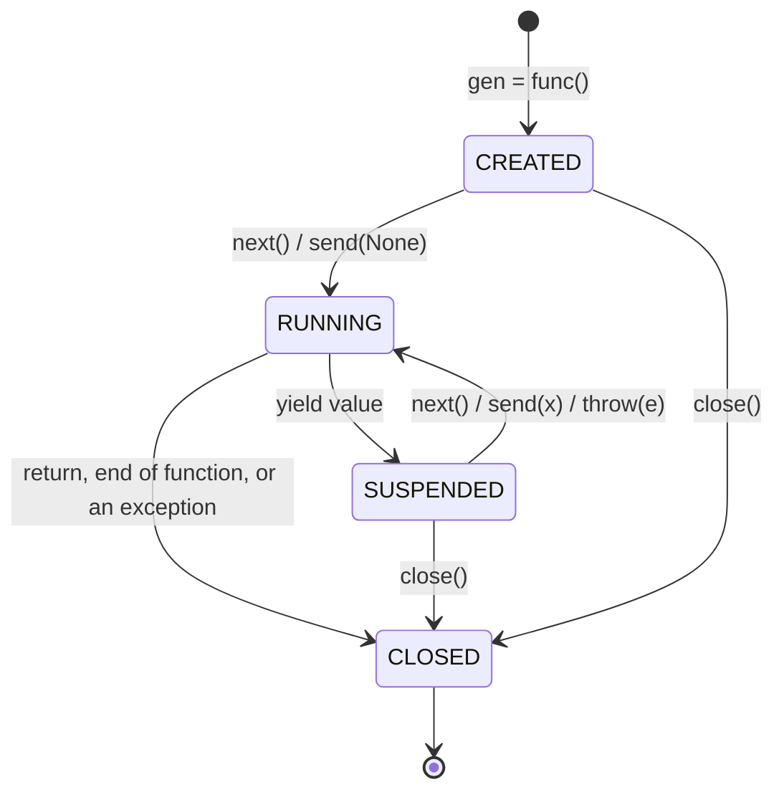
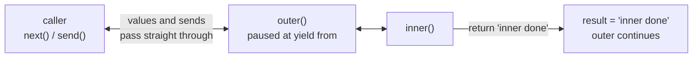
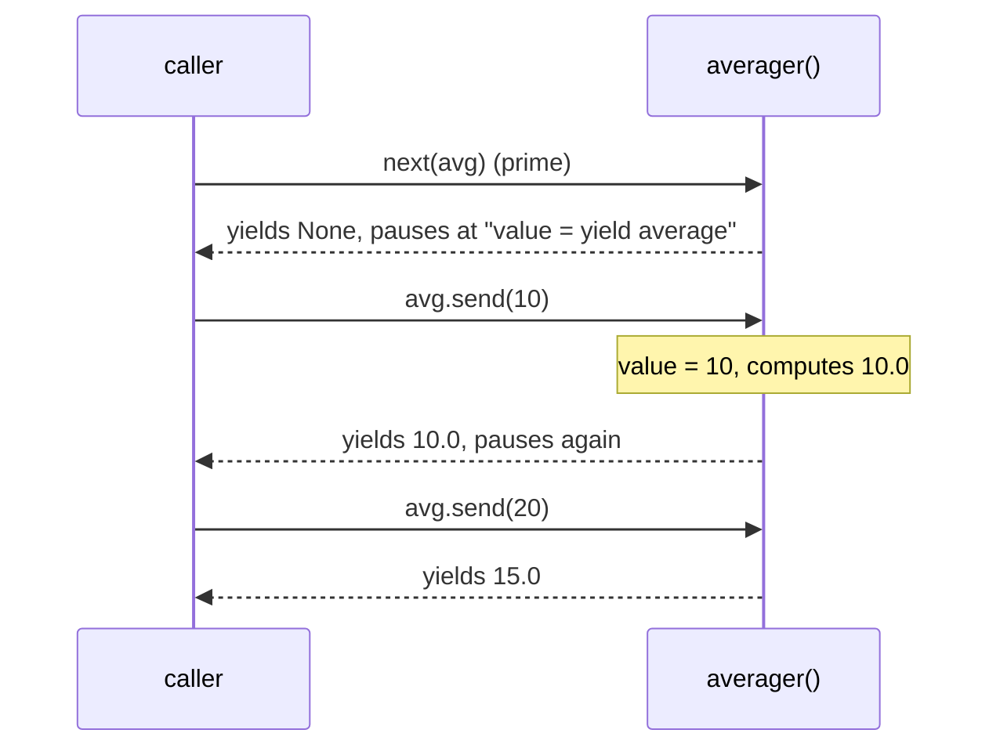
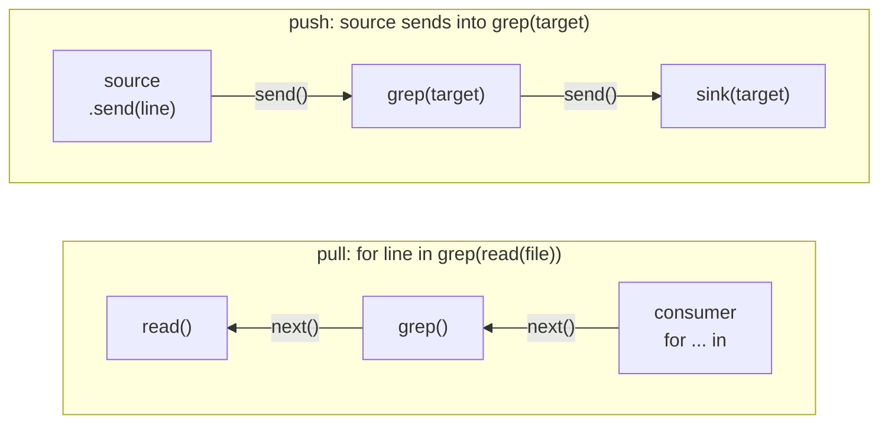

# Lesson 08 · Generators in depth

> **Level:** 🟣 Advanced · **Time:** ~3 h · **Assignment:** [09 · Coroutine tools](assignments/09-coroutine-tools/)

In Intermediate lesson 06 you used generators to produce values lazily, one `next()` at a time. A
generator can do more: it can **receive** values (`send`), react to **exceptions thrown into it**
(`throw`), clean up when it is **closed**, **delegate** to another generator (`yield from`) and
**return** a result. These features turn a generator into a *coroutine*: a function that can pause
and resume while keeping its state. They are how `@contextmanager` works, and they are the
foundation `async` / `await` was built on (lesson 11).

## What you will learn

- the life cycle of a generator and its four states
- `return` in a generator, and `StopIteration.value`
- `yield from`: delegating to a sub-generator, including its return value
- `send()`: generators that receive values, and why they must be "primed"
- `throw()` and `close()`: exceptions into a generator, and guaranteed cleanup
- how `@contextmanager` is built from these pieces
- pull pipelines vs push pipelines

---

## 1. The life cycle of a generator

Calling a generator function runs **no code**. It creates a generator object, paused before the first
line. Each `next()` runs it until the next `yield`, where it pauses again.

```python
import inspect

def countdown(n):
    print("starting")
    while n > 0:
        yield n
        n -= 1
    return "liftoff"

g = countdown(2)
inspect.getgeneratorstate(g)    # → 'GEN_CREATED'    nothing printed yet
next(g)                         # starting   → 2
inspect.getgeneratorstate(g)    # → 'GEN_SUSPENDED'
next(g)                         # → 1
next(g)                         # ❌ StopIteration: liftoff
inspect.getgeneratorstate(g)    # → 'GEN_CLOSED'
```



The local variables (`n` here) survive between the pauses. That is the superpower of a generator: it is
a function with **memory of where it was**.

## 2. A generator can return a value

`return value` in a generator ends it and puts the value into the `StopIteration` exception:

```python
try:
    next(g)
except StopIteration as stop:
    stop.value                  # → 'liftoff'
```

A `for` loop swallows `StopIteration` and with it the value. To get it, use `yield from`.

## 3. `yield from`: delegation

`yield from sub` runs another generator (or any iterable) to the end, passing all its values through,
and evaluates to the sub-generator's **return value**:

```python
def inner():
    yield 1
    yield 2
    return "inner done"

def outer():
    result = yield from inner()
    print("inner returned", result)
    yield 3

list(outer())
# inner returned inner done
# → [1, 2, 3]
```



`yield from` is more than `for x in sub: yield x`: it also forwards `send()`, `throw()` and `close()` to
the sub-generator. That makes it possible to split a big generator into smaller ones, like splitting a
function into helpers. The classic use is recursion over nested data:

```python
def flatten(items):
    for item in items:
        if isinstance(item, list):
            yield from flatten(item)
        else:
            yield item

list(flatten([1, [2, [3, 4]], 5]))      # → [1, 2, 3, 4, 5]
```

## 4. `send()`: values into a generator

So far `yield` was a statement that hands a value **out**. It is also an **expression** that evaluates to
the value sent **in**:

```python
def averager():
    total = count = 0
    average = None
    while True:
        value = yield average       # hand out the average, wait for the next value
        total += value
        count += 1
        average = total / count

avg = averager()
next(avg)               # → None     "prime" it: run to the first yield
avg.send(10)            # → 10.0
avg.send(20)            # → 15.0
avg.send(60)            # → 30.0
```



**Priming:** a fresh generator is paused **before** its first line, not at a `yield`, so there is no
`yield` expression yet to receive a value. `gen.send(10)` on a fresh generator raises
`TypeError: can't send non-None value to a just-started generator`. Always call `next(gen)` (or
`gen.send(None)`) first. A tiny decorator that does this automatically is a classic (you write it in
the assignment).

A generator used this way, mainly **consuming** values, is called a **coroutine**. It is a neat way to
keep state between calls without writing a class: the state lives in local variables.

## 5. `throw()` and `close()`

`gen.throw(exception)` raises the exception **at the paused `yield`**, as if that line had raised it.
The generator can catch it and continue, or let it propagate:

```python
def tolerant():
    while True:
        try:
            yield "ready"
        except ValueError as error:
            print("handled", error)

t = tolerant()
next(t)
t.throw(ValueError("bad input"))    # handled bad input   → 'ready'
```

`gen.close()` throws a special `GeneratorExit` into the generator. It must not yield again: it should
clean up and end. `try` / `finally` (or `except GeneratorExit` followed by `raise`) guarantees the
cleanup:

```python
def worker():
    try:
        while True:
            job = yield
            print("working on", job)
    finally:
        print("cleaning up")

w = worker()
next(w)
w.send("a")         # working on a
w.close()           # cleaning up
```

Python also calls `close()` when a suspended generator is garbage collected, so `finally` blocks in
generators do run, eventually. If cleanup must happen at a **known** time, close the generator
explicitly (or use it as a context manager).

| Method | Effect at the paused `yield` | Returns |
|---|---|---|
| `next(gen)` / `gen.send(None)` | `yield` evaluates to `None` | the next yielded value |
| `gen.send(x)` | `yield` evaluates to `x` | the next yielded value |
| `gen.throw(exc)` | `yield` raises `exc` | the next yielded value, if the generator caught it |
| `gen.close()` | `yield` raises `GeneratorExit` | `None` |

## 6. How `@contextmanager` works

With `next`, `throw` and `StopIteration`, you can read the essence of `contextlib.contextmanager`. This
simplified version is about 20 lines:

```python
class GeneratorContextManager:
    def __init__(self, gen):
        self.gen = gen

    def __enter__(self):
        return next(self.gen)                   # run the setup, up to the yield

    def __exit__(self, exc_type, exc, tb):
        if exc_type is None:
            try:
                next(self.gen)                  # run the cleanup after the yield
            except StopIteration:
                return False
            raise RuntimeError("generator didn't stop")
        try:
            self.gen.throw(exc)                 # re-raise the block's exception AT the yield
        except StopIteration:
            return True                         # the generator caught it: suppress
        except BaseException as raised:
            if raised is exc:
                return False                    # it propagated unchanged: let `with` re-raise it
            raise                               # the generator raised something new
        raise RuntimeError("generator didn't stop after throw()")
```

That is why lesson 02 insisted on `try` / `finally` around the `yield`: the exception from the
with-block really is raised on that line.

## 7. Pull and push pipelines

Intermediate lesson 06 built **pull** pipelines: the consumer at the end calls `next()`, and each stage
pulls from the one before it. With `send()` you can build **push** pipelines: the producer at the start
sends values forward, and each stage pushes to the next.



```python
def grep(pattern, target):
    try:
        while True:
            line = yield
            if pattern in line:
                target.send(line)
    finally:
        target.close()                  # closing the head closes the whole pipeline
```

Push pipelines are handy when the data **arrives** over time (a socket, a log file being written, user
events) or when one value must go to **several** consumers (a `broadcast` stage). For data you already
have, the pull style is simpler.

---

## Common mistakes

**Sending to a fresh generator.** `TypeError: can't send non-None value to a just-started generator`.
Prime it with `next()` first.

**Yielding after `GeneratorExit`.** `RuntimeError: generator ignored GeneratorExit`. Clean up and return.

**Losing the return value.** A `for` loop discards it; use `result = yield from gen` (inside another
generator) or catch `StopIteration` and read `.value`.

**Re-using an exhausted generator.** A finished generator stays finished; iterate a fresh one.

**Recursion with `for x in sub: yield x`.** It works for iteration, but `send()` and `throw()` do not
reach the inner generator. Use `yield from`.

## Try it yourself

1. Step through `countdown(3)` with `next()` and `inspect.getgeneratorstate` after every call.
2. Call `averager().send(5)` without priming. Then fix it with `send(None)` instead of `next()`.
3. Add a `return count` at the end of a generator and get the value with `yield from` in another generator.
4. Use `GeneratorContextManager` from section 6 with a generator that has a `try` / `except ValueError`
   around its `yield`. Raise `ValueError` in the with-block. Is it suppressed?
5. Write `broadcast(*targets)`, a coroutine that sends each value it receives to all targets.

## Summary

- A generator is created paused; `next` / `send` run it to the next `yield`; states: created, suspended, running, closed.
- `return value` ends a generator; the value travels in `StopIteration.value`.
- `result = yield from sub` delegates values, `send`, `throw` and `close`, and returns `sub`'s return value.
- `value = yield out` receives what `send()` passes in; prime a new generator with `next()`.
- `throw(exc)` raises at the paused `yield`; `close()` raises `GeneratorExit`; use `finally` for cleanup.
- `@contextmanager` is `next()` for setup and cleanup, and `throw()` for exceptions from the with-block.

## Assignment

➡️ **[09 · Coroutine tools](assignments/09-coroutine-tools/)**: recursive flattening, return values with `yield from`, a priming decorator, a push pipeline and your own `@contextmanager`.

---

<p align="center">
  <a href="../07-protocols-and-generics/">← Previous: 07 · Protocols and generics</a> · <a href="../README.md">Advanced overview</a> · <a href="../09-functional-tools/">Next: 09 · Functional tools →</a>
</p>
