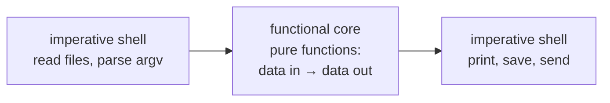
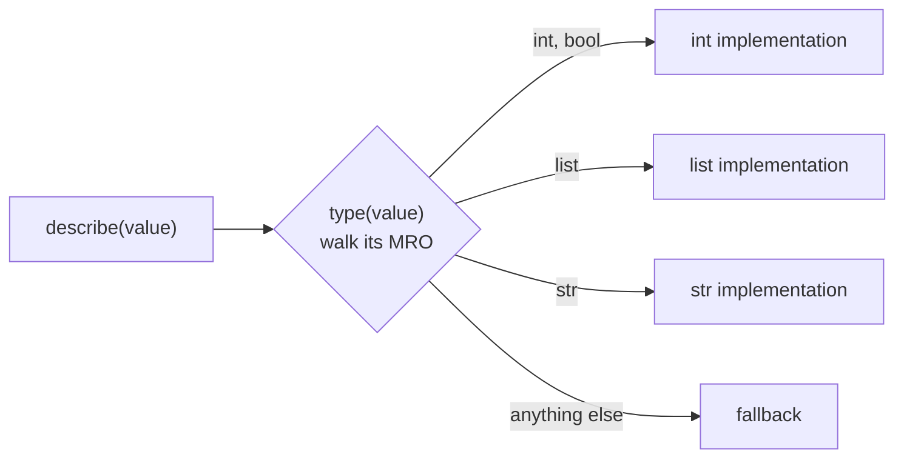
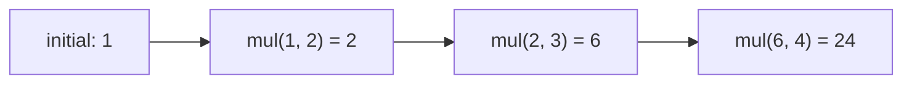

# Lesson 09 · Functional tools

> **Level:** 🟣 Advanced · **Time:** ~2.5 h · **Assignment:** [10 · Serializer](assignments/10-serializer/)

Python is not a purely functional language, but it borrows the best ideas: functions as values, small
functions combined into bigger ones, data that does not change under your feet. The `functools`,
`operator` and `itertools` modules turn these ideas into tools. Intermediate lesson 07 introduced
`cache`, `partial` and `reduce`; this lesson adds **type-based dispatch**, complete ordering from two
methods, caching in depth, function composition, and immutable data.

## What you will learn

- the ideas behind the functional style: pure functions, immutability, composition
- `functools.singledispatch`: one function, different implementations per type
- `functools.total_ordering`: all six comparisons from `__eq__` and `__lt__`
- caching in depth: `lru_cache(maxsize)`, `cache_info`, `cached_property`, and the pitfalls
- `reduce` for folding, and composing functions
- `operator` and `itertools` as a functional vocabulary (`methodcaller`, `accumulate`, `starmap`, `pairwise`)
- immutable data: tuples, `frozenset`, `MappingProxyType`, frozen dataclasses and `replace`

---

## 1. The functional style in one minute

| Idea | Means | Benefit |
|---|---|---|
| **pure functions** | the result depends only on the arguments; no side effects | easy to test, cache and run in parallel |
| **immutability** | data is never changed, only replaced by new data | no "who changed my list?" bugs, safe sharing between threads |
| **composition** | build behaviour by combining small functions | small, reusable, testable pieces |

You do not have to write everything this way. A good Python program has a **functional core** (pure
functions that compute) and a thin **imperative shell** (code that reads input, prints, writes files).
The capstones of the earlier levels were built exactly like that.



## 2. `singledispatch`: dispatch on type

A function that must handle many types often turns into an `isinstance` chain. Every new type means
editing that chain. `singledispatch` turns it into a **generic function** with one implementation per
type, and other modules can add implementations for their own types without touching yours.

```python
from functools import singledispatch

@singledispatch
def describe(value):                    # the fallback for unregistered types
    return f"something: {value!r}"

@describe.register
def _(value: int):                      # the annotation says which type
    return f"an int: {value}"

@describe.register
def _(value: list):
    return f"a list of {len(value)}"

@describe.register(str)                 # or pass the type explicitly
def _(value):
    return f"a string: {value!r}"

describe(3)         # → 'an int: 3'
describe(True)      # → 'an int: True'     bool is a subclass of int
describe([1, 2])    # → 'a list of 2'
describe(2.5)       # → 'something: 2.5'
```



Dispatch looks at the type of the **first** argument and follows the MRO, so a registered base class
also handles its subclasses (which is why `True` became "an int"). Register the subclass separately if
it needs different behaviour. Registering an **abstract** class such as `collections.abc.Mapping` covers
every mapping type at once.

For methods, use `functools.singledispatchmethod`: it dispatches on the first argument **after**
`self`.

## 3. `total_ordering`

Lesson 03 said: define `__eq__` and `__lt__`, and let `@total_ordering` do the rest. Here it is:

```python
from functools import total_ordering

@total_ordering
class Grade:
    ORDER = "FEDCBA"

    def __init__(self, letter):
        self.letter = letter

    def __eq__(self, other):
        if not isinstance(other, Grade):
            return NotImplemented
        return self.letter == other.letter

    def __lt__(self, other):
        if not isinstance(other, Grade):
            return NotImplemented
        return self.ORDER.index(self.letter) < self.ORDER.index(other.letter)

Grade("B") > Grade("C")         # → True    __gt__ was generated from __lt__ and __eq__
Grade("F") <= Grade("D")        # → True
```

The generated methods are a little slower than hand-written ones. For data classes,
`@dataclass(order=True)` is often simpler: it compares the fields as a tuple, in order.

## 4. Caching in depth

`@cache` remembers every result forever. `@lru_cache(maxsize=n)` keeps only the `n` most recently
used results, so memory stays bounded. Both add `cache_info()` and `cache_clear()`:

```python
from functools import lru_cache

@lru_cache(maxsize=2)
def square(n):
    return n * n

for n in [1, 2, 1, 3, 1]:
    square(n)

square.cache_info()     # → CacheInfo(hits=2, misses=3, maxsize=2, currsize=2)
```

**Only cache pure functions.** A cached function that reads a file or the clock returns stale data.

**The arguments must be hashable**, because they become dict keys:

```python
@cache
def total(items):
    return sum(items)

total([1, 2])       # ❌ TypeError: unhashable type: 'list'      pass a tuple instead
```

**Do not mutate cached results.** The cache returns the **same** object every time. If a caller
appends to a cached list, every later caller sees the change.

**Careful with methods.** `@cache` on a method keeps every `self` alive in the cache forever (a memory
leak for short-lived objects). For a value computed once per instance, use `@cached_property`
(lesson 04 showed how it works):

```python
from functools import cached_property

class Report:
    def __init__(self, rows):
        self.rows = rows

    @cached_property
    def total(self):
        print("computing")
        return sum(self.rows)

r = Report([1, 2])
r.total, r.total    # computing   → (3, 3)
```

## 5. Folding and composing

`reduce(func, items, initial)` **folds** a sequence into one value: it applies `func` to the running
result and the next item, from left to right.



```python
from functools import reduce
import operator

reduce(operator.mul, [2, 3, 4], 1)      # → 24
reduce(operator.add, [], 0)             # → 0      the initial value makes empty input safe
```

For sums, maxima and joins, the built-ins (`sum`, `max`, `"".join`, `math.prod`) are clearer. `reduce`
shines when the "items" are **functions**: composing a list of functions into one is a fold.

```python
def compose(*funcs):
    """compose(f, g)(x) == f(g(x))"""
    return reduce(lambda f, g: lambda x: f(g(x)), funcs, lambda x: x)

inc_then_double = compose(lambda x: x * 2, lambda x: x + 1)
inc_then_double(5)          # → 12
```

`compose` applies right to left (like mathematics); the `pipeline` from Intermediate assignment 02
applies left to right. Both are folds over functions.

## 6. A functional vocabulary

The `operator` module has a function for every operator, so you rarely need a `lambda`:

| Instead of | Use |
|---|---|
| `lambda a, b: a + b` | `operator.add` |
| `lambda row: row["name"]` | `operator.itemgetter("name")` |
| `lambda p: p.age` | `operator.attrgetter("age")` |
| `lambda s: s.lower()` | `operator.methodcaller("lower")` |

`itertools` adds the loops:

```python
from itertools import accumulate, starmap, pairwise

list(accumulate([1, 2, 3, 4]))          # → [1, 3, 6, 10]       running totals
list(accumulate([3, 1, 4, 1, 5], max))  # → [3, 3, 4, 4, 5]     running maximum
list(starmap(pow, [(2, 3), (10, 2)]))   # → [8, 100]            pow(*args) for each tuple
list(pairwise("abcd"))                  # → [('a', 'b'), ('b', 'c'), ('c', 'd')]
```

`itertools.batched(items, n)` (Python 3.12+) splits into chunks of `n`.

## 7. Immutable data

Immutable values can be shared freely: between functions, between threads, as dict keys. Python has an
immutable counterpart for most containers:

| Mutable | Immutable |
|---|---|
| `list` | `tuple` |
| `set` | `frozenset` |
| `dict` | `types.MappingProxyType(d)`: a read-only **view** of a dict |
| a normal class / dataclass | `@dataclass(frozen=True)`, `NamedTuple` |

```python
from types import MappingProxyType

DEFAULTS = MappingProxyType({"debug": False})
DEFAULTS["debug"] = True        # ❌ TypeError: 'mappingproxy' object does not support item assignment
```

To "change" immutable data, create a **new** value with the change applied:

```python
from dataclasses import dataclass, replace

@dataclass(frozen=True)
class Point:
    x: int
    y: int

p = Point(1, 2)
moved = replace(p, y=5)     # → Point(x=1, y=5)
p                           # → Point(x=1, y=2)     unchanged

new_config = {**config, "debug": True}      # the same idea for dicts
```

Copying a large structure on every change sounds expensive, but only the path to the change is new; the
unchanged parts are **shared** between the old and the new version. You write such an update function in
the assignment.

---

## Common mistakes

**Caching impure functions.** Results that depend on time, files or global state go stale.

**Mutating a cached or shared result.** Every caller gets the same object; return tuples or copies.

**`@cache` on methods of short-lived objects.** The cache keeps them alive. Use `cached_property`.

**Registering `bool` behaviour on `int` by accident.** `singledispatch` follows the MRO; register `bool`
separately if it must behave differently.

**`reduce` where a built-in exists.** `sum`, `max`, `any`, `"".join` and `math.prod` say more clearly what
they do.

**A frozen dataclass with a list field.** The attribute cannot be reassigned, but the list inside can
still be changed. Use a tuple.

## Try it yourself

1. Register `bool` for `describe` and check that `True` and `3` now take different paths.
2. Call `describe.registry.keys()`. What is the entry for the fallback?
3. Decorate a recursive `fib` with `lru_cache(maxsize=2)` and compare `cache_info()` for `fib(30)` with `@cache`.
4. Write `compose` with a loop instead of `reduce`. Which version do you find clearer?
5. Make a `frozen` dataclass with a list field, then append to the list. Is it really immutable?

## Summary

- Keep a functional core of pure functions; do I/O at the edges.
- `@singledispatch` + `.register` replaces `isinstance` chains and is open for new types.
- `@total_ordering` derives all comparisons from `__eq__` and `__lt__`.
- Cache only pure functions with hashable arguments; bound memory with `lru_cache(maxsize)`; use `cached_property` for per-instance values.
- `reduce` folds a sequence; folding functions gives composition.
- Prefer immutable data (`tuple`, `frozenset`, `MappingProxyType`, frozen dataclasses) and create changed copies.

## Assignment

➡️ **[10 · Serializer](assignments/10-serializer/)**: a `singledispatch` serializer, a `total_ordering` version class, `compose` and an immutable nested update.

---

<p align="center">
  <a href="../08-generators-in-depth/">← Previous: 08 · Generators in depth</a> · <a href="../README.md">Advanced overview</a> · <a href="../10-threads-and-processes/">Next: 10 · Threads and processes →</a>
</p>
