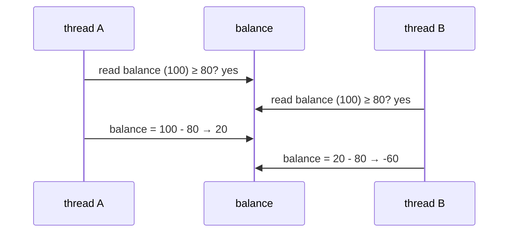
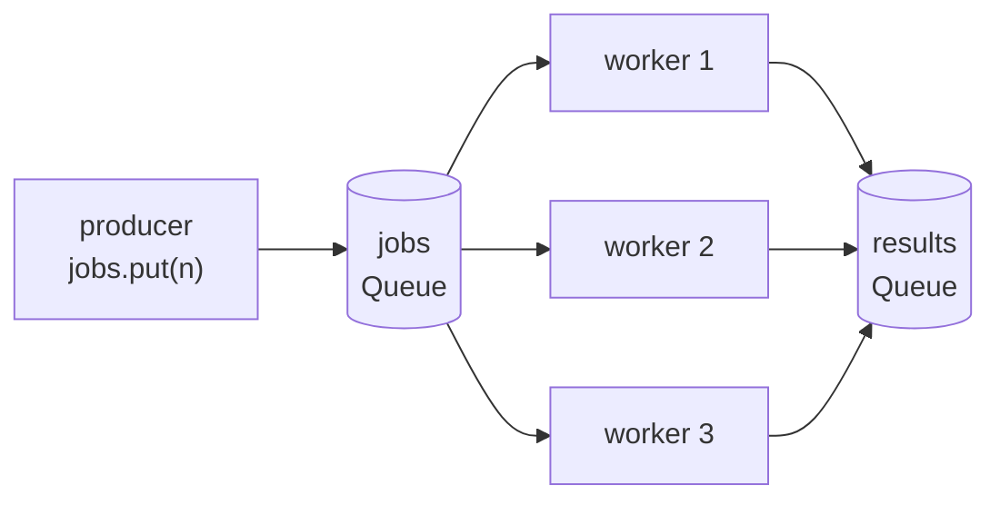
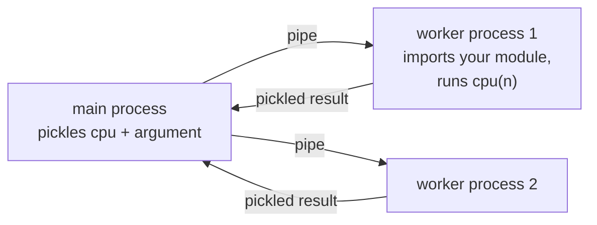

# Lesson 10 · Threads and processes

> **Level:** 🟣 Advanced · **Time:** ~3.5 h · **Assignment:** [11 · Worker pool](assignments/11-worker-pool/)

Most programs spend their time **waiting**: for the network, the disk, a database. Others spend it
**computing**. Python can do several things at once in both cases, but with different tools: **threads**
for waiting, **processes** for computing. This lesson explains why (the GIL), shows the classic bugs of
concurrent code (race conditions) and the tools that prevent them (locks, queues), and ends with
`concurrent.futures`, the high-level API you will use most.

## What you will learn

- concurrency vs parallelism, I/O-bound vs CPU-bound work
- the Global Interpreter Lock (GIL) and what it means for threads
- starting and joining threads with `threading`
- race conditions, and protecting shared data with a `Lock`
- passing work between threads safely with `queue.Queue`
- `ThreadPoolExecutor` and `ProcessPoolExecutor`: `map`, `submit`, futures, `as_completed`
- what processes need: picklable data, importable functions, the `__main__` guard

---

## 1. Two kinds of slow

| | **I/O-bound** | **CPU-bound** |
|---|---|---|
| spends its time | waiting for network, disk, database, user | computing: loops, maths, parsing, compression |
| example | downloading 100 web pages | resizing 100 images |
| what helps | doing other work **while** waiting (**concurrency**) | using several CPU cores **at the same time** (**parallelism**) |
| Python tool | threads, `asyncio` (lesson 11) | processes |

```mermaid
gantt
    dateFormat X
    axisFormat %s
    section sequential
    download a :0, 5
    download b :5, 10
    download c :10, 15
    section 3 threads
    download a :0, 5
    download b :0, 5
    download c :0, 5
```



Three downloads that each wait 0.5 s take 1.5 s one after the other, but only 0.5 s with three threads,
because the waiting overlaps:

```python
import threading, time

def download(name):
    time.sleep(0.5)             # stands in for waiting on the network
    return f"{name} done"

threads = [threading.Thread(target=download, args=(name,)) for name in "abc"]
for thread in threads:
    thread.start()              # starts running download(name) in the background
for thread in threads:
    thread.join()               # waits until that thread has finished
# about 0.5 s instead of 1.5 s
```

## 2. The GIL

CPython has a **Global Interpreter Lock**: only one thread at a time executes Python bytecode. It keeps
the interpreter's internals (reference counts, dicts, lists) consistent without a lock on every object.

The GIL is **released while a thread waits** (sleeping, reading a socket or a file) and inside many C
extensions (hashing, compression, NumPy). So:

- **I/O-bound work:** threads run concurrently and help a lot.
- **CPU-bound pure-Python work:** threads take turns on one core and do **not** get faster.

```python
def cpu(n):
    return sum(i * i for i in range(n))

# 4 × cpu(10_000_000) on a 4-core laptop:
# sequential:            2.0 s
# 4 threads:             2.0 s     the GIL: one thread computes at a time
# 4 processes:           0.6 s     4 interpreters, 4 GILs, 4 cores
```

> Python 3.13 introduced an optional **free-threaded** build (`python3.13t`) without the GIL. It is
> still experimental; the rules in this lesson are the ones that apply to the normal build.

## 3. Race conditions

Threads share memory. That is convenient (no copying) and dangerous: when two threads read and write the
same data, the result can depend on **who is faster**. That is a **race condition**.

```python
balance = 100

def withdraw(amount):
    global balance
    if balance >= amount:       # 1. check
        time.sleep(0.001)       #    (any work, or just bad luck with timing)
        balance -= amount       # 2. act

# two threads run withdraw(80) at the same time
# → balance == -60     both passed the check before either subtracted
```



The bug is in the **gap** between check and act. Even `count += 1` has such a gap (read, add, write),
which is why it is not guaranteed to be safe, although modern CPython rarely shows it. Race conditions
are the worst kind of bug: rare, timing-dependent, and they disappear when you add `print` to look for
them.

### Locks

A `threading.Lock` lets only **one** thread at a time into a block of code. Use it as a context manager
(lesson 02), so it is released even when the block raises:

```python
balance_lock = threading.Lock()

def withdraw(amount):
    global balance
    with balance_lock:              # acquire; other threads wait here
        if balance >= amount:
            time.sleep(0.001)
            balance -= amount       # check and act are now one indivisible step
                                    # release at the end of the block
```

Keep locked sections **short** (no network calls inside), always use `with`, and if you need several
locks, always acquire them in the same order: two threads that each hold one lock and wait for the
other's lock wait forever (a **deadlock**).

## 4. Queues: share by communicating

The safest shared data is no shared data. Instead of several threads changing one object, let them
**pass work and results through a queue**. `queue.Queue` does all the locking internally:

```python
import queue

jobs = queue.Queue()
results = queue.Queue()
STOP = object()                     # a unique "no more work" marker (a sentinel)

def worker():
    while True:
        job = jobs.get()            # blocks until an item is available
        if job is STOP:
            break
        results.put(job * job)

threads = [threading.Thread(target=worker) for _ in range(3)]
for t in threads:
    t.start()
for n in range(10):
    jobs.put(n)
for _ in threads:
    jobs.put(STOP)                  # one STOP per worker
for t in threads:
    t.join()

sorted(results.get() for _ in range(10))    # → [0, 1, 4, 9, 16, 25, 36, 49, 64, 81]
```



This **producer/consumer** pattern is the backbone of web crawlers, job queues and log processors.

## 5. `concurrent.futures`: pools of workers

Creating threads by hand, collecting results and handling errors is repetitive. An **executor** manages
a pool of worker threads (or processes) for you:

```python
from concurrent.futures import ThreadPoolExecutor, as_completed

with ThreadPoolExecutor(max_workers=8) as pool:
    results = list(pool.map(download, ["a", "b", "c"]))    # like map(), but concurrent
# → ['a done', 'b done', 'c done']                            results in INPUT order
```

`submit` schedules one call and returns a **future**: a placeholder for a result that does not exist
yet.

```python
with ThreadPoolExecutor(max_workers=8) as pool:
    futures = {pool.submit(download, name): name for name in ["x", "y", "z"]}
    for future in as_completed(futures):        # in COMPLETION order, fastest first
        name = futures[future]
        print(name, future.result())
```

| Future method | Does |
|---|---|
| `future.result(timeout=None)` | waits for the result; **re-raises** the exception if the call failed; `TimeoutError` after `timeout` seconds |
| `future.exception()` | the exception, or `None` |
| `future.done()` | finished (successfully or not)? |
| `future.cancel()` | cancels it if it has not started yet |

```python
bad = pool.submit(int, "x")
bad.result()        # ❌ ValueError: invalid literal for int() with base 10: 'x'
```

An exception in a worker does **not** crash your program: it waits inside the future until you call
`result()`. If you never do, it disappears silently. Always collect the results.

The `with` block waits for all submitted work when it ends (`pool.shutdown(wait=True)`).

## 6. Processes

`ProcessPoolExecutor` has the **same API**, but every worker is a separate Python **process** with its
own interpreter and its own GIL. That is real parallelism for CPU-bound work, at a price:

- **Data is copied**, not shared. Arguments and results are sent between processes with `pickle`, so
  they must be picklable, and big data makes it slow.
- **Functions must be importable.** The worker process finds your function by module and name. Lambdas,
  nested functions and functions defined in a REPL do not work.
- **Start-up costs** tens of milliseconds per process. Only worth it for chunks of work that take
  much longer than that.
- **The `__main__` guard is mandatory.** On Windows and macOS, a new process starts a **fresh**
  interpreter that imports your script again. Code at the top level runs again in **every** worker:

```python
from concurrent.futures import ProcessPoolExecutor

def cpu(n):
    return sum(i * i for i in range(n))

if __name__ == "__main__":          # without this line, each worker would start the pool again
    with ProcessPoolExecutor() as pool:
        print(list(pool.map(cpu, [10_000_000] * 4)))
```



## 7. Choosing a tool

| Situation | Tool |
|---|---|
| many network or disk operations | `ThreadPoolExecutor` (or `asyncio`, lesson 11) |
| heavy pure-Python computation on several cores | `ProcessPoolExecutor` |
| heavy computation in NumPy, hashing, compression | often threads are enough: those release the GIL |
| a background task that runs alongside the program | `threading.Thread` (with a queue to talk to it) |
| a few things, and the program is fast enough | **nothing**: sequential code is the easiest to get right |

Other tools in `threading`: `Event` (one thread signals others), `Semaphore` (at most *n* threads at
once), `RLock` (a lock the same thread may acquire repeatedly), `threading.local()` (one value per
thread).

---

## Common mistakes

**Threads for CPU-bound work.** No speed-up because of the GIL. Use processes, or measure first (lesson 13).

**Shared data without a lock.** Works in testing, fails in production. Protect every read-modify-write,
or avoid sharing with a queue.

**Forgetting `join()` or `result()`.** The program ends or moves on before the work is done, and errors
inside futures are never seen.

**Missing `if __name__ == "__main__":`** with processes: the workers re-run your script's top-level code.

**Passing lambdas or huge objects to processes.** `PicklingError`, or the copying costs more than the work.

**A lock held during slow I/O.** Every other thread waits; you are back to sequential, plus overhead.

## Try it yourself

1. Time the three downloads sequentially, with threads and with `ThreadPoolExecutor.map`.
2. Run the `withdraw` race a few times, then fix it with a `Lock` and run it again.
3. Use `as_completed` with downloads that sleep 0.3, 0.1 and 0.2 s. In which order do they print?
4. Pass a `lambda` to `ProcessPoolExecutor.map`. Read the error.
5. Remove the `__main__` guard from the process example and add a `print("loading")` at the top. Run it.

## Summary

- I/O-bound work → threads (concurrency); CPU-bound work → processes (parallelism).
- The GIL lets one thread run Python bytecode at a time, but is released while waiting.
- Shared mutable data + threads = race conditions; protect it with `with lock:` or pass data through a `queue.Queue`.
- `ThreadPoolExecutor` / `ProcessPoolExecutor`: `map` for results in order, `submit` + `as_completed` for results as they finish.
- `future.result()` returns the value or re-raises the worker's exception.
- Processes copy data with pickle, need importable functions and the `if __name__ == "__main__":` guard.

## Assignment

➡️ **[11 · Worker pool](assignments/11-worker-pool/)**: a thread-safe counter, concurrent fetching with an executor, a queue-based worker pool, timeouts and a process pool.

---

<p align="center">
  <a href="../09-functional-tools/">← Previous: 09 · Functional tools</a> · <a href="../README.md">Advanced overview</a> · <a href="../11-asyncio/">Next: 11 · asyncio →</a>
</p>
