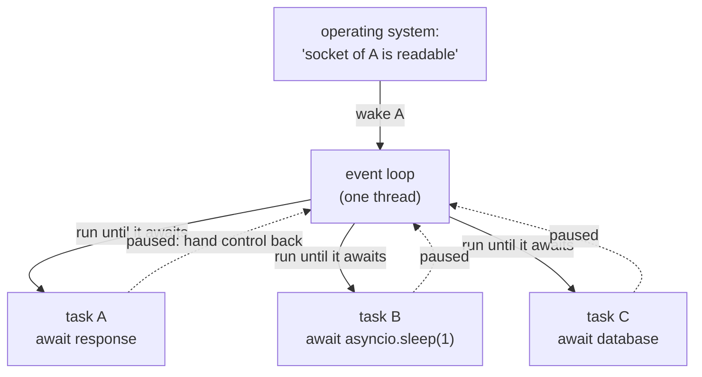
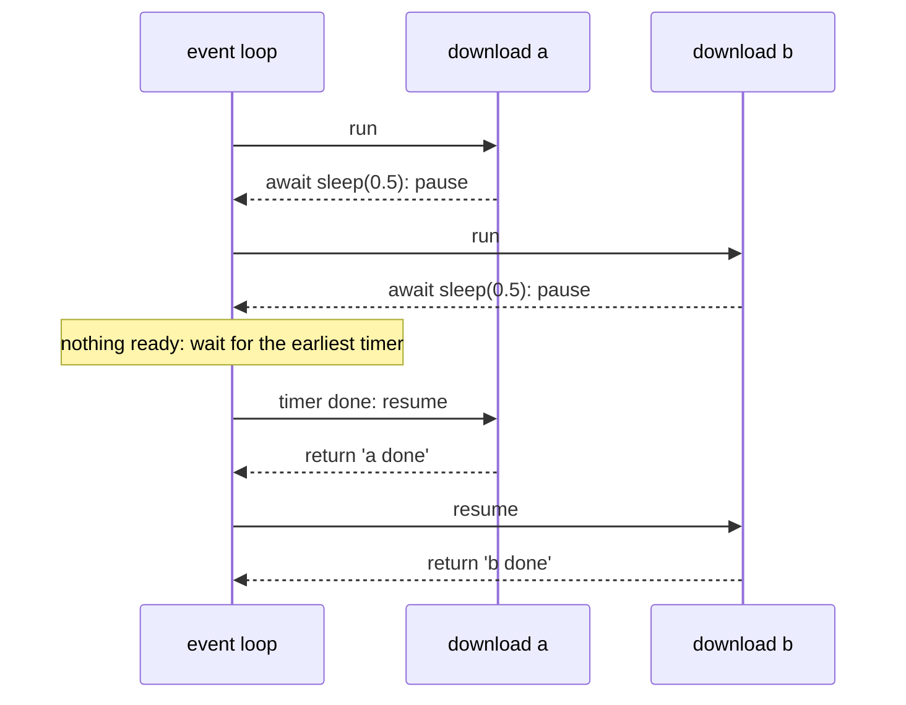

# Lesson 11 · asyncio

> **Level:** 🟣 Advanced · **Time:** ~3.5 h · **Assignment:** [12 · Async crawler](assignments/12-async-crawler/)

Threads let you wait for many things at once, but each thread costs memory, and shared data needs locks.
`asyncio` takes a different road: **one** thread, and functions that **voluntarily pause** while they
wait, so that others can run. A single process can then juggle thousands of network connections. Web
frameworks like FastAPI, database drivers and HTTP clients like `httpx` and `aiohttp` are built on it.
You already know the mechanism: it grew out of the generators of lesson 08.

## What you will learn

- the idea: cooperative multitasking on one thread, driven by an event loop
- `async def`, `await` and `asyncio.run`
- running coroutines concurrently with tasks and `asyncio.gather`
- the golden rule: never block the event loop (and `asyncio.to_thread` when you must)
- timeouts, cancellation and errors
- limiting concurrency with a `Semaphore`, and producer/consumer with `asyncio.Queue`
- `async with`, `async for` and async generators

---

## 1. The idea: one thread, many waiting tasks



The **event loop** keeps a list of tasks. It runs one until that task reaches an `await` on something
that is not ready yet (a network response, a timer). There, the task **pauses** and hands control back
to the loop, which runs the next ready task. When the awaited thing is ready, the loop resumes the task
exactly where it paused.

| | Threads | asyncio |
|---|---|---|
| who switches | the OS, at **any** moment | the task itself, **only at `await`** |
| shared data | needs locks | safe between two `await`s: nobody else runs |
| cost per task | a thread (~MB of stack) | a small object (~KB) |
| good for | blocking libraries, a few dozen tasks | network I/O, thousands of tasks |
| catch | race conditions | one blocking call freezes **everything** |

## 2. `async def`, `await`, `asyncio.run`

```python
import asyncio

async def download(name, seconds):
    await asyncio.sleep(seconds)            # a non-blocking wait: the loop can run others meanwhile
    return f"{name} done"

async def main():
    a = await download("a", 0.5)
    b = await download("b", 0.5)
    print(a, b)                             # a done b done    after 1.0 s

asyncio.run(main())                         # start the event loop, run main() to completion
```

- `async def` defines a **coroutine function**. Calling it does **not** run it; it returns a
  **coroutine object**, like a generator function returns a generator:
  `download("a", 1)` → `<coroutine object download at 0x...>`.
- `await something` runs `something` and waits for its result, **pausing this coroutine** if it has to
  wait. You can only use `await` inside `async def`.
- `asyncio.run(main())` is the bridge from normal code: it creates an event loop, runs the coroutine,
  and closes the loop. Call it **once**, at the top of your program.

Note that `main` above took 1.0 s: `await` one after the other is still **sequential**. Concurrency
needs tasks.

## 3. Concurrency: tasks and `gather`

`asyncio.gather` runs several awaitables **concurrently** and returns their results **in order**:

```python
async def main():
    results = await asyncio.gather(
        download("a", 0.5),
        download("b", 0.5),
        download("c", 0.5),
    )
    print(results)              # ['a done', 'b done', 'c done']    after 0.5 s, not 1.5 s
```



`asyncio.create_task(coro)` schedules a coroutine to run **in the background** and returns a `Task`
(a kind of future, lesson 10). Await it later to get its result:

```python
async def main():
    task = asyncio.create_task(download("bg", 0.2))     # starts running at the next await
    print("doing other things")
    print(await task)                                    # bg done
```

Keep a reference to every task you create: a task that nobody references can be garbage-collected
before it finishes.

## 4. Never block the event loop

Everything runs on one thread. A function that **blocks** without `await` (CPU-heavy work,
`time.sleep`, `requests.get`, reading a big file) stops **every** task until it returns:

```python
async def bad():
    time.sleep(2)               # ❌ the whole program freezes for 2 s
    requests.get(url)           # ❌ the same: a blocking library

async def good():
    await asyncio.sleep(2)      # ✅ pauses only this task
```

Use async libraries for I/O (`httpx`, `aiohttp`, `asyncpg`, `aiofiles`). When you must call blocking
code, push it to a thread so the loop stays free:

```python
await asyncio.gather(
    asyncio.to_thread(time.sleep, 0.3),      # both run in worker threads,
    asyncio.to_thread(time.sleep, 0.3),      # the loop keeps going: 0.3 s in total
)
```

## 5. Timeouts, cancellation and errors

`asyncio.wait_for(aw, timeout)` cancels the awaitable if it takes too long and raises `TimeoutError`:

```python
try:
    await asyncio.wait_for(download("slow", 10), timeout=0.1)
except asyncio.TimeoutError:            # the built-in TimeoutError since Python 3.11
    print("too slow")
```

> Python 3.11+ also has `async with asyncio.timeout(0.1):` for a whole block.

**Cancellation** is how asyncio stops a task: `task.cancel()` raises `asyncio.CancelledError` inside the
task **at its current `await`**. The task can clean up in `finally` (or `except CancelledError` + `raise`),
just like `GeneratorExit` in lesson 08. Do not swallow `CancelledError`.

**Errors in `gather`:** by default, the first exception propagates to the `await gather(...)` and the
other results are lost (the other tasks keep running). With `return_exceptions=True`, exceptions are
returned **as values** in the result list:

```python
async def boom():
    raise ValueError("boom")

await asyncio.gather(download("ok", 0), boom(), return_exceptions=True)
# → ['ok done', ValueError('boom')]
```

> Python 3.11+ adds `asyncio.TaskGroup`: `async with asyncio.TaskGroup() as tg: tg.create_task(...)`.
> If one task fails, the others are cancelled, and all errors are reported together. It is the
> recommended way to run tasks on newer versions.

## 6. Limiting concurrency: `Semaphore`

Starting 10 000 downloads at once overwhelms the server (and your machine). A **semaphore** is a counter
of free slots: `async with sem:` takes a slot or waits until one is free.

```python
sem = asyncio.Semaphore(2)

async def limited(n):
    async with sem:                     # at most 2 tasks inside this block at any moment
        await asyncio.sleep(0.2)
        return n

await asyncio.gather(*(limited(n) for n in range(6)))      # 3 rounds of 2 → 0.6 s
```

## 7. Producer and consumer: `asyncio.Queue`

`asyncio.Queue` is the async version of `queue.Queue` from lesson 10: `await queue.get()` pauses until an
item is available. A fixed number of **worker tasks** reading from one queue is the standard shape of a
crawler or a job processor:

```python
async def worker(queue, results):
    while True:
        url = await queue.get()
        try:
            results.append(await fetch(url))
        finally:
            queue.task_done()           # tell the queue this item is finished

async def main(urls):
    queue, results = asyncio.Queue(), []
    for url in urls:
        queue.put_nowait(url)
    workers = [asyncio.create_task(worker(queue, results)) for _ in range(3)]
    await queue.join()                  # wait until every item got its task_done()
    for w in workers:
        w.cancel()                      # the workers loop forever: stop them
    return results
```

Workers may also **add** items to the queue while they run (a crawler finds new links), and
`queue.join()` still waits for all of them.

## 8. `async with`, `async for` and async generators

Some context managers and iterators need to `await` inside: opening a network connection, fetching the
next page of results. They have async versions of the protocols: `__aenter__` / `__aexit__` and
`__aiter__` / `__anext__`. You use them with `async with` and `async for`.

The easiest way to write an async iterator is an **async generator**: an `async def` with `yield`.

```python
async def ticker(count, interval):
    for i in range(count):
        await asyncio.sleep(interval)
        yield i

async def main():
    async for tick in ticker(3, 0.1):
        print(tick)
    ticks = [i async for i in ticker(3, 0.1)]       # async comprehensions work too
```

---

## Common mistakes

**Calling without `await`.** `download("a", 1)` alone creates a coroutine and throws it away:
`RuntimeWarning: coroutine 'download' was never awaited`.

**Blocking calls in `async def`.** `time.sleep`, `requests`, heavy loops: the whole loop stops. Use the
async version or `asyncio.to_thread`.

**Sequential awaits when you wanted concurrency.** `await a(); await b()` runs one after the other; use
`gather` or tasks.

**`asyncio.run` inside a running loop** (for example in Jupyter): `RuntimeError: asyncio.run() cannot be
called from a running event loop`. Use `await` there instead.

**Losing errors.** Exceptions in tasks you never await are only logged when the task is garbage
collected. Await every task, or use `gather` / `TaskGroup`.

**Swallowing `CancelledError`.** Cancellation and timeouts stop working. Clean up and re-raise.

## Try it yourself

1. Time `main()` from section 2, then rewrite it with `gather`.
2. Put `time.sleep(1)` instead of `await asyncio.sleep(1)` into one of the gathered downloads. What happens to the others?
3. Run 10 downloads through a `Semaphore(3)` and print when each starts and ends.
4. Cancel a task that is in `await asyncio.sleep(10)` and print something in its `finally`.
5. Call a coroutine function without `await` and read the warning.

## Summary

- asyncio runs many tasks on **one** thread; a task pauses only at `await`, where the event loop switches.
- `async def` makes a coroutine function; calling it creates a coroutine; `await` runs it; `asyncio.run` starts everything.
- Concurrency comes from `asyncio.gather(...)` and `asyncio.create_task(...)`, not from sequential `await`s.
- Never block the loop; move blocking work to `asyncio.to_thread`.
- `wait_for` adds timeouts, `cancel()` raises `CancelledError` at the current `await`, `return_exceptions=True` keeps errors as values.
- `Semaphore` limits concurrency; `asyncio.Queue` + worker tasks is the producer/consumer pattern; `async for` consumes async generators.

## Assignment

➡️ **[12 · Async crawler](assignments/12-async-crawler/)**: limited concurrent fetching, a race with cancellation, async retries, an async generator and a queue-based web crawler.

---

<p align="center">
  <a href="../10-threads-and-processes/">← Previous: 10 · Threads and processes</a> · <a href="../README.md">Advanced overview</a> · <a href="../12-packaging/">Next: 12 · Packaging →</a>
</p>
