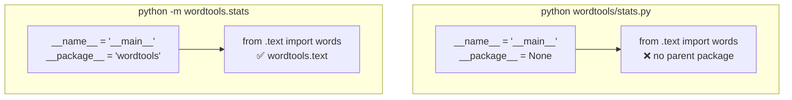
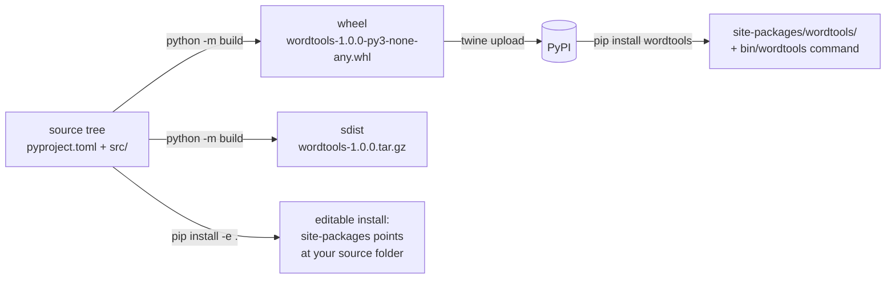

# Lesson 12 · Packaging

> **Level:** 🟣 Advanced · **Time:** ~3 h · **Assignment:** [13 · Package split](assignments/13-package-split/)

A single `.py` file is fine for a script. As soon as your code grows, or other people (or other projects
of yours) should use it, it needs to become a **package**: a folder of modules with a clear public
interface, a `pyproject.toml` that says what it is and what it needs, and a way to install it with
`pip`. This lesson takes you from "a file that works on my machine" to "a package anyone can install".

## What you will learn

- modules, packages and `__init__.py`
- absolute and relative imports inside a package, and why some of them fail
- designing a public API with `__init__.py` and `__all__`
- `__main__.py`: making a package runnable with `python -m`
- the `src` layout and why it prevents a whole class of bugs
- `pyproject.toml`: metadata, dependencies and command-line entry points
- editable installs, wheels, version numbers, and how a package gets to PyPI

---

## 1. Modules and packages

A **module** is one `.py` file. A **package** is a folder of modules with an `__init__.py` file. Packages
can contain packages:

```text
wordtools/              ← the package (import wordtools)
├── __init__.py         ← runs on "import wordtools"; defines what the package offers
├── __main__.py         ← runs on "python -m wordtools"
├── text.py             ← a module: wordtools.text
├── stats.py            ← wordtools.stats
└── cli.py              ← wordtools.cli
```

`import wordtools.text` first imports the package (running `wordtools/__init__.py`), then the module.
Each module is executed **once** per program and cached in `sys.modules`.

Python finds top-level packages by searching the folders in **`sys.path`**, in order: the folder of the
script you run (or the current folder for `python -m`), then `PYTHONPATH`, then the standard library and
`site-packages`, where `pip` installs things.

## 2. Imports inside a package

There are two ways for `stats.py` to use a function from `text.py`:

```python
# wordtools/stats.py
from wordtools.text import words        # absolute: the full path from the top
from .text import words                 # relative: "text, next to me" (. = this package, .. = the parent)
```

Both work. Relative imports keep working if you rename the package, and they make clear that the
dependency is internal. Use whichever your project prefers, but be consistent.

Relative imports only work in a module that is **part of a package**. Running a module from inside a
package as a script breaks them:

```text
$ python wordtools/stats.py
ImportError: attempted relative import with no known parent package

$ python -m wordtools.stats       ✅ run it as a module of its package instead
```



**Avoid circular imports**: if `text.py` imports `stats.py` and `stats.py` imports `text.py`, one of
them sees a half-initialised module. Arrange modules in layers (lower layers never import higher ones),
just like the layers of the capstones.

## 3. `__init__.py`: the front door

Users should not need to know your internal file structure. Re-export the public names in
`__init__.py`, so `from wordtools import slugify` works, and you can move code between modules later
without breaking anyone:

```python
# wordtools/__init__.py
"""Small tools for words: slugs, counts and frequencies."""

from .stats import top_words
from .text import slugify, word_count

__all__ = ["slugify", "top_words", "word_count"]
__version__ = "1.0.0"
```

`__all__` lists the public names. It controls `from wordtools import *`, and tools like linters,
documentation generators and IDEs treat it as the official API. Names starting with `_` are private
by convention.

Keep `__init__.py` light: everything in it runs on every import of the package.

## 4. `__main__.py`: `python -m package`

`python -m wordtools` runs `wordtools/__main__.py`. Keep it to two lines that call the real entry point:

```python
# wordtools/__main__.py
import sys

from .cli import main

sys.exit(main())
```

`main(argv=None) -> int` lives in `cli.py`, where it can be imported and tested (Intermediate lesson 13).

## 5. Project layout: `src`

The package folder sits inside a **project** folder, next to the files that describe the project:

```text
wordtools-project/                 wordtools-project/
├── pyproject.toml                 ├── pyproject.toml
├── README.md                      ├── README.md
├── wordtools/                     ├── src/
│   ├── __init__.py                │   └── wordtools/
│   └── ...                        │       ├── __init__.py
└── tests/                         │       └── ...
    └── test_text.py               └── tests/
                                       └── test_text.py
   "flat" layout                      "src" layout
```

In the flat layout, running `pytest` from the project folder can import `wordtools` **straight from the
folder**, not from the installed package. Your tests then pass even if the package is broken when
installed (a missing file in the build, a wrong dependency). The **src layout** puts the package one
level down, out of reach of the current folder: you must install it (`pip install -e .`) to import it,
so the tests always test what users get. Most new projects use it.

## 6. `pyproject.toml`

One file describes the project for every tool: how to build it, its metadata, its dependencies, and its
commands.

```toml
[build-system]                          # which tool builds the package
requires = ["setuptools>=77"]
build-backend = "setuptools.build_meta"

[project]
name = "wordtools"                      # the name on PyPI: pip install wordtools
version = "1.0.0"
description = "Small tools for words: slugs, counts and frequencies."
readme = "README.md"
requires-python = ">=3.10"
license = "MIT"
authors = [{ name = "Ada Lovelace" }]
dependencies = []                       # e.g. ["httpx>=0.27", "rich"]

[project.optional-dependencies]
dev = ["pytest>=7", "mypy>=1.8"]        # pip install -e ".[dev]"

[project.scripts]
wordtools = "wordtools.cli:main"        # installs a "wordtools" command that calls cli.main()
```

| Section | Purpose |
|---|---|
| `[build-system]` | the build backend: setuptools, hatchling, flit, poetry-core, … |
| `[project]` | the standard metadata (PEP 621), the same for every backend |
| `dependencies` | what `pip` installs with your package. Use **lower bounds** (`>=`), not exact pins: a library must work together with other libraries |
| `[project.scripts]` | command-line commands: `name = "package.module:function"` |
| `[tool.xyz]` | settings for tools: `[tool.pytest.ini_options]`, `[tool.mypy]`, `[tool.ruff]` |

## 7. Installing, building, publishing



- **`pip install -e .`** (editable) installs the package so that imports point **at your source folder**.
  Changes take effect immediately, without reinstalling. Use it while developing.
- **`python -m build`** (install the `build` package first) creates a **wheel** (`.whl`: a zip file
  ready to be unpacked into `site-packages`, fast to install) and an **sdist** (the source archive).
- **`twine upload dist/*`** uploads them to PyPI. Practise on **TestPyPI** first; a version number, once
  uploaded, can never be reused.

### Version numbers

Most packages use **semantic versioning**, `MAJOR.MINOR.PATCH`:

| Change | Bump | Example |
|---|---|---|
| bug fix, no API change | PATCH | 1.4.2 → 1.4.3 |
| new feature, old code keeps working | MINOR | 1.4.3 → 1.5.0 |
| incompatible change | MAJOR | 1.5.0 → 2.0.0 |

Users can then depend on `wordtools>=1.4,<2`: "any version with the features of 1.4, but nothing that
breaks my code".

### Data files

Files inside the package (templates, word lists, JSON schemas) should be read with
`importlib.resources`, not with paths built from `__file__`: it also works when the package is installed
as a zip file.

```python
from importlib.resources import files

stopwords = files("wordtools").joinpath("stopwords.txt").read_text(encoding="utf-8")
```

---

## Common mistakes

**Running a package module as a script** (`python pkg/module.py`): relative imports fail. Use
`python -m pkg.module`.

**A file named like a standard module** (`random.py`, `json.py`, `test.py`) in your project shadows the
real one for every import.

**Circular imports.** `ImportError: cannot import name 'x' from partially initialized module`. Layer
your modules; move shared code down into a module both can import.

**Exact pins in a library** (`requests==2.31.0`). Users cannot install it next to anything that needs
another version. Pin exactly only in **applications** (a lock file), never in libraries.

**Testing the folder, not the package.** With a flat layout, tests can pass while the installed
package is broken. Use the src layout and an editable install.

**Heavy work in `__init__.py`.** It runs on every import, including `import wordtools.text`.

## Try it yourself

1. Create `wordtools/` with an `__init__.py` that prints `"loading"`. Import it twice. How often does it print?
2. Add a relative import to a module and run it once as a script and once with `python -m`.
3. Print `sys.path` from a script in another folder, and from `python -m`. What is the first entry?
4. Write the `pyproject.toml` from section 6, run `pip install -e .` in a venv, and call the `wordtools` command.
5. Run `pip show -f wordtools` after the install. Where does Python find your code?

## Summary

- A package is a folder with `__init__.py`; Python finds top-level packages on `sys.path`.
- Inside a package, use absolute or relative (`from .text import x`) imports; run package modules with `python -m`.
- `__init__.py` re-exports the public API and sets `__all__` and `__version__`; `__main__.py` makes `python -m package` work.
- The src layout makes tests run against the installed package.
- `pyproject.toml` holds the build backend, `[project]` metadata, dependencies (with lower bounds) and `[project.scripts]` commands.
- `pip install -e .` for development, `python -m build` for wheels, `twine` for PyPI; follow semantic versioning.

## Assignment

➡️ **[13 · Package split](assignments/13-package-split/)**: turn a one-file program into a package with modules, a public API, `__main__.py`, a `pyproject.toml` and a backwards-compatible shim.

---

<p align="center">
  <a href="../11-asyncio/">← Previous: 11 · asyncio</a> · <a href="../README.md">Advanced overview</a> · <a href="../13-performance/">Next: 13 · Performance →</a>
</p>
