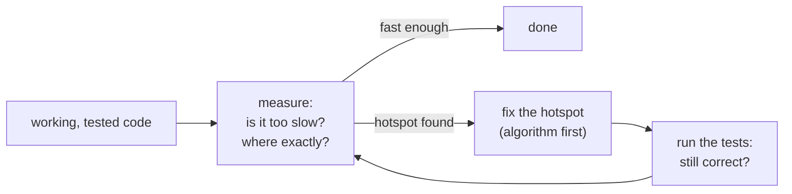
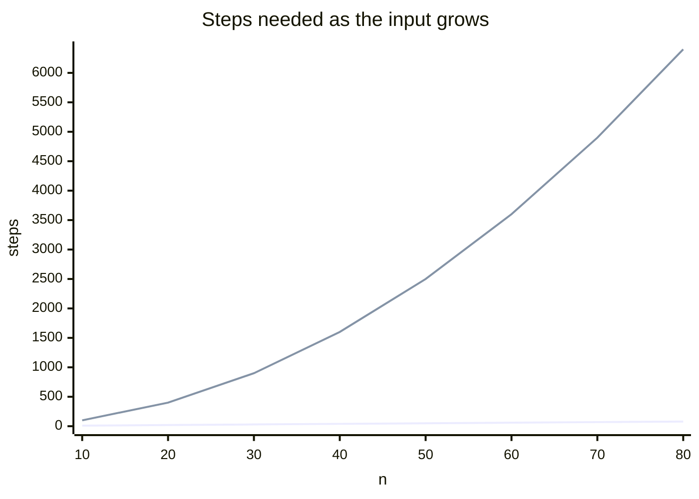

# Lesson 13 · Performance

> **Level:** 🟣 Advanced · **Time:** ~3 h · **Assignment:** [14 · Speed-up](assignments/14-speed-up/)

"Python is slow" is half true. A Python **statement** is slower than a C one, but most slow programs are
slow because they do **far more work than necessary**: they search a list where a set would answer
instantly, recompute what they already know, or copy data over and over. This lesson teaches the
professional order: **measure** to find where the time goes, **think about complexity** to fix it, and
only then reach for micro-optimisations.

## What you will learn

- when to optimise, and why you measure first
- timing small snippets with `timeit`
- finding hotspots in a whole program with `cProfile` and `pstats`
- Big-O complexity, and the cost of common operations on lists, dicts, sets and deques
- the classic fixes: the right data structure, caching, avoiding repeated work, `str.join`
- measuring and saving memory: `sys.getsizeof`, `tracemalloc`, generators
- what to do when pure Python is really not fast enough

---

## 1. First make it work, then measure

> Make it work, make it right, make it fast. (Kent Beck)

Optimising code that is not correct yet, or that is not the bottleneck, wastes time and makes the code
harder to read. Programmers are famously bad at **guessing** where a program spends its time. So the
workflow is always:



The tests from Intermediate lesson 11 are what make optimising safe: you change **how** the code works,
the tests check that **what** it computes stays the same.

## 2. `timeit`: timing small pieces

Timing with two `time.perf_counter()` calls is fine for whole programs. For small snippets it is
unreliable: one run is too short to measure, and the result jumps around. `timeit` runs the code many
times and reports the best of several repetitions:

```text
$ python -m timeit -s "items = list(range(10_000))" "9_999 in items"
5000 loops, best of 5: 60.1 usec per loop

$ python -m timeit -s "s = set(range(10_000))" "9_999 in s"
10000000 loops, best of 5: 21.7 nsec per loop
```

`-s` is the setup (run once, not timed). The same lookup is about **2 800 times faster** in a set. In
code:

```python
import timeit

timeit.timeit("9_999 in items", globals={"items": list(range(10_000))}, number=1000)
```

Use the **minimum** of repeated runs: the higher numbers are noise from other programs, not your code.

## 3. `cProfile`: where does the time go?

A profiler records every function call of a whole program run. Start with the program as it is:

```text
$ python -m cProfile -s tottime report.py
         200405 function calls in 0.075 seconds

   Ordered by: internal time

   ncalls  tottime  percall  cumtime  percall filename:lineno(function)
      200    0.040    0.000    0.050    0.000 report.py:6(concat)
        1    0.024    0.024    0.024    0.024 report.py:12(helper)
   200000    0.008    0.000    0.008    0.000 {method 'append' of 'list' objects}
      200    0.002    0.000    0.002    0.000 {method 'join' of 'str' objects}
```

| Column | Means |
|---|---|
| `ncalls` | how often the function was called |
| `tottime` | time spent **inside** the function itself, without the functions it called |
| `cumtime` | time spent in the function **including** everything it called |

Sort by `tottime` to find the functions that do the heavy lifting themselves; sort by `cumtime` to see
which high-level step is expensive. A huge `ncalls` for a tiny function often means "this is called in a
loop that should not exist".

From code, profile one call and print the top entries:

```python
import cProfile
import pstats

profiler = cProfile.Profile()
profiler.runcall(main)
pstats.Stats(profiler).sort_stats("cumtime").print_stats(10)
```

Visual tools like `snakeviz` (`pip install snakeviz`) draw the same data as an interactive chart.

## 4. Complexity: how the work grows

Big-O notation describes how the running time **grows** with the size *n* of the input, ignoring
constant factors. It answers the question that matters: "what happens when the data is 100 times
bigger?"

| Complexity | Name | n = 1 000 | n = 1 000 000 | Example |
|---|---|---|---|---|
| O(1) | constant | 1 | 1 | `d[key]`, `x in a_set`, `list.append` |
| O(log n) | logarithmic | 10 | 20 | binary search (`bisect`) |
| O(n) | linear | 1 000 | 1 000 000 | `x in a_list`, `sum`, one loop |
| O(n log n) | | 10 000 | 20 000 000 | `sorted()` |
| O(n²) | quadratic | 1 000 000 | 1 000 000 000 000 | a loop inside a loop over the same data |



The flat line is O(n), the steep one O(n²). For small inputs both are fast; at a million items the
quadratic one takes days. **Quadratic code hides** inside innocent lines:

```python
for order in orders:                    # n times ...
    if order.customer in customers:     # ... a search through a list: n steps
        ...                             # → n × n
```

### The cost of common operations

| Operation | `list` | `dict` / `set` | `collections.deque` |
|---|---|---|---|
| `x in container` | **O(n)** | O(1) | O(n) |
| get / set by index or key | O(1) | O(1) | O(n) in the middle |
| append / pop at the **end** | O(1) | O(1) (add) | O(1) |
| insert / pop at the **front** | **O(n)** | | O(1) |
| `len()` | O(1) | O(1) | O(1) |
| sort | O(n log n) | | |

The two **bold** cells cause most accidental slowness in Python code.

## 5. The classic fixes

Ordered from "biggest win" to "smallest win":

**1. A better algorithm or data structure.** This is where factors of 1 000 come from.

```python
# O(n·m): for every item of a, search through all of b
common = [x for x in a if x in b]

# O(n + m): one pass to build a set, one pass to look up
b_set = set(b)
common = [x for x in a if x in b_set]
```

Use a `set` or `dict` for membership and lookups, a `deque` for queues, `heapq` for "the k smallest",
`bisect` for sorted data, a `Counter` instead of counting with `list.count()` in a loop.

**2. Do not repeat work.** Move invariant computations out of loops, cache results of pure functions
(`functools.cache`, lesson 09), and reuse partial results: a running window sum adds the new item and
subtracts the old one instead of summing the whole window again.

**3. Let C do the looping.** Built-ins (`sum`, `max`, `sorted`, `any`, `str.join`, `set` operations)
run their loops in C. A comprehension is faster than an equivalent `for` loop with `append`.

```python
text = ""
for word in words:
    text += word + " "          # may copy the growing string again and again

text = " ".join(words)          # one pass, one allocation
```

**4. Micro-optimisations** (local variables instead of globals, avoiding attribute lookups in tight
loops) give a few percent. Only worth it in the innermost loop of a measured hotspot.

## 6. Memory

`sys.getsizeof(obj)` gives the size of one object (not of what it references). `tracemalloc` measures all
memory allocated while code runs, including the peak:

```python
import tracemalloc

tracemalloc.start()
sum([i * i for i in range(1_000_000)])          # builds a list of a million ints first
print(tracemalloc.get_traced_memory()[1])       # peak: about 40 MB

tracemalloc.reset_peak()
sum(i * i for i in range(1_000_000))            # a generator: one value at a time
print(tracemalloc.get_traced_memory()[1])       # peak: under 1 KB
tracemalloc.stop()
```

The tools from earlier lessons are memory tools too: generators (Intermediate lesson 06) process data one
item at a time, `__slots__` (lesson 04) shrinks many small objects, and reading a file line by line
avoids loading it whole.

## 7. When Python is not fast enough

Sometimes the algorithm is already right and the hotspot is still too slow. Options, from the least to
the most effort:

| Option | Good for |
|---|---|
| **NumPy / pandas** | number crunching on arrays: one call runs a loop in C over millions of values ("vectorisation") |
| **processes** (lesson 10) | CPU-bound work that splits into independent chunks |
| **PyPy** | an alternative interpreter with a JIT compiler; often several times faster for pure-Python loops |
| **Cython, mypyc, Rust/C extensions** | compiling the hot function to native code |

Before any of them: measure again. Often the fix from section 5 was enough.

---

## Common mistakes

**Optimising without measuring.** The code gets harder to read and the real hotspot stays slow.

**Timing one run of a tiny snippet.** Use `timeit` with many runs and the minimum of several repeats.

**`x in some_list` inside a loop.** The most common accidental O(n²). Build a set once.

**`list.pop(0)` / `list.insert(0, x)` in a loop.** Each call shifts the whole list. Use a `deque`.

**Building strings with `+=` in a loop.** Collect the parts in a list and `"".join()` them.

**Optimising code that runs once.** Shaving 5 ms off a start-up step nobody notices is not worth a less
readable function.

## Try it yourself

1. Repeat the `timeit` comparison of list and set membership with 100, 10 000 and 1 000 000 items.
2. Profile one of your capstones (for example the task tracker's `main` with a few hundred tasks). Which function has the highest `cumtime`?
3. Time `list.pop(0)` against `deque.popleft()` for emptying a container of 100 000 items.
4. Write a function that is O(n²) by accident, double the input size, and check that the time roughly quadruples.
5. Compare the peak memory of `sorted(list_of_numbers)` and `list_of_numbers.sort()` with `tracemalloc`.

## Summary

- Make it work, make it right, make it fast; measure before and after every change, and keep the tests green.
- `timeit` for snippets (take the minimum), `cProfile` + `pstats` for programs (`tottime` vs `cumtime`).
- Think in Big-O: a loop around an O(n) operation is O(n²). Sets and dicts give O(1) lookups; deques give O(1) at both ends.
- Biggest wins first: algorithm and data structure, then avoiding repeated work, then built-ins, then micro-tweaks.
- `tracemalloc` measures memory; generators keep it flat.
- For number crunching use NumPy; for CPU-bound chunks use processes; compile only as a last resort.

## Assignment

➡️ **[14 · Speed-up](assignments/14-speed-up/)**: six functions that are correct but slow. Make them fast without changing their results, and write a tiny profiler helper.

---

<p align="center">
  <a href="../12-packaging/">← Previous: 12 · Packaging</a> · <a href="../README.md">Advanced overview</a> · <a href="../capstone-job-runner/">Next: 🏁 Capstone: job runner →</a>
</p>
