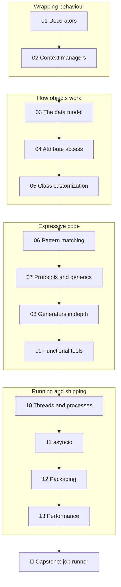

# 🟣 Advanced level

**Goal:** after this level you understand the machinery that the features you already use are built
on. You write your own decorators and context managers, make your classes behave like built-in types,
control how attributes and classes are created, run work concurrently with threads, processes and
`asyncio`, ship your code as an installable package, and measure before you optimise.

**Time:** about 40–50 hours, spread over a few weeks.

**You need:** the [Intermediate level](../intermediate/) (or equivalent knowledge: classes, dataclasses,
generators, closures, type hints, pytest) and the setup from the [main README](../README.md#set-up-python-a-venv-and-pytest).

## The lessons

| # | Lesson | You will learn | Assignments |
|---|---|---|---|
| 01 | [Decorators](01-decorators/) | wrapping functions, `functools.wraps`, decorators with arguments, stacking, class decorators | 01 |
| 02 | [Context managers](02-context-managers/) | `with` under the hood, `__enter__` / `__exit__`, `@contextmanager`, `ExitStack` | 02 |
| 03 | [The data model](03-the-data-model/) | dunder methods: operators, comparisons, hashing, containers, `__format__`, `NotImplemented` | 03, 04 |
| 04 | [Attribute access](04-attribute-access/) | the lookup chain, `__getattr__`, properties under the hood, descriptors, `__slots__` | 05 |
| 05 | [Class customization](05-class-customization/) | classes are objects, `__init_subclass__`, class decorators, metaclasses and when not to use them | 06 |
| 06 | [Structural pattern matching](06-pattern-matching/) | `match` / `case`, sequence, mapping and class patterns, guards | 07 |
| 07 | [Protocols and generics](07-protocols-and-generics/) | structural typing, `TypeVar`, generic classes, `Callable`, `overload`, `mypy --strict` | 08 |
| 08 | [Generators in depth](08-generators-in-depth/) | `yield from`, `send`, `throw`, `close`, generators as coroutines, `contextlib` internals | 09 |
| 09 | [Functional tools](09-functional-tools/) | `singledispatch`, `cache`, `reduce`, `total_ordering`, `operator`, immutability | 10 |
| 10 | [Threads and processes](10-threads-and-processes/) | the GIL, `threading`, locks, queues, `concurrent.futures`, CPU-bound vs I/O-bound | 11 |
| 11 | [asyncio](11-asyncio/) | the event loop, `async` / `await`, tasks, `gather`, timeouts, semaphores | 12 |
| 12 | [Packaging](12-packaging/) | packages, `__init__.py`, `__main__.py`, `pyproject.toml`, entry points, editable installs | 13 |
| 13 | [Performance](13-performance/) | measuring with `timeit` and `cProfile`, complexity, the right data structure, memory | 14 |
| 🏁 | [Capstone: job runner](capstone-job-runner/) | everything above, in one tested build tool with dependencies and parallel runs | capstone |



## How each lesson is built

The same structure as in the levels before:

1. **What you will learn**: the goals, in one list.
2. **The theory**: how the feature works inside Python, with diagrams and short runnable examples.
   The output of each example is shown in a comment (`# → ...`).
3. **Common mistakes**: the errors almost everyone makes, and how to recognise them.
4. **Try it yourself**: a few quick REPL experiments.
5. **Summary**: the few lines worth remembering.
6. **Assignments**: the graded exercises for this lesson.

The Advanced level asks "how does this work?" as often as "how do I use this?". Many lessons open
the hood on something you already used: `@property` is a descriptor, `@contextmanager` is a generator,
a `for` loop calls `__iter__`. Once you have seen the mechanism, you can build your own.

## How to check your work

From the repository root, with your venv active:

```bash
pytest advanced/01-decorators/assignments/01-decorator-kit
```

Every task folder has the same three files: `README.md` (the task), `exercise.py` (your file) and
`test_exercise.py` (the tests). The template solutions are in [`solutions/advanced/`](../solutions/advanced/).
