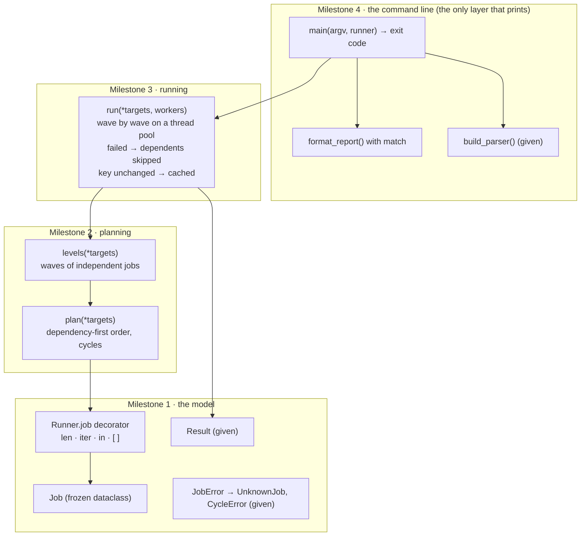
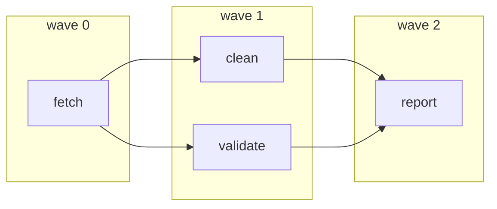

# 🏁 Capstone · Job runner

> **Level:** 🟣 Advanced · **Difficulty:** ⭐⭐⭐⭐⭐ · **Time:** ~8–10 h, spread over several sessions

You made it through all thirteen Advanced lessons. Now build the core of a tool every project needs: a
**job runner**, the idea behind `make`, CI pipelines, `tox`, `nox` and data pipelines like Airflow. You
register jobs with a decorator, declare what each job depends on, and the runner works out the right
order, runs independent jobs **in parallel**, skips what depends on a failure, and does not redo work
whose inputs did not change.

```python
runner = Runner()

@runner.job
def fetch(deps):
    return download_data()

@runner.job(deps=["fetch"])
def clean(deps):
    return remove_bad_rows(deps["fetch"])     # each job receives its dependencies' results

@runner.job(deps=["fetch"], key=lambda: os.path.getmtime("schema.json"))
def validate(deps):
    ...                                       # re-runs only when schema.json changed

@runner.job(name="report", deps=["clean", "validate"])
def make_report(deps):
    ...
```

```text
$ python exercise.py run -j 4
ok       fetch (0.21 s)
ok       clean (0.03 s)
cached   validate
ok       report (0.01 s)
4 jobs: 3 ok, 1 cached, 0 failed, 0 skipped
```

## How the program is built



The runner from the example above, as waves (Milestone 2): jobs in the same wave do not depend on each
other, so Milestone 3 may run them at the same time.



## What you use from each lesson

| Lesson | Where it shows up |
|---|---|
| 01 Decorators | `@runner.job` and `@runner.job(...)`: a registering decorator with optional brackets |
| 02 Context managers | the thread pool in `with`, which waits for a whole wave |
| 03 The data model | `Runner` behaves like a container: `len`, iteration, `in`, `runner["name"]` |
| 04 Attribute access · 05 Class customization | frozen dataclasses, a property on `Result`, the exception hierarchy with `KeyError` as a second base |
| 06 Pattern matching | `format_report` matches on `Result(status=...)` |
| 07 Protocols and generics | full type hints; the template solution passes `mypy --strict` (with an `@overload` for the decorator) |
| 08 Generators · 09 Functional tools | caching by key, results passed from job to job as values |
| 10 Threads and processes | a `ThreadPoolExecutor` per wave, futures, failures that do not stop the others |
| 11 asyncio · 12 Packaging | stretch goals: an async runner, and a package with a `jobs` command |
| 13 Performance | planning in O(jobs + dependencies), a test with 600 jobs, a clock you can replace in tests |

## Milestones

Work through them in order. Each has its own tests:

```bash
pytest advanced/capstone-job-runner -v -k milestone1
```

### Milestone 1 · The model

| Name | Specification |
|---|---|
| `Job` | a **frozen** dataclass: `name: str`, `func` (the job function), `deps: tuple[str, ...] = ()`, `key = None` |
| `Runner(cache=None, clock=time.perf_counter)` | an empty runner. `cache` is a dict-like store for Milestone 3 (a new `{}` if `None`), available as `runner.cache`; `clock` is used to measure durations |
| `runner.job` | registers a function as a job and returns the function **unchanged**. Three forms: `@runner.job`, `@runner.job(name=..., deps=[...], key=...)` (all optional; the name defaults to the function's name) and the direct call `runner.job(func, name=..., deps=...)`. `deps` is stored as a tuple. A name that is already registered: `JobError("duplicate job 'x'")` |
| container | `len(runner)`, iterating gives the job **names** in registration order, `"name" in runner`, `runner["name"]` returns the `Job`; an unknown name raises `UnknownJob("unknown job 'x'")` |

`JobError`, `UnknownJob`, `CycleError` and `Result` are given.

### Milestone 2 · Planning

`plan(*targets)` returns the list of job names to run, **every job after all its dependencies**:

- Start from the targets in the given order (no targets: all jobs, in registration order).
- For each, first plan its dependencies, in the order they are listed, depth first; then add the job.
- Every job appears **once**. Jobs that no target needs are left out.
- An unknown target or dependency raises `UnknownJob`. A cycle raises
  `CycleError("cycle: a -> b -> c -> a")`, starting from the first job of the cycle that the search reached.

`levels(*targets)` groups the same jobs into **waves**: a job without dependencies is in wave 0,
every other job is in the wave after its **deepest** dependency. Within a wave, jobs keep their plan order.

```python
>>> runner.plan("package")             # package needs compile and assets, both need fetch
['fetch', 'compile', 'assets', 'package']
>>> runner.levels()
[['fetch', 'docs'], ['compile', 'assets'], ['test', 'package']]
```

### Milestone 3 · Running

`run(*targets, workers=1)` runs the plan **wave by wave**, the jobs of one wave on a
`ThreadPoolExecutor(max_workers=workers)`, and returns `{name: Result}` in **plan order**.

| Rule | Specification |
|---|---|
| inputs | every job function is called with **one** argument: a dict `{dependency name: its value}` (empty for jobs without dependencies) |
| success | `Result(name, "ok", duration, value=return value)`; `duration` is `clock()` after minus `clock()` before the call |
| failure | an exception in a job gives `Result(name, "failed", duration, error=the exception)`. Other jobs continue |
| skip | a job whose dependency did not succeed (failed or skipped) is not run: `Result(name, "skipped")` |
| errors first | `UnknownJob` and `CycleError` are raised before any job runs |
| caching | a job with a `key` function: call `key()` before the job. If `runner.cache[name]` holds the same key **and** none of the job's dependencies ran in this run (status `"ok"`), the job is not run: `Result(name, "cached", value=cached value)`. After a successful run, store `(key, value)` in `runner.cache[name]`. Jobs without `key` always run. If `key()` raises, the job fails |

A `"cached"` result counts as success: its dependents run and receive the cached value.

### Milestone 4 · The command line

`format_report(results)` returns one line per result, written with a `match` statement on the `Result`
objects, plus a summary line:

```text
ok       fetch (1.23 s)
cached   compile
FAILED   test: AssertionError: 2 tests failed
skipped  package
4 jobs: 1 ok, 1 cached, 1 failed, 1 skipped
```

`main(argv, runner)` parses `argv` with the given `build_parser()` and returns the exit code:

| Command | Prints | Exit code |
|---|---|---|
| `list` | every job, `name` or `name <- dep1, dep2` | 0 |
| `plan [TARGET ...]` | the plan, one name per line | 0 |
| `run [TARGET ...] [-j N]` | the report of `run(..., workers=N)` | 1 if a job failed, else 0 |

A `JobError` (unknown job, cycle) prints `jobs: error: <message>` to **stderr**, nothing to stdout, and
returns `1`. Usage errors are handled by argparse (exit code 2).

## Hints

<details>
<summary>Milestone 1: the decorator</summary>

The pattern from lesson 01: `def job(self, func=None, *, name=None, deps=(), key=None)`, an inner
`decorator(f)` that registers and returns `f`, and `return decorator if func is None else decorator(func)`.
</details>

<details>
<summary>Milestone 2: depth-first search with cycle detection</summary>

Keep a set `done` and a list `visiting` (the current path). `visit(name)`: return if done; if `name` is
in `visiting`, the path from its position to the end, plus `name`, is the cycle. Otherwise push it,
visit the dependencies, pop it, mark it done and append it to the plan. For `levels`, walk the plan once:
because dependencies come first, their depth is already known when you reach a job.
</details>

<details>
<summary>Milestone 3: one wave at a time</summary>

For each wave, first decide for every job: skip, cached, or "runnable". Then submit all runnable jobs to a
`with ThreadPoolExecutor(...)` block; leaving the block waits for the whole wave. A small method
`_execute(job, inputs)` that measures the time and turns an exception into a failed `Result` keeps
`run` readable.
</details>

<details>
<summary>Milestone 4: main</summary>

The same shape as the Intermediate capstone: compute all output lines inside one `try`, catch `JobError`,
and print only at the end.
</details>

## Try it for real

```bash
python advanced/capstone-job-runner/exercise.py run -j 2
```

```bash
python advanced/capstone-job-runner/exercise.py plan report
```

## Check your work

```bash
pytest advanced/capstone-job-runner -v
```

## Stretch goals

Done and all green? These have no tests; they are for practice.

- Run `mypy --strict` on your file. Typing `runner.job` so that both decorator forms keep the function's
  type needs two `@overload`s (lesson 07).
- **Persistent cache:** a `JsonCache` class with the `MutableMapping` interface (lesson 03,
  `collections.abc`) that stores keys and values in a JSON file, so a second program run can skip work.
- **An async runner:** `async def run_async(...)` where job functions are coroutines and a wave runs
  with `asyncio.gather` (lesson 11).
- **Timeouts and retries:** `@runner.job(timeout=5, retries=2)`, built from your tools in assignments 01 and 11.
- **Packaging:** split the file into a package `jobrunner/` with a `pyproject.toml` and a `jobs` command
  that loads the jobs from a `jobsfile.py` in the current folder (lesson 12).
- **Profile it:** create 10 000 jobs in a random dependency graph and profile `plan()` (lesson 13).

## Done?

Compare with the [template solution](../../solutions/advanced/capstone-job-runner/exercise.py). Read it as a
whole: notice how planning never runs anything, how `run` never prints, and how one replaceable `clock`
makes the timing testable.

Then tick off the capstone in the [progress checklist](../../README.md#progress-checklist).
**Congratulations: you have finished the Advanced level. 🎉**

---

<p align="center">
  <a href="../13-performance/">← Previous: 13 · Performance</a> · <a href="../README.md">Advanced overview</a>
</p>
