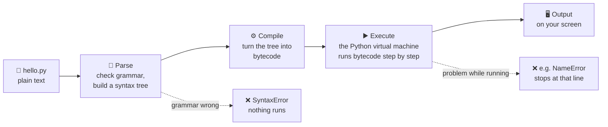
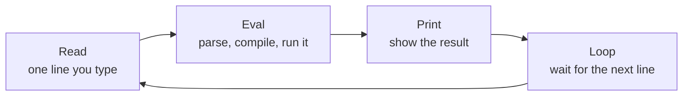
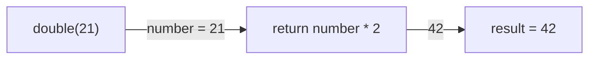

# Lesson 01 · How Python runs code

> **Level:** 🟡 Beginner · **Time:** ~1.5 h · **Assignment:** [01 · First script](assignments/01-first-script/)

Before you learn *what* to write, it helps to know *what happens* to what you write. This lesson follows
one line of code from your keyboard to the screen. That picture will help you with every error message
you meet later.

## What you will learn

- what "Python" actually is: a language **and** a program called the interpreter
- the steps from a `.py` file to running code: parse → compile to bytecode → execute
- the difference between the **REPL** (interactive) and a **script** (a file)
- why a `SyntaxError` stops everything, while other errors only stop the program halfway
- just enough about functions (`def`, `return`) to do the assignments

---

## 1. Python is a language and a program

When people say "Python" they mean two things:

1. **The language**: the rules for what valid Python code looks like (`print("hi")` is valid, `print "hi"` is not, since Python 3).
2. **The interpreter**: a program, usually called `python` or `python3`, that reads your code and runs it.
   The standard one is called **CPython** because it is written in C. It is the one you get from python.org.

Your computer's processor does not understand Python. It only understands machine code. The interpreter
is the translator in between: it reads your text and does what the text says.

## 2. From text to running code

When you run `python hello.py`, the interpreter does this:



1. **Parse.** Python reads the whole file and checks that it follows the grammar of the language.
   If one bracket is missing anywhere, you get a `SyntaxError` and **not a single line runs**.
2. **Compile.** The checked code is translated into **bytecode**: small, simple instructions for a
   virtual machine. This is not machine code; it is Python's own instruction set.
3. **Execute.** The **Python Virtual Machine (PVM)**, a loop inside the interpreter, runs the bytecode
   one instruction at a time, from top to bottom.

You can look at the bytecode yourself with the `dis` (disassemble) module:

```python
import dis

dis.dis("total = price * 2")
# →  LOAD_NAME     price
#    LOAD_CONST    2
#    BINARY_OP     *        (multiply)
#    STORE_NAME    total
```

The exact output depends on your Python version, but the idea is always the same: load the values,
multiply them, store the result under the name `total`.

> **Side note: `__pycache__`.** When you import a file (lesson 12), Python saves its bytecode in a folder
> called `__pycache__` as a `.pyc` file, so it can skip parsing and compiling the next time. You can
> safely delete these folders; Python recreates them. That is why they are in `.gitignore`.

### Proof: parsing happens before running

Save this as `order.py` and run it:

```python
print("first line")
print("second line"
```

You might expect `first line` to appear before the error. It does not:

```text
  File "order.py", line 2
    print("second line"
         ^
SyntaxError: '(' was never closed
```

Parsing fails, so nothing is executed. Now fix the bracket, but make a *different* mistake:

```python
print("first line")
print(second_line)
```

```text
first line
Traceback (most recent call last):
  File "order.py", line 2, in <module>
    print(second_line)
NameError: name 'second_line' is not defined
```

This time `first line` **is** printed. The grammar is fine, so the file was compiled and started running.
Line 2 only fails when the PVM gets to it. Remember the difference:

| Error type | Found when? | Did earlier lines run? |
|---|---|---|
| `SyntaxError`, `IndentationError` | while **parsing** the whole file | ❌ no |
| `NameError`, `TypeError`, `ZeroDivisionError`, … | while **running**, at that line | ✅ yes |

## 3. Two ways to run code: the REPL and scripts

### The REPL

Type `python3` (macOS/Linux) or `py` (Windows) in a terminal, without a file name. You get the
**REPL**, short for **R**ead–**E**val–**P**rint **L**oop:



```python
>>> 2 + 3
5
>>> name = "Ada"
>>> name
'Ada'
>>> len(name)
3
```

The `>>>` is the prompt: Python is waiting for you. When a line continues (for example after a `:`),
the prompt changes to `...`. Leave the REPL with `exit()` or Ctrl+D (Ctrl+Z then Enter on Windows).

The REPL **prints the value of every expression automatically**. That makes it perfect for experiments:
"what does `len("hello")` return?", "what happens if I add a string to a number?".

### Scripts

A script is a text file ending in `.py`. You run the whole file at once:

```bash
python3 hello.py
```

A script does **not** print values automatically. Only what you pass to `print()` appears:

```python
# hello.py
2 + 3              # computed, then thrown away: nothing appears
print(2 + 3)       # → 5
```

### When to use which

| | REPL | Script |
|---|---|---|
| Good for | trying things out, checking one idea | real programs, anything you want to keep |
| Shows results | automatically, after every line | only with `print()` |
| Saved? | no, gone when you close it | yes, in a file you can edit and rerun |
| Runs | one statement at a time | the whole file, top to bottom |

A good habit: write your program in a file, and keep a REPL open next to it to try out single lines.

## 4. The shape of Python code

A few rules that apply from the very first line:

```python
# A comment starts with # and is ignored by Python. Write comments for humans.

message = "Hello"      # a statement: store a value under a name
print(message)         # a statement: call a function

if len(message) > 3:   # a line ending with ":" opens a block ...
    print("long")      # ... and the block is the indented lines below it
print("done")          # back at the left edge: the block is over
```

- **One statement per line.** No semicolons needed.
- **Indentation is grammar.** Other languages use `{ }` for blocks; Python uses indentation.
  Use **4 spaces** per level (every good editor does this when you press Tab).
- **Case matters.** `print`, `Print` and `PRINT` are three different names. Only the first one exists.
- **Statements vs expressions.** An *expression* produces a value (`2 + 3`, `len(name)`).
  A *statement* does something (`name = "Ada"`, `if ...:`). Many statements contain expressions.

## 5. Just enough about functions for the assignments

Lesson 09 covers functions in depth. For now, you only need to read and fill in this shape:

```python
def double(number):        # def = define a function called "double" with one input, "number"
    """Return twice the number."""   # docstring: what the function should do
    return number * 2      # return = hand this value back to whoever called the function


result = double(21)        # call the function with 21 as input
print(result)              # → 42
```



In every assignment you get a file with **stubs**: the `def` line and the docstring are written for you,
and the body is a placeholder:

```python
def double(number):
    """Return twice the number."""
    raise NotImplementedError   # ← replace this line with your code
```

`return` and `print` are not the same: `print` shows a value on the screen, `return` hands it back to the
code that called the function. The tests can only check what you **return**.

---

## Common mistakes

**Typing a terminal command inside the REPL.**

```python
>>> python3 hello.py
  File "<stdin>", line 1
    python3 hello.py
            ^^^^^
SyntaxError: invalid syntax
```

`python3 hello.py` is a command for your **terminal**, not Python code. Leave the REPL with `exit()`
first. Rule of thumb: if you see `>>>`, you are talking to Python; if you see `$` or `PS C:\>`, you are
talking to your terminal.

**Expecting a script to show values like the REPL does.** A bare `2 + 3` in a script prints nothing.
Use `print(2 + 3)`.

**Mixing tabs and spaces, or indenting by accident.**

```python
print("a")
    print("b")    # IndentationError: unexpected indent
```

Only indent after a line ending in `:`. Let your editor insert 4 spaces.

**Curly "smart" quotes** copied from a word processor or website: `print(“hi”)` is a `SyntaxError`.
Python needs plain quotes: `"` or `'`.

**The wrong command name.** On macOS and Linux, `python` may not exist or may be an old Python 2;
use `python3`. On Windows, use `py`. Inside an active venv (lesson 13), plain `python` always works.

**Using `print` instead of `return` in a function.** The function shows the right value but returns
`None`, so the tests fail with something like `assert None == 42`.

## Try it yourself

1. Start the REPL. Type `7 * 6`, then `"ab" * 3`, then `len("Python")`. What does each return?
2. In the REPL, run `import this`. (It prints *The Zen of Python*, the design ideas behind the language.)
3. Create `order.py` from section 2 and reproduce both errors. Which one printed `first line`?
4. Run `import dis` and then `dis.dis("x = 1 + 2")`. Python computes `1 + 2` already while compiling.
   Can you spot `3` in the bytecode?

## Summary

- Python is a language **and** an interpreter program (CPython) that runs your code.
- Running a file means: **parse** (grammar check) → **compile** to bytecode → **execute** on the virtual machine.
- A `SyntaxError` stops the program before line 1 runs; other errors stop it at the failing line.
- The **REPL** shows every value automatically and is for experiments; **scripts** need `print()` and are for programs.
- Indentation is part of the grammar. Functions hand back results with `return`, not `print`.

## Assignment

➡️ **[01 · First script](assignments/01-first-script/)**: write your first functions and run your first script.

---

<p align="center">
  <a href="../README.md">Beginner overview</a> · <a href="../02-variables-and-types/">Next: 02 · Variables and types →</a>
</p>
