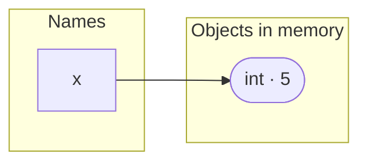
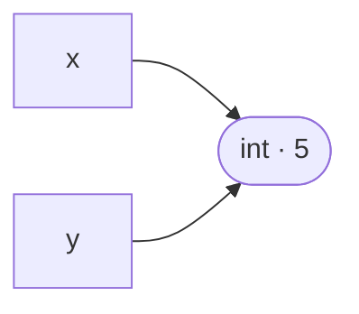
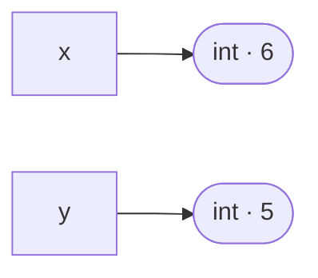
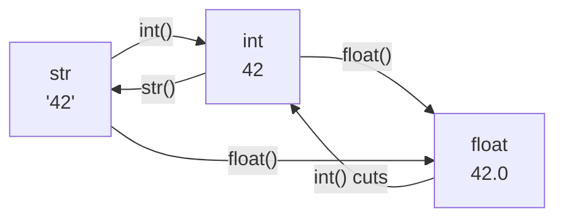

# Lesson 02 · Variables and types

> **Level:** 🟡 Beginner · **Time:** ~2 h · **Assignment:** [02 · Type detective](assignments/02-type-detective/)

Many tutorials say "a variable is a box that holds a value". In Python that picture is wrong, and it
causes real bugs later (lesson 07 shows one). This lesson gives you the right picture: **names point to
objects**.

## What you will learn

- what really happens in `x = 5`: objects, names and references
- the three properties of every object: **identity**, **type** and **value**
- dynamic typing ("names have no type") and strong typing ("no silent conversions")
- the core types: `int`, `float`, `str`, `bool` and `None`
- converting between types, and naming things well

---

## 1. Names point to objects

```python
x = 5
```

This line does two things, right to left:

1. Python creates an **object** in memory: an integer with the value `5`.
2. Python binds the **name** `x` to that object. The name is a label with an arrow to the object.



Now assign one name to another:

```python
y = x
```

`y = x` does **not** copy the 5. It makes `y` point at the **same object** that `x` points at:



What happens when we "change" `x`?

```python
x = x + 1
print(x, y)   # → 6 5
```

The integer `5` cannot change (integers are **immutable**). So Python computes a **new** object, `6`,
and moves the arrow of `x` to it. `y` still points at `5`:



This is called **rebinding**: the `=` sign always moves a name's arrow; it never changes an object.
An object that no name points to any more is cleaned up automatically (garbage collection).

## 2. Every object has an identity, a type and a value

```python
age = 36

id(age)      # → 4339023400     identity: where the object lives (a different number on your machine)
type(age)    # → <class 'int'>  type: what kind of object it is
age          # → 36             value: the data itself
```

| Property | Ask with | Can it change? |
|---|---|---|
| **identity** | `id(obj)`, compare with `is` | never, while the object exists |
| **type** | `type(obj)`, `isinstance(obj, int)` | never |
| **value** | the object itself, compare with `==` | only for *mutable* objects (lists, dicts, …) |

`==` asks "do these have the same **value**?", `is` asks "are these the **same object**?":

```python
a = [1, 2, 3]
b = [1, 2, 3]
c = a

a == b    # → True   same value
a is b    # → False  two different list objects
a is c    # → True   two names, one object
```

Use `==` to compare values. Use `is` almost only for `None` (`if result is None:`).

## 3. Dynamic and strong typing

**Dynamic typing: names have no type, objects do.** The same name can point to an int now and a string
later. Python checks types while the program runs, not before.

```python
thing = 42          # thing → int
thing = "forty-two" # now thing → str; the int is gone
```

**Strong typing: Python does not silently convert.** Mixing types that do not fit is an error, not a guess:

```python
"3" + 4
# TypeError: can only concatenate str (not "int") to str
```

Some languages would give you `"34"` or `7` here. Python makes you say which one you mean:

```python
"3" + str(4)   # → '34'   text joined to text
int("3") + 4   # → 7      number added to number
```

## 4. The core types

| Type | Example values | Used for |
|---|---|---|
| `int` | `0`, `42`, `-7`, `1_000_000` | whole numbers, any size |
| `float` | `3.14`, `-0.5`, `2.0`, `1e6` | numbers with a fractional part (approximate!) |
| `str` | `"hello"`, `'Ada'`, `""` | text |
| `bool` | `True`, `False` | yes/no answers |
| `NoneType` | `None` (the only value) | "no value here (yet)" |

```python
type(42)        # → <class 'int'>
type(42.0)      # → <class 'float'>
type("42")      # → <class 'str'>
type(True)      # → <class 'bool'>
type(None)      # → <class 'NoneType'>
```

`42`, `42.0` and `"42"` look alike but are three different types. Lesson 03 goes deep into numbers and text.

**`None`** means "nothing". A function without a `return` returns `None`. You check for it with `is`:

```python
result = None
if result is None:
    print("no result yet")
```

## 5. Converting between types

The type names double as conversion functions:

```python
int("42")       # → 42
int(3.99)       # → 3        cuts off the fraction, does not round
float("2.5")    # → 2.5
str(100)        # → '100'
bool(0)         # → False    (lesson 05: "truthiness")
int("hello")    # ValueError: invalid literal for int() with base 10: 'hello'
```



## 6. Assignment tricks

```python
a, b = 1, 2        # assign two names at once
a, b = b, a        # swap: the right side is evaluated first → a is 2, b is 1

count = 0
count += 1         # short for: count = count + 1
count *= 10        # count = count * 10 → 10

x = y = 0          # both names point to the same 0
```

## 7. Naming well

- Allowed: letters, digits, `_`; must not start with a digit. `total_2` ✅ `2total` ❌
- Case-sensitive: `name` and `Name` are different.
- Not a keyword: `if`, `for`, `class`, `return`, … (see `import keyword; keyword.kwlist`).
- Convention (PEP 8): `snake_case` for variables and functions, `UPPER_CASE` for constants:

```python
MAX_RETRIES = 3
user_name = "ada"
```

- Say what it is: `price_in_euros` beats `p`, `x1` or `data`.

---

## Common mistakes

**Thinking `b = a` makes a copy.** It creates a second name for the same object. With immutable objects
(int, str) you never notice. With lists you will (lesson 07).

**Overwriting a built-in name.**

```python
str = "hello"      # str now points to your text, not to the str type
str(42)            # TypeError: 'str' object is not callable
```

Avoid names like `str`, `int`, `list`, `dict`, `sum`, `max`, `input`, `id`, `type`. If it happened in
the REPL, `del str` removes your name and the built-in works again.

**Using a name before assigning it.**

```python
print(total)       # NameError: name 'total' is not defined
total = 10
```

Python runs top to bottom; the name does not exist yet on line 1.

**Mixing text and numbers.** `"Age: " + 36` is a `TypeError`. Convert first: `"Age: " + str(36)`.

**`=` vs `==`.** `=` binds a name, `==` compares. `if x = 5:` is a `SyntaxError`.

**Using `is` to compare values.** `"hi" is "hi"` or `1000 is 1000` may be `True` or `False` depending on
implementation details. Always use `==` for values; keep `is` for `None`.

## Try it yourself

1. In the REPL: `x = 5`, `y = x`, then `id(x) == id(y)`. Now `x += 1` and check again.
2. What are `type(1 + 2)`, `type(1 + 2.0)`, `type("1" + "2")`? Predict first, then check.
3. Try `int("  42  ")`, `int("4.2")` and `float("4.2")`. Which one fails, and why?
4. Swap two variables with `a, b = b, a`. Print them before and after.

## Summary

- `=` binds a **name** to an **object**; it never copies and never changes the object.
- Every object has an **identity** (`id`, `is`), a **type** (`type`) and a **value** (`==`).
- Names have no type; objects do (**dynamic**). Python never mixes types silently (**strong**).
- Core types: `int`, `float`, `str`, `bool`, `None`. Convert with `int()`, `float()`, `str()`.
- Use `snake_case`, descriptive names, and never shadow built-ins.

## Assignment

➡️ **[02 · Type detective](assignments/02-type-detective/)**: inspect types, convert values and swap variables.

---

<p align="center">
  <a href="../01-how-python-runs/">← Previous: 01 · How Python runs code</a> · <a href="../README.md">Beginner overview</a> · <a href="../03-numbers-and-strings/">Next: 03 · Numbers and strings →</a>
</p>
