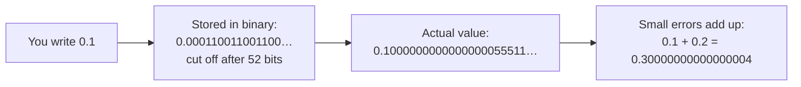

# Lesson 03 · Numbers and strings

> **Level:** 🟡 Beginner · **Time:** ~2.5 h · **Assignments:** [03 · Temperature converter](assignments/03-temperature-converter/) · [04 · String toolkit](assignments/04-string-toolkit/)

Numbers and text are what almost every program works with. This lesson shows how Python stores them,
why `0.1 + 0.2` is not `0.3`, and how to slice, search and format text.

## What you will learn

- `int` vs `float`, the arithmetic operators, and the difference between `/` and `//`
- why floats are approximate, and how to round and compare them safely
- strings as **immutable sequences** of characters: indexing and slicing
- the string methods you will use every day
- formatting output with **f-strings**

---

## Part A · Numbers

### 1. Integers and floats

```python
type(7)       # → <class 'int'>    whole number, exact, any size
type(7.0)     # → <class 'float'>  floating-point number, approximate
2 ** 100      # → 1267650600228229401496703205376   ints never overflow
1_000_000     # → 1000000          underscores make big numbers readable
```

### 2. Operators

| Operator | Meaning | Example | Result |
|---|---|---|---|
| `+` `-` `*` | add, subtract, multiply | `7 * 3` | `21` |
| `/` | **true division**, always a float | `7 / 2` | `3.5` |
| `//` | **floor division**, rounds down | `7 // 2` | `3` |
| `%` | **modulo**, the remainder | `7 % 2` | `1` |
| `**` | power | `2 ** 10` | `1024` |

`//` and `%` belong together: `7 == 2 * (7 // 2) + (7 % 2)`. Modulo is everywhere:
`n % 2 == 0` tests for even numbers, `minutes % 60` gives the leftover minutes.

```python
total_minutes = 135
hours = total_minutes // 60      # → 2
minutes = total_minutes % 60     # → 15
```

Mixing `int` and `float` gives a `float`: `2 + 0.5` → `2.5`. Operator precedence follows maths
(`**` before `*` `/` before `+` `-`); use brackets when in doubt: `(a + b) / 2`.

### 3. Why floats are approximate

```python
0.1 + 0.2           # → 0.30000000000000004
0.1 + 0.2 == 0.3    # → False
```

This is not a Python bug. Computers store floats in **binary**. Just as 1/3 cannot be written exactly in
decimal (0.3333…), 1/10 cannot be written exactly in binary (0.0001100110011…). The stored value is the
nearest number that fits into 64 bits, so tiny errors appear.



How to live with it:

```python
round(0.1 + 0.2, 2)                   # → 0.3   round for display or storage
abs((0.1 + 0.2) - 0.3) < 1e-9         # → True  compare with a tolerance
import math
math.isclose(0.1 + 0.2, 0.3)          # → True  the standard-library way
```

For money, use whole cents as `int` (`1999` instead of `19.99`), or the `decimal` module.

> **Rounding surprise:** `round(2.5)` is `2` and `round(3.5)` is `4`. Python rounds halves to the nearest
> **even** number ("banker's rounding"), which avoids a bias when you round many numbers.

## Part B · Strings

### 4. A string is a sequence of characters

```python
word = "Python"
```

Each character has a position, its **index**. Counting starts at **0**. Negative indexes count from the end:

```text
 index:     0    1    2    3    4    5
          +----+----+----+----+----+----+
 word:    | P  | y  | t  | h  | o  | n  |
          +----+----+----+----+----+----+
 negative: -6   -5   -4   -3   -2   -1
```

```python
word[0]      # → 'P'
word[5]      # → 'n'
word[-1]     # → 'n'    the last character, whatever the length
len(word)    # → 6
word[6]      # IndexError: string index out of range
```

### 5. Slicing: `text[start:stop:step]`

A slice takes a piece of the sequence. **`start` is included, `stop` is excluded.** Think of the
indexes as pointing *between* the characters:

```text
          P    y    t    h    o    n
        ^    ^    ^    ^    ^    ^    ^
        0    1    2    3    4    5    6
```

```python
word[0:2]     # → 'Py'      from cut 0 to cut 2
word[2:]      # → 'thon'    leave out stop: until the end
word[:4]      # → 'Pyth'    leave out start: from the beginning
word[-3:]     # → 'hon'     the last three
word[::2]     # → 'Pto'     every second character
word[::-1]    # → 'nohtyP'  step -1: backwards (reversed)
word[10:20]   # → ''        slices never raise IndexError
```

### 6. Strings are immutable

You cannot change a string in place. Every "change" creates a **new** string:

```python
word[0] = "J"          # TypeError: 'str' object does not support item assignment
new_word = "J" + word[1:]   # → 'Jython'
```

That is also why string methods **return** a result instead of changing the original:

```python
name = "ada"
name.upper()      # → 'ADA'  a new string ...
name              # → 'ada'  ... the original is unchanged
name = name.upper()   # keep the result by rebinding the name
```

### 7. Everyday string methods

| Method | Example | Result |
|---|---|---|
| `.lower()` / `.upper()` | `"Ada".lower()` | `'ada'` |
| `.title()` / `.capitalize()` | `"ada lovelace".title()` | `'Ada Lovelace'` |
| `.strip()` | `"  hi \n".strip()` | `'hi'` (also `.lstrip()`, `.rstrip()`) |
| `.replace(old, new)` | `"a-b-c".replace("-", "+")` | `'a+b+c'` |
| `.split(sep)` | `"a,b,c".split(",")` | `['a', 'b', 'c']` |
| `.split()` | `" one  two ".split()` | `['one', 'two']` (any whitespace) |
| `sep.join(parts)` | `"-".join(["a", "b"])` | `'a-b'` |
| `.startswith()` / `.endswith()` | `"main.py".endswith(".py")` | `True` |
| `.find(sub)` | `"banana".find("n")` | `2` (or `-1` if not found) |
| `.count(sub)` | `"banana".count("a")` | `3` |
| `.isdigit()` / `.isalpha()` | `"42".isdigit()` | `True` |
| `in` | `"nan" in "banana"` | `True` |

Methods can be chained, because each one returns a string:

```python
"  Hello World  ".strip().lower().replace(" ", "-")   # → 'hello-world'
```

### 8. Quotes, escapes and multi-line strings

```python
'single' == "double"              # → True, no difference
"It's fine"                       # use the other quote type inside
"Line 1\nLine 2"                  # \n = new line, \t = tab, \\ = a backslash
"""A string over
several lines"""                  # triple quotes keep line breaks
r"C:\new\folder"                  # raw string: backslashes stay as they are
```

### 9. f-strings: put values into text

Put an `f` before the quotes, and everything in `{ }` is evaluated and inserted:

```python
name, price, qty = "Coffee", 3.5, 3
f"{qty} × {name} cost {price * qty} €"     # → '3 × Coffee cost 10.5 €'
```

After a `:` inside the braces you can add a **format spec**:

| Spec | Example | Result | Meaning |
|---|---|---|---|
| `.2f` | `f"{3.14159:.2f}"` | `'3.14'` | 2 decimals |
| `,` | `f"{1234567:,}"` | `'1,234,567'` | thousands separator |
| `%` | `f"{0.256:.1%}"` | `'25.6%'` | percentage |
| `>10` | `f"{'hi':>10}"` | `'        hi'` | right-align in 10 characters |
| `<10` | `f"{'hi':<10}"` | `'hi        '` | left-align |
| `^10` | `f"{'hi':^10}"` | `'    hi    '` | centre |
| `.>10` | `f"{'hi':.>10}"` | `'........hi'` | fill with `.` |
| `05` | `f"{42:05}"` | `'00042'` | pad with zeros |
| `=` | `f"{qty=}"` | `'qty=3'` | debug: show name and value |

f-strings call `str()` for you, so `f"Age: {36}"` works where `"Age: " + 36` fails.

---

## Common mistakes

**Expecting `/` to give an int.** `10 / 2` is `5.0`, a float. Use `//` when you want a whole number.

**Comparing floats with `==`.** Use `round()` or `math.isclose()`.

**Off-by-one in slices.** `text[0:3]` has **3** characters: indexes 0, 1 and 2. The stop index is not included.

**Forgetting that string methods return a new string.**

```python
name = " ada "
name.strip()        # result thrown away
print(name)         # → ' ada '   still with spaces
name = name.strip() # ✅
```

**Forgetting the `f`.** `"Hello {name}"` prints the braces literally. It must be `f"Hello {name}"`.

**`int("3.5")`** raises a `ValueError`: `int()` only accepts whole-number text. Use `float("3.5")`, then `int()` if needed.

## Try it yourself

1. Compute how many full weeks and leftover days are in 100 days, using `//` and `%`.
2. Predict `"Python"[1:4]`, `"Python"[-2:]` and `"Python"[::-1]`, then check.
3. Turn `"  the QUICK brown fox "` into `"The Quick Brown Fox"` in one chained line.
4. Print `pi = 3.14159` as `pi ≈ 3.14` with an f-string.
5. Try `0.1 * 3`, `round(0.1 * 3, 10)` and `math.isclose(0.1 * 3, 0.3)`.

## Summary

- `int` is exact and unlimited; `float` is approximate (binary fractions). Compare floats with a tolerance.
- `/` always gives a float, `//` divides and rounds down, `%` gives the remainder.
- A string is an **immutable sequence**: index from 0, slice with `[start:stop:step]` (stop excluded).
- String methods never change the original; they **return** a new string.
- f-strings (`f"{value:.2f}"`) are the modern way to build text from values.

## Assignments

➡️ **[03 · Temperature converter](assignments/03-temperature-converter/)**: formulas, rounding and formatting.<br>
➡️ **[04 · String toolkit](assignments/04-string-toolkit/)**: slicing, methods and chaining.

---

<p align="center">
  <a href="../02-variables-and-types/">← Previous: 02 · Variables and types</a> · <a href="../README.md">Beginner overview</a> · <a href="../04-input-and-output/">Next: 04 · Input and output →</a>
</p>
