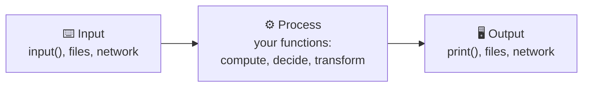
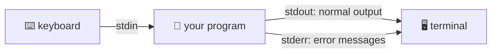
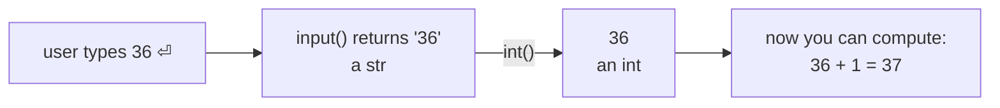
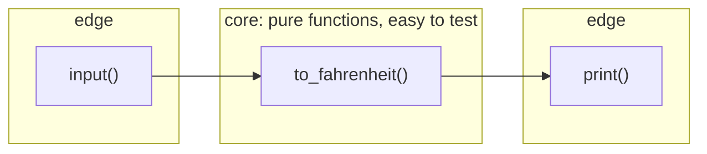

# Lesson 04 · Input and output

> **Level:** 🟡 Beginner · **Time:** ~1.5 h · **Assignment:** [05 · Receipt printer](assignments/05-receipt-printer/)

A program that cannot talk to the outside world is not much use. This lesson covers the two simplest
channels: reading what the user types and printing results. It also introduces a habit that professional
code depends on: **keep input and output at the edges, and the logic in the middle.**

## What you will learn

- the input → process → output model of a program
- everything `print()` can do: several values, `sep`, `end`, and the standard streams
- why `input()` always returns a **string**, and how to convert it safely
- how to lay out output in neat columns
- why you separate I/O from logic, and how that makes your code testable

---

## 1. Input → process → output

Almost every program, from a calculator to a web server, has this shape:



In this lesson the input is the **keyboard** and the output is the **terminal**. Lesson 11 swaps them for files;
the middle part stays the same.

## 2. `print()` in detail

```python
print("Hello")                     # → Hello
print("a", "b", "c")               # → a b c        values separated by one space
print("a", "b", "c", sep="-")      # → a-b-c        choose the separator
print("no newline", end="")        # end="" stops the line break at the end
print(" ... same line")            # → no newline ... same line
print()                            # an empty line
print(3, 4.5, True, None)          # → 3 4.5 True None   any type works, print calls str()
```

`print` is a function that **shows** something and returns `None`. It does not hand a value back to your code:

```python
result = print("hi")   # shows: hi
print(result)          # → None
```

### Where does print write to?

Every program starts with three open **streams**, connected to your terminal:



`print()` writes to **stdout**. `input()` reads from **stdin**. Python writes tracebacks to **stderr**,
so they still show up when you redirect normal output into a file (`python report.py > out.txt`).
You can print to stderr yourself: `import sys; print("warning!", file=sys.stderr)`.

## 3. `input()` always returns a string

```python
name = input("What is your name? ")
```

1. `input` shows the prompt (note the space at the end, so the cursor is not glued to the `?`).
2. The program **waits** until the user presses Enter.
3. Everything typed, without the Enter, comes back as a `str`.

The last point causes the most famous beginner bug:

```python
age = input("Age: ")      # user types 36
age + 1                   # TypeError: can only concatenate str (not "int") to str
type(age)                 # → <class 'str'>   it is '36', not 36
```

Convert the text yourself:

```python
age = int(input("Age: "))           # '36' → 36
price = float(input("Price: "))     # '3.50' → 3.5
```



### Clean up before converting

Users type extra spaces and use commas as decimal separators. Clean the text first:

```python
raw = input("Price: ")                 # user types ' 3,50 '
price = float(raw.strip().replace(",", "."))   # → 3.5
```

If the text still is not a number, `int()` and `float()` raise a `ValueError`. Lesson 10 shows how to
catch it and ask again; for now, a clear crash is fine.

## 4. Formatting output in columns

f-strings with a width and alignment (lesson 03) make tables line up:

```python
print(f"{'Item':<10}{'Qty':>5}{'Price':>10}")
print(f"{'Coffee':<10}{3:>5}{10.5:>10.2f}")
print(f"{'Cake':<10}{1:>5}{4.2:>10.2f}")
```

```text
Item        Qty     Price
Coffee        3     10.50
Cake          1      4.20
```

`:<10` pads to 10 characters, aligned left. `:>10.2f` pads to 10, aligned right, with two decimals.
Numbers usually align right so the decimal points line up.

A repeated character makes a separator line: `print("-" * 25)`.

## 5. Keep I/O at the edges

Compare two versions of the same program:

```python
# ❌ Everything mixed together
celsius = float(input("°C: "))
print("°F:", celsius * 9 / 5 + 32)
```

```python
# ✅ Logic in a function, I/O only in main()
def to_fahrenheit(celsius):
    return celsius * 9 / 5 + 32


def main():
    celsius = float(input("°C: "))
    print("°F:", to_fahrenheit(celsius))


if __name__ == "__main__":
    main()
```

The second version is longer, but `to_fahrenheit` can now be **tested** without anyone typing,
**reused** in another program, and **read** in one glance. All assignments in this repo use this pattern:
functions that `return` results, plus a `main()` that does the talking.



> **How do the tests type for you?** pytest can replace `input` with a fake that returns prepared answers
> (`monkeypatch`), and it can capture what you print (`capsys`). Look at `test_exercise.py` in the
> assignment if you are curious; you will write tests like these yourself in the Intermediate level.

---

## Common mistakes

**Doing maths with the result of `input()`.** It is a string. Convert with `int()` or `float()` first.

**Converting too early or too late.** `int(input())` crashes on `3.5`; decide which type you need:
whole numbers → `int`, anything with decimals → `float`.

**Printing instead of returning.** A function that ends with `print(result)` returns `None`, and the code
that called it cannot use the result. Return in the function, print in `main()`.

**No space after the prompt.** `input("Name:")` gives `Name:Ada`. Write `input("Name: ")`.

**Comma vs `+` in print.** `print("Total:", 5)` works; `print("Total: " + 5)` is a `TypeError`.
Commas let `print` convert for you; `+` needs strings on both sides.

## Try it yourself

1. Print `2026-10-30` from the three numbers `2026`, `10`, `30` using `sep`.
2. Write a two-line script that asks for two numbers and prints their sum. Try typing `3,5` and see the error.
3. Print a small table of three fruits and prices with aligned columns.
4. Run a script with `> out.txt` at the end of the command. Where did the output go?

## Summary

- Programs follow **input → process → output**.
- `print()` takes many values, joins them with `sep`, ends with `end`, and returns `None`.
- `input()` waits for Enter and **always returns a `str`**. Clean it (`strip`, `replace`) and convert it (`int`, `float`).
- f-string widths and alignment (`:<10`, `:>8.2f`) produce clean columns.
- Keep I/O in `main()` and logic in functions that **return**: testable, reusable, readable.

## Assignment

➡️ **[05 · Receipt printer](assignments/05-receipt-printer/)**: read prices from the user and print an aligned receipt.

---

<p align="center">
  <a href="../03-numbers-and-strings/">← Previous: 03 · Numbers and strings</a> · <a href="../README.md">Beginner overview</a> · <a href="../05-conditions/">Next: 05 · Conditions →</a>
</p>
