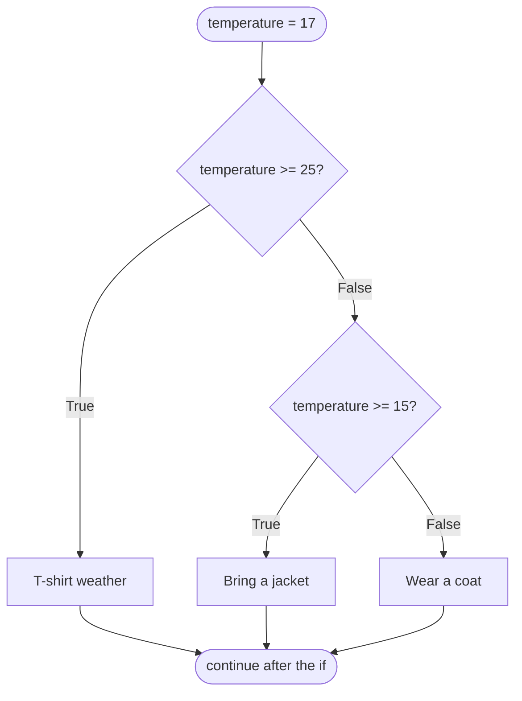
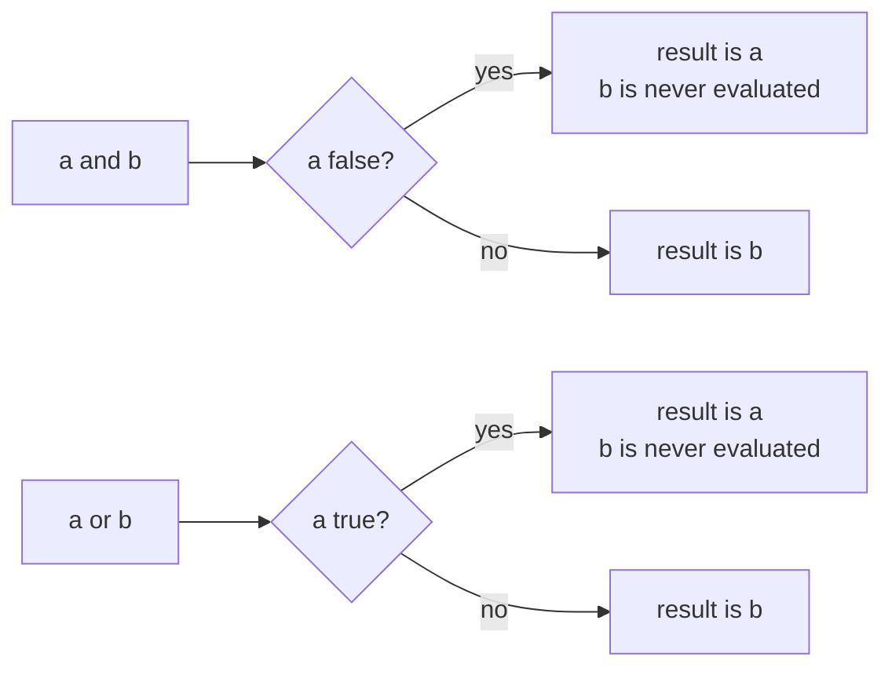

# Lesson 05 · Conditions

> **Level:** 🟡 Beginner · **Time:** ~2 h · **Assignments:** [06 · Grade calculator](assignments/06-grade-calculator/) · [07 · Leap years](assignments/07-leap-years/)

So far every program ran straight from top to bottom. Conditions let a program **decide**: do this,
or that, depending on the data. This lesson covers how Python evaluates a condition, and how to write
decisions that stay readable when they grow.

## What you will learn

- the `bool` type and the comparison operators, including chained comparisons
- `if` / `elif` / `else`, and why the order of the branches matters
- `and`, `or`, `not`, and **short-circuit** evaluation
- **truthiness**: why `if name:` works on a string
- the one-line conditional expression, guard clauses, and a first look at `match`

---

## 1. Booleans and comparisons

A condition is any expression that produces `True` or `False`:

| Operator | Meaning | Example | Result |
|---|---|---|---|
| `==` | equal | `3 == 3.0` | `True` |
| `!=` | not equal | `"a" != "A"` | `True` |
| `<` `<=` `>` `>=` | ordering | `2 <= 2` | `True` |
| `in` / `not in` | contained in | `"py" in "python"` | `True` |
| `is` / `is not` | same object | `value is None` | `True` / `False` |

Comparisons can be **chained** like in maths:

```python
age = 36
18 <= age < 65          # → True   means: 18 <= age and age < 65
```

Strings compare letter by letter, by their Unicode number: `"apple" < "banana"` is `True`, but so is
`"Zebra" < "apple"` (all capitals come before lower case). Compare `.lower()` versions when that matters.

## 2. `if`, `elif`, `else`

```python
temperature = 17

if temperature >= 25:
    print("T-shirt weather")
elif temperature >= 15:
    print("Bring a jacket")
else:
    print("Wear a coat")
# → Bring a jacket
```



The rules:

- Python checks the conditions **from top to bottom** and runs **only the first** branch whose condition is true.
  The rest is skipped, even if it would also be true.
- `elif` (else-if) and `else` are optional. You can have as many `elif` as you like, and at most one `else`, at the end.
- Each branch is an indented block after a line ending in `:`.

### Order matters

Because only the first matching branch runs, put the **narrowest** condition first:

```python
# ❌ wrong order: 95 matches ">= 50" first and never reaches the "A" branch
if points >= 50:
    grade = "pass"
elif points >= 90:
    grade = "A"

# ✅ narrow first
if points >= 90:
    grade = "A"
elif points >= 50:
    grade = "pass"
```

Notice also that in the ✅ version, the second branch does not need `points < 90`: if the program gets
there, the first condition was already false.

## 3. `and`, `or`, `not`

| Expression | True when |
|---|---|
| `a and b` | both are true |
| `a or b` | at least one is true |
| `not a` | `a` is false |

```python
has_ticket = True
age = 15
if has_ticket and age >= 16:
    print("Welcome")
elif has_ticket and not age >= 16:
    print("Only with an adult")
```

Precedence: `not` binds tighter than `and`, which binds tighter than `or`. When you mix `and` and `or`,
use brackets so the reader does not have to know that: `(a or b) and c`.

### Short-circuit evaluation

Python stops evaluating as soon as the result is certain:



This lets you guard a check that would otherwise crash:

```python
count = 0
if count != 0 and total / count > 10:   # the division never runs when count is 0
    print("big average")
```

## 4. Truthiness

`if` does not need a real `bool`. Every object counts as **truthy** or **falsy**:

| Falsy (count as `False`) | Truthy (count as `True`) |
|---|---|
| `False`, `None` | `True` |
| `0`, `0.0` | any other number, even `-1` |
| `""` (empty string) | `"0"`, `" "`, `"False"`: any non-empty string |
| `[]`, `()`, `{}`, `set()` (empty collections) | any non-empty collection |

```python
name = input("Name: ")
if name:                      # same as: if name != "":
    print(f"Hi {name}")
else:
    print("You did not type anything")
```

`bool(x)` shows how Python sees a value: `bool("")` → `False`, `bool("0")` → `True`.

`and` / `or` return **one of the operands**, not necessarily `True`/`False`:
`"" or "anonymous"` → `'anonymous'`. That is a common way to set a fallback value.

## 5. Conditional expression

For a choice between two values, there is a one-line form:

```python
status = "adult" if age >= 18 else "minor"
```

Read it as: *"adult" if the condition holds, else "minor"*. Use it for short choices of a **value**;
use a normal `if` block for actions or longer logic.

## 6. Keep decisions flat: guard clauses

Deeply nested `if`s are hard to follow:

```python
# ❌ arrow-shaped code
def shipping_cost(weight, country):
    if weight > 0:
        if country == "DE":
            if weight <= 2:
                return 4.99
            else:
                return 7.99
        else:
            return 14.99
    else:
        return None
```

Handle the special cases first and `return` early. What is left needs no nesting:

```python
# ✅ guard clauses
def shipping_cost(weight, country):
    if weight <= 0:
        return None          # invalid input: leave right away
    if country != "DE":
        return 14.99
    if weight <= 2:
        return 4.99
    return 7.99
```

After a `return`, the function is over, so no `else` is needed.

## 7. A first look at `match` (Python 3.10+)

When you compare one value against many fixed options, `match` can be clearer than a chain of `elif`:

```python
match command:
    case "start":
        print("Starting")
    case "stop" | "quit":
        print("Stopping")
    case _:
        print("Unknown command")      # _ matches anything: the default
```

`match` can do much more (it matches structures, not just values); the Intermediate level covers it.
For simple choices, `if` / `elif` is always fine.

---

## Common mistakes

**`if x == 1 or 2:`** is always true. Python reads it as `(x == 1) or 2`, and `2` is truthy.
Write `if x == 1 or x == 2:` or, better, `if x in (1, 2):`.

**Wrong branch order.** A broad condition before a narrow one swallows it (see section 2).

**`=` instead of `==`.** `if x = 5:` is a `SyntaxError`.

**`if flag == True:`** works, but is redundant. Write `if flag:`; and `if not flag:` instead of `== False`.

**Checking for "empty" by length.** `if len(items) == 0:` works; `if not items:` is the Pythonic way.

**Forgetting that `0` and `""` are falsy.** `if price:` is false for a price of `0`. If 0 is a valid value,
test `if price is not None:` instead.

**Missing colon or indentation** after `if`, `elif`, `else`: `SyntaxError` / `IndentationError`.

## Try it yourself

1. Predict, then check: `bool([])`, `bool([0])`, `bool(" ")`, `bool(0.0)`, `"" or "default"`, `0 and 1/0`.
2. Write `sign(n)` that returns `"positive"`, `"negative"` or `"zero"`.
3. Rewrite `if x == "a" or x == "e" or x == "i" or x == "o" or x == "u":` in a much shorter way.
4. Write a conditional expression that gives `"even"` or `"odd"` for a number.

## Summary

- Conditions produce `True`/`False`; comparisons can be chained (`0 <= x < 10`).
- `if` / `elif` / `else` runs **only the first** matching branch: put narrow conditions first.
- `and` / `or` **short-circuit**; `not` flips. Use brackets when you mix them.
- Empty and zero values are **falsy**, everything else is truthy: `if items:`, `if not name:`.
- Keep decisions flat with **guard clauses** and early `return`.

## Assignments

➡️ **[06 · Grade calculator](assignments/06-grade-calculator/)**: ranges, branch order and invalid input.<br>
➡️ **[07 · Leap years](assignments/07-leap-years/)**: combining conditions with `and`, `or`, `not`.

---

<p align="center">
  <a href="../04-input-and-output/">← Previous: 04 · Input and output</a> · <a href="../README.md">Beginner overview</a> · <a href="../06-loops/">Next: 06 · Loops →</a>
</p>
