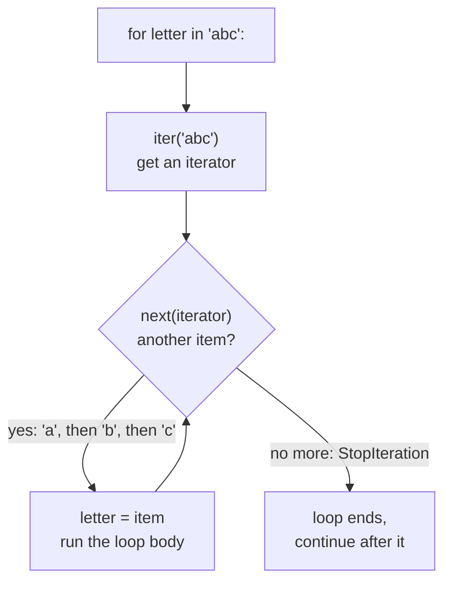
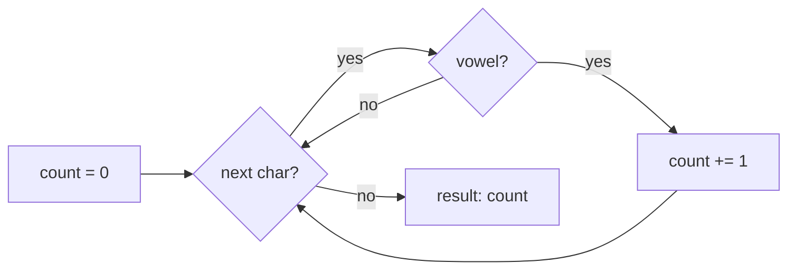
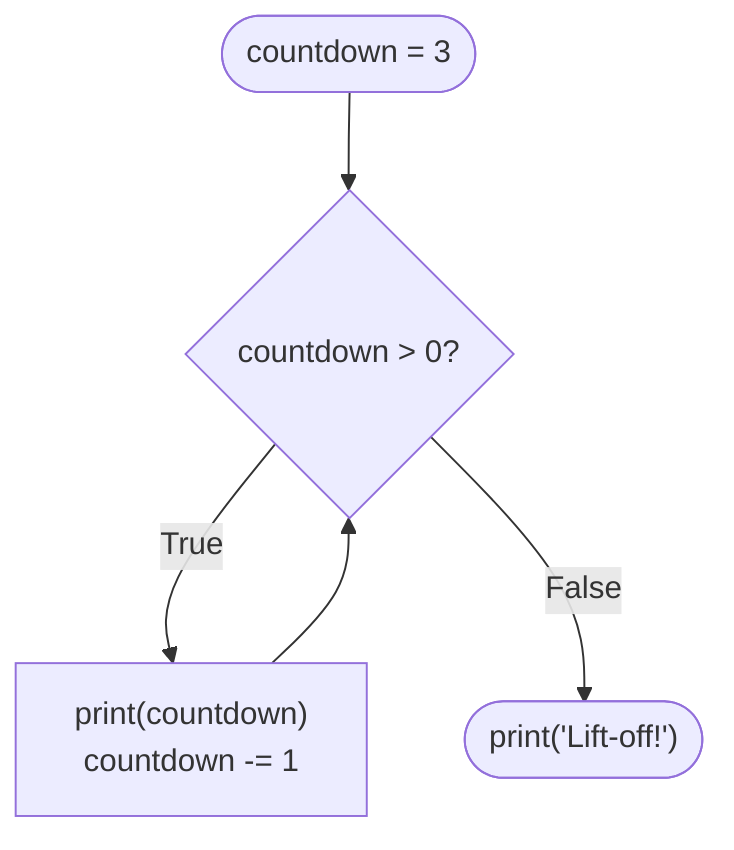

# Lesson 06 · Loops

> **Level:** 🟡 Beginner · **Time:** ~2.5 h · **Assignments:** [08 · FizzBuzz and friends](assignments/08-fizzbuzz/) · [09 · Guess the number](assignments/09-guess-the-number/)

Computers are good at doing the same thing many times without getting bored. Loops are how you tell
them to. Python has two: `for` walks through the items of something, `while` repeats as long as a
condition holds.

## What you will learn

- how a `for` loop really works: **iterables** and **iterators**
- `range()` for counting, and `enumerate()` when you need the position too
- the **accumulator** pattern: summing, counting, building results in a loop
- `while` loops, `break`, `continue`, and the "loop until valid input" pattern
- when to pick `for` and when `while`

---

## 1. The `for` loop

```python
for letter in "abc":
    print(letter)
# → a
# → b
# → c
```

Read it as: *for each item in this thing, run the indented block, with the name `letter` pointing at the
current item.* After the last item, the loop ends and the program continues below it.

### What `for` does behind the scenes

`for` works on anything that is **iterable**: strings, ranges, lists, dicts, files, … Python asks the
iterable for an **iterator**, an object that hands out one item at a time, and keeps asking until it
runs out:



You can do the same steps by hand:

```python
it = iter("ab")
next(it)    # → 'a'
next(it)    # → 'b'
next(it)    # StopIteration   (for catches this for you and just stops)
```

This is why one `for` syntax works for so many types: each type only has to know how to hand out its items.

## 2. Counting with `range()`

`range` produces a sequence of whole numbers. Like slicing, **start is included, stop is excluded**:

| Call | Numbers | Use for |
|---|---|---|
| `range(5)` | 0, 1, 2, 3, 4 | "do this 5 times" |
| `range(1, 6)` | 1, 2, 3, 4, 5 | counting from 1 |
| `range(0, 10, 2)` | 0, 2, 4, 6, 8 | every second number |
| `range(5, 0, -1)` | 5, 4, 3, 2, 1 | counting down |

```python
for i in range(3):
    print("Hip hip hooray!")
```

`range` does not build all the numbers in memory; it computes them one by one when the loop asks.
`range(1_000_000_000)` costs no more memory than `range(3)`.

### Position and value: `enumerate()`

When you need both the index and the item, do not write `range(len(...))`. Use `enumerate`:

```python
for position, letter in enumerate("abc", start=1):
    print(position, letter)
# → 1 a
# → 2 b
# → 3 c
```

## 3. The accumulator pattern

Most loops build up a result step by step. The pattern always has three parts:

```python
text = "hello world"

count = 0                  # 1. start value, BEFORE the loop
for char in text:
    if char in "aeiou":
        count += 1         # 2. update it INSIDE the loop
print(count)               # 3. use it AFTER the loop  → 3
```



The same shape works for sums (`total = 0`, `total += x`), products (`result = 1`, `result *= x`),
strings (`text = ""`, `text += piece`) and, from lesson 07, lists (`items = []`, `items.append(x)`).

The most common bug is putting the start value **inside** the loop, which resets it on every round.

## 4. The `while` loop

`while` repeats its block **as long as the condition is true**. It checks the condition before every round:

```python
countdown = 3
while countdown > 0:
    print(countdown)
    countdown -= 1         # without this line the loop would never end
print("Lift-off!")
# → 3, 2, 1, Lift-off!
```



Something inside the loop **must** eventually make the condition false. If not, you have an infinite
loop; stop it with **Ctrl+C**.

`while` is the right tool when you do not know in advance how many rounds you need, for example when
taking a number apart digit by digit:

```python
n = 4096
digits = 0
while n > 0:
    n //= 10           # drop the last digit
    digits += 1
print(digits)          # → 4
```

## 5. `break` and `continue`

| Statement | Effect |
|---|---|
| `break` | leave the loop **immediately**; continue after it |
| `continue` | skip the rest of **this round**; go on with the next one |

```python
for n in range(1, 10):
    if n % 2 == 0:
        continue           # skip even numbers
    if n > 7:
        break              # stop completely
    print(n)
# → 1, 3, 5, 7
```

### The "ask until valid" pattern

`while True` with a `break` is the standard way to repeat until something succeeds:

```python
while True:
    answer = input("Continue? (y/n) ").strip().lower()
    if answer in ("y", "n"):
        break                       # valid: leave the loop
    print("Please type y or n.")    # invalid: the loop asks again
print("You chose", answer)
```

> **Side note: `for ... else`.** A loop can have an `else` block. It runs only when the loop finished
> **without** a `break`. It is handy for searches ("…else: not found"), but many people find it
> surprising, so use it sparingly and add a comment.

## 6. Nested loops

A loop inside a loop runs the inner loop completely for **every** round of the outer one:

```python
for row in range(1, 4):
    line = ""
    for col in range(1, 4):
        line += f"{row * col:4}"
    print(line)
# →    1   2   3
# →    2   4   6
# →    3   6   9
```

3 outer rounds × 3 inner rounds = 9 multiplications. Nested loops multiply the work, so keep an eye on them
with big inputs.

## 7. `for` or `while`?

| Situation | Use |
|---|---|
| go through every item of a string, list, file, … | `for item in things:` |
| do something *n* times | `for _ in range(n):` (`_` = "I do not need the counter") |
| repeat until a condition changes (input valid, game won, number is 0) | `while condition:` |
| repeat until something succeeds, check in the middle | `while True:` + `break` |

Rule of thumb: prefer `for`. It cannot run forever by accident.

---

## Common mistakes

**Off-by-one with `range`.** `range(1, 10)` stops at **9**. To include 10, write `range(1, 11)`.

**Resetting the accumulator inside the loop.**

```python
for price in prices:
    total = 0          # ❌ reset on every round
    total += price
```

Move `total = 0` above the loop.

**Infinite `while` loops.** Forgetting to update the variable in the condition (`countdown -= 1`),
or updating the wrong one. Press Ctrl+C, then check what changes in each round.

**`range(len(text))` to get items.** `for char in text:` is simpler; use `enumerate` when you need the index too.

**`return` inside the loop too early.**

```python
def has_vowel(text):
    for char in text:
        if char in "aeiou":
            return True
        else:
            return False   # ❌ returns after looking at the FIRST character only
```

The `return False` belongs **after** the loop: only when every character was checked do you know there is none.

**Changing a list while looping over it** skips items. Lesson 07 shows why, and how to avoid it.

## Try it yourself

1. Print the numbers from 10 down to 0 in steps of 2 with one `range`.
2. Sum all numbers from 1 to 100 with an accumulator. (Answer: 5050.)
3. Use `enumerate` to print each character of `"Python"` with its index.
4. Write a `while` loop that halves 1000 (integer division) until it is below 1. How many rounds?
5. Print a 5×5 multiplication table with nested loops and aligned columns.

## Summary

- `for item in iterable:` asks the iterable for an **iterator** and takes items until `StopIteration`.
- `range(start, stop, step)` counts lazily; stop is excluded. `enumerate` gives index and item.
- **Accumulator:** start value before the loop, update inside, use after.
- `while condition:` repeats while the condition is true; make sure it eventually becomes false.
- `break` leaves the loop, `continue` skips to the next round; `while True` + `break` = "until it works".

## Assignments

➡️ **[08 · FizzBuzz and friends](assignments/08-fizzbuzz/)**: `for`, `range`, `%` and accumulators.<br>
➡️ **[09 · Guess the number](assignments/09-guess-the-number/)**: a game loop with `while`, `break` and input validation.

---

<p align="center">
  <a href="../05-conditions/">← Previous: 05 · Conditions</a> · <a href="../README.md">Beginner overview</a> · <a href="../07-lists-and-tuples/">Next: 07 · Lists and tuples →</a>
</p>
