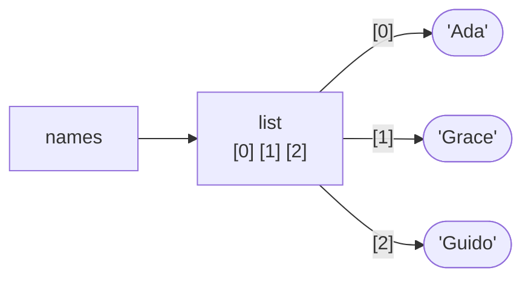
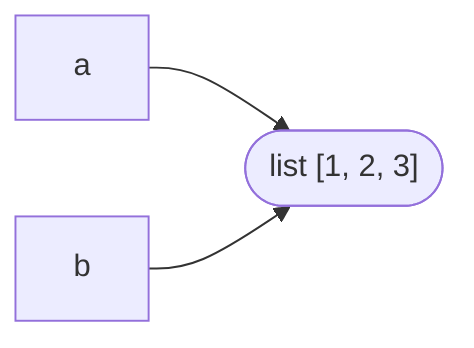
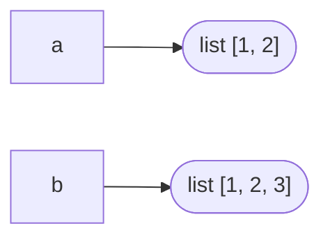

# Lesson 07 · Lists and tuples

> **Level:** 🟡 Beginner · **Time:** ~2.5 h · **Assignment:** [10 · List statistics](assignments/10-list-stats/)

Real programs work with **collections**: all the prices in a cart, all the lines in a file, all the
users in a group. Lists and tuples are Python's ordered collections. This lesson also returns to the
"names point to objects" picture from lesson 02, because with lists it finally matters.

## What you will learn

- creating, indexing, slicing and changing lists
- the list methods you need daily, and `sorted()` vs `.sort()`
- **mutability and aliasing**: why changing one list can change "another"
- how to copy a list, and how not to change a list while looping over it
- tuples, packing and unpacking, and when to choose a tuple over a list
- a first look at list comprehensions

---

## 1. Lists: ordered, changeable collections

```python
prices = [3.5, 1.2, 4.0]
names = ["Ada", "Grace", "Guido"]
mixed = [1, "two", 3.0, None, [5, 6]]   # any types, even other lists
empty = []
```

A list does not contain the objects themselves. It holds **references** (arrows) to them, in order:



Indexing and slicing work exactly like for strings (lesson 03):

```python
names[0]       # → 'Ada'
names[-1]      # → 'Guido'
names[1:]      # → ['Grace', 'Guido']   a slice is a NEW list
len(names)     # → 3
"Ada" in names # → True
```

## 2. Lists are mutable

Unlike strings, lists can be changed **in place**:

```python
names[0] = "Alan"           # replace an item
names.append("Barbara")     # add one item at the end
names.extend(["Ken", "Dennis"])  # add several items
names.insert(1, "Linus")    # insert at a position
names.remove("Ken")         # remove the first matching value (ValueError if missing)
last = names.pop()          # remove and return the last item
first = names.pop(0)        # remove and return the item at index 0
del names[0]                # delete by index
```

| Function / method | Does | Returns |
|---|---|---|
| `len(xs)`, `sum(xs)`, `min(xs)`, `max(xs)` | size, total, smallest, largest | a value |
| `xs.append(x)` | adds `x` at the end | `None` |
| `xs.extend(ys)` | adds every item of `ys` | `None` |
| `xs.insert(i, x)` | inserts `x` before index `i` | `None` |
| `xs.pop(i=-1)` | removes the item at `i` | the removed item |
| `xs.remove(x)` | removes the first `x` | `None` |
| `xs.index(x)` | finds the position of `x` | an int |
| `xs.count(x)` | counts how often `x` occurs | an int |
| `xs.sort()` | sorts **in place** | `None` |
| `sorted(xs)` | — | a **new** sorted list |
| `xs.reverse()` / `reversed(xs)` | reverse in place / iterate backwards | `None` / an iterator |

Notice how many methods return `None`. They change the list itself and hand nothing back.

### `sort()` vs `sorted()`

```python
scores = [70, 95, 82]

ranked = sorted(scores, reverse=True)   # → [95, 82, 70]   new list
scores                                  # → [70, 95, 82]   unchanged

scores.sort()                           # changes scores itself
scores                                  # → [70, 82, 95]
```

Both accept `key=`: a function that computes what to sort by. `sorted(names, key=len)` sorts by length,
`sorted(names, key=str.lower)` sorts without caring about upper and lower case.

## 3. Aliasing: two names, one list

Remember: `=` never copies (lesson 02). With an immutable `int` you could not see it. With a list you can:

```python
a = [1, 2]
b = a           # b is another name for the SAME list
b.append(3)
print(a)        # → [1, 2, 3]   😲 a "changed" too
```



There is only one list; `a` and `b` are two labels on it. This is called **aliasing**. It also happens
when you pass a list to a function: the function receives a reference to *your* list and can change it.

### Making a real copy

```python
a = [1, 2]
b = a.copy()        # or list(a), or a[:]
b.append(3)
print(a, b)         # → [1, 2] [1, 2, 3]
```



These are **shallow** copies: a new outer list, but the items inside are still shared. For lists of
numbers or strings that does not matter, because those are immutable. For lists of lists, see
`copy.deepcopy` (Intermediate level).

### Do not change a list while looping over it

```python
numbers = [1, 2, 2, 3]
for n in numbers:
    if n == 2:
        numbers.remove(n)   # ❌ shifts the items; the loop skips the second 2
print(numbers)              # → [1, 2, 3]
```

Build a new list instead:

```python
numbers = [1, 2, 2, 3]
kept = []
for n in numbers:
    if n != 2:
        kept.append(n)
print(kept)                 # → [1, 3]
```

## 4. List comprehensions

Building a list with a loop and `append` is so common that Python has a short form for it:

```python
# loop version
squares = []
for n in range(5):
    squares.append(n * n)

# comprehension version: same result
squares = [n * n for n in range(5)]                 # → [0, 1, 4, 9, 16]
evens = [n for n in range(10) if n % 2 == 0]        # → [0, 2, 4, 6, 8]
clean = [name.strip().title() for name in [" ada ", "GRACE"]]  # → ['Ada', 'Grace']
```

Read it as: *[what to collect **for** each item **in** source **if** condition]*. Use comprehensions for
simple transform-and-filter steps; for anything with several steps, a normal loop is clearer.
The Intermediate level goes deeper.

## 5. Tuples: fixed sequences

A tuple is like a list that cannot change after it is created:

```python
point = (3, 4)
rgb = (255, 128, 0)
single = (42,)          # one item needs a trailing comma; (42) is just the number 42
empty = ()

point[0]                # → 3
point[0] = 10           # TypeError: 'tuple' object does not support item assignment
```

Actually it is the **comma** that makes a tuple, not the brackets: `point = 3, 4` also works.

### Packing and unpacking

```python
point = 3, 4            # packing: two values into one tuple
x, y = point            # unpacking: one tuple into two names

first, *rest = [1, 2, 3, 4]    # first = 1, rest = [2, 3, 4]

def min_and_max(values):
    return min(values), max(values)   # return two values = return one tuple

low, high = min_and_max([4, 1, 9])    # → low = 1, high = 9

for name, score in [("Ada", 95), ("Grace", 88)]:   # unpacking in a loop
    print(f"{name}: {score}")
```

Swapping `a, b = b, a` from lesson 02 was packing and unpacking all along.

### List or tuple?

| | List | Tuple |
|---|---|---|
| Can change? | ✅ mutable | ❌ immutable |
| Typical content | many items of the **same kind**: all prices, all names | a **fixed group** of different parts: `(name, age)`, `(x, y)` |
| Length | grows and shrinks | fixed |
| Usable as dict key / in a set (lesson 08)? | ❌ | ✅ (if its items are immutable) |

---

## Common mistakes

**Assigning the result of a method that returns `None`.**

```python
names = names.sort()    # ❌ names is now None
names = sorted(names)   # ✅ or just: names.sort()
```

**Thinking `b = a` copied the list.** Use `a.copy()` when you need an independent list.

**Removing items while looping over the same list.** Build a new list, or loop over a copy: `for x in items[:]:`.

**`IndexError: list index out of range`.** The last index is `len(xs) - 1`. Use `xs[-1]` for the last item,
and check `if xs:` before taking items from a list that might be empty.

**`append` vs `extend`.** `xs.append([4, 5])` adds **one** item (a list); `xs.extend([4, 5])` adds two.

**`(42)` is not a tuple.** Write `(42,)`.

**Changing a list that was passed into a function by accident.** If a function should not change its input,
work on `sorted(xs)` or `xs.copy()`, never on `xs` directly.

## Try it yourself

1. Create `a = [3, 1, 2]`, then `b = a` and `c = a.copy()`. Call `a.sort()`. Print all three. Explain the result.
2. Use `sorted` with `key=len` to sort `["kiwi", "fig", "banana"]` by length.
3. Unpack `first, *middle, last = range(6)`. What is in each name?
4. Write a comprehension that collects the lengths of the words in `"the quick brown fox".split()`.
5. Try `t = (1, [2, 3])`, then `t[1].append(4)`. Why does that work although tuples are immutable?

## Summary

- A list is an **ordered, mutable** sequence of **references**. Index and slice like strings.
- Many list methods change the list **in place** and return `None`; `sorted()` returns a new list.
- `b = a` creates an **alias**, not a copy. Copy with `.copy()`, `list(a)` or `a[:]`.
- Never remove items from a list you are looping over; build a new list.
- A tuple is an **immutable** sequence for fixed groups of values; unpack it with `x, y = point`.

## Assignment

➡️ **[10 · List statistics](assignments/10-list-stats/)**: compute statistics without changing the caller's list.

---

<p align="center">
  <a href="../06-loops/">← Previous: 06 · Loops</a> · <a href="../README.md">Beginner overview</a> · <a href="../08-dicts-and-sets/">Next: 08 · Dictionaries and sets →</a>
</p>
