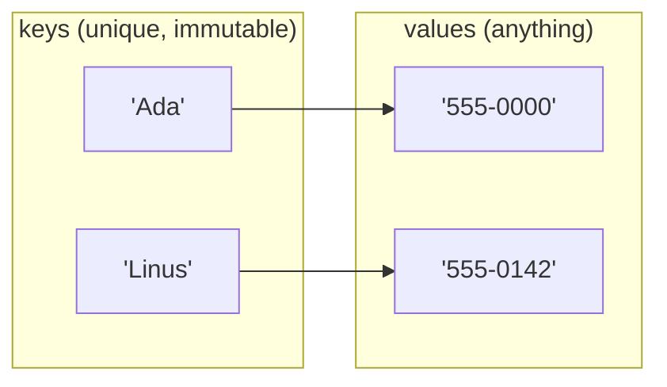
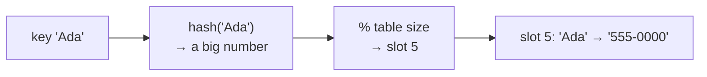
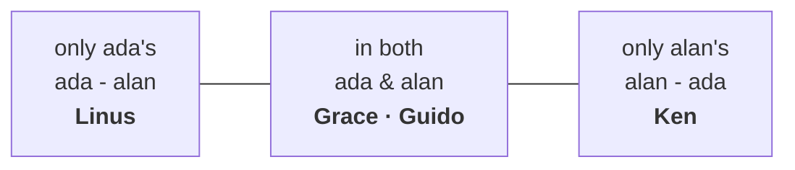
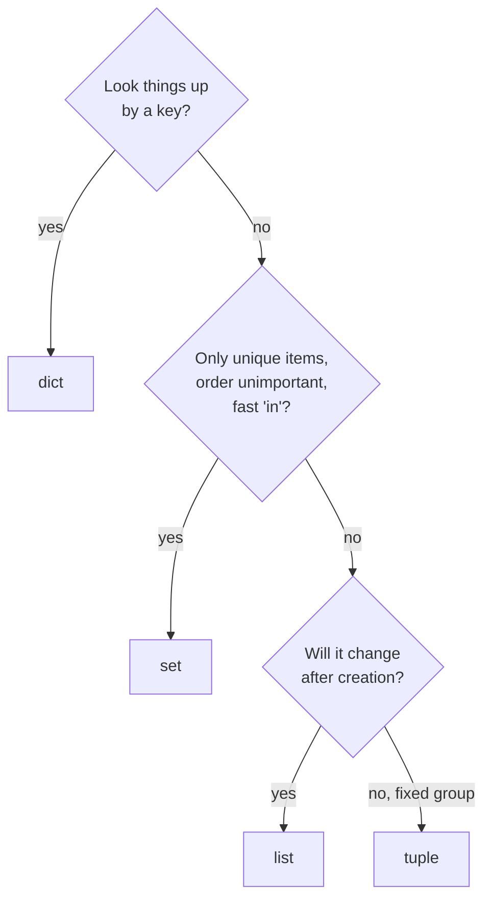

# Lesson 08 · Dictionaries and sets

> **Level:** 🟡 Beginner · **Time:** ~2.5 h · **Assignments:** [11 · Word counter](assignments/11-word-counter/) · [12 · Common friends](assignments/12-common-friends/)

A list answers "what is at position 3?". Often you want to ask something else: "what is Ada's phone
number?", "have I seen this word before?". Dictionaries and sets answer those questions **instantly**,
no matter how much data they hold. This lesson shows how they do it.

## What you will learn

- dictionaries: key → value lookups, adding, changing, removing, looping
- `.get()`, `in`, and the **counting** and **grouping** patterns
- how **hashing** makes lookups fast, and why keys must be immutable
- sets: unique items, fast membership tests, union / intersection / difference
- choosing between list, tuple, dict and set

---

## 1. Dictionaries: look up by key

```python
phone = {"Ada": "555-0101", "Grace": "555-0199"}

phone["Ada"]            # → '555-0101'
phone["Linus"] = "555-0142"     # add a new key
phone["Ada"] = "555-0000"       # change an existing one
del phone["Grace"]              # remove a key
len(phone)                      # → 2
"Ada" in phone                  # → True   `in` checks the KEYS
```

A dict maps **keys** to **values**. Keys are unique; assigning to an existing key replaces its value.
Since Python 3.7, dicts remember the order in which keys were inserted.



### Missing keys

```python
phone["Bob"]                     # KeyError: 'Bob'
phone.get("Bob")                 # → None          no error
phone.get("Bob", "unknown")      # → 'unknown'     your own default
```

Use `d[key]` when the key **must** be there (a missing key is a bug you want to see).
Use `d.get(key, default)` when missing is normal.

### Looping over a dict

```python
prices = {"coffee": 3.5, "cake": 4.2, "tea": 2.8}

for item in prices:                    # loops over the KEYS
    print(item)

for item, price in prices.items():     # keys and values together (tuples, unpacked)
    print(f"{item:<8}{price:>6.2f}")

list(prices.keys())      # → ['coffee', 'cake', 'tea']
list(prices.values())    # → [3.5, 4.2, 2.8]
sum(prices.values())     # → 10.5
```

Sort a dict's items by value with `key=`:

```python
sorted(prices.items(), key=lambda pair: pair[1])
# → [('tea', 2.8), ('coffee', 3.5), ('cake', 4.2)]
```

(`lambda pair: pair[1]` is a tiny unnamed function: "given a pair, return its second part". Lesson 09 covers functions.)

## 2. Two patterns you will use constantly

### Counting

```python
votes = ["red", "blue", "red", "green", "red", "blue"]

counts = {}
for colour in votes:
    counts[colour] = counts.get(colour, 0) + 1
print(counts)        # → {'red': 3, 'blue': 2, 'green': 1}
```

`counts.get(colour, 0)` returns the count so far, or 0 the first time a colour appears.
(The standard library also has `collections.Counter`, which does exactly this; Intermediate level.)

### Grouping

```python
words = ["apple", "avocado", "banana", "blueberry", "cherry"]

by_letter = {}
for word in words:
    first = word[0]
    if first not in by_letter:
        by_letter[first] = []        # first time: start an empty list
    by_letter[first].append(word)
print(by_letter)
# → {'a': ['apple', 'avocado'], 'b': ['banana', 'blueberry'], 'c': ['cherry']}
```

## 3. Why lookups are fast: hashing

How does `phone["Ada"]` find the value without checking every key? Python computes a **hash** of the
key: a number derived from its content. The hash says directly in which slot of an internal table the
entry lives:



So a lookup takes the **same time** for 10 keys or 10 million: one hash, one jump. A list has to
compare item after item (`x in my_list` gets slower as the list grows).

| Operation | list | dict / set |
|---|---|---|
| `x in collection` | checks items one by one: slow for big lists | one hash: fast, always |
| find value for a key | — | one hash: fast |

### Keys must be immutable (hashable)

If a key could change after it was stored, its hash would change, and Python would look in the wrong
slot. So only **immutable** objects can be keys:

```python
ok = {"name": 1, 42: 2, (3, 4): 3, None: 4}   # str, int, tuple, None: fine
bad = {[1, 2]: "x"}                            # TypeError: unhashable type: 'list'
```

Values have no such rule; they can be anything, including lists and other dicts.

## 4. Sets: unique items, fast membership

A set is like a dict with only keys: an **unordered** collection of **unique**, hashable items.

```python
tags = {"python", "learning", "python"}   # duplicates disappear
print(tags)            # → {'learning', 'python'}   (order may differ)
"python" in tags       # → True, fast
tags.add("exercises")
tags.discard("missing")    # no error if absent (.remove would raise KeyError)
empty = set()              # NOT {}: that is an empty dict
unique = set([3, 1, 3, 2]) # → {1, 2, 3}
```

### Set operations

```python
ada = {"Grace", "Linus", "Guido"}
alan = {"Grace", "Guido", "Ken"}
```



All three boxes together are the **union** `ada | alan`; the two outer boxes are the **symmetric difference** `ada ^ alan`.

| Operation | Operator | Method | Result |
|---|---|---|---|
| in both (**intersection**) | `ada & alan` | `ada.intersection(alan)` | `{'Grace', 'Guido'}` |
| in either (**union**) | `ada \| alan` | `ada.union(alan)` | `{'Grace', 'Guido', 'Linus', 'Ken'}` |
| only in the first (**difference**) | `ada - alan` | `ada.difference(alan)` | `{'Linus'}` |
| in exactly one (**symmetric difference**) | `ada ^ alan` | `ada.symmetric_difference(alan)` | `{'Linus', 'Ken'}` |
| is every item also in the other? | `ada <= alan` | `ada.issubset(alan)` | `False` |

Sets have no order and no indexes: `tags[0]` is a `TypeError`. When you need them in order, use `sorted(tags)`.

## 5. Which collection when?



---

## Common mistakes

**`KeyError` on a missing key.** Use `in` to check, or `.get(key, default)`.

**`{}` is an empty dict, not an empty set.** Use `set()`.

**Looking for a value with `in`.** `"555-0101" in phone` checks the keys. Use `in phone.values()`.

**Changing a dict's size while looping over it.**

```python
for name in phone:
    if name.startswith("A"):
        del phone[name]     # RuntimeError: dictionary changed size during iteration
```

Loop over a copy of the keys instead: `for name in list(phone):`.

**Using a list as a key.** Lists are mutable and unhashable. Use a tuple: `{(3, 4): "point"}`.

**Expecting a set to keep order or allow indexing.** It does neither. `sorted(the_set)` gives an ordered list.

## Try it yourself

1. Build a dict from two lists with `dict(zip(["a", "b", "c"], [1, 2, 3]))`.
2. Count the letters in `"mississippi"` with the counting pattern. Which letter is most common?
3. Find the letters that appear in both `"python"` and `"typhoon"` with a set operation.
4. Measure the difference: `import timeit`, then compare
   `timeit.timeit("99999 in data", "data = list(range(100000))", number=1000)` with `set(range(100000))`.
5. What does `hash("abc")` return? Run it twice in the same REPL, then in a new REPL.

## Summary

- A **dict** maps unique, immutable **keys** to any **values**; `d[k]` for must-exist, `d.get(k, default)` for may-be-missing.
- Loop with `for k, v in d.items():`. Count with `d[k] = d.get(k, 0) + 1`; group with lists as values.
- **Hashing** makes dict and set lookups fast regardless of size; that is why keys must be immutable.
- A **set** holds unique items with fast `in`; combine sets with `&`, `|`, `-`, `^`.
- Choose: lookup by key → dict; unique and fast `in` → set; changing sequence → list; fixed group → tuple.

## Assignments

➡️ **[11 · Word counter](assignments/11-word-counter/)**: the counting pattern on real text.<br>
➡️ **[12 · Common friends](assignments/12-common-friends/)**: set operations on a small social network.

---

<p align="center">
  <a href="../07-lists-and-tuples/">← Previous: 07 · Lists and tuples</a> · <a href="../README.md">Beginner overview</a> · <a href="../09-functions/">Next: 09 · Functions →</a>
</p>
