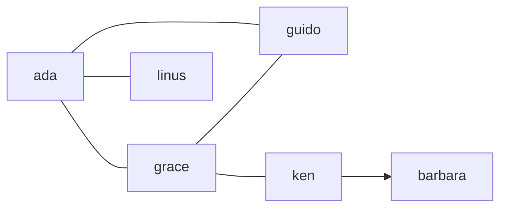

# Assignment 12 · Common friends

> **Lesson:** [08 · Dictionaries and sets](../../) · **Difficulty:** ⭐⭐⭐☆☆ · **Time:** ~45 min

## Goal

Model a tiny social network as a **dict of sets** and answer the questions a real network asks:
who are our mutual friends, whom might I know, who is in the network at all?

## The data

Each key is a person; its value is the **set** of people they list as friends:

```python
network = {
    "ada":   {"grace", "linus", "guido"},
    "grace": {"ada", "guido", "ken"},
    "linus": {"ada"},
    "guido": {"ada", "grace"},
    "ken":   {"grace", "barbara"},
}
```



Note: `barbara` appears only as somebody's friend; she has no entry of her own.
The arrow `ken → barbara` is one-sided: ken lists barbara, but barbara lists nobody.

## What to write

| Function | Returns |
|---|---|
| `mutual_friends(network, a, b)` | the set of people both `a` and `b` list as friends |
| `suggestions(network, person)` | the set of friends of `person`'s friends who are not `person` and not already their friend |
| `everyone(network)` | the set of all names in the network: keys **and** everyone listed as a friend |
| `is_mutual(network)` | `True` if every friendship goes both ways, else `False` |

A person without an entry has no friends (an empty set). None of the functions may change `network`.

## Examples

```python
>>> mutual_friends(network, "ada", "grace")
{'guido'}
>>> suggestions(network, "linus")
{'grace', 'guido'}
>>> suggestions(network, "barbara")
set()
>>> sorted(everyone(network))
['ada', 'barbara', 'grace', 'guido', 'ken', 'linus']
>>> is_mutual(network)
False
```

## Hints

<details>
<summary>Hint 1: people without an entry</summary>

`network.get(name, set())` gives an empty set for unknown names instead of a `KeyError`.
</details>

<details>
<summary>Hint 2: suggestions</summary>

Start an empty set. For each friend, add all of *their* friends with `.update(...)` or `|=`.
At the end, take away the person's own friends and the person themself: set difference with `-`.
</details>

<details>
<summary>Hint 3: everyone</summary>

Start with `set(network)` (the keys), then add every friend set with `|=`.
</details>

<details>
<summary>Hint 4: is_mutual</summary>

Loop over `network.items()`. For each friend in the set, check that `person` is in the friend's set
(remember Hint 1). Return `False` as soon as one check fails, `True` after the loop.
</details>

## Check your work

```bash
pytest beginner/08-dicts-and-sets/assignments/12-common-friends -v
```

## Done?

Compare with the [template solution](../../../../solutions/beginner/08-dicts-and-sets/assignments/12-common-friends/exercise.py),
then tick off assignment 12 in the [progress checklist](../../../../README.md#progress-checklist).
