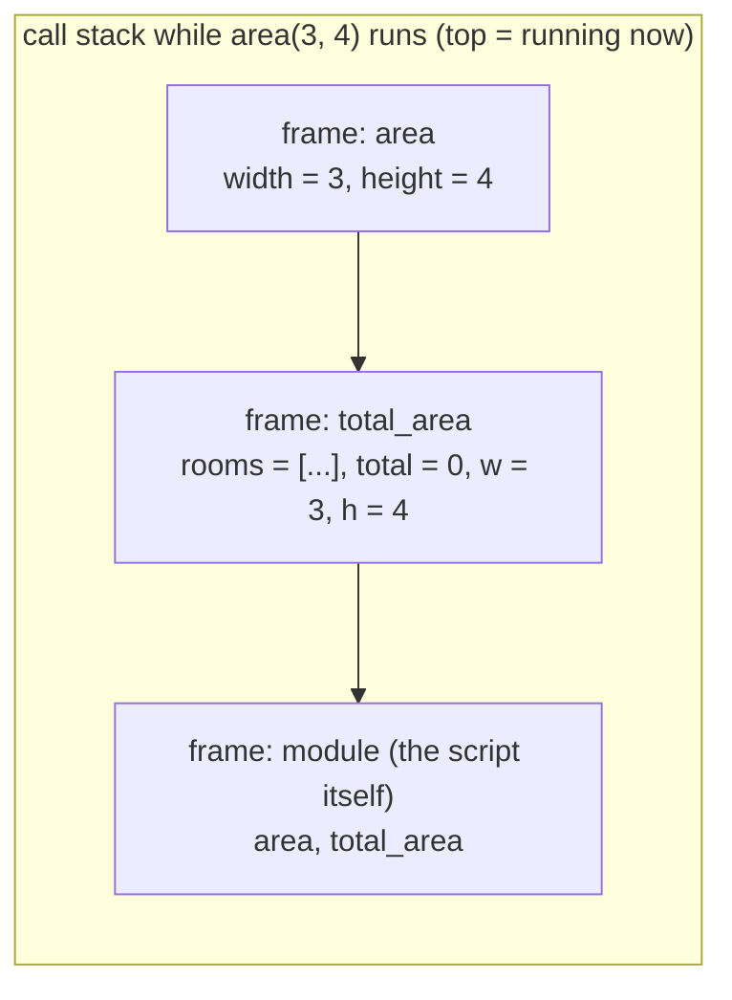
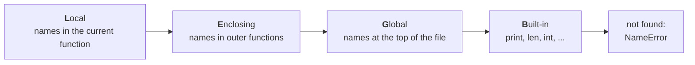
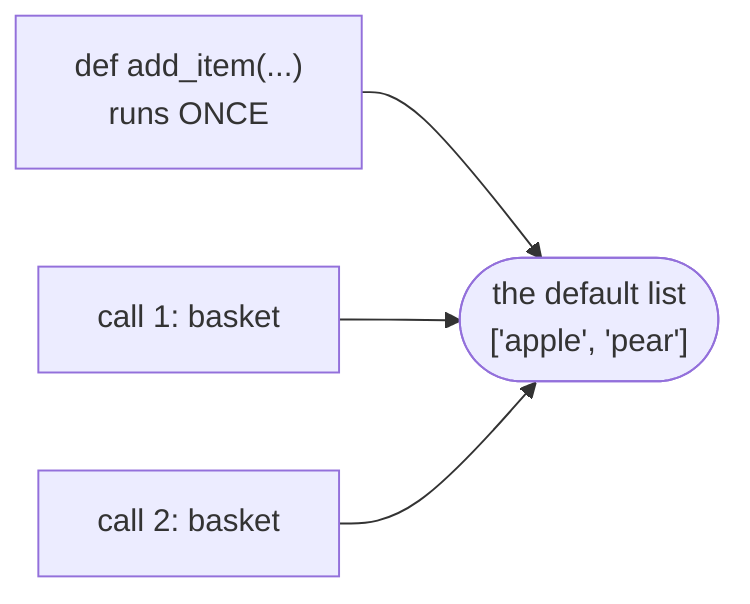

# Lesson 09 · Functions

> **Level:** 🟡 Beginner · **Time:** ~2.5 h · **Assignment:** [13 · Password checker](assignments/13-password-checker/)

You have been writing functions since lesson 01. This lesson explains what happens when you call one:
where its variables live, how arguments get in and results get out, and the one trap with default
values that catches nearly every Python programmer once.

## What you will learn

- why functions matter: naming, reuse, testing
- what happens on a call: **frames** and the **call stack**
- parameters and arguments: positional, keyword, defaults, `*args`, `**kwargs`
- `return`, multiple return values, and the implicit `None`
- **scope**: local vs global names, and the LEGB rule
- the **mutable default argument** trap
- functions as objects: passing them around, `key=` and `lambda`

---

## 1. Why functions?

A function gives a **name** to a piece of logic. That brings three things:

- **Reuse:** write it once, call it everywhere. Fix a bug in one place.
- **Readability:** `if is_leap_year(year):` explains itself; the formula it hides does not.
- **Testability:** a function with inputs and a return value can be checked automatically. That is
  exactly what the tests in this repo do.

A good function does **one thing**, has a name that is a verb or a question (`calculate_total`,
`is_valid`), and fits on one screen.

## 2. Anatomy of a function

```python
def area(width, height=1):
    """Return the area of a rectangle."""
    return width * height
```

| Part | Meaning |
|---|---|
| `def` | "define a function" |
| `area` | the function's name |
| `width, height=1` | **parameters**: the names the inputs get inside the function; `height` has a **default** |
| `"""..."""` | the **docstring**: what the function does (`help(area)` shows it) |
| `return ...` | hands a value back to the caller and ends the function |

`def` itself does not run the body. It creates a **function object** and binds the name `area` to it.
The body runs only when you **call** the function: `area(3, 4)`.

## 3. What happens on a call

Every call gets its own private workspace, a **frame**, holding its local names. Frames are stacked:
the function that is running right now is on top.

```python
def area(width, height):
    return width * height

def total_area(rooms):
    total = 0
    for w, h in rooms:
        total += area(w, h)
    return total

print(total_area([(3, 4), (2, 5)]))   # → 22
```



1. Python creates a new frame and binds the parameters to the arguments (`width = 3`, `height = 4`).
2. The body runs inside that frame.
3. `return` hands the value to the caller, and the frame is thrown away, along with its local names.

That is why a traceback lists several lines: it is the call stack at the moment of the error, from the
outermost call down to where it happened.

## 4. Parameters and arguments

**Parameters** are the names in the `def` line. **Arguments** are the values you pass in a call.

```python
def greet(name, greeting="Hello", punctuation="!"):
    return f"{greeting}, {name}{punctuation}"

greet("Ada")                           # → 'Hello, Ada!'       defaults used
greet("Ada", "Hi")                     # → 'Hi, Ada!'          positional: matched by order
greet("Ada", punctuation=".")          # → 'Hello, Ada.'       keyword: matched by name
greet(punctuation="?", name="Grace")   # → 'Hello, Grace?'     any order with keywords
```

Rules: positional arguments come before keyword arguments, and parameters with defaults come after
those without. Keyword arguments make calls readable: `resize(img, width=800)` beats `resize(img, 800)`.

### Any number of arguments

```python
def total(*numbers):              # *: collect extra positional arguments into a TUPLE
    return sum(numbers)

total(1, 2, 3)                    # → 6

def tag(name, **attributes):      # **: collect extra keyword arguments into a DICT
    parts = [f'{key}="{value}"' for key, value in attributes.items()]
    return f"<{name} {' '.join(parts)}>"

tag("img", src="cat.png", alt="A cat")   # → ''
```

The same stars **unpack** in a call: `total(*[1, 2, 3])`, `greet(**{"name": "Ada"})`.

## 5. Return values

```python
def divide(a, b):
    return a // b, a % b        # one tuple with two values

quotient, remainder = divide(17, 5)   # → 3, 2

def log(message):
    print(message)              # no return statement ...

result = log("hi")
print(result)                   # → None   ... means the function returns None
```

`return` ends the function immediately; code after it in the same block never runs. A function can
have several `return` statements (guard clauses, lesson 05).

## 6. Scope: where names live

A name assigned inside a function is **local**: it exists only in that call's frame.

```python
def make_total():
    total = 100       # local to make_total
    return total

make_total()
print(total)          # NameError: name 'total' is not defined
```

When Python looks up a name, it searches four places in order, the **LEGB rule**:



The first match wins. That is why a local variable called `len` hides the built-in `len` inside that function.

Reading a global from inside a function works. **Assigning** to it creates a new local instead:

```python
counter = 0

def increment():
    counter += 1      # UnboundLocalError: cannot access local variable 'counter'
```

The fix is not `global counter` (that works, but makes code hard to follow and test). The fix is
to pass values in and return results out:

```python
def increment(counter):
    return counter + 1

counter = increment(counter)
```

## 7. The mutable default trap

Default values are created **once**, when `def` runs, not on every call. With an immutable default
(`0`, `""`, `None`) you never notice. With a list you will:

```python
def add_item(item, basket=[]):     # ❌ one list, shared by every call
    basket.append(item)
    return basket

add_item("apple")     # → ['apple']
add_item("pear")      # → ['apple', 'pear']   😲 the apple is still there
```



The standard fix: use `None` as the default and create the list inside:

```python
def add_item(item, basket=None):   # ✅
    if basket is None:
        basket = []                # a NEW list on every call
    basket.append(item)
    return basket
```

## 8. Pure functions and side effects

A **pure** function only computes: same inputs, same output, and nothing else changes. `area(3, 4)` is pure.
A function with **side effects** changes something outside itself: it prints, writes a file, changes a
list it was given, or changes a global.

Programs need side effects, but keep them at the edges (lesson 04). Pure functions are easy to test,
easy to reuse and safe to call twice. When a function does change its input, say so in its name
and docstring (`list.sort()` vs `sorted()`).

## 9. Functions are objects

A function is an object like any other. You can store it in a variable, put it in a list, and pass it
to another function:

```python
def shout(text):
    return text.upper() + "!"

say = shout             # no brackets: the function itself, not a call
say("hi")               # → 'HI!'

def apply_twice(func, value):
    return func(func(value))

apply_twice(shout, "hi")    # → 'HI!!'
```

You have already used this: `sorted(words, key=len)` passes the function `len` to `sorted`.
For a tiny one-off function, `lambda` creates one without a name:

```python
sorted(["kiwi", "Fig", "apple"], key=lambda word: word.lower())   # → ['apple', 'Fig', 'kiwi']
```

A `lambda` can only contain one expression. As soon as you need more, write a normal `def`.

## 10. Docstrings and type hints

```python
def bmi(weight_kg: float, height_m: float) -> float:
    """Return the body-mass index for a weight in kg and a height in metres."""
    return weight_kg / height_m ** 2
```

The `: float` and `-> float` are **type hints**: documentation for readers and tools. Python does not
enforce them at runtime. The Intermediate level uses them throughout.

---

## Common mistakes

**Forgetting `return`.** The function computes the right value, then returns `None`.

**Calling vs referencing.** `key=len` passes the function; `key=len()` calls it immediately (and fails).
Likewise `if is_valid:` is always true (a function object is truthy). You meant `if is_valid(x):`.

**Mutable defaults** (`def f(items=[])`). Use `None` and create the list inside.

**Changing a global from inside a function.** Pass it in, return the new value.

**Too many responsibilities.** A function that reads input, computes and prints cannot be tested.
Split it: one function computes and returns, `main()` does the I/O.

**Wrong argument order.** With more than two or three parameters, call with keywords.

## Try it yourself

1. Write `describe(name, *hobbies)` that returns `"Ada likes chess, maths"`. Call it with zero, one and three hobbies.
2. Reproduce the mutable default trap in the REPL. Then fix it with `None`.
3. Inside a function, print `locals()`. Outside, try `print(globals().keys())`.
4. Call a function that calls a function that raises an error. Read the traceback from bottom to top.
5. Sort `[("Ada", 36), ("Grace", 85), ("Alan", 41)]` by age using `key=lambda person: person[1]`.

## Summary

- A function names a piece of logic; `def` creates it, a call runs it in a new **frame** on the **call stack**.
- Arguments match parameters by **position** or by **keyword**; `*args` and `**kwargs` collect extras.
- `return` hands back a value (a tuple for several); without it, the function returns `None`.
- Names assigned inside a function are **local**; lookup follows **LEGB**. Pass values in, return results out.
- Defaults are created **once**: never use a mutable default; use `None`.
- Functions are objects: pass them to `sorted(key=...)`, store them, use `lambda` for tiny ones.

## Assignment

➡️ **[13 · Password checker](assignments/13-password-checker/)**: small focused functions, defaults and keyword arguments.

---

<p align="center">
  <a href="../08-dicts-and-sets/">← Previous: 08 · Dictionaries and sets</a> · <a href="../README.md">Beginner overview</a> · <a href="../10-errors-and-exceptions/">Next: 10 · Errors and exceptions →</a>
</p>
