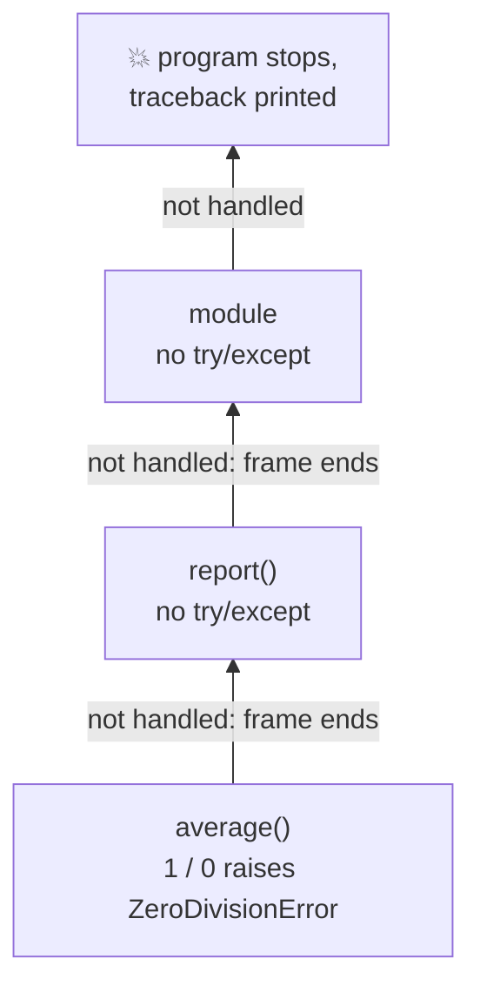
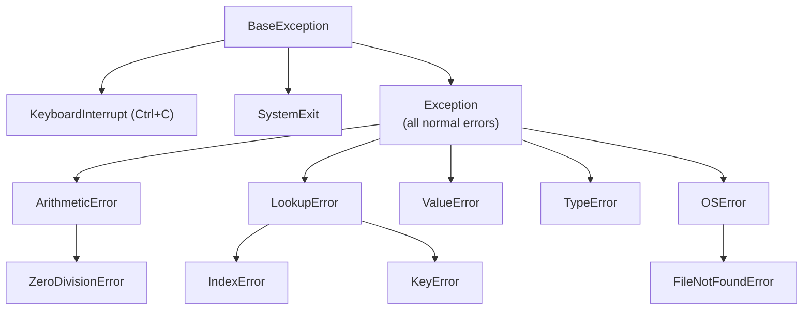
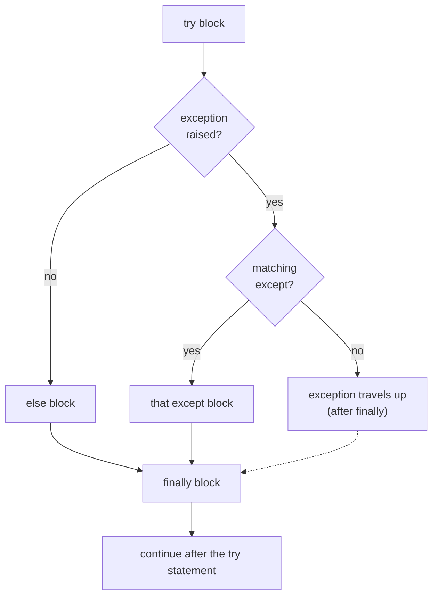

# Lesson 10 · Errors and exceptions

> **Level:** 🟡 Beginner · **Time:** ~2 h · **Assignment:** [14 · Safe calculator](assignments/14-safe-calculator/)

Every programmer sees error messages all day. The difference between a beginner and a professional is
not that the professional sees fewer errors, but that they **read** them, and that they write code that
fails **clearly** and **on purpose**. This lesson teaches both.

## What you will learn

- how to read a traceback, from the bottom up
- what an exception is, and how it travels up the call stack
- `try` / `except` / `else` / `finally`: what runs when
- catching **specific** exceptions, and why a bare `except:` is dangerous
- raising your own exceptions with `raise`, and when to do it
- "ask forgiveness, not permission" (EAFP) vs "look before you leap" (LBYL)

---

## 1. Reading a traceback

```python
# prices.py
def average(prices):
    return sum(prices) / len(prices)

def report(cart):
    print("Average:", average(cart))

report([])
```

```text
Traceback (most recent call last):
  File "prices.py", line 7, in <module>
    report([])
  File "prices.py", line 5, in report
    print("Average:", average(cart))
  File "prices.py", line 2, in average
    return sum(prices) / len(prices)
           ~~~~~~~~~~~~^~~~~~~~~~~~~
ZeroDivisionError: division by zero
```

**Read it from the bottom:**

1. **The last line** says *what* went wrong: the exception type (`ZeroDivisionError`) and a message.
2. **The line above it** says *where*: file, line number, function, and the code itself. The `^` marks
   point at the exact operation (Python 3.11+).
3. **Further up** is *how you got there*: the call stack from lesson 09, outermost call first.

The bug is not always in the last frame. Here, `average` is fine; the real question is why `report` was
called with an empty cart.

### The exceptions you will meet most

| Exception | Typical cause | Example |
|---|---|---|
| `SyntaxError` | code that is not valid Python | `if x = 1:` |
| `NameError` | a name that does not exist (typo?) | `pritn("hi")` |
| `TypeError` | an operation on the wrong type | `"3" + 4` |
| `ValueError` | right type, wrong value | `int("abc")` |
| `IndexError` | list/string index too big | `[1, 2][5]` |
| `KeyError` | missing dict key | `{}["x"]` |
| `AttributeError` | object has no such attribute/method | `"hi".push("!")` |
| `ZeroDivisionError` | division by zero | `1 / 0` |
| `FileNotFoundError` | opening a file that does not exist | `open("nope.txt")` |

## 2. What an exception is

An exception is an **object** that describes a problem. When something goes wrong, Python **raises** it:
the current function stops immediately, and the exception travels **up the call stack**, frame by frame,
looking for code that handles it. If nobody does, the program ends and prints the traceback.



Exceptions are organised in a family tree. Catching a parent also catches its children:



## 3. Handling exceptions: `try` / `except`

```python
text = input("A number: ")
try:
    number = int(text)
except ValueError:
    print(f"'{text}' is not a whole number.")
```

Python runs the `try` block. If a `ValueError` is raised inside it, Python jumps to the matching
`except` block instead of crashing. If no exception happens, the `except` block is skipped.

### The full form

```python
try:
    file = open("prices.txt")             # code that might fail
except FileNotFoundError:
    print("No price list found.")         # runs if THIS error happened
except PermissionError as error:
    print("Not allowed:", error)          # `as error` gives you the exception object
else:
    print("Loaded", len(file.read()), "characters")   # runs only if NO exception happened
    file.close()
finally:
    print("Done.")                        # runs ALWAYS: success, error, even return
```



- **`except`** blocks are checked top to bottom; the first match wins. Put specific ones first.
- **`else`** is for code that should run only when the `try` worked. Keeping it out of the `try` block
  means you do not accidentally catch errors from it.
- **`finally`** is for clean-up that must happen no matter what (closing things, releasing locks).
  Lesson 11 shows `with`, which does this for files automatically.

Catch several types at once with a tuple: `except (ValueError, TypeError):`.

### Keep the `try` block small

```python
# ❌ which line failed? The except hides bugs in all five.
try:
    data = load()
    cleaned = clean(data)
    total = int(cleaned["total"])
    save(total)
    notify()
except ValueError:
    ...

# ✅ only the line you expect to fail
try:
    total = int(cleaned["total"])
except ValueError:
    total = 0
```

## 4. Never catch everything silently

```python
try:
    result = compute()
except:            # ❌ bare except: catches EVERYTHING, even Ctrl+C and typos (NameError)
    pass           # ❌ and then hides it
```

This turns a loud, easy-to-find bug into a silent wrong result that you find weeks later. Rules:

- Catch the **specific** exception you expect and know how to handle.
- If you must catch broadly (for example, at the very top of a program to log errors), use
  `except Exception as error:` and **do something** with `error`: log it, show it, re-raise it.
- Never `except: pass`.

## 5. Raising exceptions yourself

When your function receives input it cannot work with, the clearest response is to **raise** an exception:

```python
def set_age(age):
    if age < 0:
        raise ValueError(f"age must not be negative, got {age}")
    return age
```

```text
ValueError: age must not be negative, got -3
```

Why not return `None` or `-1`? Because the caller can forget to check a special return value, and the
program continues with nonsense. An exception cannot be ignored by accident. A good error message says
**what** was wrong and **which value** caused it.

Pick the exception type that fits: `ValueError` for a bad value, `TypeError` for a wrong type,
`KeyError`/`LookupError` for something missing.

To pass an exception on after doing something with it, use a bare `raise` inside `except`:

```python
except ValueError:
    print("logging the problem ...")
    raise                  # re-raise the same exception, traceback intact
```

## 6. EAFP vs LBYL

Two styles for dealing with things that might go wrong:

```python
# LBYL: Look Before You Leap — check first
if key in settings:
    value = settings[key]
else:
    value = "default"

# EAFP: Easier to Ask Forgiveness than Permission — try, and handle failure
try:
    value = settings[key]
except KeyError:
    value = "default"
```

Python code often prefers **EAFP**, especially when the check would duplicate the work or could be out
of date by the time you act (a file can be deleted between "does it exist?" and "open it"). For
conversions, EAFP is the only reliable way: `"-3".isdigit()` is `False`, but `int("-3")` works fine.

Use whichever is clearer. For simple cases, `.get()` beats both.

---

## Common mistakes

**Reading the traceback from the top.** Start at the bottom: type, message, then the line.

**`except: pass`.** Hides every bug. Catch specific exceptions and handle them.

**A huge `try` block.** You catch errors from lines you did not mean to protect. Keep it to the risky line.

**Catching an exception you cannot handle.** If your code has no sensible fallback, let the exception
travel up. A crash with a clear traceback is better than a wrong result.

**Returning error codes instead of raising.** `return -1` gets ignored; `raise ValueError(...)` does not.

**Wrong order of `except` blocks.** `except Exception` before `except ValueError` means the second is never reached.

**Raising without a message.** `raise ValueError` alone tells the reader nothing. Include the bad value.

## Try it yourself

1. Trigger each exception from the table in section 1 in the REPL. Read each message carefully.
2. Write a loop that asks for a number until `int()` succeeds, using `try`/`except` (EAFP).
3. Add `print` lines to every block of a `try`/`except`/`else`/`finally` and run it once with and
   once without an error. Which blocks ran?
4. Write `def sqrt(x)` that raises `ValueError` with a helpful message for negative numbers.
5. What does `except (ValueError, ZeroDivisionError) as error: print(type(error).__name__)` print for `int("x")`?

## Summary

- Read tracebacks **bottom-up**: exception type and message, then the failing line, then how you got there.
- An exception stops the current function and travels **up the call stack** until something handles it.
- `try` / `except` handles it; `else` runs on success; `finally` runs always. Keep `try` blocks small.
- Catch **specific** exceptions. Never use a bare `except:` or `except: pass`.
- **Raise** `ValueError` / `TypeError` with a clear message when your function gets input it cannot use.

## Assignment

➡️ **[14 · Safe calculator](assignments/14-safe-calculator/)**: raise clear errors, catch them at the right level.

---

<p align="center">
  <a href="../09-functions/">← Previous: 09 · Functions</a> · <a href="../README.md">Beginner overview</a> · <a href="../11-files/">Next: 11 · Files →</a>
</p>
