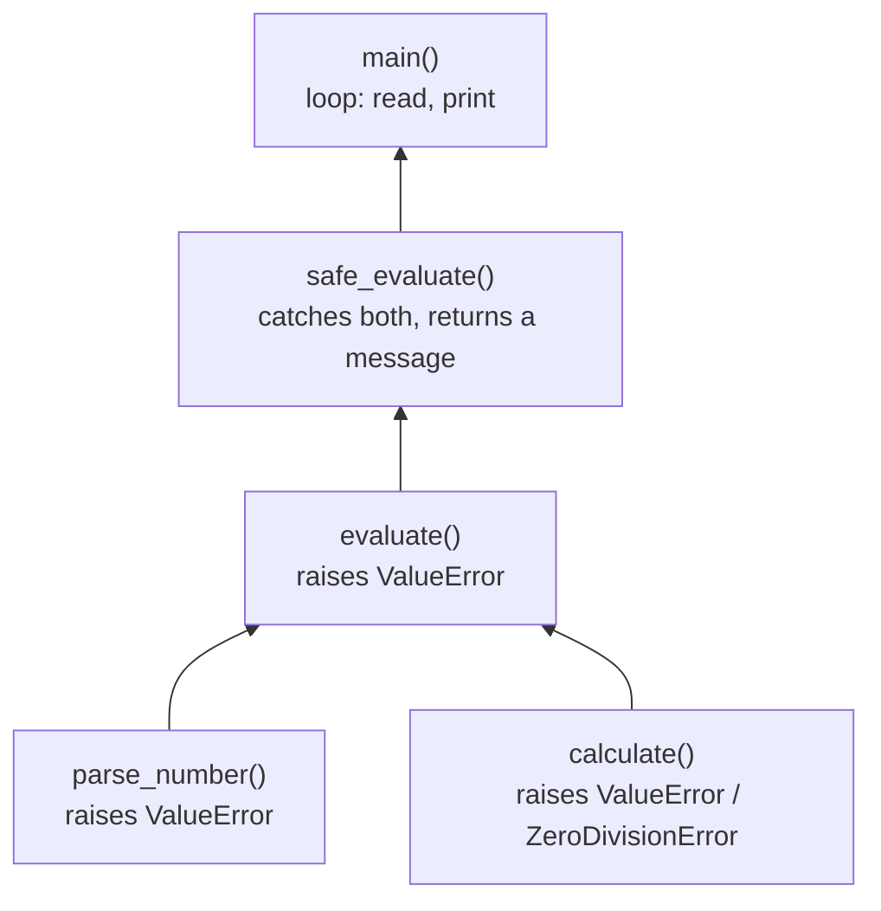

# Assignment 14 · Safe calculator

> **Lesson:** [10 · Errors and exceptions](../../) · **Difficulty:** ⭐⭐⭐⭐☆ · **Time:** ~1 h

## Goal

Build a calculator for expressions like `3 + 4` that **never crashes** on bad input. The trick is in the
layering: the low-level functions **raise** clear exceptions, and only the top-level function **catches**
them and turns them into friendly messages.



## What to write

| Function | Returns / raises |
|---|---|
| `parse_number(text)` | the number in `text` as a `float` (spaces and a decimal comma allowed). Raises `ValueError("not a number: '<text>'")` otherwise |
| `calculate(a, operator, b)` | `a + b`, `a - b`, `a * b` or `a / b`. Raises `ZeroDivisionError("cannot divide by zero")` for `/` with `b == 0`, and `ValueError("unknown operator: '<operator>'")` for anything else |
| `evaluate(expression)` | the result of an expression of exactly three parts separated by spaces, like `"3 + 4"`. Raises `ValueError("expected: <number> <operator> <number>")` if there are not exactly three parts |
| `safe_evaluate(expression)` | the result as text (`f"{result:g}"`), or `"Error: <message>"` when a `ValueError` or `ZeroDivisionError` was raised. **Never raises.** |

`main()` is written for you.

## Examples

```python
>>> parse_number(" 2,5 ")
2.5
>>> parse_number("abc")
Traceback (most recent call last):
ValueError: not a number: 'abc'
>>> calculate(7, "/", 2)
3.5
>>> calculate(1, "/", 0)
Traceback (most recent call last):
ZeroDivisionError: cannot divide by zero
>>> evaluate("3 * 4")
12.0
>>> safe_evaluate("3 * 4")
'12'
>>> safe_evaluate("10 / 4")
'2.5'
>>> safe_evaluate("1 / 0")
'Error: cannot divide by zero'
>>> safe_evaluate("3 ^ 4")
"Error: unknown operator: '^'"
>>> safe_evaluate("three + 4")
"Error: not a number: 'three'"
>>> safe_evaluate("3+4")
'Error: expected: <number> <operator> <number>'
```

## Hints

<details>
<summary>Hint 1: parse_number</summary>

Put only the conversion in the `try` block. In the `except ValueError:` block, raise a **new**
`ValueError` with the required message. (Adding `from None` at the end of the `raise` line hides the
original, less helpful error from the traceback.)
</details>

<details>
<summary>Hint 2: calculate</summary>

An `if` / `elif` chain over the operator. Check for division by zero **before** dividing and raise
your own `ZeroDivisionError` with the required message. The last branch raises the `ValueError`.
</details>

<details>
<summary>Hint 3: evaluate</summary>

`expression.split()` gives a list. Check its length first (guard clause), then unpack:
`left, operator, right = parts`. Do **not** catch anything here: let the exceptions travel up.
</details>

<details>
<summary>Hint 4: safe_evaluate</summary>

`try:` call `evaluate`. `except (ValueError, ZeroDivisionError) as error:` return
`f"Error: {error}"`. `str(error)` is the message the exception was created with.
`:g` formats `12.0` as `12` and `2.5` as `2.5`.
</details>

## Check your work

```bash
pytest beginner/10-errors-and-exceptions/assignments/14-safe-calculator -v
```

## Done?

Compare with the [template solution](../../../../solutions/beginner/10-errors-and-exceptions/assignments/14-safe-calculator/exercise.py),
then tick off assignment 14 in the [progress checklist](../../../../README.md#progress-checklist).
