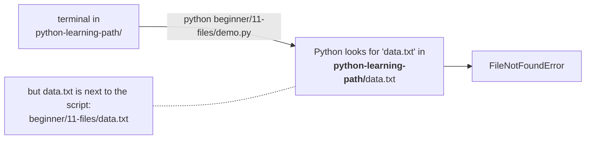
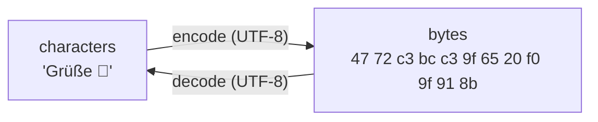
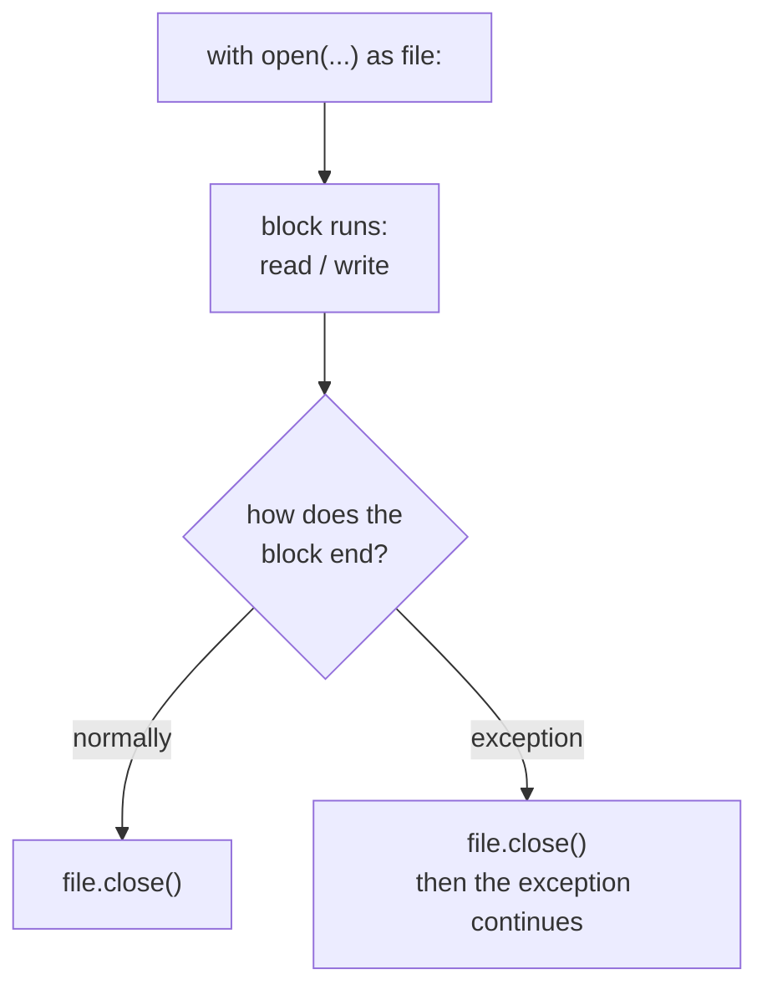

# Lesson 11 · Files

> **Level:** 🟡 Beginner · **Time:** ~2 h · **Assignment:** [15 · Log analyzer](assignments/15-log-analyzer/)

Everything a program keeps after it ends lives in a file: settings, data, logs, reports. This lesson
covers reading and writing text files the safe way, what an **encoding** is (and why ignoring it breaks
programs on Windows), and how to work with paths using `pathlib`.

## What you will learn

- what a file is: bytes on a disk, found by a **path**
- text vs bytes, and what **UTF-8** means
- `open()` modes, and why you always use `with`
- reading a whole file, reading line by line, and writing
- relative vs absolute paths, the current working directory, and `pathlib.Path`
- reading and writing CSV files with the `csv` module

---

## 1. What a file is

To the operating system, a file is a named sequence of **bytes** (numbers from 0 to 255) stored on a disk.
A **path** says where it is:

| Path | Kind | Meaning |
|---|---|---|
| `/Users/ada/notes.txt` (macOS/Linux) | absolute | from the root of the disk |
| `C:\Users\ada\notes.txt` (Windows) | absolute | from drive C |
| `notes.txt` | relative | in the **current working directory** |
| `data/prices.csv` | relative | in the `data` folder inside the current working directory |

The **current working directory** (cwd) is the folder your terminal was in when you started Python,
**not** the folder your script is in. That difference causes the most common file bug of all:



Section 6 shows how to build paths that do not depend on the cwd.

## 2. Text and encodings

Text files store characters, but disks store bytes. An **encoding** is the table that translates
between the two. The modern standard is **UTF-8**: plain English letters take 1 byte, accented letters
2, many other scripts 3, emoji 4.



```python
"Grüße".encode("utf-8")        # → b'Gr\xc3\xbc\xc3\x9fe'   (ü and ß are 2 bytes each)
b'Gr\xc3\xbc\xc3\x9fe'.decode("utf-8")   # → 'Grüße'
```

If you decode with the **wrong** table, you get garbage (`Grüße`) or a `UnicodeDecodeError`.
Without an explicit encoding, `open()` uses the operating system's default, which is UTF-8 on macOS and
Linux but often an old code page (cp1252) on Windows. **Always pass `encoding="utf-8"`** for text files,
and your program behaves the same everywhere.

## 3. `open()` and the `with` statement

```python
with open("notes.txt", "w", encoding="utf-8") as file:
    file.write("First line\n")
    file.write("Second line\n")
# here the file is closed automatically
```

`open()` returns a **file object** connected to the file. The `with` statement guarantees that the file is
**closed** when the block ends, even if an exception happens inside it. Closing matters: written data may
sit in a memory buffer until the file is closed, and every open file uses an operating-system resource.



(It is `try`/`finally` from lesson 10, built in. Objects that work with `with` are called *context managers*.)

### Modes

| Mode | Meaning | If the file exists | If it does not |
|---|---|---|---|
| `"r"` (default) | read | read from the start | `FileNotFoundError` |
| `"w"` | write | **erased first!** | created |
| `"a"` | append | write at the end | created |
| `"x"` | exclusive create | `FileExistsError` | created |
| add `"b"` | binary: bytes instead of str, no encoding | | |

`"w"` empties the file the moment it is opened. Use `"a"` to add to it, `"x"` to never overwrite.

## 4. Reading

```python
# The whole file as one string
with open("notes.txt", encoding="utf-8") as file:
    text = file.read()                  # 'First line\nSecond line\n'

# Line by line: the best way for big files
with open("notes.txt", encoding="utf-8") as file:
    for line in file:                   # a file object is iterable (lesson 06)
        print(line.rstrip("\n"))        # each line still ends with '\n'
```

Looping over the file reads **one line at a time**, so it works for a 10 GB log file as well as for a
10-line one. `file.read()` loads everything into memory at once.

Each line you read includes its newline character. Strip it with `.rstrip("\n")` (or `.strip()` if
spaces at the ends do not matter), otherwise `print` shows an empty line after each one.

A file object has a **position**. After `read()` the position is at the end, so a second `read()`
returns `""`. Open the file again (or use `file.seek(0)`) to start over.

## 5. Writing

```python
lines = ["apple", "banana", "cherry"]

with open("fruit.txt", "w", encoding="utf-8") as file:
    for fruit in lines:
        file.write(fruit + "\n")        # write() does NOT add a newline

with open("fruit.txt", "a", encoding="utf-8") as file:
    print("date", file=file)            # print() can write to a file, newline included
```

`write()` only accepts strings: convert numbers with `str()` or an f-string first.

## 6. Paths with `pathlib`

String paths are fragile: `/` vs `\`, missing separators, the cwd problem. The `pathlib` module turns
paths into objects:

```python
from pathlib import Path

here = Path(__file__).parent            # the folder THIS script is in (not the cwd!)
data = here / "data" / "prices.csv"     # / joins path parts, correct on every OS

data.name        # → 'prices.csv'
data.stem        # → 'prices'
data.suffix      # → '.csv'
data.parent      # → .../data
data.exists()    # → True or False

text = data.read_text(encoding="utf-8")          # open + read + close in one call
Path("out.txt").write_text("hi\n", encoding="utf-8")

for path in here.glob("*.txt"):         # all .txt files in the folder
    print(path.name)

Path.cwd()                              # the current working directory
```

`Path(__file__).parent / "name"` is the reliable way to find files that belong to your script, whatever
folder the user started it from. `open()` accepts `Path` objects too.

## 7. CSV files

CSV (comma-separated values) is the simplest table format, and every spreadsheet can read and write it:

```text
date,category,amount
2026-10-01,food,12.50
2026-10-02,transport,2.90
```

Splitting on `,` yourself breaks as soon as a value contains a comma (`"Smith, Ada"`). The `csv` module
handles quoting for you. `DictReader` turns each row into a dict keyed by the header:

```python
import csv

with open("expenses.csv", newline="", encoding="utf-8") as file:
    for row in csv.DictReader(file):
        print(row["category"], float(row["amount"]))   # every value is a str: convert!

rows = [{"date": "2026-10-03", "category": "food", "amount": "8.00"}]
with open("expenses.csv", "a", newline="", encoding="utf-8") as file:
    writer = csv.DictWriter(file, fieldnames=["date", "category", "amount"])
    writer.writerows(rows)              # use writer.writeheader() first for a new file
```

Pass `newline=""` when opening CSV files; the `csv` module handles line endings itself (otherwise you get
blank lines between rows on Windows).

---

## Common mistakes

**Opening with `"w"` when you meant to add.** The old content is gone. Use `"a"`.

**No `encoding="utf-8"`.** Works on your Mac, breaks with `UnicodeDecodeError` on a Windows machine.

**Relying on the current working directory.** Build paths from `Path(__file__).parent`.

**Forgetting `\n` with `write()`.** Everything ends up on one line.

**Forgetting to strip lines.** Comparisons like `line == "done"` fail because the line is `"done\n"`.

**Not using `with`.** A file left open may lose written data if the program crashes.

**Reading a file twice from the same file object.** The second read returns `""`.

**Backslashes in Windows paths.** `"C:\new\test.txt"` contains `\n` and `\t`! Use `Path`, forward slashes,
or a raw string `r"C:\new\test.txt"`.

## Try it yourself

1. Write three lines to `practice.txt`, then append a fourth, then read it back line by line with line numbers (`enumerate(file, start=1)`).
2. Print `Path(__file__).parent` and `Path.cwd()` from a script. Run it from two different folders.
3. Compare `len("Grüße")` with `len("Grüße".encode("utf-8"))`. Why are they different?
4. List all `.md` files in this repository with `Path(".").glob("**/*.md")`.
5. Write a small CSV with `DictWriter` and read it back with `DictReader`.

## Summary

- A file is bytes on a disk, found by a **path**; relative paths start at the **cwd**, not at your script.
- An **encoding** maps characters to bytes. Always use `encoding="utf-8"` for text.
- Always open files with **`with`**, so they are closed even on errors. `"w"` erases, `"a"` appends.
- Loop over a file object to read **line by line**; strip the `\n`. `write()` does not add one.
- Use `pathlib.Path`: `/` joins parts, `Path(__file__).parent` finds files next to your script.
- Use the `csv` module for CSV; every value comes back as a string.

## Assignment

➡️ **[15 · Log analyzer](assignments/15-log-analyzer/)**: read a log file line by line and write a summary report.

---

<p align="center">
  <a href="../10-errors-and-exceptions/">← Previous: 10 · Errors and exceptions</a> · <a href="../README.md">Beginner overview</a> · <a href="../12-modules-and-imports/">Next: 12 · Modules and imports →</a>
</p>
