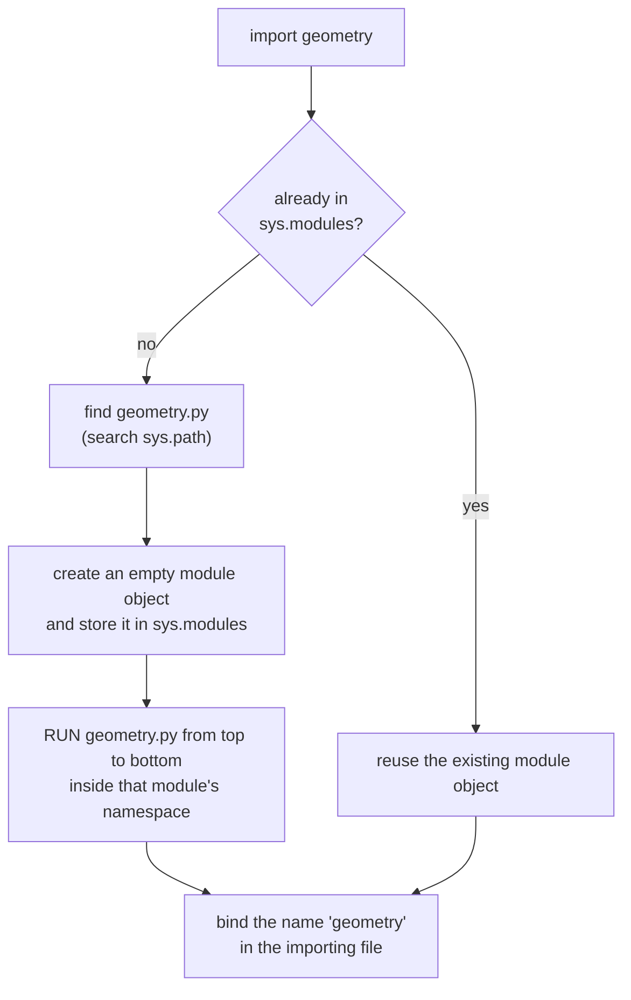
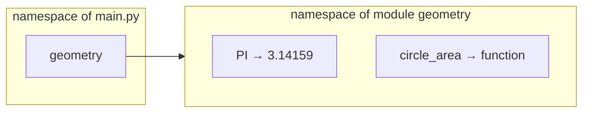
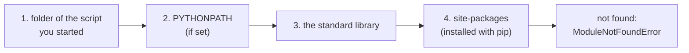
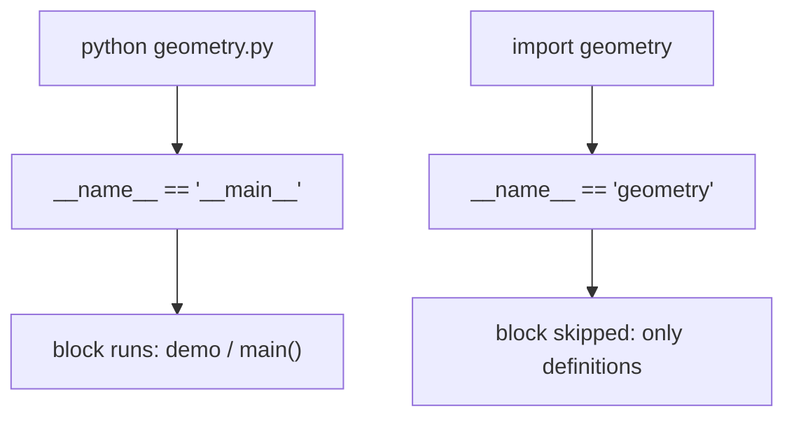

# Lesson 12 · Modules and imports

> **Level:** 🟡 Beginner · **Time:** ~2 h · **Assignment:** [16 · Standard library tour](assignments/16-stdlib-tour/)

No real program lives in a single file, and nobody writes everything from scratch. **Modules** let you
split your own code into files and reuse code that others wrote, starting with Python's large
**standard library**. This lesson explains what `import` really does, where Python looks for modules,
and finally what that `if __name__ == "__main__":` line at the bottom of every assignment means.

## What you will learn

- what a module is, and what happens step by step on `import`
- the forms of `import`, and which to prefer
- where Python searches for modules (`sys.path`), and the "my file is called `random.py`" bug
- `__name__` and the `if __name__ == "__main__":` idiom
- packages: folders of modules
- a tour of the standard-library modules you will use most

---

## 1. A module is a `.py` file

Any Python file is a module. Say you have two files in the same folder:

```python
# geometry.py
PI = 3.14159

def circle_area(radius):
    return PI * radius ** 2
```

```python
# main.py
import geometry

print(geometry.circle_area(2))   # → 12.56636
print(geometry.PI)               # → 3.14159
```

`import geometry` gives `main.py` access to everything defined at the top level of `geometry.py`,
through the name `geometry`.

## 2. What `import` does



Three things to remember:

1. **Importing runs the file.** Every top-level statement executes: `def` creates functions, `=` creates
   variables, and a top-level `print(...)` would print. That is why modules should only *define* things
   at the top level, not *do* things.
2. **A module runs only once per program.** The second `import geometry` (in any file) finds it in
   `sys.modules` and reuses it.
3. **Each module has its own namespace.** `geometry.PI` and a `PI` in `main.py` are different names. No clashes.



## 3. Forms of `import`

| Form | Then you write | Use when |
|---|---|---|
| `import math` | `math.sqrt(2)` | **default choice**: always clear where a name comes from |
| `import datetime as dt` | `dt.date.today()` | the name is long, or a convention exists (`import numpy as np`) |
| `from math import sqrt, pi` | `sqrt(2)` | you use a few names very often |
| `from pathlib import Path` | `Path("x")` | importing a class (common and fine) |
| `from math import *` | `sqrt(2)` | ❌ never: you cannot see what was imported, and names get overwritten silently |

Put all imports at the **top** of the file, in this order, separated by blank lines: standard library,
third-party packages (lesson 13), your own modules.

## 4. Where Python looks: `sys.path`

When a module is not cached yet, Python searches a list of folders, in order, and takes the **first** match:

```python
import sys
for folder in sys.path:
    print(folder)
```



### The classic bug: shadowing a standard module

Because the script's own folder is searched **first**, a file of yours with the same name as a standard
module wins:

```text
my-project/
├── random.py          ← your practice file
└── game.py            ← contains: import random
```

```text
AttributeError: module 'random' has no attribute 'randint'
```

`game.py` imported **your** `random.py`, not the standard one. Never name your files after modules you
use: `random.py`, `math.py`, `csv.py`, `email.py`, `test.py`, `string.py`, … Rename the file and delete any
`__pycache__` folder next to it.

## 5. `__name__` and `if __name__ == "__main__":`

Every module has a variable `__name__`. Python sets it to:

- the module's name (`"geometry"`) when the file is **imported**,
- the special string `"__main__"` when the file is **run directly** (`python geometry.py`).

```python
# geometry.py
def circle_area(radius):
    return 3.14159 * radius ** 2

if __name__ == "__main__":
    # runs only with:  python geometry.py
    # not when another file does:  import geometry
    print(circle_area(2))
```



This is why every assignment ends with this block: you can run the file as a program, and the tests can
import it to check the functions **without** starting the program (and without waiting for `input()`).

## 6. Packages: folders of modules

A **package** is a folder of modules. A file called `__init__.py` marks it as a regular package and runs
when the package is imported (it is often empty):

```text
shop/
├── __init__.py
├── prices.py
└── reports/
    ├── __init__.py
    └── monthly.py
```

```python
import shop.prices
from shop.reports.monthly import build_report
```

The dots follow the folders. The Intermediate level builds a real package with tests.

## 7. Exploring a module

```python
import math
dir(math)           # every name in the module
help(math.sqrt)     # the docstring
math.__file__       # where the module lives on disk
```

The official documentation for every standard module is at [docs.python.org/3/library](https://docs.python.org/3/library/).

## 8. Standard library tour

Python comes with "batteries included". Before you write something general, check whether it exists here:

| Module | For | Example |
|---|---|---|
| `math` | maths functions and constants | `math.sqrt(2)`, `math.pi`, `math.hypot(3, 4)`, `math.isclose(a, b)` |
| `random` | random numbers (not for security) | `random.randint(1, 6)`, `random.choice(items)`, `random.shuffle(items)` |
| `statistics` | mean, median, standard deviation | `statistics.median([3, 1, 2])` |
| `datetime` | dates, times, durations | `date.fromisoformat("2026-12-24")`, `date.today()`, `timedelta(days=7)` |
| `pathlib` | file paths (lesson 11) | `Path(__file__).parent / "data.csv"` |
| `csv`, `json` | read and write data files | `json.loads('{"a": 1}')`, `json.dumps(data, indent=2)` |
| `collections` | special containers | `Counter("hello").most_common(1)` → `[('l', 2)]` |
| `itertools` | building blocks for loops | `itertools.combinations("abc", 2)` |
| `sys` | the interpreter itself | `sys.argv`, `sys.path`, `sys.exit()` |
| `os` | the operating system | `os.environ`, `os.getcwd()` |
| `time` | clock and waiting | `time.sleep(1)`, `time.perf_counter()` |

### Dates in practice

```python
from datetime import date, timedelta

christmas = date.fromisoformat("2026-12-24")
today = date(2026, 10, 30)
(christmas - today).days        # → 55     subtracting dates gives a timedelta
today + timedelta(weeks=2)      # → datetime.date(2026, 11, 13)
christmas.strftime("%A")        # → 'Thursday'
```

### Reproducible randomness

```python
import random

rng = random.Random(42)        # a generator with a fixed seed
[rng.randint(1, 6) for _ in range(5)]   # the same five numbers every time you run it
```

A **seed** makes "random" numbers repeatable, which is essential for tests and debugging.

---

## Common mistakes

**Naming your file after a standard module** (`random.py`, `math.py`, `test.py`). See section 4.

**`ModuleNotFoundError` for a third-party package.** It is not installed in the Python you are running.
Lesson 13 explains venvs and `pip install`.

**Running a file from the wrong folder.** Imports of your own modules work relative to the **script's**
folder; start the program from where its files are, or build a package.

**Top-level code with side effects in a module.** Importing it prints, asks for input or deletes files.
Put such code into functions or under `if __name__ == "__main__":`.

**`from module import *`.** You cannot tell where names come from, and they overwrite yours silently.

**Circular imports.** `a.py` imports `b.py`, which imports `a.py`: one of them sees a half-finished module.
Move the shared code into a third module.

## Try it yourself

1. Create `geometry.py` and `main.py` from section 1 in an empty folder and run `main.py`.
2. Add `print("importing geometry")` to the top of `geometry.py`. Import it twice from `main.py`. How often does it print?
3. Print `__name__` in `geometry.py`, then run it directly and via import.
4. Find out how many days you have been alive with `datetime.date`.
5. Use `collections.Counter` to find the three most common letters in a sentence.

## Summary

- A module is a `.py` file. `import` **finds** it on `sys.path`, **runs it once**, caches it in `sys.modules`
  and binds its **namespace** to a name.
- Prefer `import module`; use `from module import name` for a few names; never `import *`.
- Your script's folder is searched first: **never name a file like a standard module**.
- `__name__ == "__main__"` only when the file is run directly; put program start-up code under that check.
- A package is a folder of modules. The standard library already solves many problems: look there first.

## Assignment

➡️ **[16 · Standard library tour](assignments/16-stdlib-tour/)**: solve six small problems with `math`, `datetime`, `random`, `statistics` and `collections`.

---

<p align="center">
  <a href="../11-files/">← Previous: 11 · Files</a> · <a href="../README.md">Beginner overview</a> · <a href="../13-venv-and-pip/">Next: 13 · venv and pip →</a>
</p>
