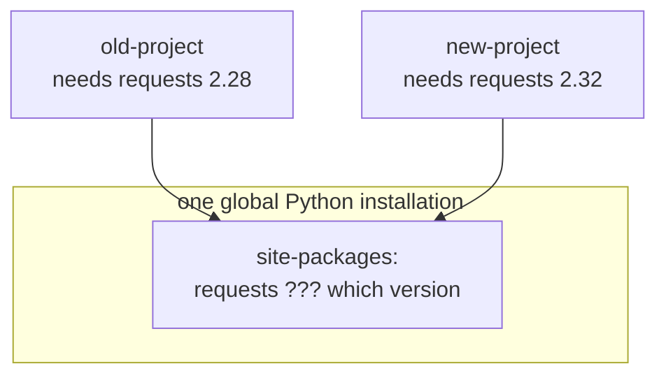
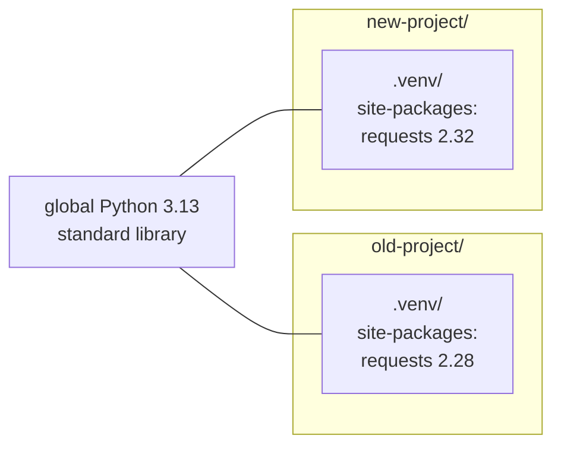
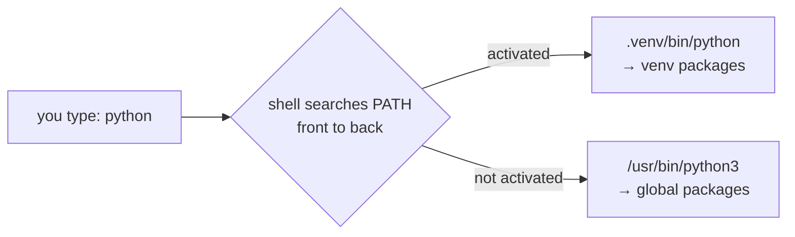
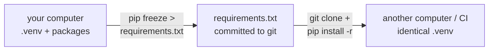

# Lesson 13 · venv and pip

> **Level:** 🟡 Beginner · **Time:** ~1.5 h · **Assignment:** [17 · Requirements parser](assignments/17-requirements-parser/)

The standard library is big, but the real power of Python is the half a million packages on
[PyPI](https://pypi.org): web frameworks, data analysis, machine learning, game engines. This lesson
shows how to install them **without breaking anything**: one isolated **virtual environment** per project,
and a `requirements.txt` that lets anyone rebuild it. You already did all of this during setup;
now you will understand each step.

## What you will learn

- why installing packages "globally" causes trouble
- what a virtual environment (venv) is, and what "activating" it really does
- creating, activating and deleting a venv on macOS, Linux and Windows
- `pip`: installing, upgrading, removing and listing packages
- version specifiers and `requirements.txt`
- staying safe on PyPI

---

## 1. The problem: one Python, many projects

Imagine two projects on your computer:



If both install into the same global Python, one of them always has the wrong version. Upgrading a package
for one project silently breaks the other. On macOS and Linux, the operating system also uses its own
Python, and changing its packages can break system tools; that is why modern `pip` refuses to install
into it (`error: externally-managed-environment`).

## 2. The solution: a virtual environment per project

A **virtual environment** is a folder (by convention `.venv`) inside your project that contains:

- a link to (or copy of) the Python interpreter,
- **its own, empty `site-packages`** folder for packages,
- `pip`, and activation scripts.



Each project gets exactly the packages it needs, in exactly the versions it needs. Deleting the `.venv`
folder deletes them all, and nothing else on your computer is touched.

## 3. Creating and using a venv

The `venv` module is part of the standard library:

| Step | macOS / Linux | Windows (PowerShell) |
|---|---|---|
| create | `python3 -m venv .venv` | `py -m venv .venv` |
| activate | `source .venv/bin/activate` | `.venv\Scripts\Activate.ps1` |
| check | `which python` | `Get-Command python` |
| leave | `deactivate` | `deactivate` |
| remove | delete the `.venv` folder | delete the `.venv` folder |

`python -m venv` means "run the module `venv` as a program" (lesson 12: the module's
`if __name__ == "__main__":` block).

### What "activate" really does

Activating changes only **your current terminal**: it puts `.venv/bin` (Windows: `.venv\Scripts`) at the
**front** of the `PATH` environment variable, the list of folders your shell searches for commands.
So when you type `python` or `pip`, the shell finds the venv's versions first. It also adds `(.venv)` to
your prompt as a reminder.



That is all. You do not even have to activate: `.venv/bin/python script.py` uses the venv directly.
Editors like VS Code and PyCharm detect a `.venv` folder and use it automatically.

Check which Python you are running at any time:

```python
import sys
print(sys.executable)     # e.g. /Users/ada/python-learning-path/.venv/bin/python
print(sys.prefix)         # the venv folder when a venv is active
```

## 4. pip, the package installer

With the venv active:

```bash
pip install requests                # newest version
pip install "requests==2.32.3"      # exactly this version
pip install --upgrade requests      # upgrade
pip uninstall requests              # remove
pip list                            # what is installed
pip show requests                   # details: version, dependencies, location
pip freeze                          # installed packages in requirements format
```

pip downloads packages from **PyPI** (the Python Package Index) and also installs everything they depend on.

> **Tip:** `python -m pip install ...` is the bulletproof form. It guarantees that pip installs into the
> same Python you will run, even when several Pythons are installed and the venv is not active.

## 5. Versions and `requirements.txt`

Package versions usually follow **semantic versioning**: `MAJOR.MINOR.PATCH`, e.g. `2.32.3`.
A major bump (`2.x` → `3.0`) may break your code; minor and patch updates should not.

| Specifier | Means | Example |
|---|---|---|
| `==` | exactly this version | `requests==2.32.3` |
| `>=` | this version or newer | `pytest>=7` |
| `<`, `<=`, `>` | upper / lower bounds | `numpy<2` |
| `!=` | anything except | `urllib3!=2.0.0` |
| `~=` | compatible release: `~=2.32` means `>=2.32, <3` | `requests~=2.32` |
| combined | several conditions | `django>=4.2,<5` |

A **`requirements.txt`** file lists what a project needs, one requirement per line. Comments start with `#`:

```text
# web
requests~=2.32
flask==3.0.3

# testing
pytest>=7
```

```bash
pip install -r requirements.txt     # install everything listed
pip freeze > requirements.txt       # write down exactly what is installed now
```



That is how this repository works: [`requirements.txt`](../../requirements.txt) contains `pytest>=7`, and
the CI workflow runs `pip install -r requirements.txt` on fresh Linux, macOS and Windows machines.

### Commit the list, never the venv

The `.venv` folder is big, contains absolute paths of *your* computer, and is specific to your operating
system. It belongs in `.gitignore` (this repo already has it there). Commit `requirements.txt` instead;
anyone can rebuild the venv from it in seconds.

Two approaches to pinning:

- **Applications** (something you deploy): pin exact versions (`==`) with `pip freeze`, so every
  installation is identical.
- **Libraries and learning projects**: use ranges (`>=`, `~=`), so they work alongside other packages.

The Professional level covers modern tools built on these ideas (`pyproject.toml`, lock files, `uv`).

## 6. Staying safe on PyPI

Anyone can upload a package to PyPI, and installing a package runs code from its author on your computer.

- Install packages you **know**: check the name on pypi.org, the project's homepage, its download count and activity.
- Watch for **typosquatting**: malicious packages with names like `reqeusts` or `python-dateutils`.
  Copy package names from official documentation.
- Never run `sudo pip install`. Inside a venv you never need admin rights.

---

## Common mistakes

**Forgetting to activate.** `pip install` goes to the global Python, and `python script.py` cannot
find the package: `ModuleNotFoundError`. Check for `(.venv)` in your prompt.

**pip and python from different installations.** `pip` installs into Python A, you run Python B.
Use `python -m pip install ...` to be sure.

**Committing `.venv` to git.** Add it to `.gitignore`; commit `requirements.txt`.

**Moving or renaming a venv folder.** Venvs contain absolute paths and break when moved. Delete it and
create a new one; it only takes a moment with `requirements.txt`.

**PowerShell refuses to run `Activate.ps1`.** Run `Set-ExecutionPolicy -Scope CurrentUser RemoteSigned` once.

**`sudo pip install`** or installing into the system Python on Linux/macOS. Always use a venv.

## Try it yourself

1. In an empty folder, create a venv, activate it and run `pip list`. How many packages are there?
2. Install `requests`, then run `pip list` again. Where did the extra packages come from? (`pip show requests`)
3. Run `pip freeze > requirements.txt`, delete `.venv`, create a new one and `pip install -r requirements.txt`.
4. Compare `python -c "import sys; print(sys.prefix)"` with the venv active and after `deactivate`.
5. Look up `rich` on [pypi.org](https://pypi.org/project/rich/), install it and run `python -m rich`.

## Summary

- Install packages into a **virtual environment per project**, never into the global Python.
- `python -m venv .venv` creates one; **activating** just puts its `bin`/`Scripts` folder first in `PATH`.
- `pip install`, `pip list`, `pip freeze`; `python -m pip` when in doubt.
- `requirements.txt` lists the packages and versions (`==`, `>=`, `~=`); rebuild with `pip install -r`.
- Commit `requirements.txt`, ignore `.venv`. Install only packages you trust.

## Assignment

➡️ **[17 · Requirements parser](assignments/17-requirements-parser/)**: read `requirements.txt` files the way pip does, and compare two of them.

---

<p align="center">
  <a href="../12-modules-and-imports/">← Previous: 12 · Modules and imports</a> · <a href="../README.md">Beginner overview</a> · <a href="../capstone-expense-tracker/">Next: 🏁 Capstone →</a>
</p>
