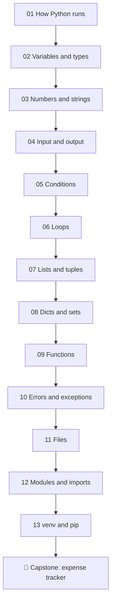

# 🟡 Beginner level

**Goal:** after this level you can write, run and test small Python programs on your own. You understand
what Python does with your code, how values live in memory, and how to read an error message instead of
fearing it.

**Time:** about 25–35 hours, spread over a few weeks. Take your time; the lessons build on each other.

**You need:** a computer and the setup from the [main README](../README.md#set-up-python-a-venv-and-pytest).
No prior programming experience.

## The lessons

| # | Lesson | You will learn | Assignments |
|---|---|---|---|
| 01 | [How Python runs code](01-how-python-runs/) | interpreter, bytecode, the REPL vs scripts, your first program | 01 |
| 02 | [Variables and types](02-variables-and-types/) | names point to objects, dynamic typing, `type()`, `id()`, `None` | 02 |
| 03 | [Numbers and strings](03-numbers-and-strings/) | int and float (and why `0.1 + 0.2 != 0.3`), string methods, slicing, f-strings | 03, 04 |
| 04 | [Input and output](04-input-and-output/) | `print`, `input`, converting text to numbers, formatting output | 05 |
| 05 | [Conditions](05-conditions/) | `if` / `elif` / `else`, comparisons, `and` / `or` / `not`, truthiness | 06, 07 |
| 06 | [Loops](06-loops/) | `for` over anything iterable, `range`, `while`, `break` / `continue` | 08, 09 |
| 07 | [Lists and tuples](07-lists-and-tuples/) | mutability, aliasing, slicing, sorting, unpacking | 10 |
| 08 | [Dictionaries and sets](08-dicts-and-sets/) | hashing, fast lookups, counting, set operations | 11, 12 |
| 09 | [Functions](09-functions/) | parameters, return values, scope, defaults and their famous trap | 13 |
| 10 | [Errors and exceptions](10-errors-and-exceptions/) | reading tracebacks, `try` / `except` / `else` / `finally`, `raise` | 14 |
| 11 | [Files](11-files/) | `with open(...)`, encodings, reading line by line, `pathlib` | 15 |
| 12 | [Modules and imports](12-modules-and-imports/) | how `import` finds code, the standard library, `__name__ == "__main__"` | 16 |
| 13 | [venv and pip](13-venv-and-pip/) | virtual environments, installing packages, `requirements.txt` | 17 |
| 🏁 | [Capstone: expense tracker](capstone-expense-tracker/) | everything above, in one small real program | capstone |



## How each lesson is built

Every lesson `README.md` follows the same structure, so you always know where to look when you come back:

1. **What you will learn**: the goals, in one list.
2. **The theory**: how the feature works inside Python, with diagrams and short runnable examples.
   The output of each example is shown in a comment (`# → ...`).
3. **Common mistakes**: the errors almost everyone makes, and how to recognise them.
4. **Try it yourself**: a few quick REPL experiments.
5. **Summary**: the few lines worth remembering.
6. **Assignments**: the graded exercises for this lesson.

## How to check your work

From the repository root, with your venv active:

```bash
pytest beginner/01-how-python-runs/assignments/01-first-script
```

Every task folder has the same three files: `README.md` (the task), `exercise.py` (your file) and
`test_exercise.py` (the tests). The template solutions are in [`solutions/beginner/`](../solutions/beginner/).
