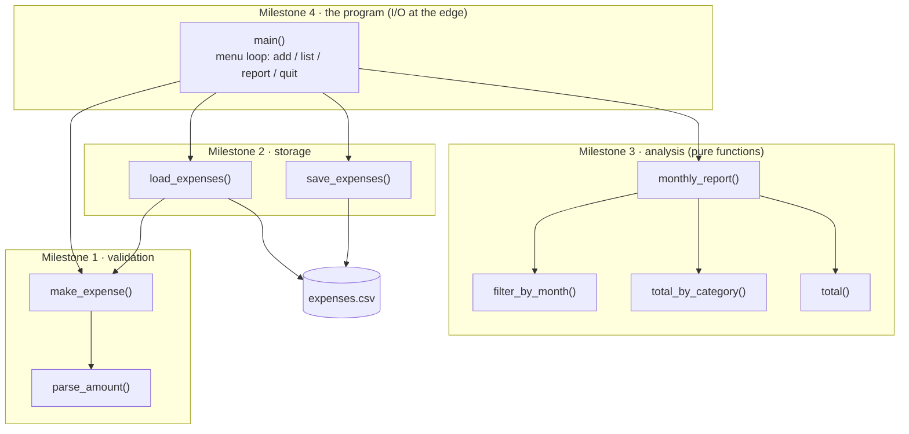

# 🏁 Capstone · Expense tracker

> **Level:** 🟡 Beginner · **Difficulty:** ⭐⭐⭐⭐⭐ · **Time:** ~4–6 h, spread over several sessions

You made it through all thirteen lessons. Now build something real: a small command-line program that
records your expenses in a CSV file and prints monthly reports. It is small enough to finish, and it
uses **every** topic of the Beginner level.

```text
$ python exercise.py
Expense tracker · 9 expenses loaded
Command (add, list, report, quit): add
Date (YYYY-MM-DD, empty = today): 2026-10-30
Category: Food
Amount: 7,80
Note (optional): pizza
Saved.
Command (add, list, report, quit): report
Month (YYYY-MM): 2026-10
Expenses for 2026-10
============================
rent                  750.00
food                   61.30
transport              51.90
fun                    15.00
----------------------------
TOTAL                 878.20
Command (add, list, report, quit): quit
Bye!
```

## How the program is built



Every expense is a dict with four keys. In memory, `amount` is a `float`; in the file it is text:

```python
{"date": "2026-10-01", "category": "food", "amount": 12.5, "note": "lunch with Grace"}
```

```text
date,category,amount,note
2026-10-01,food,12.50,lunch with Grace
```

## What you use from each lesson

| Lesson | Where it shows up |
|---|---|
| 02 Variables and types · 03 Numbers and strings | dicts of `str` and `float`, rounding money, f-string columns |
| 04 Input and output | the menu, prompts, and keeping I/O inside `main()` |
| 05 Conditions · 06 Loops | the command loop, validation, filtering |
| 07 Lists · 08 Dicts | a list of expense dicts, totals per category |
| 09 Functions | one job per function, pure analysis functions, `data_file` parameter |
| 10 Errors and exceptions | raising `ValueError` in validation, catching it once in `main()` |
| 11 Files | CSV with `csv.DictReader`/`DictWriter`, `pathlib`, `encoding="utf-8"` |
| 12 Modules | `csv`, `datetime`, `pathlib` from the standard library |

## Milestones

Work through them in order. Each one has its own tests, so you can check it before moving on:

```bash
pytest beginner/capstone-expense-tracker -v -k milestone1
```

### Milestone 1 · Parse and validate

| Function | Returns / raises |
|---|---|
| `parse_amount(text)` | the amount as a `float` rounded to 2 decimals; spaces and a decimal comma allowed. Raises `ValueError("invalid amount: '<text>'")` if it is not a number **or** not greater than 0 |
| `make_expense(date_text, category, amount_text, note="")` | a validated expense dict. The date must be a real ISO date (`ValueError("invalid date: '<date_text>'")`); the category is stripped and lower-cased and must not be empty (`ValueError("category must not be empty")`); the note is stripped |

```python
>>> make_expense("2026-10-01", "  Food ", "12,50", " lunch ")
{'date': '2026-10-01', 'category': 'food', 'amount': 12.5, 'note': 'lunch'}
>>> make_expense("2026-02-30", "food", "1")
Traceback (most recent call last):
ValueError: invalid date: '2026-02-30'
```

### Milestone 2 · Store

| Function | Returns / does |
|---|---|
| `load_expenses(path)` | the list of expenses in the CSV file; **an empty list if the file does not exist** (the first run). Every row goes through `make_expense`, so a broken file raises `ValueError` |
| `save_expenses(path, expenses)` | writes the header `date,category,amount,note` and one row per expense, amounts with exactly 2 decimals. Does not change the expense dicts |

Saving and loading must give back exactly the same list (the tests check this "round trip", including a
note that contains a comma and quotes).

### Milestone 3 · Analyse

| Function | Returns |
|---|---|
| `total(expenses)` | the sum of all amounts, rounded to 2 decimals |
| `filter_by_month(expenses, month)` | the expenses of one month (`"2026-10"`), in their original order |
| `total_by_category(expenses)` | `{category: total}`, totals rounded to 2 decimals, **largest total first**, ties alphabetically |
| `monthly_report(expenses, month)` | the report text below (lines joined with `"\n"`, no newline at the end), or `"No expenses for <month>."` |

The report is 28 characters wide: the category left-aligned in 20 characters, the amount right-aligned
in 8 with 2 decimals:

```text
Expenses for 2026-10
============================
transport              51.90
food                   43.70
fun                    15.00
----------------------------
TOTAL                 110.60
```

### Milestone 4 · The program

`main(data_file=DATA_FILE)` loads the expenses, prints `Expense tracker · <n> expenses loaded`, and then
asks `Command (add, list, report, quit): ` in a loop:

| Command | Does |
|---|---|
| `add` | asks for date (empty = today), category, amount and note; on success appends the expense, **saves immediately** and prints `Saved.`; on a `ValueError` prints `Error: <message>` and saves nothing |
| `list` | prints every expense on one line (your own format), or `No expenses yet.` |
| `report` | asks `Month (YYYY-MM): ` and prints `monthly_report` |
| `quit` | prints `Bye!` and ends the loop |
| anything else | prints `Unknown command: '<command>'` |

The program must **never crash** on bad user input. `data_file` is a parameter so the tests can use a
temporary file instead of your real data.

## Hints

<details>
<summary>Milestone 1: validating a date</summary>

`date.fromisoformat("2026-02-30")` raises `ValueError` because February has no 30th. Call it only to
validate, keep the original text in the dict, and turn the error into your own message (lesson 10,
`raise ... from None`).
</details>

<details>
<summary>Milestone 2: CSV</summary>

Open with `newline=""` and `encoding="utf-8"` (lesson 11). `csv.DictReader(file)` gives one dict per row,
with every value as a string; pass them to `make_expense`. An empty note cell may come back as `""`.
For saving, `csv.DictWriter(file, fieldnames=FIELDS)`, `writeheader()`, then one `writerow` per expense with
the amount formatted as `f"{amount:.2f}"`. Build a **new** dict for that row so you do not overwrite the
float in the caller's expense.
</details>

<details>
<summary>Milestone 3: sorting categories</summary>

Sum per category with the counting pattern from lesson 08. Then `sorted(totals.items(), key=lambda pair:
(-pair[1], pair[0]))` and build a new dict from the sorted pairs: dicts keep insertion order.
For the report, collect the lines in a list and `"\n".join(lines)` at the end.
</details>

<details>
<summary>Milestone 4: structure of main</summary>

A `while True:` loop with an `if`/`elif` chain over the command, `break` on `quit` (lesson 06). Put the
`try`/`except ValueError` only around the call to `make_expense`. A helper function for the `add` dialogue
keeps `main()` short.
</details>

## Try it with real data

Copy the sample file to `expenses.csv` (which git ignores), then start the program:

```bash
cp beginner/capstone-expense-tracker/sample-expenses.csv beginner/capstone-expense-tracker/expenses.csv
```

```bash
python beginner/capstone-expense-tracker/exercise.py
```

On Windows, use `copy` instead of `cp` and backslashes in the paths.

## Check your work

```bash
pytest beginner/capstone-expense-tracker -v
```

## Stretch goals

Done and all green? Make it yours. These have no tests; they are for practice.

- A `delete` command that removes an expense by its number in the `list` output.
- A `budget` per category, with a warning in the report when it is exceeded.
- A `year` report with one line per month.
- Command-line arguments instead of a menu: `python exercise.py report 2026-10` (look up `sys.argv`).
- Split the program into modules: `storage.py`, `analysis.py`, `cli.py` (lesson 12).

## Done?

Compare with the [template solution](../../solutions/beginner/capstone-expense-tracker/exercise.py).
It is longer than the exercises before, so read it as a whole: notice where validation happens, where
exceptions are raised and where they are caught, and how small `main()` stays.

Then tick off the capstone in the [progress checklist](../../README.md#progress-checklist).
**Congratulations: you have finished the Beginner level. 🎉**

---

<p align="center">
  <a href="../13-venv-and-pip/">← Previous: 13 · venv and pip</a> · <a href="../README.md">Beginner overview</a>
</p>
