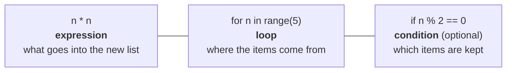
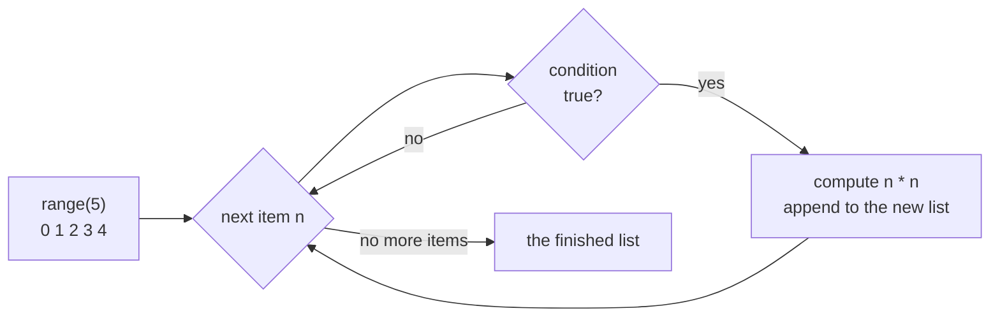
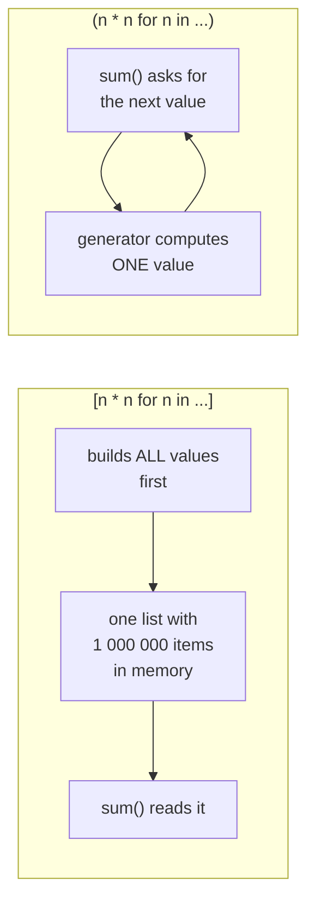
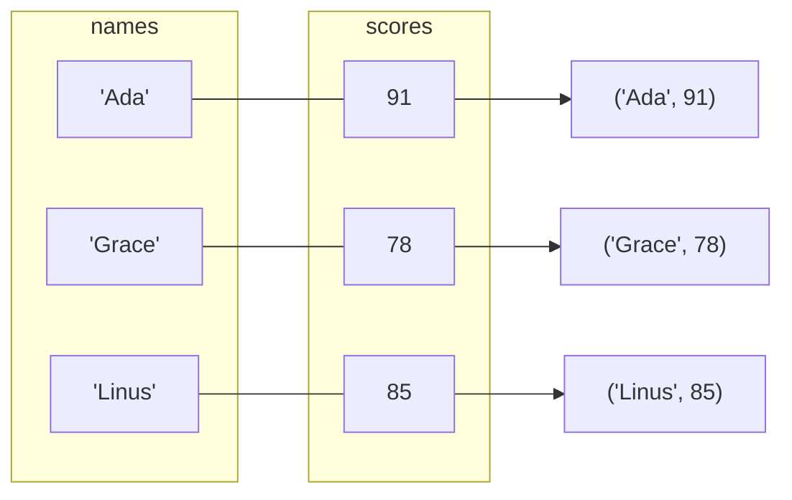

# Lesson 01 · Comprehensions

> **Level:** 🔵 Intermediate · **Time:** ~2 h · **Assignment:** [01 · Data wrangler](assignments/01-data-wrangler/)

Half of all everyday programming is turning one collection into another: keep only the valid rows,
convert every price, build a lookup table. In the Beginner level you did this with a `for` loop and
`.append()`. Python has a shorter, faster and more readable tool for it: the **comprehension**. This
lesson shows how comprehensions work, the four kinds there are, and where to stop using them.

## What you will learn

- how a list comprehension maps to the loop you already know
- filtering with `if`, transforming with an expression, and both at once
- dict and set comprehensions
- generator expressions, and why `sum(x for x in ...)` needs no list
- the helpers that make comprehensions shine: `zip`, `enumerate`, `any`, `all`, `sorted`
- nested comprehensions, and when a plain loop is the better choice

---

## 1. From loop to comprehension

This loop builds a list of squares:

```python
squares = []
for n in range(5):
    squares.append(n * n)
squares                        # → [0, 1, 4, 9, 16]
```

The same as a **list comprehension**:

```python
squares = [n * n for n in range(5)]
```

Read it from the middle out: *for each `n` in `range(5)`, put `n * n` into a new list*. Every list
comprehension has the same three parts:



Step by step, the comprehension does exactly what the loop does:



The comprehension is not just shorter. It **says what you want** (a list of squares) instead of **how
to build it** (empty list, loop, append), it cannot accidentally append to the wrong list, and it is
usually a bit faster because the appending happens inside the interpreter.

## 2. Filtering and transforming

The optional `if` at the end **filters**: only items for which it is true are kept.

```python
numbers = [4, -2, 7, 0, -5, 3]
[n for n in numbers if n > 0]           # → [4, 7, 3]          filter only
[n * 10 for n in numbers]               # → [40, -20, 70, 0, -50, 30]   transform only
[n * 10 for n in numbers if n > 0]      # → [40, 70, 30]       both
```

To **choose between two values** for every item, use a conditional expression (`a if cond else b`)
in the **expression** part. It does not filter; every item produces something:

```python
["positive" if n > 0 else "not positive" for n in numbers]
# → ['positive', 'not positive', 'positive', 'not positive', 'not positive', 'positive']
```

| Where | Syntax | Effect |
|---|---|---|
| at the end | `[x for x in xs if cond]` | keeps or drops items |
| at the front | `[a if cond else b for x in xs]` | picks a value for every item |

Comprehensions work on **any iterable**: lists, strings, ranges, dict views, files, …

```python
[char.upper() for char in "abc"]                          # → ['A', 'B', 'C']
[line.strip() for line in open("notes.txt", encoding="utf-8")]   # every line, without '\n'
```

## 3. Dict and set comprehensions

Curly braces build a **dict** (with `key: value`) or a **set** (with just a value):

```python
words = ["apple", "fig", "banana", "fig"]

{word: len(word) for word in words}     # → {'apple': 5, 'fig': 3, 'banana': 6}
{len(word) for word in words}           # → {3, 5, 6}           a set: duplicates vanish
```

Dict comprehensions are perfect for transforming an existing dict. `.items()` gives you key and value:

```python
prices = {"apple": 0.5, "banana": 0.25, "cherry": 3.0}

{fruit: price * 1.19 for fruit, price in prices.items()}      # add 19 % tax
{fruit: price for fruit, price in prices.items() if price < 1} # → {'apple': 0.5, 'banana': 0.25}
{price: fruit for fruit, price in prices.items()}              # swap keys and values
```

When you swap keys and values, two fruits with the same price collide, and the later one silently
wins. Remember that for the assignment.

## 4. Generator expressions

Put a comprehension in **round brackets** and you get a **generator expression**. It does not build a
list. It produces the values **one at a time**, when they are asked for:

```python
squares = (n * n for n in range(1_000_000))
squares                                   # → <generator object <genexpr> at 0x...>
sum(squares)                              # → 333332833333500000
```



When a generator expression is the only argument of a function, you can drop the extra brackets:

```python
sum(n * n for n in range(10))             # → 285
max(len(word) for word in words)          # → 6
",".join(str(n) for n in [1, 2, 3])       # → '1,2,3'
```

A generator can be used **only once**. After it has produced all its values, it is empty. Lesson 06
explains why, and how to write your own.

## 5. The helpers: `zip`, `enumerate`, `any`, `all`, `sorted`

These built-ins make comprehensions much more powerful.

**`enumerate`** gives you the position and the item:

```python
names = ["Ada", "Grace", "Linus"]
[f"{i}. {name}" for i, name in enumerate(names, start=1)]   # → ['1. Ada', '2. Grace', '3. Linus']
```

**`zip`** walks through several iterables **side by side**, like a zipper:

```python
scores = [91, 78, 85]
dict(zip(names, scores))                       # → {'Ada': 91, 'Grace': 78, 'Linus': 85}
[f"{n}: {s}" for n, s in zip(names, scores)]   # → ['Ada: 91', 'Grace: 78', 'Linus: 85']
```



`zip` stops at the **shortest** input and silently drops the rest. Pass `strict=True` (Python 3.10+)
when the lengths must match; then a mismatch raises `ValueError` instead of hiding a bug.

`zip(*rows)` turns rows into columns (the `*` unpacks the list into separate arguments, see lesson 02):

```python
grid = [[1, 2, 3],
        [4, 5, 6]]
[list(column) for column in zip(*grid)]   # → [[1, 4], [2, 5], [3, 6]]
```

**`any`** and **`all`** answer yes/no questions about a whole collection, and stop as soon as the
answer is known:

```python
any(score < 50 for score in scores)    # → False   is there at least one?
all(score >= 75 for score in scores)   # → True    is it true for every one?
all([])                                # → True    (nothing to disprove it)
```

**`sorted`** with `key=` sorts by a computed value, and combines well with comprehensions:

```python
sorted(names, key=len)                             # → ['Ada', 'Grace', 'Linus']
[n for n, s in sorted(zip(names, scores), key=lambda pair: pair[1], reverse=True)]
# → ['Ada', 'Linus', 'Grace']    names, best score first
```

## 6. Nested comprehensions

A comprehension can have several `for` parts. They run in the **same order as nested loops**, written
left to right:

```python
grid = [[1, 2, 3], [4, 5, 6]]

[n for row in grid for n in row]       # → [1, 2, 3, 4, 5, 6]

# is the same as:
result = []
for row in grid:          # first `for` = outer loop
    for n in row:         # second `for` = inner loop
        result.append(n)
```

A comprehension **inside** the expression builds a nested result:

```python
[[n * 10 for n in row] for row in grid]  # → [[10, 20, 30], [40, 50, 60]]
[[0] * 3 for _ in range(2)]              # → [[0, 0, 0], [0, 0, 0]]  two independent rows
```

That last line is the correct way to build a grid. `[[0] * 3] * 2` looks the same but contains the
**same** inner list twice (beginner lesson 07: aliasing), so changing one row changes both.

## 7. When not to use a comprehension

Comprehensions are for **building a collection**. They are the wrong tool when:

- **You only want side effects.** `[print(x) for x in items]` builds a useless list of `None`s.
  Use a `for` loop.
- **It no longer fits in your head.** Two `for`s and an `if` is about the limit. If you need to read
  it three times, write a loop, or move the logic into a well-named function:
  ```python
  [normalise(row) for row in rows if is_valid(row)]   # readable again
  ```
- **You need `try`/`except`, `break`, or several statements per item.** Use a loop.

---

## Common mistakes

**Using square brackets when you only need a generator.** `sum([x for x in big_list])` builds a whole
list just to add it up. `sum(x for x in big_list)` does not.

**Confusing the two `if` positions.** `[x for x in xs if cond else 0]` is a `SyntaxError`. A filter
has no `else`; a choice goes in front: `[x if cond else 0 for x in xs]`.

**Reusing a generator.** The second `sum(gen)` returns `0`, because the generator is already exhausted.

**Silent data loss with `zip`.** Lists of different lengths are cut to the shortest. Use `strict=True`.

**Duplicate keys in a dict comprehension.** The later value silently overwrites the earlier one.

**Comprehensions for side effects.** Use a `for` loop for `print`, `append` to another list, writing files.

**`[[0] * n] * m`** creates `m` references to the same row. Use `[[0] * n for _ in range(m)]`.

## Try it yourself

1. Rewrite `[n * n for n in range(10) if n % 3 == 0]` as a loop, then back again.
2. Build `{letter: ord(letter) for letter in "python"}`. What does `ord` do?
3. Compare the memory size: `import sys`, then `sys.getsizeof([n for n in range(10**6)])` and
   `sys.getsizeof(n for n in range(10**6))`.
4. Use `zip` and a dict comprehension to turn `["a", "b"]` and `[1, 2]` into `{'a': 1, 'b': 2}`.
5. What does `[(x, y) for x in range(3) for y in range(x)]` produce? Predict first, then run it.

## Summary

- `[expr for item in iterable if cond]` builds a list; `{k: v for ...}` a dict; `{x for ...}` a set.
- The `if` at the end **filters**; `a if cond else b` at the front **chooses** a value per item.
- `(expr for ...)` is a **generator expression**: lazy, memory-friendly, usable once. Ideal inside `sum`, `max`, `any`, `all`, `join`.
- `enumerate` adds positions, `zip` pairs items up (use `strict=True`), `zip(*rows)` transposes.
- Multiple `for`s read like nested loops, left to right. Stop at two; then write a loop or a helper.

## Assignment

➡️ **[01 · Data wrangler](assignments/01-data-wrangler/)**: clean, reshape and summarise data with
one comprehension per function.

---

<p align="center">
  <a href="../README.md">Intermediate overview</a> · <a href="../02-functions-in-depth/">Next: 02 · Functions in depth →</a>
</p>
