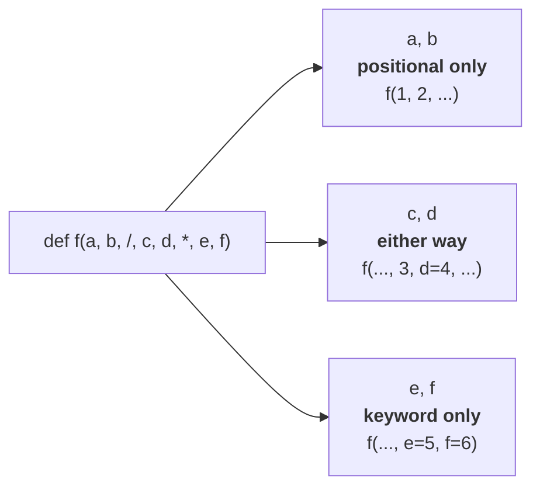
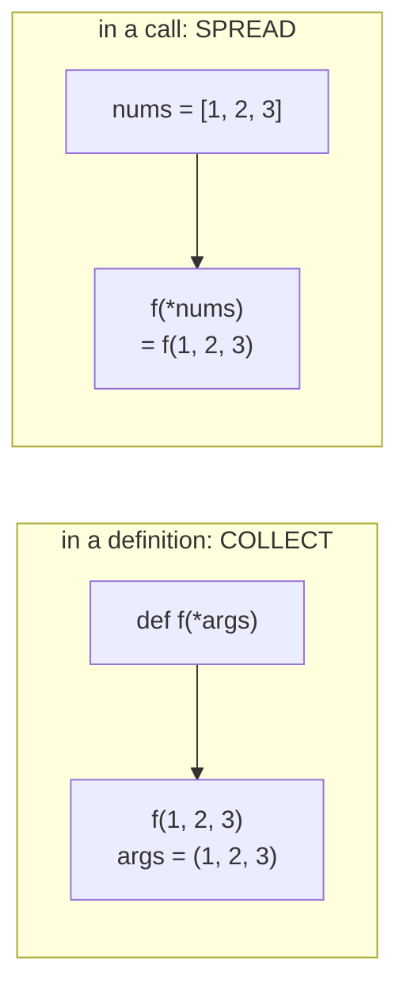
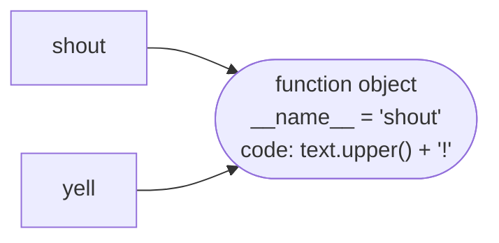
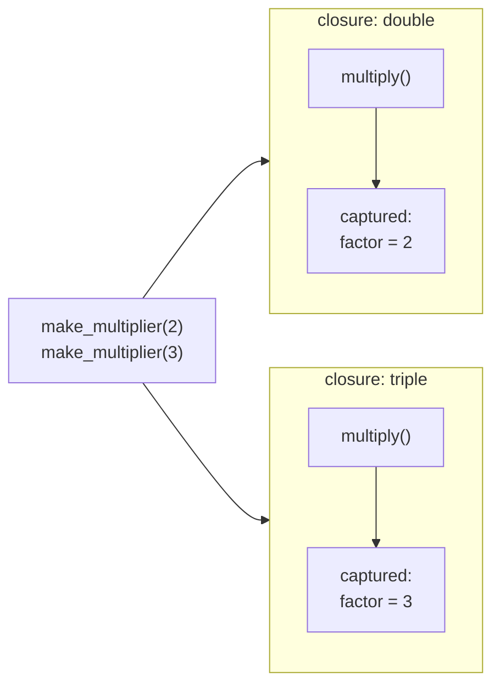

# Lesson 02 · Functions in depth

> **Level:** 🔵 Intermediate · **Time:** ~2.5 h · **Assignment:** [02 · Function toolkit](assignments/02-function-toolkit/)

In the Beginner level, functions were named blocks of code that you call. This lesson shows the other
half of the story: in Python a function is a **value** like a number or a list. You can store it in a
dict, pass it to another function, and even build new functions while the program runs. This is the
foundation for callbacks, `key=` arguments, decorators (Advanced level) and most of the standard library.

## What you will learn

- precise control over arguments: positional-only (`/`) and keyword-only (`*`) parameters
- unpacking with `*` and `**` when **calling** a function, and forwarding arguments
- functions as objects: storing, passing and returning them
- higher-order functions: `map`, `filter`, `sorted(key=...)`, and when a comprehension is better
- **closures**: inner functions that remember their surroundings
- `nonlocal`, the late-binding trap, and `functools.partial`

---

## 1. Recap: the kinds of parameters

```python
def greet(name, greeting="Hello", *others, sep=", ", **options):
    ...
```

| Parameter | Kind | Filled by |
|---|---|---|
| `name` | positional or keyword | `greet("Ada")` or `greet(name="Ada")` |
| `greeting="Hello"` | with a default | optional |
| `*others` | collects extra **positional** arguments into a tuple | `greet("Ada", "Hi", "Grace", "Linus")` |
| `sep=", "` | **keyword-only** (it comes after `*others`) | only `sep=" & "` |
| `**options` | collects extra **keyword** arguments into a dict | `greet("Ada", loud=True)` |

## 2. Keyword-only and positional-only parameters

A bare `*` in the parameter list means: **everything after it must be passed by keyword**.

```python
def connect(host, port, *, timeout=10, retries=3):
    ...

connect("example.com", 443, timeout=5)    # ✅ clear
connect("example.com", 443, 5, 3)         # ❌ TypeError: takes 2 positional arguments but 4 were given
```

Why force keywords? A call like `connect("example.com", 443, 5, 3)` is unreadable: is `5` the timeout
or the retries? Keyword-only parameters make every call site self-explaining, and you can later add or
reorder options without breaking anybody's code. Use them for **options and flags**, especially booleans.

A `/` does the opposite: everything **before** it must be passed by position.

```python
def distance(x, y, /):
    return (x ** 2 + y ** 2) ** 0.5

distance(3, 4)          # → 5.0
distance(x=3, y=4)      # ❌ TypeError: got some positional-only arguments passed as keyword arguments
```

That keeps parameter names private, so you can rename them freely. Many built-ins work this way:
`len(obj=[1])` does not work either.



## 3. Unpacking arguments when calling

`*` and `**` also work **in a call**, in the opposite direction: they spread a collection out into
separate arguments.

```python
def volume(length, width, height):
    return length * width * height

size = [2, 3, 4]
volume(*size)                     # → 24     same as volume(2, 3, 4)

box = {"length": 2, "width": 3, "height": 4}
volume(**box)                     # → 24     same as volume(length=2, width=3, height=4)
```



Together they let a function **forward** whatever it receives, without knowing what that is:

```python
def logged(func, *args, **kwargs):
    print(f"calling {func.__name__} with {args} {kwargs}")
    return func(*args, **kwargs)

logged(volume, 2, 3, height=4)
# calling volume with (2, 3) {'height': 4}
# → 24
```

Unpacking works in literals, too: `[*a, *b]` joins two lists, `{**defaults, **overrides}` merges two
dicts (the right one wins for duplicate keys).

## 4. Functions are objects

`def` creates a function **object** and binds a name to it. That name is a variable like any other:

```python
def shout(text):
    return text.upper() + "!"

yell = shout              # no brackets: the function itself, not a call
yell("hi")                # → 'HI!'
shout.__name__            # → 'shout'
type(shout)               # → <class 'function'>
```



So you can do everything with functions that you do with other values:

```python
# store them in a dict: a "dispatch table" instead of a long if/elif chain
operations = {
    "+": lambda a, b: a + b,
    "-": lambda a, b: a - b,
    "*": lambda a, b: a * b,
}
operations["*"](6, 7)      # → 42

# pass them to other functions
def apply_twice(func, value):
    return func(func(value))

apply_twice(shout, "hi")   # → 'HI!!'
```

A function that takes or returns another function is called a **higher-order function**. You already
used one: `sorted(names, key=len)` receives the function `len` and calls it on every item.

## 5. `map`, `filter` and comprehensions

`map(func, items)` calls `func` on every item; `filter(func, items)` keeps the items for which `func`
returns something truthy. Both return **lazy iterators**:

```python
words = ["  apple", "Fig ", " banana"]
list(map(str.strip, words))                    # → ['apple', 'Fig', 'banana']
list(filter(str.isupper, ["A", "b", "C"]))     # → ['A', 'C']
```

Everything `map` and `filter` do, a comprehension does too, often more readably:

```python
[word.strip() for word in words]               # same as map
[c for c in ["A", "b", "C"] if c.isupper()]    # same as filter
```

Rule of thumb: when you already **have** a named function (`str.strip`, `int`), `map` is short and
clear. When you would need a `lambda`, write a comprehension instead.

`lambda` creates a small anonymous function from a **single expression**. It is perfect for `key=`
and dispatch tables, but if you give it a name (`double = lambda x: x * 2`), use `def` instead: you
get a proper name in tracebacks and room for a docstring.

## 6. Closures: functions that remember

A function defined **inside** another function can use the outer function's variables, even **after
the outer function has returned**:

```python
def make_multiplier(factor):
    def multiply(number):
        return number * factor        # `factor` comes from the enclosing function
    return multiply                   # return the function itself, not a call

double = make_multiplier(2)
triple = make_multiplier(3)
double(5)                             # → 10
triple(5)                             # → 15
```

Normally a function's local variables disappear when it returns. But `multiply` still needs `factor`,
so Python keeps it alive and attaches it to the inner function. A function together with the variables
it captured is called a **closure**.



Each call of `make_multiplier` creates a **new** inner function with its **own** captured `factor`.
You can see it: `double.__closure__[0].cell_contents` → `2`.

Closures are a lightweight way to make **configured** functions: a validator with a given limit, a
formatter with a given currency, a callback that knows which button was clicked.

### Changing a captured variable: `nonlocal`

Reading a captured variable just works. **Assigning** to it does not, because an assignment inside a
function creates a new local variable (beginner lesson 09, LEGB):

```python
def make_counter():
    count = 0
    def counter():
        nonlocal count        # "count is the variable of the enclosing function"
        count += 1            # without nonlocal: UnboundLocalError
        return count
    return counter

tick = make_counter()
tick(), tick(), tick()        # → (1, 2, 3)
```

`nonlocal` is to enclosing functions what `global` is to the module. Use it sparingly: once a closure
keeps several pieces of changing state, a **class** (lesson 03) is usually clearer.

### The late-binding trap

A closure captures the **variable**, not its value at that moment. The value is looked up when the
inner function **runs**:

```python
multipliers = [lambda x: x * i for i in range(3)]
[m(10) for m in multipliers]        # → [20, 20, 20]   not [0, 10, 20]!
```

All three lambdas share the same `i`, which is `2` once the loop has finished. Fix it by giving each
function its own variable, for example by calling a factory function:

```python
multipliers = [make_multiplier(i) for i in range(3)]
[m(10) for m in multipliers]        # → [0, 10, 20]
```

## 7. `functools.partial`

Sometimes you want an existing function with some arguments **already filled in**. `partial` does that
without writing a closure by hand:

```python
from functools import partial

def power(base, exponent):
    return base ** exponent

square = partial(power, exponent=2)
square(7)                             # → 49

parse_binary = partial(int, base=2)
parse_binary("1011")                  # → 11
```

---

## Common mistakes

**Calling instead of passing.** `sorted(names, key=len())` calls `len` with no argument: `TypeError`.
Pass the function: `key=len`.

**Assigning to a captured variable without `nonlocal`.** You get `UnboundLocalError: cannot access local
variable 'count'`.

**The late-binding trap.** Closures created in a loop all see the loop variable's **last** value.

**Long lambdas.** If it does not fit comfortably on one line, or you give it a name, use `def`.

**Too many positional parameters.** `send(msg, True, False, 3)` is unreadable. Make options keyword-only.

**Forgetting to forward `**kwargs`.** A wrapper that calls `func(*args)` silently drops keyword arguments.

## Try it yourself

1. Define `def f(a, /, b, *, c): ...` and try every combination of passing `a`, `b` and `c` by position and keyword.
2. Merge `{"debug": False, "port": 80}` and `{"port": 8080}` with `{**a, **b}`. Swap the order. What changes?
3. Build a dispatch table that maps `"upper"`, `"lower"` and `"title"` to the matching `str` methods and use it in a loop.
4. Write `make_greeter(greeting)` that returns a function `greet(name)`. Inspect `greet.__closure__`.
5. Reproduce the late-binding trap, then fix it with a default argument: `lambda x, i=i: x * i`. Why does that work?

## Summary

- `*` in a parameter list makes the following parameters **keyword-only**; `/` makes the previous ones **positional-only**.
- In a call, `*items` and `**mapping` **spread** a collection into arguments; `func(*args, **kwargs)` forwards everything.
- Functions are objects: store them in dicts, pass them as arguments, return them from functions.
- A **closure** is an inner function plus the variables it captured from the enclosing function. Use `nonlocal` to reassign them.
- Closures capture variables, not values (**late binding**). `functools.partial` pre-fills arguments.

## Assignment

➡️ **[02 · Function toolkit](assignments/02-function-toolkit/)**: build functions that take, combine and return other functions.

---

<p align="center">
  <a href="../01-comprehensions/">← Previous: 01 · Comprehensions</a> · <a href="../README.md">Intermediate overview</a> · <a href="../03-classes-and-objects/">Next: 03 · Classes and objects →</a>
</p>
