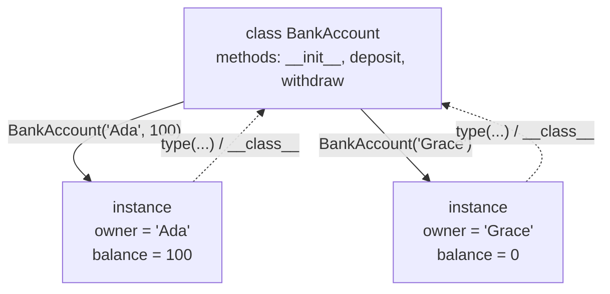
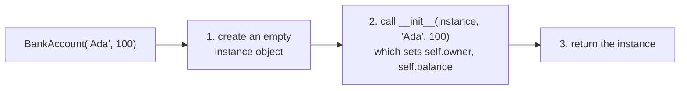
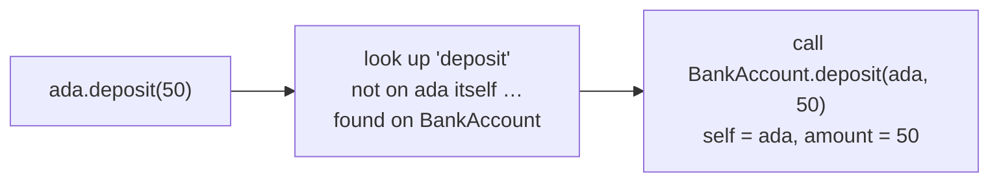
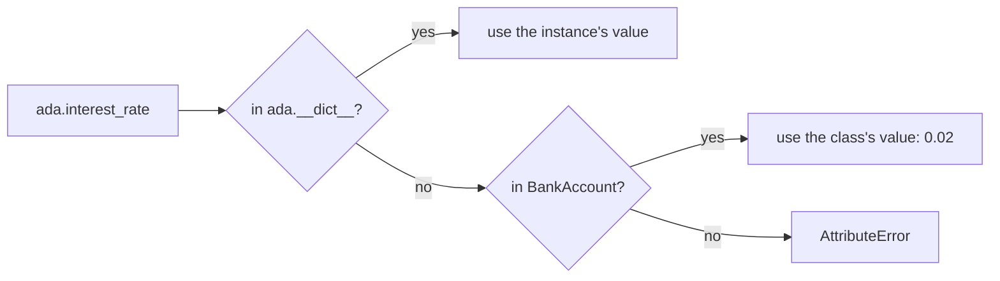

# Lesson 03 · Classes and objects

> **Level:** 🔵 Intermediate · **Time:** ~3 h · **Assignment:** [03 · Bank account](assignments/03-bank-account/)

Every value you have used so far is an object: `"hello"` is a `str` object with methods like `.upper()`,
`[1, 2]` is a `list` object with `.append()`. A **class** is how you make your own types: you bundle data
(an account's owner and balance) with the operations that belong to it (deposit, withdraw), and you
protect the rules (a balance never goes below zero) in one place. This lesson explains how classes work
under the hood, including the mysterious `self`.

## What you will learn

- what a class and an instance are, and how they relate
- `__init__`, `self`, attributes and methods, and what really happens on `account.deposit(50)`
- instance attributes vs class attributes, and the shared-mutable trap
- `__repr__` and `__str__`: how your objects print
- `__eq__`: when two objects count as equal
- protecting data: the `_name` convention and `@property`
- alternative constructors with `@classmethod`, and `@staticmethod`

---

## 1. Why classes?

Without classes, you would represent an account as a dict and write functions that work on it:

```python
account = {"owner": "Ada", "balance": 100}

def deposit(account, amount):
    account["balance"] += amount
```

That works, but nothing stops anyone from writing `account["balance"] = -5000` or `account["balnce"] = 0`
(typo, new key, no error). The data and its rules live in different places. A class puts them together:

```python
class BankAccount:
    def __init__(self, owner, balance=0):
        self.owner = owner
        self.balance = balance

    def deposit(self, amount):
        if amount <= 0:
            raise ValueError("deposit must be positive")
        self.balance += amount

account = BankAccount("Ada", 100)
account.deposit(50)
account.balance            # → 150
```

## 2. Class and instance

A **class** is a blueprint. An **instance** (or object) is one concrete thing built from it. You can
create as many instances as you like; each has its **own data** but they **share the methods** of their class.



```python
ada = BankAccount("Ada", 100)
grace = BankAccount("Grace")
type(ada)                       # → <class '__main__.BankAccount'>
isinstance(ada, BankAccount)    # → True
ada.balance, grace.balance      # → (100, 0)
```

By convention, class names use `CapWords` (`BankAccount`), unlike functions and variables (`snake_case`).

## 3. What `BankAccount("Ada", 100)` does

Calling the class creates an instance in two steps:



`__init__` (say "dunder init", for **d**ouble **under**score) is the **initialiser**. It does not create the
object; it receives the brand-new, empty object as its first argument and fills it in. Its job is to
make sure that every instance starts in a **valid state**.

## 4. What `self` is

`self` is simply the **instance the method was called on**. When you write

```python
ada.deposit(50)
```

Python looks up `deposit` on the class and calls it with the instance as the first argument:

```python
BankAccount.deposit(ada, 50)     # exactly the same thing
```



So inside a method, `self.balance` means "the balance of **this particular** account". The name `self`
is only a convention, but a universal one: always use it.

**Attributes** are names attached to an object. You create them by assigning: `self.owner = owner`.
You can see an instance's own attributes in its `__dict__`:

```python
ada.__dict__          # → {'owner': 'Ada', 'balance': 150}
```

Yes, an instance is (almost) a dict with a class attached. The class adds methods and rules.

## 5. Instance attributes vs class attributes

An attribute assigned **in the class body** belongs to the class and is **shared** by all instances:

```python
class BankAccount:
    interest_rate = 0.02              # class attribute: one value for all accounts

    def __init__(self, owner, balance=0):
        self.owner = owner            # instance attributes: one per account
        self.balance = balance

    def add_interest(self):
        self.balance += self.balance * self.interest_rate
```

When you read `self.interest_rate`, Python looks in the **instance** first, then in the **class**:



Class attributes are good for **constants** and settings shared by all instances. Be careful with
**mutable** class attributes:

```python
class Basket:
    items = []                  # ❌ ONE list, shared by every basket

    def add(self, item):
        self.items.append(item)

a, b = Basket(), Basket()
a.add("apple")
b.items                         # → ['apple']   b sees a's apple!
```

It is the class-level version of the mutable default trap. Create mutable data in `__init__`:
`self.items = []`.

## 6. How your objects print: `__repr__` and `__str__`

By default an object prints unhelpfully:

```python
ada                   # → <__main__.BankAccount object at 0x104f3a2d0>
```

Methods with double underscores on both sides are **special methods**: Python calls them for you in
certain situations. Two of them control printing:

```python
class BankAccount:
    ...
    def __repr__(self):
        return f"BankAccount(owner={self.owner!r}, balance={self.balance!r})"

    def __str__(self):
        return f"{self.owner}'s account: {self.balance:.2f} EUR"
```

```python
ada                   # → BankAccount(owner='Ada', balance=150)      the REPL uses repr()
print(ada)            # Ada's account: 150.00 EUR                     print uses str()
[ada]                 # → [BankAccount(owner='Ada', balance=150)]     containers use repr()
```

| | `__repr__` | `__str__` |
|---|---|---|
| for | developers: debugging, logs, the REPL | end users: `print`, f-strings |
| goal | unambiguous; ideally valid Python that recreates the object | readable |
| if missing | default `<... object at 0x...>` | falls back to `__repr__` |

**Always write a `__repr__`.** It makes every debugging session easier. (`!r` in an f-string uses
`repr()`, so strings get their quotes.)

## 7. Equality: `__eq__`

By default, `==` on your objects compares **identity**, like `is`:

```python
BankAccount("Ada", 100) == BankAccount("Ada", 100)   # → False: two different objects
```

To compare by value, define `__eq__`:

```python
def __eq__(self, other):
    if not isinstance(other, BankAccount):
        return NotImplemented           # "I don't know how to compare with that"
    return (self.owner, self.balance) == (other.owner, other.balance)
```

Returning `NotImplemented` (a special constant, not an exception) lets Python try the other object's
`__eq__` and finally fall back to `False`. Note: a class that defines `__eq__` becomes **unhashable**
(it can no longer be a dict key or set member) unless you also define `__hash__`. Lesson 05 shows how
dataclasses handle all of this for you.

## 8. Protecting data: `_name` and `@property`

Python has no `private` keyword. Instead there is a convention: a name starting with **one underscore**
is *internal*: "do not touch this from outside the class". Nothing enforces it, but every Python
programmer respects it.

To give read access while keeping control, use a **property**: a method that is accessed like an attribute.

```python
class BankAccount:
    def __init__(self, owner, balance=0):
        if balance < 0:
            raise ValueError("balance must not be negative")
        self.owner = owner
        self._balance = balance           # internal storage

    @property
    def balance(self):                    # read with account.balance (no brackets)
        return self._balance

    def deposit(self, amount):
        if amount <= 0:
            raise ValueError("deposit must be positive")
        self._balance += amount
```

```python
ada = BankAccount("Ada", 100)
ada.balance            # → 100
ada.balance = 1_000_000   # ❌ AttributeError: property 'balance' of 'BankAccount' object has no setter
```

Now the only way to change the balance is through methods that check the rules. You can also add a
**setter** that validates every assignment:

```python
    @property
    def owner(self):
        return self._owner

    @owner.setter
    def owner(self, value):
        if not value.strip():
            raise ValueError("owner must not be empty")
        self._owner = value.strip()
```

Start with plain attributes. Turn one into a property when you need a rule. The calling code does not
change, because `account.owner` looks the same either way.

## 9. `@classmethod` and `@staticmethod`

A **class method** receives the **class** (by convention `cls`) instead of an instance. Its main use is
**alternative constructors**: other ways to create an instance.

```python
class BankAccount:
    ...
    @classmethod
    def from_string(cls, text):
        owner, balance = text.split(":")
        return cls(owner, float(balance))    # cls is BankAccount (or a subclass, lesson 04)

BankAccount.from_string("Ada:100")       # → BankAccount(owner='Ada', balance=100.0)
```

You already know one: `dict.fromkeys(["a", "b"], 0)`. A **static method** receives neither the instance nor
the class; it is a plain function that lives in the class namespace because it belongs there thematically.
Often a module-level function is just as good.

| Decorator | First parameter | Typical use |
|---|---|---|
| (none) | `self`: the instance | normal methods |
| `@classmethod` | `cls`: the class | alternative constructors, class-wide counters |
| `@staticmethod` | none | helper that belongs to the class thematically |

---

## Common mistakes

**Forgetting `self` in the parameter list.** `def deposit(amount):` then `ada.deposit(50)` gives
`TypeError: deposit() takes 1 positional argument but 2 were given`. The instance is always passed first.

**Forgetting `self.` inside a method.** `balance += amount` creates or reads a local variable, not the attribute.

**Mutable class attributes.** `items = []` in the class body is shared by all instances. Create it in `__init__`.

**Calling the class without brackets.** `account = BankAccount` binds the class itself, not a new instance.

**Validating only in `__init__`.** If methods or attribute assignments can break the rules later, the
check in `__init__` is not enough. Use properties and methods that check.

**No `__repr__`.** Debugging a list of `<object at 0x...>` is miserable.

## Try it yourself

1. Create two accounts and compare `ada.__dict__`, `grace.__dict__` and `BankAccount.__dict__.keys()`.
2. Call a method the long way: `BankAccount.deposit(ada, 10)`. Check the balance.
3. Set `ada.interest_rate = 0.1` and compare `ada.interest_rate` with `grace.interest_rate`. Where did the new value go?
4. Reproduce the shared `Basket.items` bug, then fix it.
5. Remove `__str__` from your class. What does `print(ada)` show now?

## Summary

- A **class** is a blueprint; calling it creates an **instance** and runs `__init__` to fill it in.
- `obj.method(x)` is `Class.method(obj, x)`: **`self` is the instance**. Attributes live in the instance's `__dict__`.
- Class attributes are **shared**; never put mutable data there. Instance attributes are created in `__init__`.
- Write a `__repr__` for every class; `__str__` when users see it; `__eq__` when equality means "same values".
- `_name` means internal. `@property` gives controlled, attribute-style access. `@classmethod` makes alternative constructors.

## Assignment

➡️ **[03 · Bank account](assignments/03-bank-account/)**: a class that guards its own rules.

---

<p align="center">
  <a href="../02-functions-in-depth/">← Previous: 02 · Functions in depth</a> · <a href="../README.md">Intermediate overview</a> · <a href="../04-inheritance-and-composition/">Next: 04 · Inheritance and composition →</a>
</p>
