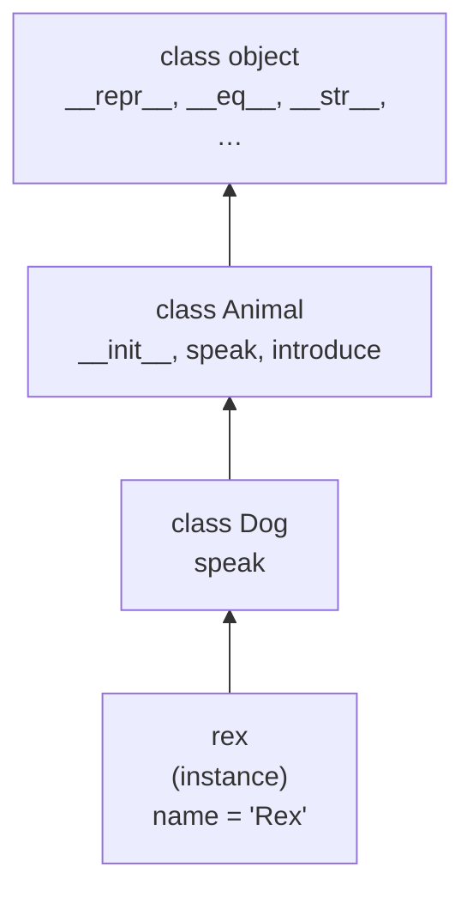
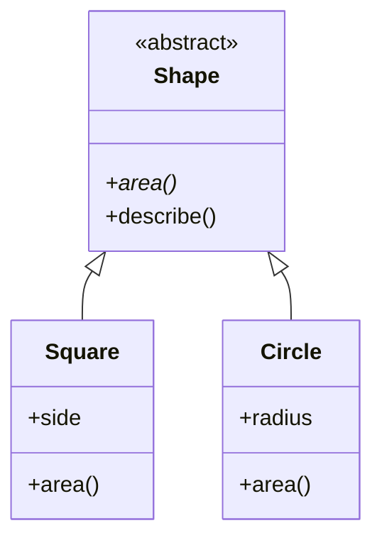
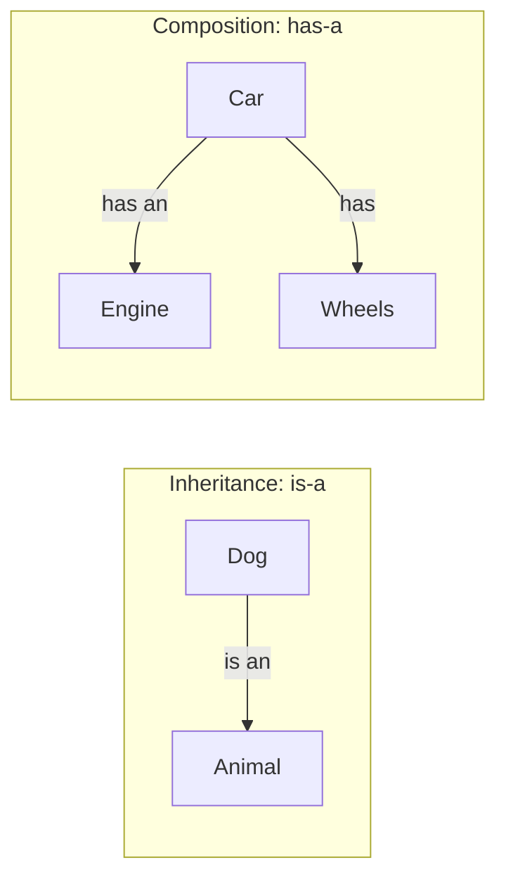

# Lesson 04 · Inheritance and composition

> **Level:** 🔵 Intermediate · **Time:** ~2.5 h · **Assignment:** [04 · Shapes](assignments/04-shapes/)

Once you have a few classes, you notice that some of them are **special cases** of others (a savings
account *is* a bank account), and some are **built from** others (a car *has* an engine). Python gives
you a tool for each: **inheritance** and **composition**. This lesson shows how both work, how Python
finds a method when classes inherit from each other, and how to choose between them.

## What you will learn

- defining a subclass, and how attribute lookup walks up the class chain
- overriding methods, and extending them with `super()`
- polymorphism: one call, different behaviour, and Python's duck typing
- abstract base classes with `abc.ABC` and `@abstractmethod`
- your own exception hierarchy
- composition ("has-a") and why it is often the better choice
- a short look at multiple inheritance and the MRO

---

## 1. A subclass

```python
class Animal:
    def __init__(self, name):
        self.name = name

    def speak(self):
        return "..."

    def introduce(self):
        return f"I am {self.name} and I say {self.speak()}"


class Dog(Animal):              # Dog inherits from Animal
    def speak(self):            # and overrides one method
        return "Woof"
```

```python
rex = Dog("Rex")
rex.introduce()                 # → 'I am Rex and I say Woof'
isinstance(rex, Dog)            # → True
isinstance(rex, Animal)         # → True: a Dog IS an Animal
issubclass(Dog, Animal)         # → True
```

`Dog` gets everything `Animal` has (`__init__`, `introduce`) and replaces `speak`. `Animal` is called the
**base class** (or parent, superclass), `Dog` the **subclass** (child).

## 2. How Python finds a method

Lesson 03 showed that `obj.attr` looks in the instance first, then in its class. With inheritance, the
search simply continues **up the chain** of base classes, ending at `object`, the root of every class:



- `rex.speak()`: found on `Dog`. Python stops searching, so `Animal.speak` is **overridden**.
- `rex.introduce()`: not on `Dog`, found on `Animal`.
- `rex.__repr__()`: found all the way up on `object`. That is where the default `<... object at 0x...>` comes from.

Notice the subtle part: inside `introduce`, `self.speak()` is looked up on **`self`**, which is a `Dog`.
So code written in the base class automatically calls the subclass's version. This is what makes
inheritance powerful: the base class defines the **algorithm**, the subclasses fill in the **details**.

You can print the search order: `Dog.__mro__` → `(Dog, Animal, object)` (MRO = method resolution order).

## 3. Extending with `super()`

Often a subclass wants to **add** to a method instead of replacing it. `super()` gives you the parent's
version:

```python
class Dog(Animal):
    def __init__(self, name, breed):
        super().__init__(name)        # let Animal set up what it knows about
        self.breed = breed            # then add our own part

    def speak(self):
        return "Woof"

    def introduce(self):
        return super().introduce() + f" (a {self.breed})"
```

```python
Dog("Rex", "beagle").introduce()      # → 'I am Rex and I say Woof (a beagle)'
```

If a subclass defines `__init__` and forgets to call `super().__init__(...)`, the parent's attributes
are never set: `AttributeError: 'Dog' object has no attribute 'name'` later, far from the real cause.

## 4. Polymorphism and duck typing

**Polymorphism** means: the same call does the right thing for different types.

```python
class Cat(Animal):
    def speak(self):
        return "Meow"

for animal in [Dog("Rex", "beagle"), Cat("Tom"), Animal("Generic")]:
    print(animal.speak())        # Woof / Meow / ...
```

The loop does not care which class each object has. In Python it does not even need a common base
class. Any object with a `speak()` method works:

```python
class Robot:
    def speak(self):
        return "Beep"
```

This is **duck typing**: "if it walks like a duck and quacks like a duck, it is a duck". Python checks
whether an object **can do** what you ask at the moment you ask, not what it **is**. That is why
`for` works on lists, strings, files and dicts alike: they all support iteration.

So check behaviour, not types: avoid `if type(x) == Dog: ... elif type(x) == Cat: ...`. Put the varying
behaviour in a method and call it.

## 5. Abstract base classes

Sometimes a base class only exists to define **what every subclass must provide**. Creating an
instance of it makes no sense. The `abc` module enforces this:

```python
from abc import ABC, abstractmethod

class Shape(ABC):
    @abstractmethod
    def area(self):
        """Return the area."""

    def describe(self):                       # a normal, inherited method
        return f"{type(self).__name__} with area {self.area():.2f}"


class Square(Shape):
    def __init__(self, side):
        self.side = side

    def area(self):
        return self.side ** 2
```

```python
Square(3).describe()      # → 'Square with area 9.00'
Shape()                   # ❌ TypeError: Can't instantiate abstract class Shape ... area
```

A subclass that forgets to implement `area` cannot be instantiated either. The mistake shows up
**immediately when you create the object**, not later when someone calls `area()`.



(`type(self).__name__` gives the name of the instance's actual class, so `describe` prints `Square`
or `Circle` without any `if`.)

## 6. Your own exception hierarchy

Exceptions are classes, and they use inheritance too (beginner lesson 10 showed the family tree).
Defining your own lets callers catch **your** errors specifically:

```python
class ShopError(Exception):
    """Base class for all errors of the shop module."""

class OutOfStock(ShopError):
    pass

class InvalidCoupon(ShopError, ValueError):     # also a ValueError for generic callers
    pass
```

```python
try:
    checkout(cart)
except OutOfStock:
    print("Sorry, sold out.")
except ShopError as error:            # any other error from the shop
    print("Shop problem:", error)
```

A `pass` body is enough; the class name carries the meaning. Name them after the problem and, for
the base class, end with `Error`.

## 7. Composition: "has-a" instead of "is-a"

Inheritance says **is-a**: a `Dog` *is an* `Animal`. Composition says **has-a**: the object keeps other
objects as attributes and **delegates** work to them.

```python
class Engine:
    def __init__(self, horsepower):
        self.horsepower = horsepower

    def start(self):
        return "Vroom"


class Car:
    def __init__(self, model, engine):
        self.model = model
        self.engine = engine           # a Car HAS an Engine

    def start(self):
        return f"{self.model}: {self.engine.start()}"   # delegate


Car("Beetle", Engine(50)).start()      # → 'Beetle: Vroom'
```



Why "favour composition over inheritance"?

- **Flexibility.** You can give a car a different engine at runtime: `car.engine = ElectricMotor()`.
  A class cannot change its base class.
- **Loose coupling.** A subclass depends on every detail of its parent; a change in the parent can
  break all subclasses. Composition only depends on the public methods.
- **No deep trees.** `ElectricSportsCabrioletCar(SportsCar(Car(Vehicle)))` gets hard to follow quickly.

A good test: if "B **is a** A" sounds right **and** B can be used everywhere an A is expected, inherit.
Otherwise, compose. A `Stack` that inherits from `list` would also inherit `insert` and `sort`, which
break the idea of a stack: a stack should **have** a list, not **be** one.

## 8. Multiple inheritance, briefly

A class can have several base classes: `class InvalidCoupon(ShopError, ValueError)` above. Python then
searches them in a well-defined order (the MRO, computed with an algorithm called C3) that you can
inspect with `ClassName.__mro__`. Outside of exceptions and small "mixin" classes that add one feature,
avoid it until you need it; the Advanced level covers it in depth.

---

## Common mistakes

**Forgetting `super().__init__(...)`.** The parent's attributes are missing, and the error appears much later.

**Inheriting just to reuse code.** If "is-a" does not hold, the subclass inherits methods that make
no sense for it. Use composition.

**Type checks instead of polymorphism.** `if isinstance(shape, Circle): ... elif isinstance(shape, Square): ...`
must change for every new shape. Call `shape.area()` instead.

**Deep inheritance trees.** More than two or three levels is hard to understand and to change.

**Overriding a method with a different signature.** If `Animal.speak()` takes no arguments, `Dog.speak(volume)`
breaks code that treats all animals the same.

**Catching `Exception` where your own exception class would do.** Define a hierarchy and catch precisely.

## Try it yourself

1. Print `Dog.__mro__` and `bool.__mro__`. What does `bool` inherit from?
2. Remove `super().__init__(name)` from `Dog.__init__` and call `introduce()`. Read the error.
3. Write a `Robot` class without any base class and use it in the polymorphism loop.
4. Create an abstract class with two abstract methods, implement only one in a subclass, and instantiate it.
5. Model a `Playlist` that **has** a list of songs. Which `list` methods should it expose, and which not?

## Summary

- `class B(A)` makes B a **subclass**: attribute lookup goes instance → B → A → `object` (the **MRO**).
- **Overriding** replaces a method; `super().method(...)` calls the parent's version to **extend** it.
- **Polymorphism / duck typing**: call the method and let each object respond in its own way.
- `ABC` + `@abstractmethod` define what subclasses must implement; abstract classes cannot be instantiated.
- Inheritance is **is-a**, composition is **has-a**. When in doubt, compose.

## Assignment

➡️ **[04 · Shapes](assignments/04-shapes/)**: an abstract base class, three shapes, a custom exception and a drawing that is composed of shapes.

---

<p align="center">
  <a href="../03-classes-and-objects/">← Previous: 03 · Classes and objects</a> · <a href="../README.md">Intermediate overview</a> · <a href="../05-dataclasses-and-enums/">Next: 05 · Dataclasses and enums →</a>
</p>
