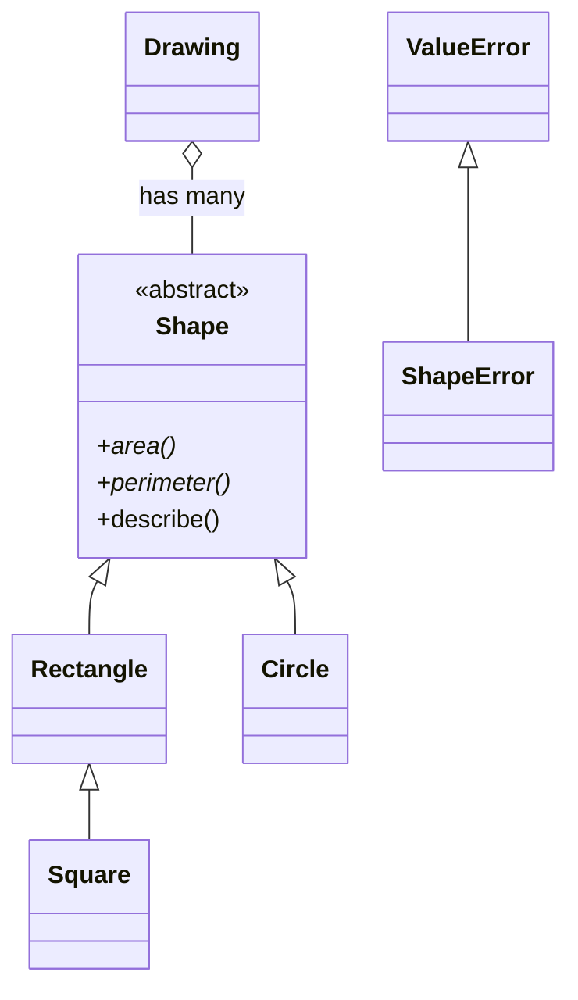

# Assignment 04 · Shapes

> **Lesson:** [04 · Inheritance and composition](../../) · **Difficulty:** ⭐⭐⭐☆☆ · **Time:** ~2 h

## Goal

Build a small geometry library: an **abstract** `Shape`, three concrete shapes (one of which inherits
from another), a custom exception, and a `Drawing` that is **composed** of shapes.



## What to write

| Name | Does |
|---|---|
| `ShapeError` | exception class, a subclass of `ValueError` |
| `Shape` | abstract base class with abstract methods `area()` and `perimeter()`, and a normal method `describe()` that returns e.g. `"Circle: area 3.14, perimeter 6.28"` (class name, both values with 2 decimals) |
| `Rectangle(width, height)` | a `Shape`. Width or height `<= 0` raises `ShapeError("width and height must be positive")`. `repr`: `Rectangle(width=2, height=3)` |
| `Square(side)` | a **subclass of `Rectangle`** that calls `super().__init__(side, side)`; a `side` property returns the side. `repr`: `Square(side=2)` |
| `Circle(radius)` | a `Shape`; uses `math.pi`. Radius `<= 0` raises `ShapeError("radius must be positive")`. `repr`: `Circle(radius=1)` |
| `Drawing()` | **has** a list of shapes (composition, not a subclass of `list`) |
| `Drawing.add(shape)` | adds a shape and returns the drawing itself (so calls can be chained). Anything that is not a `Shape` raises `TypeError` |
| `Drawing.total_area()` | the sum of all areas |
| `Drawing.largest()` | the shape with the largest area; `None` for an empty drawing |
| `Drawing.count_by_type()` | a dict `class name → count`, e.g. `{"Circle": 2, "Square": 1}` |

## Examples

```python
>>> Circle(1).describe()
'Circle: area 3.14, perimeter 6.28'
>>> Square(2)
Square(side=2)
>>> isinstance(Square(2), Rectangle)
True
>>> Shape()
Traceback (most recent call last):
TypeError: Can't instantiate abstract class Shape ...
>>> Rectangle(0, 5)
Traceback (most recent call last):
ShapeError: width and height must be positive
>>> drawing = Drawing().add(Square(2)).add(Circle(1)).add(Circle(2))
>>> round(drawing.total_area(), 2)
19.71
>>> drawing.largest()
Circle(radius=2)
>>> drawing.count_by_type()
{'Square': 1, 'Circle': 2}
```

## Hints

<details>
<summary>Hint 1: Shape and describe</summary>

`class Shape(ABC):` with two `@abstractmethod`s. In `describe`, `type(self).__name__` is the class name
of the actual object, and `self.area()` calls the subclass's implementation (polymorphism).
</details>

<details>
<summary>Hint 2: Square</summary>

`Square.__init__(self, side)` only calls `super().__init__(side, side)`. It inherits `area`,
`perimeter` and the validation. Override `__repr__` only. The `side` property returns `self.width`.
</details>

<details>
<summary>Hint 3: Drawing</summary>

Store the shapes in `self._shapes = []` in `__init__`. `largest` is `max(self._shapes, key=..., default=None)`.
For `count_by_type`, count `type(shape).__name__` with a dict (or `collections.Counter`, lesson 07,
converted with `dict(...)`).
</details>

## Check your work

```bash
pytest intermediate/04-inheritance-and-composition/assignments/04-shapes -v
```

## Done?

Compare with the [template solution](../../../../solutions/intermediate/04-inheritance-and-composition/assignments/04-shapes/exercise.py),
then tick off assignment 04 in the [progress checklist](../../../../README.md#progress-checklist).
