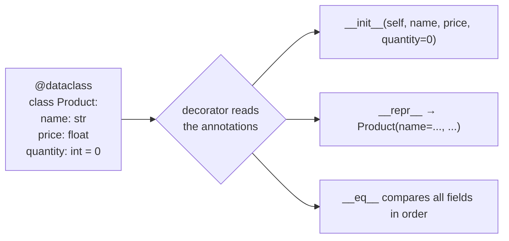
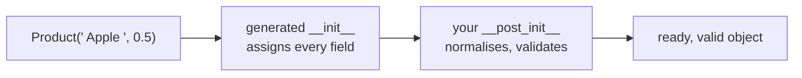
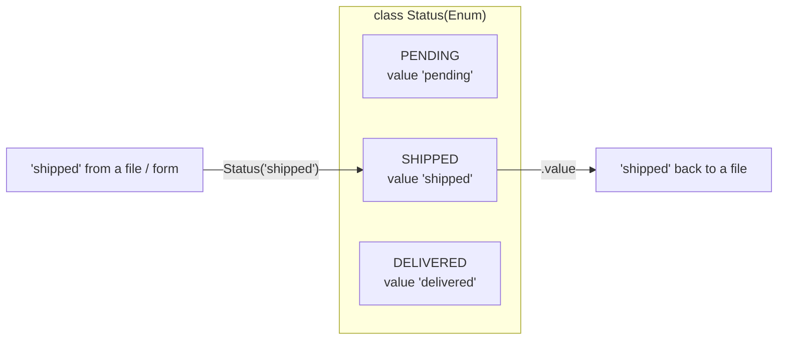

# Lesson 05 · Dataclasses and enums

> **Level:** 🔵 Intermediate · **Time:** ~2 h · **Assignment:** [05 · Inventory](assignments/05-inventory/)

Many classes exist mainly to **hold data**: a product, a point, a configuration. Writing `__init__`,
`__repr__` and `__eq__` by hand for each of them is repetitive and easy to get wrong. **Dataclasses**
generate that code for you. **Enums** solve a related problem: a value that must be one of a fixed set
of choices (a status, a colour, a category). Together they are the everyday way to model data in modern Python.

## What you will learn

- what `@dataclass` generates, and how it reads your type annotations
- defaults, `field(default_factory=...)`, and why mutable defaults are rejected
- validating and normalising in `__post_init__`
- `frozen=True` (immutable and hashable) and `order=True` (sortable)
- `asdict`, `replace` and other helpers
- `Enum`: members, names and values, iteration, lookup
- choosing between dict, tuple, `namedtuple`, dataclass and a normal class

---

## 1. The boilerplate problem

A simple class to hold a product needs a lot of code to be pleasant to use:

```python
class Product:
    def __init__(self, name, price, quantity=0):
        self.name = name
        self.price = price
        self.quantity = quantity

    def __repr__(self):
        return f"Product(name={self.name!r}, price={self.price!r}, quantity={self.quantity!r})"

    def __eq__(self, other):
        if not isinstance(other, Product):
            return NotImplemented
        return (self.name, self.price, self.quantity) == (other.name, other.price, other.quantity)
```

Each field name appears **five** times. Add a field and you must update three methods; forget one, and
`__eq__` silently ignores the new field.

## 2. `@dataclass`

```python
from dataclasses import dataclass

@dataclass
class Product:
    name: str
    price: float
    quantity: int = 0
```

That is the whole class, and it behaves exactly like the hand-written one above:

```python
apple = Product("apple", 0.5, 10)
apple                                   # → Product(name='apple', price=0.5, quantity=10)
apple == Product("apple", 0.5, 10)      # → True
Product("pear", 0.7).quantity           # → 0
```



The decorator looks at the **class annotations** (`name: str`), in order, and writes the methods for
you when the class is created. The annotations are required (that is how it finds the fields), but
Python does not **check** the types at runtime: `Product(42, "cheap")` works. Lesson 10 shows how type
checkers catch that before you run the code.

A dataclass is still a normal class: you can add methods, properties and class methods.

```python
@dataclass
class Product:
    name: str
    price: float
    quantity: int = 0

    @property
    def total_value(self):
        return self.price * self.quantity
```

## 3. Defaults and `field()`

Fields with a default must come **after** fields without one, exactly like function parameters.

A **mutable** default would be shared by all instances (the trap from lesson 03), so dataclasses refuse it:

```python
@dataclass
class Order:
    items: list = []        # ❌ ValueError: mutable default <class 'list'> for field items is not allowed: use default_factory
```

Use `field(default_factory=list)` instead: the factory is **called** for each new instance, so every
order gets its own fresh list.

```python
from dataclasses import dataclass, field

@dataclass
class Order:
    customer: str
    items: list[str] = field(default_factory=list)
    note: str = field(default="", repr=False)       # field() also controls repr, eq, …

a, b = Order("Ada"), Order("Grace")
a.items.append("tea")
b.items                     # → []   separate lists
```

## 4. Validation in `__post_init__`

The generated `__init__` only assigns. To check or normalise values, define `__post_init__`; the
generated `__init__` calls it at the very end:

```python
@dataclass
class Product:
    name: str
    price: float
    quantity: int = 0

    def __post_init__(self):
        self.name = self.name.strip().lower()
        if self.price < 0:
            raise ValueError(f"price must not be negative, got {self.price}")

Product("  Apple ", 0.5)        # → Product(name='apple', price=0.5, quantity=0)
Product("apple", -1)            # ❌ ValueError: price must not be negative, got -1
```



## 5. `frozen=True` and `order=True`

**`frozen=True`** makes instances **immutable**: assigning to a field raises an error. Frozen dataclasses
are also **hashable**, so they can be dict keys and set members.

```python
@dataclass(frozen=True)
class Point:
    x: float
    y: float

p = Point(1, 2)
p.x = 5                     # ❌ dataclasses.FrozenInstanceError: cannot assign to field 'x'
{p: "start"}                # ✅ works as a dict key
```

Use frozen dataclasses for **values**: things that are defined entirely by their data, like a point,
a date range or an amount of money. To "change" one, create a new one with `dataclasses.replace`:

```python
from dataclasses import replace
replace(p, x=5)             # → Point(x=5, y=2)   p itself is unchanged
```

**`order=True`** generates `<`, `<=`, `>`, `>=`, comparing the fields **as a tuple, in definition order**.
So the order of your fields decides how instances sort:

```python
@dataclass(frozen=True, order=True)
class Version:
    major: int
    minor: int
    patch: int = 0

sorted([Version(1, 10), Version(1, 2), Version(0, 9, 1)])
# → [Version(major=0, minor=9, patch=1), Version(major=1, minor=2, patch=0), Version(major=1, minor=10, patch=0)]
```

(Compare that with sorting the strings `"1.10"` and `"1.2"`, where `"1.10"` comes first.)

## 6. Helpers: `asdict`, `astuple`, `fields`

```python
from dataclasses import asdict, astuple, fields

asdict(Product("apple", 0.5, 10))        # → {'name': 'apple', 'price': 0.5, 'quantity': 10}
astuple(Point(1, 2))                     # → (1, 2)
[f.name for f in fields(Product)]        # → ['name', 'price', 'quantity']
```

`asdict` is the first step to saving objects as JSON (lesson 08).

## 7. Enums: a fixed set of choices

Strings like `"pending"`, `"shipped"`, `"delivered"` for a status are fragile: a typo (`"shiped"`) is
just another string and causes no error. An **enum** defines the allowed values once:

```python
from enum import Enum

class Status(Enum):
    PENDING = "pending"
    SHIPPED = "shipped"
    DELIVERED = "delivered"
```

```python
Status.SHIPPED                  # → <Status.SHIPPED: 'shipped'>
Status.SHIPPED.name             # → 'SHIPPED'
Status.SHIPPED.value            # → 'shipped'
Status("shipped")               # → <Status.SHIPPED: 'shipped'>   lookup by value (e.g. from a file)
Status["SHIPPED"]               # → <Status.SHIPPED: 'shipped'>   lookup by name
Status("shiped")                # ❌ ValueError: 'shiped' is not a valid Status
list(Status)                    # → [<Status.PENDING: 'pending'>, <Status.SHIPPED: 'shipped'>, <Status.DELIVERED: 'delivered'>]
Status.SHIPED                   # ❌ AttributeError: SHIPED    a typo fails loudly, unlike a string
```



Key facts:

- Each member exists **exactly once**, so compare with `is` or `==`: `if order.status is Status.SHIPPED:`.
- An enum member is **not** equal to its value: `Status.SHIPPED == "shipped"` is `False`. Convert at the
  edges of your program (`Status(text)` when reading, `.value` when writing), and use members inside.
- Enums can have methods, like any class.
- If the values do not matter, `auto()` numbers them for you: `PENDING = auto()`.

(Python 3.11 added `StrEnum`, whose members *are* strings. This course supports Python 3.10, so we use
a plain `Enum` with string values.)

## 8. Which structure for which data?

| You have … | Use |
|---|---|
| a quick, temporary bundle of values inside one function | a `tuple` or a `dict` |
| data from JSON whose keys you do not control | a `dict` (convert to a dataclass at the edge, lesson 08) |
| a fixed set of choices | an `Enum` |
| a value object (point, money, version): immutable, comparable | `@dataclass(frozen=True)` |
| a record with named fields and some behaviour | `@dataclass` |
| an object that guards complex rules and hides its state (bank account) | a normal class |

`collections.namedtuple` (lesson 07) is an older, tuple-based alternative to frozen dataclasses. You
will meet it in existing code; for new code, dataclasses are more flexible.

---

## Common mistakes

**Missing annotations.** `name = "x"` without `: str` is a **class attribute**, not a field. It does not
appear in `__init__`.

**Fields with defaults before fields without.** `TypeError: non-default argument 'price' follows default argument`.

**Mutable defaults.** Use `field(default_factory=list)` (or `dict`, `set`, …).

**Expecting runtime type checks.** Annotations are not enforced. Validate in `__post_init__` where it matters.

**Comparing an enum with its value.** `status == "shipped"` is always `False`. Compare members, or use `status.value`.

**Mutating a frozen dataclass.** Use `replace(obj, field=new_value)` to make a changed copy.

## Try it yourself

1. Write the `Product` dataclass and look at the generated code's effect: `help(Product)` shows the `__init__` signature.
2. Try a `list` default without `field`. Read the error message.
3. Create a frozen `Point` and put two equal points into a set. How many elements does the set have?
4. Sort a list of `Version` objects, then swap the field order in the class and sort again.
5. Define a `Weekday` enum with `auto()` values and print each member's `name` and `value`.

## Summary

- `@dataclass` reads the annotated fields and generates `__init__`, `__repr__` and `__eq__`.
- Mutable defaults need `field(default_factory=...)`. Validate and normalise in `__post_init__`.
- `frozen=True` → immutable and hashable value objects; change them with `replace()`. `order=True` → sortable by field order.
- `asdict()` turns a dataclass into a dict, ready for JSON.
- `Enum` defines a closed set of named constants. Convert with `Status(value)` and `.value` at the edges; compare members inside.

## Assignment

➡️ **[05 · Inventory](assignments/05-inventory/)**: model a shop's stock with an enum, a frozen dataclass and a validated dataclass.

---

<p align="center">
  <a href="../04-inheritance-and-composition/">← Previous: 04 · Inheritance and composition</a> · <a href="../README.md">Intermediate overview</a> · <a href="../06-iterators-and-generators/">Next: 06 · Iterators and generators →</a>
</p>
