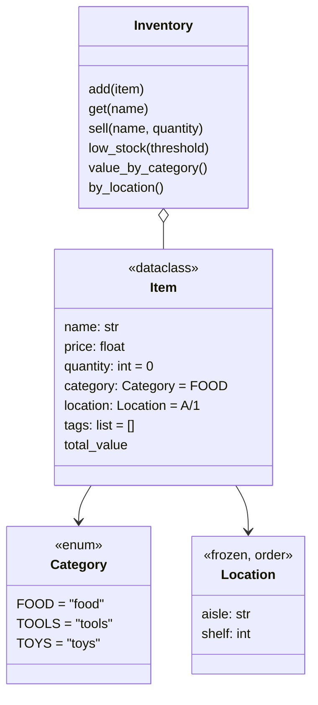

# Assignment 05 · Inventory

> **Lesson:** [05 · Dataclasses and enums](../../) · **Difficulty:** ⭐⭐⭐☆☆ · **Time:** ~2 h

## Goal

Model the stock of a small shop. You write an **enum** for the categories, a **frozen, ordered
dataclass** for shelf locations, a **validated dataclass** for items, and an `Inventory` class that
works with all three.



## What to write

| Name | Does |
|---|---|
| `Category` | an `Enum` with `FOOD = "food"`, `TOOLS = "tools"`, `TOYS = "toys"` |
| `Location(aisle, shelf)` | a dataclass with `frozen=True, order=True`, so locations sort by aisle, then shelf |
| `Item(name, price, quantity=0, category=Category.FOOD, location=Location("A", 1), tags=[])` | a dataclass (`tags` needs a `default_factory`). `__post_init__` **strips and lower-cases** the name and converts a **string** category to a `Category` (`"tools"` → `Category.TOOLS`, unknown → `ValueError`). Blank name, negative price or negative quantity: `ValueError` |
| `Item.total_value` | property: `price * quantity` |
| `Inventory()` | stores items by name |
| `Inventory.add(item)` | adds an item; a name that already exists raises `ValueError` |
| `Inventory.get(name)` | the item (the name is matched case-insensitively and stripped). Unknown: `KeyError` |
| `Inventory.sell(name, quantity)` | reduces the item's quantity and returns the price to pay (`price * quantity`). More than in stock: `ValueError("not enough <name> in stock")` and nothing changes. `quantity <= 0`: `ValueError` |
| `Inventory.low_stock(threshold=5)` | names of items with a quantity **below** the threshold, sorted |
| `Inventory.value_by_category()` | a dict `Category → total value` for the categories that have items |
| `Inventory.by_location()` | all items sorted by location, then by name |

## Examples

```python
>>> Item("  Apple ", 0.5, 10)
Item(name='apple', price=0.5, quantity=10, category=<Category.FOOD: 'food'>, location=Location(aisle='A', shelf=1), tags=[])
>>> Item("hammer", 12.0, category="tools").category
<Category.TOOLS: 'tools'>
>>> sorted([Location("B", 1), Location("A", 3), Location("A", 2)])
[Location(aisle='A', shelf=2), Location(aisle='A', shelf=3), Location(aisle='B', shelf=1)]
>>> shop = Inventory()
>>> shop.add(Item("apple", 0.5, 10))
>>> shop.add(Item("hammer", 12.0, 2, "tools", Location("C", 1)))
>>> shop.sell("Apple", 4)
2.0
>>> shop.get("apple").quantity
6
>>> shop.low_stock()
['hammer']
>>> shop.value_by_category()
{<Category.FOOD: 'food'>: 3.0, <Category.TOOLS: 'tools'>: 24.0}
```

## Hints

<details>
<summary>Hint 1: Item fields</summary>

```python
@dataclass
class Item:
    name: str
    price: float
    quantity: int = 0
    category: Category = Category.FOOD
    location: Location = Location("A", 1)     # fine: a frozen dataclass is immutable
    tags: list[str] = field(default_factory=list)
```
</details>

<details>
<summary>Hint 2: __post_init__</summary>

`Category("tools")` looks a member up by value and raises `ValueError` for unknown values. Only convert
when the category is not already a `Category`: `if not isinstance(self.category, Category): ...`.
</details>

<details>
<summary>Hint 3: Inventory</summary>

Keep a dict `self._items = {}` keyed by the (normalised) item name. Normalise the name in `get` the same
way `Item` does. `by_location` sorts with `key=lambda item: (item.location, item.name)`: the location
can be compared thanks to `order=True`.
</details>

## Check your work

```bash
pytest intermediate/05-dataclasses-and-enums/assignments/05-inventory -v
```

## Done?

Compare with the [template solution](../../../../solutions/intermediate/05-dataclasses-and-enums/assignments/05-inventory/exercise.py),
then tick off assignment 05 in the [progress checklist](../../../../README.md#progress-checklist).
