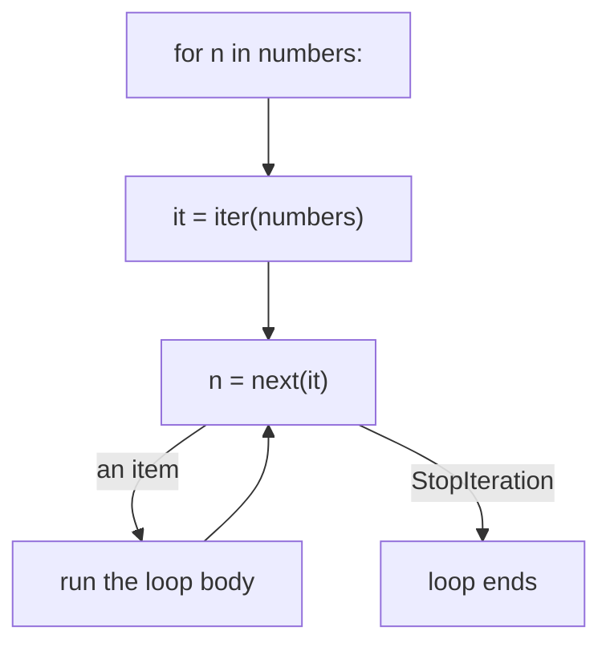
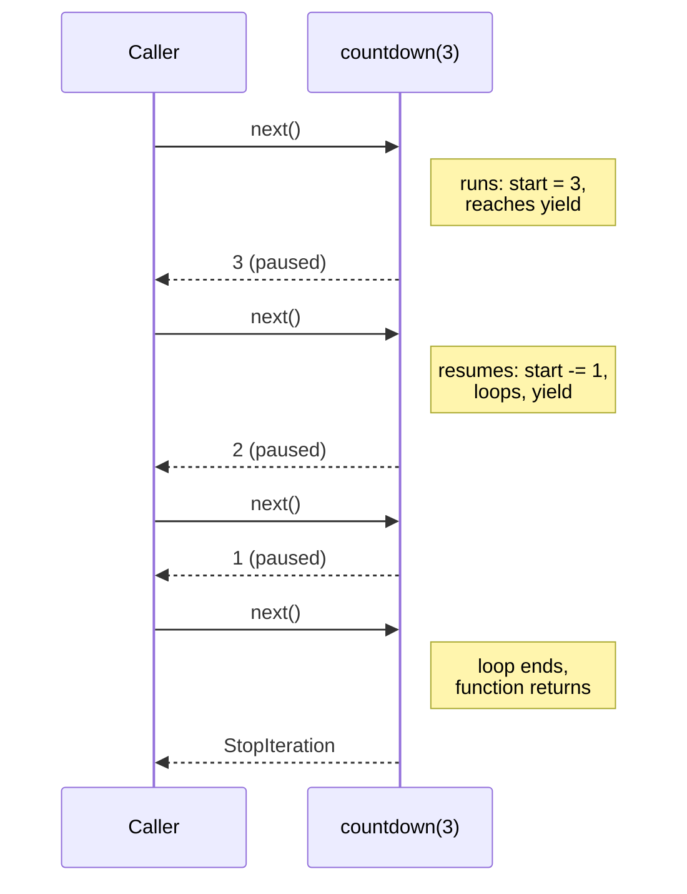
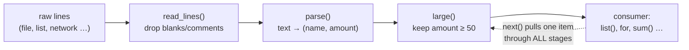

# Lesson 06 · Iterators and generators

> **Level:** 🔵 Intermediate · **Time:** ~3 h · **Assignments:** [06 · Custom iterators](assignments/06-custom-iterators/) · [07 · Lazy pipeline](assignments/07-lazy-pipeline/)

A `for` loop works on lists, strings, dicts, files, ranges and generator expressions. How does one
statement handle so many different things? Through a tiny agreement called the **iterator protocol**.
This lesson takes it apart, shows you how to write your own iterators, and then introduces
**generators**: functions that pause in the middle and continue later. With them you can process files
bigger than your memory, or even infinite streams, one item at a time.

## What you will learn

- the difference between an **iterable** and an **iterator**
- what a `for` loop really does with `iter()` and `next()`
- writing an iterator class with `__iter__` and `__next__`
- generator functions and `yield`: how a function can pause
- why generators are lazy, single-use and memory-friendly
- building data pipelines from small generators, `yield from`, infinite generators

---

## 1. Iterables and iterators

Two words that sound alike but mean different things:

| | Iterable | Iterator |
|---|---|---|
| what | something you **can loop over** | the object that **does the looping** and remembers the position |
| has | `__iter__()`, which returns an iterator | `__next__()`, which returns the next item or raises `StopIteration`, and `__iter__()` returning itself |
| examples | `list`, `str`, `dict`, `range`, `set` | what `iter(list)` returns, files, generators, `zip(...)`, `map(...)` |
| reusable? | yes: each `iter()` call starts a fresh iterator | no: once exhausted, it stays empty |

Think of a book (the iterable) and a bookmark (the iterator). One book can have many bookmarks, each at
its own page.

```python
numbers = [10, 20, 30]          # an iterable
it = iter(numbers)              # ask it for an iterator
next(it)                        # → 10
next(it)                        # → 20
next(it)                        # → 30
next(it)                        # ❌ StopIteration: no more items
```

## 2. What a `for` loop really does

```python
for n in numbers:
    print(n)
```

is executed like this:

```python
it = iter(numbers)              # 1. get an iterator
while True:
    try:
        n = next(it)            # 2. ask for the next item
    except StopIteration:       # 3. no more items: leave the loop
        break
    print(n)                    # 4. run the body
```



Every tool that consumes an iterable works the same way: `list()`, `sum()`, `max()`, `in`, `zip`,
unpacking `a, b = ...`, comprehensions. So if **your** object supports the protocol, it works with all
of them at once.

## 3. Writing an iterator class

```python
class Countdown:
    """Iterate from start down to 1."""

    def __init__(self, start):
        self.current = start

    def __iter__(self):
        return self                 # an iterator is its own iterator

    def __next__(self):
        if self.current <= 0:
            raise StopIteration     # the signal: "I am done"
        value = self.current
        self.current -= 1
        return value
```

```python
list(Countdown(3))              # → [3, 2, 1]
for n in Countdown(2):
    print(n)                    # 2, then 1
```

Because a `Countdown` keeps its position in `self.current`, it is **single-use**:

```python
c = Countdown(3)
list(c)                         # → [3, 2, 1]
list(c)                         # → []   already exhausted
```

To make a **reusable** iterable, `__iter__` must return a **new** iterator each time, instead of `self`.
The easiest way to do that is a generator, coming next.

## 4. Generator functions and `yield`

Writing `__iter__` and `__next__` by hand is clumsy. A **generator function** does the same with much
less code. It is a normal function that contains `yield`:

```python
def countdown(start):
    while start > 0:
        yield start             # hand out a value and PAUSE here
        start -= 1
```

```python
gen = countdown(3)              # nothing runs yet!
gen                             # → <generator object countdown at 0x...>
next(gen)                       # → 3   runs until the first yield
next(gen)                       # → 2   continues after the yield, until the next one
list(gen)                       # → [1] the rest
```

Calling a generator function does **not** run its body. It returns a **generator object**, which is an
iterator. Each `next()` runs the body until the next `yield`, hands out that value, and **freezes** the
function: local variables and the current line are kept. The next `next()` resumes right there. When
the function ends (or `return`s), the generator raises `StopIteration` for you.



### Reusable iterables with a generator method

Make `__iter__` itself a generator. Every `for` loop then calls `__iter__` again and gets a fresh
generator:

```python
class Countdown:
    def __init__(self, start):
        self.start = start

    def __iter__(self):             # a generator method
        current = self.start
        while current > 0:
            yield current
            current -= 1

c = Countdown(3)
list(c), list(c)                    # → ([3, 2, 1], [3, 2, 1])   reusable
```

## 5. Why lazy matters

A generator produces values **on demand**. It never holds more than the current item in memory.

```python
def read_big_file(path):
    with open(path, encoding="utf-8") as file:
        for line in file:           # the file object is lazy too
            yield line.rstrip("\n")
```

This reads a 20 GB log file with a few kilobytes of memory, because only one line exists at a time.
A function that returned `file.readlines()` would try to load all 20 GB at once.

Laziness also means generators can be **infinite**: they only compute what you ask for.

```python
def naturals():
    n = 1
    while True:                     # never ends, and that is fine
        yield n
        n += 1

from itertools import islice
list(islice(naturals(), 5))         # → [1, 2, 3, 4, 5]   take only the first five
```

(Do not call `list(naturals())`: that would run forever.)

## 6. Pipelines

Small generators can be chained into a **pipeline**, like an assembly line. Each stage takes an
iterable, transforms it lazily, and passes items on one by one:

```python
def read_lines(lines):
    for line in lines:
        line = line.strip()
        if line and not line.startswith("#"):
            yield line

def parse(lines):
    for line in lines:
        name, amount = line.split(",")
        yield name, float(amount)

def large(records, minimum):
    for name, amount in records:
        if amount >= minimum:
            yield name, amount

raw = ["# orders", "ada,120.5", "", "grace,30", "linus,99.9"]
pipeline = large(parse(read_lines(raw)), minimum=50)
list(pipeline)                      # → [('ada', 120.5), ('linus', 99.9)]
```



Nothing happens until the consumer asks. Then **one item at a time** travels through all stages. Each
stage is a small, testable function, and you can rearrange them like building blocks. The same idea
appears in Unix pipes (`cat | grep | sort`) and in data tools like pandas and Spark.

## 7. `yield from` and `return` in generators

`yield from iterable` yields every item of another iterable. It is perfect for delegating to another
generator, and for recursion:

```python
def flatten(nested):
    for item in nested:
        if isinstance(item, list):
            yield from flatten(item)     # hand out everything the inner call yields
        else:
            yield item

list(flatten([1, [2, [3, 4]], 5]))       # → [1, 2, 3, 4, 5]
```

A `return` inside a generator simply ends it (any `return value` is mostly used by advanced tools).

### Validating arguments eagerly

Because the body runs only on the first `next()`, a check at the top of a generator function runs **late**:

```python
def chunked(items, size):
    if size < 1:
        raise ValueError("size must be at least 1")    # runs only on the first next()!
    ...

chunks = chunked([1, 2, 3], 0)   # no error yet
list(chunks)                     # ❌ ValueError only now
```

That is acceptable in most cases. When you want the error immediately, split the function: a normal
function that validates and then `return`s a generator from an inner helper.

## 8. Generators vs lists: when to use which

| Use a generator when … | Use a list when … |
|---|---|
| the data is large or infinite | you need `len()`, indexing or slicing |
| you go through it once, in order | you go through it several times |
| you build a pipeline of steps | you need to sort it (sorting needs everything anyway) |
| the first results should come quickly | the data is small and simplicity wins |

Turning a generator into a list is always one call away: `list(gen)`.

---

## Common mistakes

**Iterating a generator twice.** The second loop does nothing. Create a new generator, or use a list.

**Expecting a generator function to run when called.** `countdown(3)` alone does nothing; you must iterate.

**`return` instead of `yield`.** A function with `return [x]` in a loop returns after the first item.

**`list()` on an infinite generator.** Your program hangs. Use `itertools.islice` or `break`.

**`len()` on a generator.** `TypeError: object of type 'generator' has no len()`. Count with `sum(1 for _ in gen)` (which consumes it).

**Raising `StopIteration` inside a generator.** Since Python 3.7 that becomes a `RuntimeError`. Just `return`.

**Changing a list while iterating over it.** Items get skipped. Iterate over a copy, or build a new list.

## Try it yourself

1. Call `iter()` on a list twice and compare the two iterators with `is`. Then call `iter()` on a generator twice.
2. Write the `while True` / `try` / `next` version of a `for` loop over `"abc"`.
3. Add `print` lines before and after the `yield` in `countdown` and step through it with `next()`.
4. Write `def squares(): ...` as an infinite generator and print the first 10 with `islice`.
5. Build the pipeline from section 6 over a real file, using `open(...)` as the first stage.

## Summary

- An **iterable** gives you an iterator via `iter()`; an **iterator** gives you items via `next()` and raises `StopIteration` at the end.
- `for` = `iter()` once, then `next()` until `StopIteration`. Support the protocol and every tool works with your objects.
- A function with `yield` returns a **generator**: it runs lazily, pauses at each `yield`, and is single-use.
- Generators use almost no memory, can be infinite, and chain into **pipelines** of small, testable stages.
- `yield from` delegates to another iterable. A generator method as `__iter__` makes a reusable iterable.

## Assignments

➡️ **[06 · Custom iterators](assignments/06-custom-iterators/)**: an iterator class and a reusable iterable class.
➡️ **[07 · Lazy pipeline](assignments/07-lazy-pipeline/)**: small generator functions that work on endless data.

---

<p align="center">
  <a href="../05-dataclasses-and-enums/">← Previous: 05 · Dataclasses and enums</a> · <a href="../README.md">Intermediate overview</a> · <a href="../07-standard-library-toolbox/">Next: 07 · The standard library toolbox →</a>
</p>
