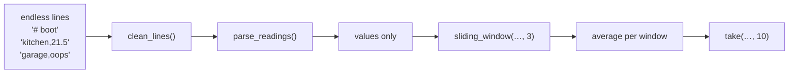

# Assignment 07 · Lazy pipeline

> **Lesson:** [06 · Iterators and generators](../../) · **Difficulty:** ⭐⭐⭐☆☆ · **Time:** ~2 h

## Goal

A temperature sensor network sends an endless stream of text lines. Build a toolbox of small
**generator functions** that can be chained into a pipeline and work on input of **any length, even
infinite**, without ever loading everything into memory.



## What to write

Every function except `take` must be a **generator function** (it contains `yield`). The tests check this.

| Function | Yields |
|---|---|
| `clean_lines(lines)` | each line stripped of surrounding whitespace; **blank lines and lines starting with `#` are skipped** |
| `parse_readings(lines)` | a tuple `(sensor, value)` with `value` as a `float`, for each line `"sensor,value"`. Lines without exactly one comma or with a value that is not a number are **skipped** |
| `running_total(numbers)` | the running sum: `1, 2, 3` → `1, 3, 6` |
| `chunked(iterable, size)` | lists of `size` items; the last one may be shorter. `size < 1` raises `ValueError` (when iteration starts is fine) |
| `sliding_window(iterable, size)` | tuples of `size` consecutive items: `1, 2, 3, 4` with size 2 → `(1, 2), (2, 3), (3, 4)`. Fewer than `size` items: nothing |
| `fibonacci()` | the infinite sequence `0, 1, 1, 2, 3, 5, 8, …` |
| `flatten(nested)` | every non-list, non-tuple item of arbitrarily nested lists and tuples, depth first |
| `take(iterable, n)` | **returns a list** with the first `n` items (fewer if the iterable is shorter). It must stop pulling items after `n`, so it works on infinite generators |

## Examples

```python
>>> list(clean_lines(["  # boot", "kitchen,21.5 ", "", "garage,oops"]))
['kitchen,21.5', 'garage,oops']
>>> list(parse_readings(["kitchen,21.5", "garage,oops", "a,b,c", "cellar,9"]))
[('kitchen', 21.5), ('cellar', 9.0)]
>>> list(running_total([1, 2, 3]))
[1, 3, 6]
>>> list(chunked("abcdefg", 3))
[['a', 'b', 'c'], ['d', 'e', 'f'], ['g']]
>>> list(sliding_window([1, 2, 3, 4], 2))
[(1, 2), (2, 3), (3, 4)]
>>> take(fibonacci(), 8)
[0, 1, 1, 2, 3, 5, 8, 13]
>>> list(flatten([1, [2, (3, [4])], 5]))
[1, 2, 3, 4, 5]
>>> take(running_total(fibonacci()), 5)
[0, 1, 2, 4, 7]
```

## Hints

<details>
<summary>Hint 1: parse_readings</summary>

Use `line.split(",")` and check the length. Converting with `float()` raises `ValueError` for non-numbers:
catch it and `continue`. Only `yield` after both checks passed (keep the `try` block small).
</details>

<details>
<summary>Hint 2: chunked and sliding_window</summary>

For `chunked`, collect items into a list and `yield` it when it reaches `size`; after the loop, yield
the rest if it is not empty. For `sliding_window`, `collections.deque(maxlen=size)` drops the oldest item
automatically when you append a new one; yield `tuple(window)` once it is full.
</details>

<details>
<summary>Hint 3: take and flatten</summary>

`take` can use `itertools.islice(iterable, n)`, or a loop with `enumerate` and `break`. Careful: checking
`if i >= n: break` *after* pulling the item pulls one item too many. `flatten` calls itself with
`yield from` for lists and tuples.
</details>

## Check your work

```bash
pytest intermediate/06-iterators-and-generators/assignments/07-lazy-pipeline -v
```

## Done?

Compare with the [template solution](../../../../solutions/intermediate/06-iterators-and-generators/assignments/07-lazy-pipeline/exercise.py),
then tick off assignment 07 in the [progress checklist](../../../../README.md#progress-checklist).
