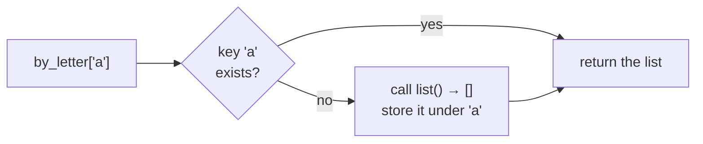
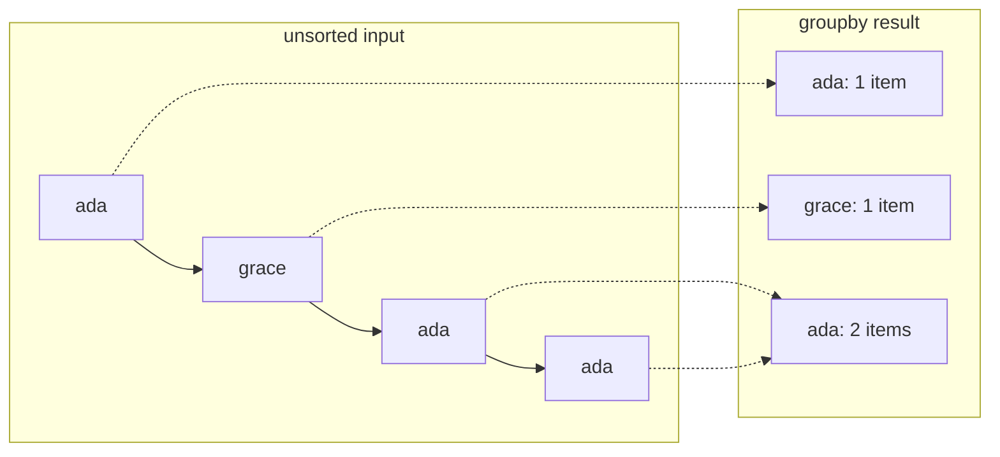
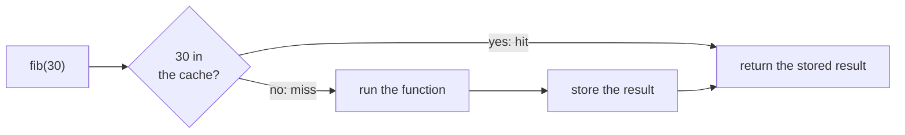

# Lesson 07 · The standard library toolbox

> **Level:** 🔵 Intermediate · **Time:** ~3 h · **Assignment:** [08 · Power tools](assignments/08-power-tools/)

The fastest code to write is code you do not write. Python's standard library contains well-tested,
fast solutions for problems you meet every week: counting things, grouping them, keeping the last N
items, combining collections, caching slow results, calculating with dates. Beginners reinvent these in
fifteen lines; experienced developers recognise the problem and reach for the right tool in one. This
lesson is a guided tour of the modules you will use most: `collections`, `itertools`, `functools`,
`operator` and `datetime`.

## What you will learn

- `collections`: `Counter`, `defaultdict`, `deque`, `namedtuple`
- `itertools`: `chain`, `islice`, `groupby`, `combinations`, `product`, `accumulate`, `pairwise`
- `functools`: `lru_cache` / `cache`, `reduce`, `partial`
- `operator`: `itemgetter` and `attrgetter` as ready-made `key=` functions
- `datetime` in depth: `date`, `datetime`, `timedelta`, parsing and formatting, time zones

---

## 1. `collections`: containers with superpowers

### `Counter`: counting things

```python
from collections import Counter

votes = ["tea", "coffee", "tea", "water", "tea", "coffee"]
counts = Counter(votes)
counts                          # → Counter({'tea': 3, 'coffee': 2, 'water': 1})
counts["tea"]                   # → 3
counts["juice"]                 # → 0     missing keys count as 0, no KeyError
counts.most_common(2)           # → [('tea', 3), ('coffee', 2)]
counts.update(["juice"])        # add more
Counter("mississippi").most_common(1)   # → [('i', 4)]
```

Counters can be added and subtracted: `Counter(a) - Counter(b)` tells you what `a` has more of.

### `defaultdict`: dicts that create missing values

Grouping items by a key normally needs an "is the key already there?" check. A `defaultdict` calls a
**factory** to create the value the first time a key is used:

```python
from collections import defaultdict

words = ["apple", "avocado", "banana", "blueberry", "cherry"]

by_letter = defaultdict(list)       # factory: list → new keys start as []
for word in words:
    by_letter[word[0]].append(word)

dict(by_letter)
# → {'a': ['apple', 'avocado'], 'b': ['banana', 'blueberry'], 'c': ['cherry']}
```



`defaultdict(int)` counts (`d[key] += 1`), `defaultdict(set)` collects unique values. Convert to a plain
`dict` before returning it, so callers do not create keys by accident just by reading.

### `deque`: a fast queue with a memory limit

A `deque` ("deck", double-ended queue) adds and removes at **both ends** in constant time. A list is
slow at the front: `list.pop(0)` moves every other element.

```python
from collections import deque

queue = deque(["a", "b"])
queue.append("c")               # right end
queue.appendleft("z")           # left end
queue.popleft()                 # → 'z'

recent = deque(maxlen=3)        # keeps only the newest 3
for page in ["home", "shop", "cart", "checkout", "thanks"]:
    recent.append(page)
recent                          # → deque(['cart', 'checkout', 'thanks'], maxlen=3)
```

### `namedtuple`: tuples with field names

```python
from collections import namedtuple

Point = namedtuple("Point", ["x", "y"])
p = Point(3, 4)
p.x, p[1]                       # → (3, 4)    by name AND by position
x, y = p                        # unpacking still works
p._replace(x=0)                 # → Point(x=0, y=4)
```

A namedtuple is immutable and as light as a tuple. Many standard functions return them
(`os.stat()`, `urllib.parse.urlparse()`). For your own new types, a frozen dataclass (lesson 05) is usually nicer.

## 2. `itertools`: building blocks for loops

All of these are **lazy** (lesson 06): they produce items on demand and combine well.

| Function | Produces | Example → result |
|---|---|---|
| `chain(a, b, …)` | all items of a, then b, … | `chain([1, 2], "ab")` → `1, 2, 'a', 'b'` |
| `islice(it, n)` / `islice(it, start, stop)` | a slice of any iterator | `islice(count(), 3)` → `0, 1, 2` |
| `count(start)` | `start, start+1, …` forever | |
| `accumulate(it)` | running totals | `accumulate([1, 2, 3])` → `1, 3, 6` |
| `pairwise(it)` | overlapping pairs (3.10+) | `pairwise("abc")` → `('a','b'), ('b','c')` |
| `combinations(it, r)` | all r-item selections, order irrelevant | `combinations("ABC", 2)` → `AB AC BC` |
| `permutations(it, r)` | all r-item orderings | `permutations("AB")` → `AB BA` |
| `product(a, b)` | every pair (nested loops) | `product("AB", [1, 2])` → `A1 A2 B1 B2` |
| `groupby(it, key)` | runs of consecutive items with the same key | see below |

### `groupby` groups **consecutive** items

```python
from itertools import groupby

orders = [("ada", 30), ("grace", 10), ("ada", 5), ("ada", 20)]

# ❌ unsorted: 'ada' appears in two separate groups
[(name, [amount for _, amount in group]) for name, group in groupby(orders, key=lambda o: o[0])]
# → [('ada', [30]), ('grace', [10]), ('ada', [5, 20])]

# ✅ sort by the same key first
orders.sort(key=lambda o: o[0])
{name: sum(amount for _, amount in group) for name, group in groupby(orders, key=lambda o: o[0])}
# → {'ada': 55, 'grace': 10}
```



`groupby` is like the Unix `uniq` command: it only looks at neighbours. Sort first, or use a
`defaultdict(list)` when the data is not sorted anyway.

## 3. `functools`: tools for functions

### Caching with `lru_cache` / `cache`

Some functions are slow and get called with the same arguments again and again. A **cache** remembers
results:

```python
from functools import lru_cache

@lru_cache(maxsize=None)            # or simply @functools.cache (3.9+)
def fib(n):
    return n if n < 2 else fib(n - 1) + fib(n - 2)

fib(100)                            # → 354224848179261915075   instantly
fib.cache_info()                    # → CacheInfo(hits=98, misses=101, maxsize=None, currsize=101)
```

Without the cache, `fib(100)` would make about 10<sup>21</sup> calls and never finish. With it, each value
is computed once. The `@` line is a **decorator**: it wraps the function in a caching layer (the Advanced
level shows how to write your own). Requirements: the arguments must be **hashable**, and the function
must be **pure** (same arguments, same result, no side effects), otherwise the cache returns stale results.



`maxsize=128` (the default) keeps the 128 most recently used results (LRU = *least recently used* are
dropped first), so memory cannot grow without limit.

### `reduce` and `partial`

`reduce(func, items)` folds a sequence into one value: `reduce(lambda a, b: a * b, [1, 2, 3, 4])` → `24`.
For sums, products, minimums and joins there are clearer built-ins (`sum`, `math.prod`, `min`, `"".join`);
use `reduce` only when none fits. `partial` you know from lesson 02.

## 4. `operator`: ready-made key functions

`lambda row: row["price"]` and `lambda p: p.name` are so common that `operator` provides them, faster
and more readable:

```python
from operator import itemgetter, attrgetter

products = [{"name": "tea", "price": 3.5}, {"name": "cake", "price": 2.0}]
sorted(products, key=itemgetter("price"))         # by dict key (or list index)
max(products, key=itemgetter("price"))["name"]    # → 'tea'

sorted(points, key=attrgetter("y", "x"))          # by attributes: y first, then x
```

## 5. `datetime` in depth

| Type | Holds | Example |
|---|---|---|
| `date` | a calendar day | `date(2026, 10, 31)` |
| `time` | a time of day | `time(14, 30)` |
| `datetime` | day + time | `datetime(2026, 10, 31, 14, 30)` |
| `timedelta` | a **duration** | `timedelta(days=2, hours=3)` |

### Arithmetic

```python
from datetime import date, datetime, timedelta

deadline = date(2026, 11, 15)
today = date(2026, 10, 31)
deadline - today                     # → datetime.timedelta(days=15)
(deadline - today).days              # → 15
today + timedelta(weeks=1)           # → datetime.date(2026, 11, 7)
today.weekday()                      # → 5   Monday = 0 … Sunday = 6 (Saturday)
today.isoformat()                    # → '2026-10-31'
```

### Parsing and formatting

`strptime` (**p**arse) turns text into a `datetime`; `strftime` (**f**ormat) does the opposite. Both use
the same format codes:

```python
start = datetime.strptime("31.10.2026 14:30", "%d.%m.%Y %H:%M")
start.strftime("%A, %d %B %Y at %H:%M")      # → 'Saturday, 31 October 2026 at 14:30'
datetime.fromisoformat("2026-10-31T14:30")   # ISO 8601 has its own fast parser
```

| Code | Meaning | Example |
|---|---|---|
| `%Y` / `%m` / `%d` | year / month / day, zero-padded | `2026` / `10` / `31` |
| `%H` / `%M` / `%S` | hour (24 h) / minute / second | `14` / `30` / `00` |
| `%A` / `%a` | weekday name / short | `Saturday` / `Sat` |
| `%B` / `%b` | month name / short | `October` / `Oct` |

Store and exchange dates as **ISO 8601** (`2026-10-31T14:30:00`): it sorts correctly as text, and every
language can read it.

### Time zones

A `datetime` without time zone information is **naive**: it is just "14:30", somewhere. One with a time
zone is **aware** and refers to one exact moment:

```python
from datetime import timezone

now = datetime.now(timezone.utc)     # aware: the current moment in UTC
now.tzinfo                           # → datetime.timezone.utc
```

Rule of thumb for programs: **store and calculate in UTC, convert to local time only for display**.
Never compare naive and aware datetimes (Python refuses with a `TypeError`). For named time zones like
`"Europe/Berlin"` with daylight saving time, see the `zoneinfo` module.

---

## Common mistakes

**Reinventing a counter.** `if key in d: d[key] += 1 else: d[key] = 1` → `Counter` or `defaultdict(int)`.

**`groupby` on unsorted data.** The same key appears in several groups. Sort by the same key first.

**`list.pop(0)` in a loop.** Slow for long lists. Use `deque.popleft()`.

**Caching an impure function.** If the result depends on time, files or global state, `lru_cache` returns outdated values.

**Mutable arguments to a cached function.** `TypeError: unhashable type: 'list'`. Pass tuples.

**Mixing up `strptime` and `strftime`**, or `%m` (month) and `%M` (minute).

**Naive datetimes across time zones.** Use aware datetimes in UTC for anything that crosses machines or countries.

## Try it yourself

1. Find the three most common letters in a paragraph of text with `Counter`, ignoring spaces.
2. Group a list of names by length with `defaultdict(list)`, then with `sorted` + `groupby`.
3. Use `itertools.product` to print every combination of `"SML"` sizes and `["red", "blue"]` colours.
4. Time `fib(32)` with and without `@lru_cache` using `time.perf_counter()`.
5. How many days until your next birthday? Which weekday will it be?

## Summary

- `Counter` counts, `defaultdict` groups, `deque` is a fast queue with optional `maxlen`, `namedtuple` names tuple fields.
- `itertools` provides lazy building blocks; `groupby` needs data **sorted by the same key**.
- `@lru_cache` / `@cache` remember results of **pure** functions with **hashable** arguments.
- `itemgetter` and `attrgetter` are ready-made `key=` functions.
- `date`, `datetime`, `timedelta` for calendar maths; `strptime` parses, `strftime` formats; store in ISO 8601 and UTC.

## Assignment

➡️ **[08 · Power tools](assignments/08-power-tools/)**: eight small problems, each solved with the right standard-library tool.

---

<p align="center">
  <a href="../06-iterators-and-generators/">← Previous: 06 · Iterators and generators</a> · <a href="../README.md">Intermediate overview</a> · <a href="../08-json-and-structured-data/">Next: 08 · JSON and structured data →</a>
</p>
