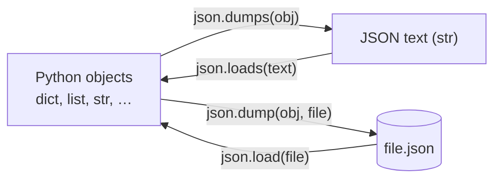
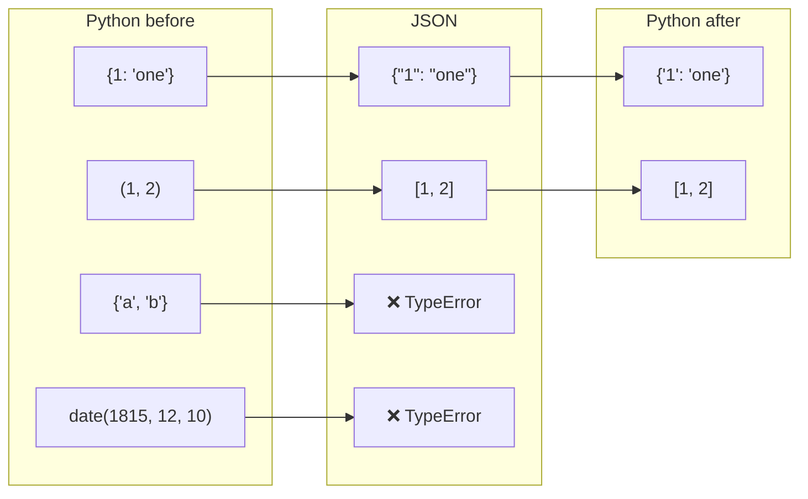
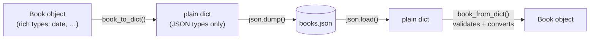
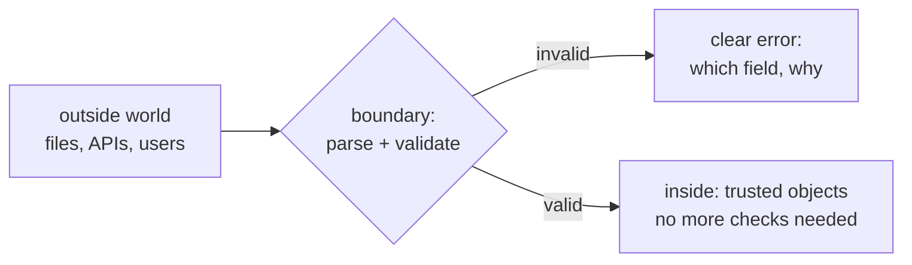

# Lesson 08 · JSON and structured data

> **Level:** 🔵 Intermediate · **Time:** ~2 h · **Assignment:** [09 · Contact book](assignments/09-contact-book/)

Sooner or later your program has to talk to the outside world: save its data so it survives a restart,
read a configuration file, answer a web API. The most common format for that is **JSON**. This lesson
covers reading and writing JSON correctly, what gets lost on the way (more than you might think), how to
save your own objects, and how to treat data from outside with healthy suspicion.

## What you will learn

- what JSON is, and how its types map to Python's
- `json.dumps` / `json.loads` for strings, `json.dump` / `json.load` for files
- readable output: `indent`, `sort_keys`, `ensure_ascii`
- the round-trip traps: tuples, sets, dates, integer keys
- saving your own objects: `default=` and converting dataclasses to and from dicts
- validating data at the boundary of your program, and handling `JSONDecodeError`
- writing files safely, and why you never `pickle` untrusted data

---

## 1. What JSON is

**JSON** (JavaScript Object Notation) is a **text** format for structured data. It is readable by humans,
supported by every programming language, and used by nearly every web API.

```json
{
  "name": "Ada Lovelace",
  "born": 1815,
  "languages": ["English", "French"],
  "mathematician": true,
  "spouse": null
}
```

It has exactly six kinds of values, and each maps to a Python type:

| JSON | Python (loading) | Python → JSON (saving) |
|---|---|---|
| object `{"k": v}` | `dict` | `dict` (keys become **strings**) |
| array `[1, 2]` | `list` | `list` **and** `tuple` |
| string `"text"` | `str` | `str` |
| number `42`, `3.14` | `int`, `float` | `int`, `float` |
| `true` / `false` | `True` / `False` | `True` / `False` |
| `null` | `None` | `None` |

Everything else (sets, dates, your own classes, bytes) **has no JSON form**. Strings in JSON always use
double quotes; single quotes and trailing commas are syntax errors.

## 2. Strings and files



The `s` stands for **string**: `dumps`/`loads` work with strings, `dump`/`load` with open files.

```python
import json

data = {"name": "Ada", "languages": ["en", "fr"], "active": True}

text = json.dumps(data)
text                        # → '{"name": "Ada", "languages": ["en", "fr"], "active": true}'
json.loads(text) == data    # → True

with open("ada.json", "w", encoding="utf-8") as file:
    json.dump(data, file, indent=2, ensure_ascii=False)

with open("ada.json", encoding="utf-8") as file:
    loaded = json.load(file)
```

Useful options for `dump`/`dumps`:

| Option | Effect |
|---|---|
| `indent=2` | pretty-prints with line breaks and indentation (great for files people read and for git diffs) |
| `sort_keys=True` | sorts object keys, so the same data always produces the same text |
| `ensure_ascii=False` | writes `"Zoë"` instead of `"Zoë"`. Use it with `encoding="utf-8"` |

## 3. What gets lost in a round trip

Saving and loading again does **not** always give back what you had:

```python
original = {1: "one", "pair": (1, 2)}
json.loads(json.dumps(original))
# → {'1': 'one', 'pair': [1, 2]}       the int key became a string, the tuple a list
```

```python
json.dumps({"tags": {"a", "b"}})
# ❌ TypeError: Object of type set is not JSON serializable

from datetime import date
json.dumps({"born": date(1815, 12, 10)})
# ❌ TypeError: Object of type date is not JSON serializable
```



JSON is a **lowest common denominator**. You decide how richer types are represented (a date as an ISO
string, a set as a sorted list), and you convert them back yourself when loading.

## 4. Saving your own objects

### The `default=` hook

`json.dumps` calls a function you pass as `default` for every object it cannot handle. Return something
JSON can handle, or raise `TypeError`:

```python
def encode(obj):
    if isinstance(obj, date):
        return obj.isoformat()              # '1815-12-10'
    if isinstance(obj, set):
        return sorted(obj)                  # a list, in a stable order
    raise TypeError(f"cannot serialise {type(obj).__name__}")

json.dumps({"born": date(1815, 12, 10), "tags": {"b", "a"}}, default=encode)
# → '{"born": "1815-12-10", "tags": ["a", "b"]}'
```

### Dataclasses: `to_dict` and `from_dict`

The clearest pattern for your own types is a pair of conversion functions, one in each direction:

```python
from dataclasses import dataclass, asdict

@dataclass
class Book:
    title: str
    year: int
    published: date

def book_to_dict(book):
    data = asdict(book)
    data["published"] = book.published.isoformat()
    return data

def book_from_dict(data):
    return Book(
        title=data["title"],
        year=data["year"],
        published=date.fromisoformat(data["published"]),
    )
```



Inside your program you work with real objects (`book.published.year` just works). Only at the very
edge, right before saving and right after loading, do you convert. This keeps all the JSON details in
two small functions.

## 5. Never trust data from outside

A JSON file can be edited by hand, written by an older version of your program, or come from someone
else's server. Anything can be wrong with it:

```python
json.loads("{'name': 'Ada'}")          # single quotes are not JSON
# ❌ json.decoder.JSONDecodeError: Expecting property name enclosed in double quotes: line 1 column 2 (char 1)
```

`JSONDecodeError` is a subclass of `ValueError`, and it tells you the line and column. But valid JSON
can still be the **wrong shape**: a missing key, a number where you expected text, a list instead of an
object. Check what you rely on, **once, at the boundary**, and turn problems into clear error messages:

```python
def book_from_dict(data):
    if not isinstance(data, dict):
        raise ValueError(f"expected an object, got {type(data).__name__}")
    title = data.get("title")
    if not isinstance(title, str) or not title.strip():
        raise ValueError("field 'title' must be a non-empty string")
    ...
```



After that, the rest of your code can trust the objects completely. This idea is called
**"parse, don't validate"**: convert untrusted data into well-typed objects as early as possible.

## 6. Writing files safely

`open(path, "w")` empties the file **immediately**. If your program crashes halfway through writing,
the old data is gone and the new data is incomplete. The safe pattern writes to a temporary file next to
the target and then **replaces** the target in one step:

```python
import os
from pathlib import Path

def save_json(path, data):
    path = Path(path)
    tmp = path.with_name(path.name + ".tmp")
    with open(tmp, "w", encoding="utf-8") as file:
        json.dump(data, file, indent=2, ensure_ascii=False)
    os.replace(tmp, path)          # atomic: readers see the old file or the new one, never half of one
```

## 7. Other formats in brief

| Format | Module | Notes |
|---|---|---|
| CSV | `csv` | tables (beginner lesson 11). Everything is a string |
| TOML | `tomllib` (3.11+, read-only) | configuration files such as `pyproject.toml` |
| `pickle` | `pickle` | saves almost any Python object, but **loading a pickle can run arbitrary code**. Never unpickle data you did not create yourself. Not readable by other languages |
| SQLite | `sqlite3` | a real database in one file (Professional level) |

For data you exchange or keep long-term, prefer JSON: it is safe to load, readable, and every language speaks it.

---

## Common mistakes

**Mixing up `dump` and `dumps`.** `json.dumps(data, file)` raises a confusing `TypeError`. Remember: the `s` means string.

**Forgetting `encoding="utf-8"`** when opening JSON files. JSON is defined as UTF-8.

**Expecting tuples, sets, dates or int keys to come back.** Convert them explicitly in both directions.

**Trusting loaded data.** A `KeyError` deep inside your program is much harder to understand than
"field 'title' is missing" right after loading.

**Catching `Exception` around `json.load`.** Catch `json.JSONDecodeError` (or `ValueError`) and `OSError` for file problems.

**Writing the target file directly.** A crash mid-write destroys your data. Write a temporary file and `os.replace` it.

**`pickle.load` on downloaded files.** It can execute code. Use JSON.

## Try it yourself

1. `json.dumps` a dict with an `int` key, a tuple and `None`. Load it back and compare.
2. Pretty-print a nested dict with `indent=2, sort_keys=True`.
3. Write the `encode` default function for `datetime` and `Decimal` values.
4. Load a file that contains `{"name": "Ada",}` (a trailing comma). Read the error message: where does it point?
5. Write a dataclass `Song`, plus `song_to_dict` / `song_from_dict`, and round-trip a list of songs through a file.

## Summary

- JSON has six value types: object, array, string, number, boolean, null → `dict`, `list`, `str`, `int`/`float`, `bool`, `None`.
- `dumps`/`loads` for strings, `dump`/`load` for files. Use `indent=2`, `ensure_ascii=False`, `encoding="utf-8"`.
- Tuples become lists, keys become strings, sets and dates are not supported: **convert explicitly** (`default=`, `to_dict`/`from_dict`).
- **Validate at the boundary**, turn bad data into clear `ValueError`s, then trust your objects inside.
- Write files atomically (temp file + `os.replace`). Never unpickle untrusted data.

## Assignment

➡️ **[09 · Contact book](assignments/09-contact-book/)**: save and load dataclasses as JSON, safely and with validation.

---

<p align="center">
  <a href="../07-standard-library-toolbox/">← Previous: 07 · The standard library toolbox</a> · <a href="../README.md">Intermediate overview</a> · <a href="../09-regular-expressions/">Next: 09 · Regular expressions →</a>
</p>
