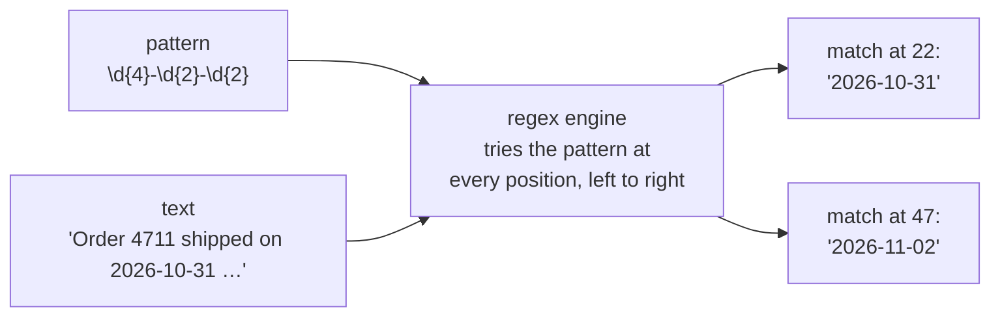
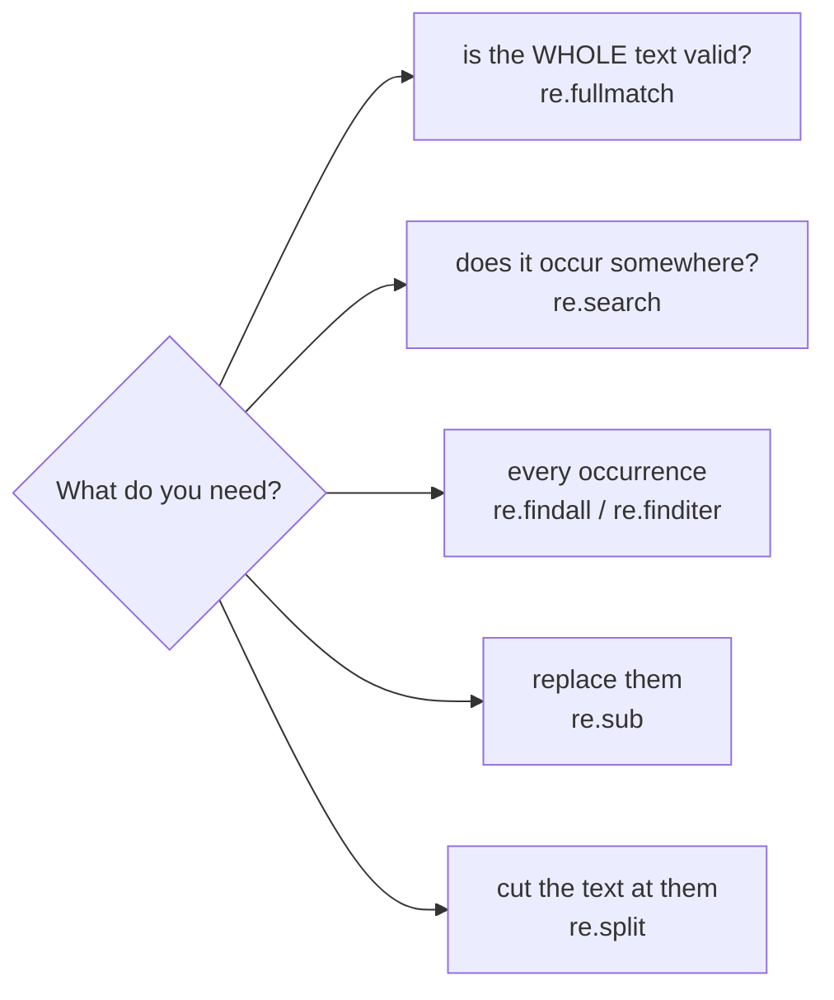
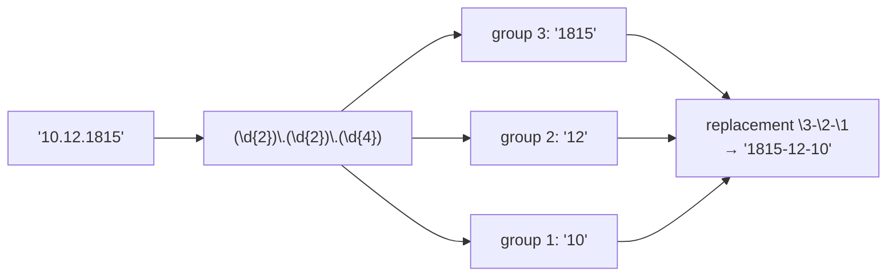

# Lesson 09 · Regular expressions

> **Level:** 🔵 Intermediate · **Time:** ~2.5 h · **Assignment:** [10 · Text extractor](assignments/10-text-extractor/)

Find every email address in a document. Check that a username has the right form. Turn `31.10.2026` into
`2026-10-31` everywhere in a file. Pull the timestamp, level and message out of each line of a log.
String methods like `.split()` and `.startswith()` get clumsy fast for jobs like these. A **regular
expression** (regex) is a tiny pattern language for describing text, and Python's `re` module uses it to
search, extract and replace. This lesson teaches the syntax you need daily, and when **not** to use it.

## What you will learn

- what a pattern is, and why patterns are written as raw strings `r"..."`
- the building blocks: literal characters, character classes, quantifiers, anchors
- `re.search`, `re.fullmatch`, `re.findall`, `re.finditer`, `re.sub`, `re.split`
- groups and named groups for extracting parts of a match
- greedy vs lazy matching, flags, and `re.compile`
- when a string method or a real parser is the better choice

---

## 1. A first pattern

```python
import re

text = "Order 4711 shipped on 2026-10-31, order 815 on 2026-11-02."
re.findall(r"\d+", text)                      # → ['4711', '2026', '10', '31', '815', '2026', '11', '02']
re.findall(r"\d{4}-\d{2}-\d{2}", text)        # → ['2026-10-31', '2026-11-02']
```

`\d` means "any digit", `+` means "one or more of the previous thing", `{4}` means "exactly four". The
regex engine walks through the text and tries the pattern at each position:



### Always use raw strings

In a normal string, `\` starts an escape sequence: `"\n"` is a newline and `"\b"` is a backspace
character. Regex patterns are full of backslashes, so write them as **raw strings** with an `r` prefix,
where a backslash is just a backslash: `r"\bword\b"`.

## 2. The building blocks

### Characters and classes

| Pattern | Matches |
|---|---|
| `abc` | the literal text `abc` |
| `.` | any character except a newline |
| `\d` / `\D` | a digit / anything but a digit |
| `\w` / `\W` | a "word" character (letter, digit, `_`) / anything else |
| `\s` / `\S` | whitespace (space, tab, newline) / anything else |
| `[aeiou]` | one of the listed characters |
| `[a-z0-9]` | one character from these ranges |
| `[^0-9]` | one character that is **not** listed (`^` at the start of a class negates it) |
| `\.` `\+` `\(` | a literal `.`, `+`, `(` (escape the special characters with `\`) |

### Quantifiers: how many?

| Quantifier | Means | Example | Matches |
|---|---|---|---|
| `*` | 0 or more | `ab*` | `a`, `ab`, `abbb` |
| `+` | 1 or more | `ab+` | `ab`, `abbb` |
| `?` | 0 or 1 (optional) | `colou?r` | `color`, `colour` |
| `{n}` | exactly n | `\d{4}` | `2026` |
| `{n,m}` | n to m | `\d{2,4}` | `12`, `123`, `1234` |

A quantifier applies to the **one thing** right before it: a character, a class, or a group in brackets.

### Anchors: where?

| Anchor | Means |
|---|---|
| `^` | start of the text (or of each line with `re.MULTILINE`) |
| `$` | end of the text (or of each line) |
| `\b` | a **word boundary**: between a `\w` and a `\W` character |

```python
re.findall(r"cat", "cat concatenate")       # → ['cat', 'cat']
re.findall(r"\bcat\b", "cat concatenate")   # → ['cat']        only the whole word
```

### Alternation

`|` means "or": `r"cat|dog"` matches either word. Combine it with a group to limit its reach:
`r"I like (cats|dogs)"`.

## 3. The functions of `re`

| Function | Returns | Use it to … |
|---|---|---|
| `re.search(p, text)` | the **first** match object, or `None` | test if the pattern occurs anywhere |
| `re.fullmatch(p, text)` | a match only if the **whole** text matches, or `None` | validate input |
| `re.match(p, text)` | a match only at the **start**, or `None` | (rarely what you want; prefer the two above) |
| `re.findall(p, text)` | a list of all matched strings (or of group tuples) | extract everything |
| `re.finditer(p, text)` | an iterator of match objects | extract with positions and groups, lazily |
| `re.sub(p, repl, text)` | the text with every match replaced | clean up, reformat |
| `re.split(p, text)` | a list of the pieces between matches | split on complex separators |



```python
re.search(r"\d+", "abc 42 def")          # → <re.Match object; span=(4, 6), match='42'>
re.search(r"\d+", "no digits")           # → None
bool(re.fullmatch(r"\d{5}", "12345"))    # → True    a German postcode
bool(re.fullmatch(r"\d{5}", "123456"))   # → False   search would have found 5 digits inside
re.sub(r"\s+", " ", "too   many\n\tspaces")     # → 'too many spaces'
re.split(r"[,;]\s*", "a, b;c ,d")        # → ['a', 'b', 'c ', 'd']
```

`search`, `match` and `fullmatch` return `None` when nothing matches, so check before using the result:

```python
match = re.search(r"\d+", text)
if match:
    print(match.group(), match.start(), match.end())
```

## 4. Groups: extracting parts

Round brackets create a **group**. The match remembers what each group matched:

```python
match = re.search(r"(\d{4})-(\d{2})-(\d{2})", "due: 2026-10-31")
match.group()           # → '2026-10-31'     the whole match
match.group(1)          # → '2026'
match.groups()          # → ('2026', '10', '31')
```

With groups, `findall` returns the groups instead of the whole match:

```python
re.findall(r"(\w+)@(\w+\.\w+)", "ada@math.org, grace@navy.mil")
# → [('ada', 'math.org'), ('grace', 'navy.mil')]
```

**Named groups** `(?P<name>...)` make patterns self-documenting, and `groupdict()` gives you a dict:

```python
pattern = r"(?P<year>\d{4})-(?P<month>\d{2})-(?P<day>\d{2})"
re.search(pattern, "due: 2026-10-31").groupdict()
# → {'year': '2026', 'month': '10', 'day': '31'}
```

In `re.sub`, refer to groups in the replacement with `\1` or `\g<name>`:

```python
re.sub(r"(\d{2})\.(\d{2})\.(\d{4})", r"\3-\2-\1", "Born 10.12.1815, died 27.11.1852")
# → 'Born 1815-12-10, died 1852-11-27'
```



If you need brackets only to group (for `|` or a quantifier), not to capture, use `(?:...)`.

The replacement can also be a **function** that receives each match object and returns the new text:

```python
re.sub(r"\d+", lambda m: str(int(m.group()) * 2), "3 apples and 10 pears")
# → '6 apples and 20 pears'
```

## 5. Greedy and lazy

Quantifiers are **greedy**: they take as much as they can.

```python
html = "<b>bold</b> and <i>italic</i>"
re.findall(r"<.+>", html)        # → ['<b>bold</b> and <i>italic</i>']   one huge match!
re.findall(r"<.+?>", html)       # → ['<b>', '</b>', '<i>', '</i>']
```

Adding `?` after a quantifier (`+?`, `*?`) makes it **lazy**: it takes as little as possible. Often an
even better fix is a class that cannot run past the end: `r"<[^>]+>"` ("anything but `>`").

## 6. Flags and `re.compile`

Flags change how a pattern behaves:

| Flag | Effect |
|---|---|
| `re.IGNORECASE` (`re.I`) | case-insensitive matching |
| `re.MULTILINE` (`re.M`) | `^` and `$` match at every line start/end |
| `re.DOTALL` (`re.S`) | `.` also matches newlines |
| `re.VERBOSE` (`re.X`) | whitespace and `# comments` inside the pattern are ignored |

`re.compile` turns a pattern into a reusable object. Combined with `re.VERBOSE`, complex patterns become readable:

```python
LOG_LINE = re.compile(r"""
    (?P<date>\d{4}-\d{2}-\d{2})\s+     # 2026-10-31
    (?P<time>\d{2}:\d{2}:\d{2})\s+     # 14:30:05
    \[(?P<level>[A-Z]+)\]\s+           # [ERROR]
    (?P<message>.*)                    # the rest of the line
""", re.VERBOSE)

LOG_LINE.fullmatch("2026-10-31 14:30:05 [ERROR] disk full").group("level")   # → 'ERROR'
```

Compiling once at module level is the clearest way to give a pattern a name. (Python also caches recently
used patterns internally, so speed is rarely the reason.)

## 7. When not to use a regex

> "Some people, when confronted with a problem, think 'I know, I'll use regular expressions.'
> Now they have two problems." (Jamie Zawinski)

- **Simple checks have simpler tools.** `text.startswith("http")`, `"@" in email`, `line.split(",")`,
  `text.isdigit()` are faster to read and to run.
- **Structured formats have parsers.** JSON → `json`, CSV → `csv`, HTML → an HTML parser, URLs →
  `urllib.parse`, dates → `datetime.strptime`. Regexes break on nesting, quoting and escaping.
- **Perfect validation is often impossible.** The full email address grammar is enormous. A pragmatic
  pattern plus a confirmation email beats a 6000-character regex.
- **Watch out for nested quantifiers** like `(a+)+`. On certain inputs they make the engine try
  exponentially many combinations and hang ("catastrophic backtracking").

Keep patterns small, name them, put a comment next to them, and **test them** with good and bad examples.

---

## Common mistakes

**No raw string.** `"\bword\b"` contains two backspace characters and never matches. Use `r"\bword\b"`.

**`search` when you mean `fullmatch`.** `re.search(r"\d{5}", "123456")` succeeds. For validation, the whole text must match.

**Forgetting that `.` and `+` are special.** `r"3.14"` also matches `"3514"`. Escape: `r"3\.14"`.

**Using the result of `search` without checking for `None`.** `AttributeError: 'NoneType' object has no attribute 'group'`.

**Greedy `.*` eating too much.** Use `.*?` or a negated class like `[^"]*`.

**Regex for everything.** HTML, JSON and CSV have proper parsers.

## Try it yourself

1. Find all words that start with a capital letter in a sentence (`r"\b[A-Z]\w*"`).
2. Validate German postcodes with `fullmatch`. Why does `search` give wrong answers?
3. Use `re.sub` with groups to turn `"Lovelace, Ada"` into `"Ada Lovelace"`.
4. Compare `re.findall(r"<.*>", ...)` and `re.findall(r"<.*?>", ...)` on a line of HTML.
5. Write the log-line pattern from section 6 with `re.VERBOSE` and run it on a few lines, including one that should not match.

## Summary

- A regex describes text: literal characters, classes (`\d`, `[a-z]`), quantifiers (`+`, `*`, `?`, `{n,m}`), anchors (`^`, `$`, `\b`). Write patterns as **raw strings**.
- `search` finds the first match, `fullmatch` validates, `findall`/`finditer` extract all, `sub` replaces, `split` splits.
- `(...)` captures groups, `(?P<name>...)` names them; `\1` / `\g<name>` reuse them in `sub`.
- Quantifiers are greedy; `+?` / `*?` are lazy. `re.VERBOSE` + `re.compile` make complex patterns readable.
- Prefer string methods and real parsers when they fit. Test every pattern with matching and non-matching examples.

## Assignment

➡️ **[10 · Text extractor](assignments/10-text-extractor/)**: extract, validate and rewrite text with seven focused patterns.

---

<p align="center">
  <a href="../08-json-and-structured-data/">← Previous: 08 · JSON and structured data</a> · <a href="../README.md">Intermediate overview</a> · <a href="../10-type-hints/">Next: 10 · Type hints →</a>
</p>
