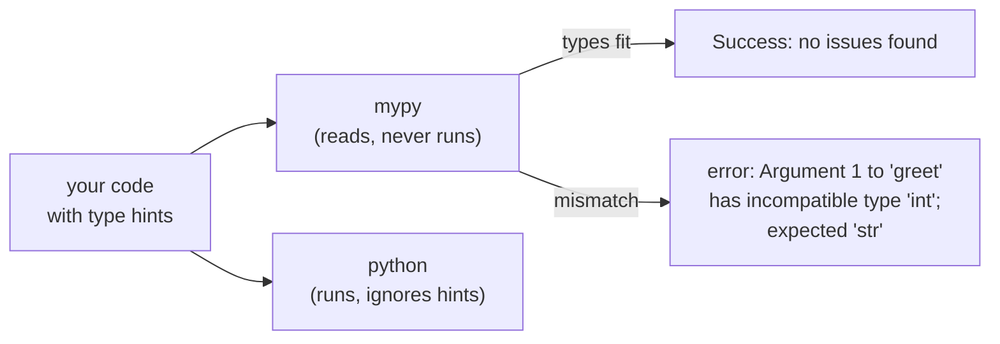
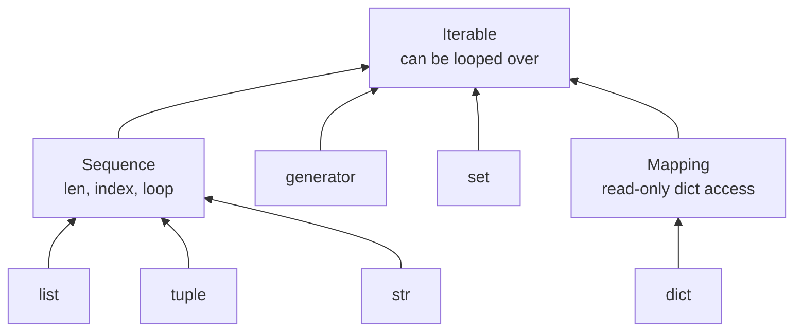
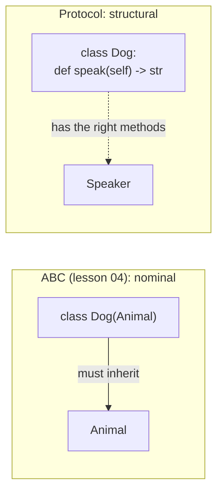

# Lesson 10 · Type hints

> **Level:** 🔵 Intermediate · **Time:** ~2.5 h · **Assignment:** [11 · Typed gradebook](assignments/11-typed-gradebook/)

Python is dynamically typed: a variable can hold anything, and type errors appear only when the faulty
line **runs**, maybe in production, maybe months later. **Type hints** let you write down what types
you expect. Python itself ignores them at runtime, but your editor and a **type checker** like mypy read
them and point out mistakes **before** you run anything. In a big codebase that is like having a
colleague who has read every line. This lesson teaches the syntax and the thinking behind it.

## What you will learn

- what annotations are, and what Python does (and does not do) with them
- annotating variables, parameters and return values
- container types: `list[int]`, `dict[str, float]`, `tuple[int, ...]`
- `X | None`, `Any`, `Callable`, `Iterable` vs `list`, `Literal`
- `TypedDict` for dict-shaped data and `Protocol` for duck typing
- generic functions with `TypeVar`
- running **mypy**, reading its messages, and adopting types gradually

---

## 1. What a type hint is

```python
def greet(name: str, times: int = 1) -> str:
    return ("Hello, " + name + "! ") * times

count: int = 0
```

`name: str` says "`name` should be a `str`", `-> str` says "this function returns a `str`". The syntax
is called an **annotation**. Python stores annotations, but it **does not check them**:

```python
greet(42)                 # ❌ at runtime: TypeError: can only concatenate str (not "int") to str
greet.__annotations__     # → {'name': <class 'str'>, 'times': <class 'int'>, 'return': <class 'str'>}
```

The function still crashes in the same place as without hints. The difference is that a type checker
finds the mistake by **reading** the code, without running it:



Hints also make code self-documenting, and they power your editor: autocompletion knows that `name`
has `.upper()`, and refactoring tools know where a function is used.

## 2. The basics

```python
age: int = 36
price: float = 9.99          # an int is accepted where a float is expected
name: str = "Ada"
active: bool = True
nothing: None = None

def area(width: float, height: float) -> float:
    return width * height

def log(message: str) -> None:       # returns nothing: annotate with None
    print(message)
```

Annotate **function signatures** (parameters and returns). Local variables usually do not need hints;
the checker **infers** them from the assigned value (`total = 0` is clearly an `int`).

## 3. Containers

Built-in container types take the type of their contents in square brackets (Python 3.9+):

| Hint | Means |
|---|---|
| `list[int]` | a list of ints |
| `dict[str, float]` | a dict with str keys and float values |
| `set[str]` | a set of strings |
| `tuple[str, int]` | a tuple of **exactly** a str and an int |
| `tuple[int, ...]` | a tuple of any number of ints |
| `list[dict[str, int]]` | nesting works as you'd expect |

```python
def word_lengths(words: list[str]) -> dict[str, int]:
    return {word: len(word) for word in words}

def min_max(numbers: list[float]) -> tuple[float, float]:
    return min(numbers), max(numbers)
```

## 4. Optional values, unions and `Any`

`X | Y` (Python 3.10+) means "an X **or** a Y". The most common case is "a value or `None`":

```python
def find_user(user_id: int) -> str | None:
    return USERS.get(user_id)

name = find_user(7)
name.upper()            # mypy: error: Item "None" of "str | None" has no attribute "upper"
if name is not None:
    name.upper()        # ✅ inside the check, mypy knows name is a str ("narrowing")
```

This is one of the most valuable checks: it catches the classic `'NoneType' object has no attribute ...`
crash before it happens. (Older code writes `Optional[str]` from `typing`; it means the same.)

`Any` switches checking off for a value: everything is allowed with it. Use it as an escape hatch,
rarely; every `Any` is a spot where the checker is blind.

## 5. Accept general types, return specific ones

```python
from collections.abc import Iterable, Sequence, Mapping

def total(prices: Iterable[float]) -> float:
    return sum(prices)

total([1.5, 2.0])            # ✅ list
total((1.5, 2.0))            # ✅ tuple
total(p for p in [1.5])      # ✅ generator
```

`list[float]` would reject the tuple and the generator, although `total` only **loops** over its input.
The abstract types from `collections.abc` describe what a function **needs**:



Rule: for **parameters**, use the most general type that works (`Iterable`, `Sequence`, `Mapping`). For
**return values**, be specific (`list[str]`), so callers know exactly what they get.

## 6. Functions as values: `Callable`

```python
from collections.abc import Callable

def apply(func: Callable[[float], float], values: list[float]) -> list[float]:
    return [func(v) for v in values]

apply(abs, [-1.0, 2.0])         # ✅
apply(len, [-1.0, 2.0])         # mypy: error: Argument 1 has incompatible type "Callable[[Sized], int]" ...
```

`Callable[[arg types], return type]` describes any function, lambda or object with a matching signature.

## 7. `Literal`, type aliases and `TypedDict`

`Literal` restricts a value to specific constants. A **type alias** gives a complex type a name:

```python
from typing import Literal

Direction = Literal["north", "east", "south", "west"]     # a type alias

def move(direction: Direction, steps: int) -> None: ...

move("north", 3)        # ✅
move("up", 3)           # mypy: error: Argument 1 has incompatible type "Literal['up']" ...
```

For a fixed set of choices **at runtime** too, an `Enum` (lesson 05) is stronger; `Literal` is lighter
and perfect for string options in function signatures.

JSON data arrives as dicts. `TypedDict` describes which keys such a dict has and what types their values are:

```python
from typing import TypedDict

class Movie(TypedDict):
    title: str
    year: int

def describe(movie: Movie) -> str:
    return f"{movie['title']} ({movie['year']})"

describe({"title": "Alien", "year": 1979})       # ✅
describe({"title": "Alien", "yaer": 1979})       # mypy: error: Extra key "yaer" for TypedDict "Movie"
```

At runtime a `TypedDict` is a plain dict; the class only exists for the checker. When the data deserves
behaviour or validation, convert it to a dataclass (lesson 08).

## 8. `Protocol`: duck typing, checked

Lesson 04 introduced duck typing: anything with the right methods works. A `Protocol` writes that down,
**without** requiring inheritance:

```python
from typing import Protocol

class Speaker(Protocol):
    def speak(self) -> str: ...

class Dog:                      # does NOT inherit from Speaker
    def speak(self) -> str:
        return "Woof"

class Rock:
    pass

def chorus(speakers: list[Speaker]) -> str:
    return " ".join(s.speak() for s in speakers)

chorus([Dog()])                 # ✅ Dog has speak() -> str, so it IS a Speaker
chorus([Rock()])                # mypy: error: List item 0 has incompatible type "Rock"; expected "Speaker"
```



The `...` (Ellipsis) body is the convention for "no implementation here". Protocols are ideal when you
accept objects from code you do not control.

## 9. Generic functions with `TypeVar`

What is the return type of a function that returns the first item of **any** list?

```python
from typing import TypeVar

T = TypeVar("T")

def first(items: Sequence[T]) -> T:
    return items[0]

first([1, 2, 3])        # mypy knows: int
first(["a", "b"])       # mypy knows: str
```

`T` is a placeholder that links the parameter type to the return type. (Python 3.12 has a shorter syntax,
`def first[T](items: Sequence[T]) -> T`; this course supports 3.10, so we use `TypeVar`.)

## 10. Running mypy

mypy is a separate tool. It is already in this repository's `requirements.txt`:

```bash
pip install -r requirements.txt
```

```bash
mypy intermediate/10-type-hints/assignments/11-typed-gradebook/exercise.py --strict
```

```text
exercise.py:12: error: Function is missing a return type annotation  [no-untyped-def]
exercise.py:20: error: Argument 1 to "average" has incompatible type "str"; expected "Iterable[float]"  [arg-type]
Found 2 errors in 1 file (checked 1 source file)
```

Each line names the file, the line number, the problem and an error code in brackets. Without options,
mypy only checks functions that have annotations, so you can add hints **gradually**. `--strict` turns on
everything, including "every function must be annotated"; use it for new code.

When you need to tell mypy something it cannot know, `typing.cast(str, value)` or a comment
`# type: ignore[code]` exist, but every one of them is a small lie; prefer fixing the types.

---

## Common mistakes

**Believing hints are checked at runtime.** They are not. Run mypy (or let your editor do it).

**Forgetting `| None`.** A function that can return `None` must say so, or callers will not check for it.

**Over-specific parameters.** `list[float]` where `Iterable[float]` would do rejects tuples and generators for no reason.

**`Any` everywhere.** It silences the checker exactly where you need it.

**`list` instead of `list[int]`.** A bare `list` means "list of anything". Say what is inside.

**Annotating with a value instead of a type.** `def f(x: 5)` or `-> []` is meaningless. Use `int`, `list[str]`, …

**Old syntax in new code.** `List[int]`, `Dict[str, int]`, `Optional[str]` from `typing` still work, but
`list[int]`, `dict[str, int]`, `str | None` are the modern forms.

## Try it yourself

1. Add hints to three functions from the Beginner level and run `mypy --strict` on them.
2. Write a function returning `str | None`. Call `.upper()` on its result without a check. Read mypy's message, then fix it with `if`.
3. Change a parameter from `list[float]` to `Iterable[float]` and pass a generator.
4. Write a `Protocol` with one method, two unrelated classes that satisfy it, and one that does not.
5. Print `typing.get_type_hints(your_function)`. What does Python keep at runtime?

## Summary

- Type hints (`x: int`, `-> str`) document intent; Python **ignores** them at runtime; **mypy** checks them without running the code.
- Containers: `list[int]`, `dict[str, float]`, `tuple[int, ...]`. Optional values: `str | None`, then narrow with `if x is not None`.
- Accept general types (`Iterable`, `Sequence`, `Mapping`, `Callable`), return specific ones.
- `Literal` for fixed options, `TypedDict` for dict-shaped data, `Protocol` for checked duck typing, `TypeVar` for generic functions.
- Add hints gradually; use `mypy --strict` for new code. Avoid `Any` and `# type: ignore`.

## Assignment

➡️ **[11 · Typed gradebook](assignments/11-typed-gradebook/)**: implement a fully annotated module that passes `mypy --strict`.

---

<p align="center">
  <a href="../09-regular-expressions/">← Previous: 09 · Regular expressions</a> · <a href="../README.md">Intermediate overview</a> · <a href="../11-testing-with-pytest/">Next: 11 · Testing with pytest →</a>
</p>
