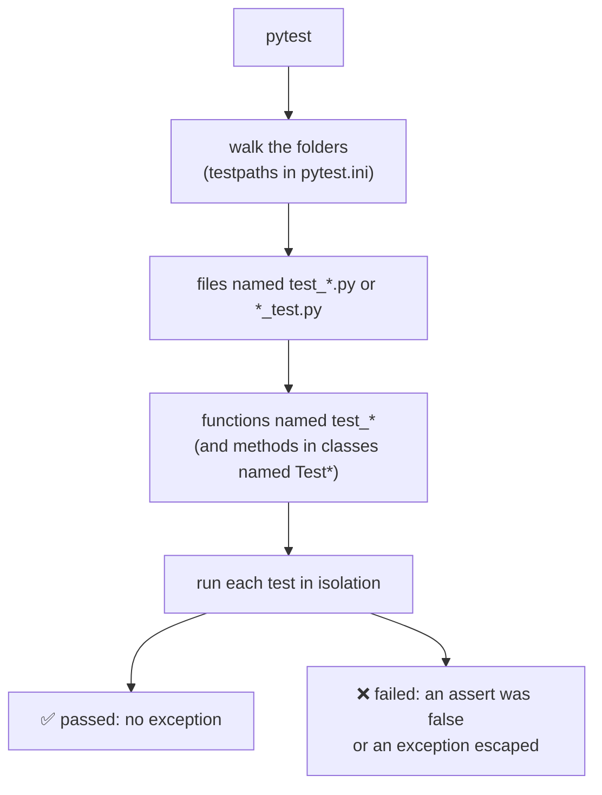
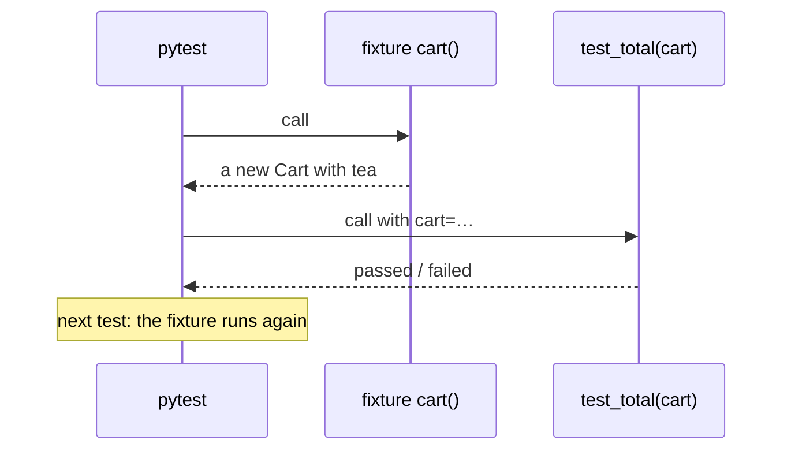
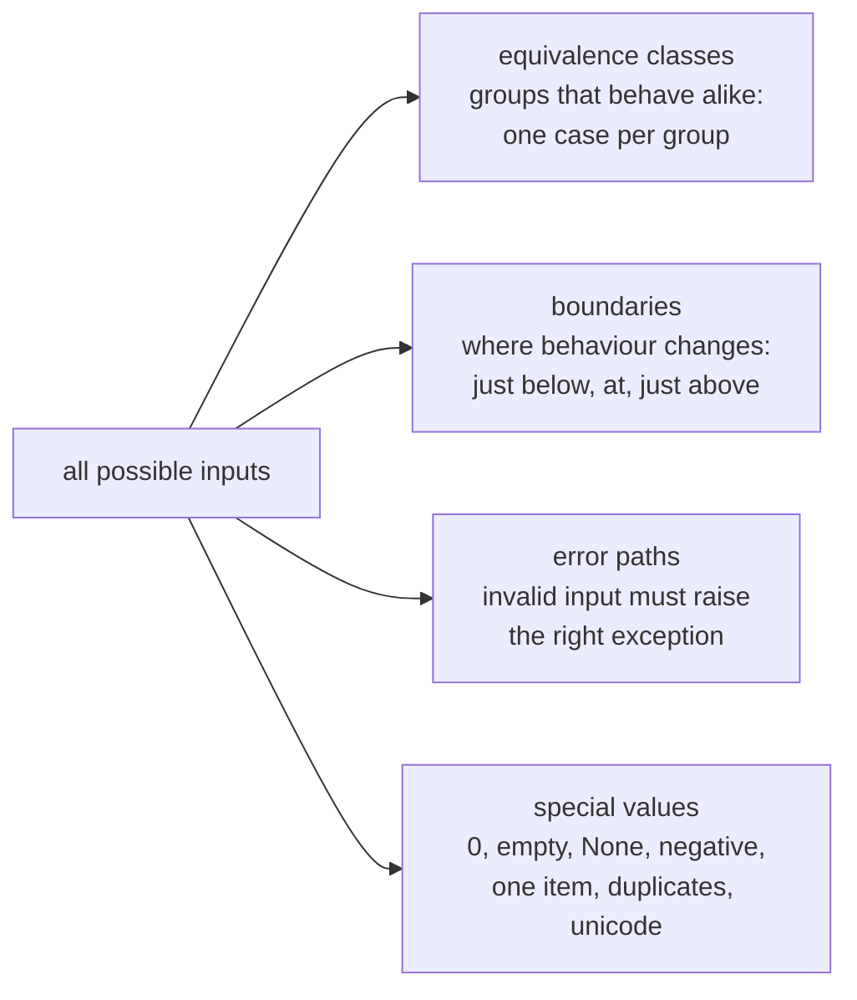
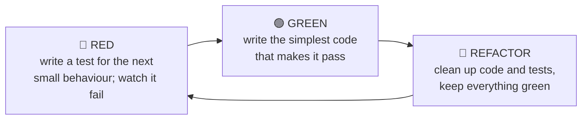

# Lesson 11 · Testing with pytest

> **Level:** 🔵 Intermediate · **Time:** ~3 h · **Assignment:** [12 · Bug hunter tests](assignments/12-bug-hunter-tests/)

Up to now the tests in this repository were written for you, and they told you when your code was
wrong. Now you switch sides. Writing your own tests is what lets professionals change code without fear:
refactor a function, upgrade a library, fix a bug, and a few seconds later you **know** that everything
still works. This lesson teaches pytest from the inside: how it finds and runs tests, the features you
will use every day, and, most importantly, how to decide **what** to test.

## What you will learn

- why automated tests pay off, and what a good test looks like
- how pytest discovers tests and why a plain `assert` is enough
- testing exceptions with `pytest.raises` and floats with `pytest.approx`
- `@pytest.mark.parametrize`: one test, many cases
- fixtures: shared setup, teardown with `yield`, and the built-ins `tmp_path`, `capsys`, `monkeypatch`
- choosing test cases: equivalence classes, boundaries, error paths
- test-driven development (red, green, refactor) and what coverage does and does not tell you

---

## 1. Why test?

You already test your code: you run it and look at the output. Automated tests do the same, but they
**remember** what you checked and repeat it in milliseconds, every time, for every function.

| Without tests | With tests |
|---|---|
| "I changed one line; I hope nothing else broke" | run `pytest`, know within seconds |
| bugs are found by users | bugs are found on your machine or in CI |
| fear of refactoring, so code rots | refactoring is safe, so code stays clean |
| the expected behaviour lives in someone's head | the tests **document** it with runnable examples |

## 2. Anatomy of a test

```python
# test_prices.py
from prices import apply_discount

def test_discount_reduces_price():
    # Arrange: set up the inputs
    price = 80.0
    # Act: call the code under test
    result = apply_discount(price, percent=25)
    # Assert: check the outcome
    assert result == 60.0
```

**Arrange, Act, Assert** is the shape of almost every test. Keep each test focused on **one behaviour**
and give it a name that says what that behaviour is: when it fails, the name alone should tell you what
is broken.

### How pytest finds tests



A test **passes** if it finishes without an exception and **fails** if anything is raised. That is all.

### Why a plain `assert` is enough

When an assert fails, pytest shows you the values involved. It rewrites your `assert` statements when it
imports the test file, so you get rich messages without special methods:

```text
    def test_discount_reduces_price():
>       assert apply_discount(80.0, percent=25) == 60.0
E       assert 20.0 == 60.0
E        +  where 20.0 = apply_discount(80.0, percent=25)
```

Here the function returned the **discount** instead of the discounted price, and the message shows it at once.

### Running tests

| Command | Runs |
|---|---|
| `pytest` | everything pytest can find |
| `pytest path/to/test_file.py` | one file |
| `pytest path/to/test_file.py::test_name` | one test |
| `pytest -k discount` | tests whose name contains "discount" |
| `pytest -x` | stop at the first failure |
| `pytest -v` | show every test name |
| `pytest --lf` | only the tests that failed last time |

## 3. Exceptions and floats

Checking that bad input raises the right exception is as important as checking good input:

```python
import pytest

def test_negative_percent_is_rejected():
    with pytest.raises(ValueError, match="percent"):
        apply_discount(80.0, percent=-5)
```

The test passes only if the block raises a `ValueError` whose message contains "percent" (`match` is a
regex, lesson 09). If nothing is raised, or a different exception, the test fails.

Floats are not exact (beginner lesson 03), so compare them with `pytest.approx`:

```python
def test_third():
    assert 1 / 3 * 3 == pytest.approx(1.0)
    assert [0.1 + 0.2, 0.3] == pytest.approx([0.3, 0.3])
```

## 4. Parametrize: one test, many cases

Instead of copying a test for every input, list the cases:

```python
@pytest.mark.parametrize("price, percent, expected", [
    (100.0, 0, 100.0),       # no discount
    (100.0, 25, 75.0),       # normal case
    (100.0, 100, 0.0),       # boundary: everything off
    (0.0, 50, 0.0),          # free item
])
def test_apply_discount(price, percent, expected):
    assert apply_discount(price, percent=percent) == pytest.approx(expected)
```

pytest generates one test per row and reports them separately (`test_apply_discount[100.0-25-75.0]`), so
you see exactly which case broke. Parametrize is the right tool whenever several tests differ only in their data.

## 5. Fixtures: shared setup

A **fixture** is a function that prepares something a test needs. A test asks for it by naming it as a
parameter, and pytest calls the fixture and passes in the result:

```python
@pytest.fixture
def cart():
    cart = Cart()
    cart.add("tea", 3.5, quantity=2)
    return cart

def test_total(cart):                 # pytest sees "cart" and calls the fixture
    assert cart.total() == 7.0

def test_remove(cart):                # a FRESH cart: tests never share state
    cart.remove("tea")
    assert cart.total() == 0
```



Code after a `yield` in a fixture runs **after** the test, even if the test fails. That is the place for clean-up:

```python
@pytest.fixture
def database():
    db = connect_to_test_database()
    yield db                 # the test runs here
    db.close()               # teardown
```

Fixtures can use other fixtures, and a `conftest.py` file makes them available to every test in its folder.
(The `ex` fixture used by every assignment of this course lives in the repository's root `conftest.py`.)

### Built-in fixtures you will use often

| Fixture | Gives you |
|---|---|
| `tmp_path` | a fresh, empty temporary folder (a `pathlib.Path`) for each test: test file I/O without touching real files |
| `capsys` | captures `print` output: `capsys.readouterr().out` |
| `monkeypatch` | temporarily replaces attributes, environment variables or dict items; undone automatically after the test |

```python
def test_save_and_load(tmp_path):
    path = tmp_path / "data.json"
    save(path, {"a": 1})
    assert load(path) == {"a": 1}

def test_greeting_output(capsys):
    greet("Ada")
    assert capsys.readouterr().out == "Hello, Ada!\n"

def test_main_reads_input(monkeypatch):
    monkeypatch.setattr("builtins.input", lambda prompt: "42")
    assert ask_number() == 42
```

## 6. What to test: choosing cases

You cannot test every possible input. Good tests pick **representative** cases:



For a discount that applies from a total of 100 €:

- **Equivalence classes:** a small total (no discount), a large total (discount).
- **Boundaries:** 99.99, **100.00**, 100.01. Off-by-one errors (`>` instead of `>=`) live exactly here.
- **Errors:** a negative price, a zero quantity.
- **Special values:** an empty cart, the same item added twice.

A useful question for every test you write: **"Which bug would make this test fail?"** If you cannot
name one, the test probably checks nothing new. This is also how the assignment of this lesson is graded:
your tests run against deliberately broken versions of the code (**mutants**), and each mutant must make at
least one of your tests fail. This technique is called **mutation testing**.

### Properties of good tests

- **Fast:** milliseconds. Slow tests are not run.
- **Independent:** any order, any subset. No test relies on another test's leftovers.
- **Repeatable:** same result every time. No real network, no real clock, no randomness without a seed.
- **Readable:** a failing test should explain itself. Prefer clarity over clever loops.
- **Behaviour, not implementation:** test *what* a function returns or does, not *how*, so refactoring does not break tests.

## 7. Test-driven development

**TDD** turns the order around: write the test **first**.



Seeing the test fail first proves that it can fail (a test that always passes is worthless). Writing the
test first forces you to think about the interface before the implementation. You have been doing a
version of this all along: every assignment started red.

## 8. Coverage, briefly

**Coverage** measures which lines your tests executed (`pip install pytest-cov`, then `pytest --cov`).
Uncovered lines are definitely untested. But 100 % coverage does **not** mean correct: a test can run a
line without checking its result. Use coverage to find gaps, and mutation thinking to judge quality.

---

## Common mistakes

**Testing nothing.** A test without an `assert` (or `pytest.raises`) passes as long as nothing crashes.

**One giant test.** When it fails, you do not know which of its twenty checks broke. One behaviour per test.

**Tests that depend on each other.** Shared global state or files make the order matter. Use fixtures and `tmp_path`.

**Comparing floats with `==`.** Use `pytest.approx`.

**`pytest.raises` around too much code.** The exception might come from the setup, not from the line you meant. Put only the call inside the block.

**Only testing the happy path.** Most bugs live at boundaries and in error handling.

**Testing implementation details.** Checking private attributes or the exact sequence of internal calls breaks with every refactoring.

## Try it yourself

1. Write a test that fails on purpose and read pytest's output. Then fix it.
2. Turn three copy-pasted tests into one `parametrize`d test.
3. Write a fixture with `yield` that prints before and after the test. Run with `pytest -s` to see the output.
4. Test a function that writes a file, using `tmp_path`.
5. Pick any beginner assignment, break its solution in a subtle way, and check whether the tests notice.

## Summary

- A test is a `test_*` function in a `test_*.py` file; it passes if nothing is raised. Arrange, Act, Assert.
- Plain `assert` gives detailed messages; `pytest.raises` checks errors, `pytest.approx` compares floats.
- `@pytest.mark.parametrize` runs one test with many inputs. Fixtures provide fresh setup per test; `yield` adds teardown.
- Built-ins: `tmp_path` for files, `capsys` for output, `monkeypatch` for temporary replacements.
- Choose cases by equivalence classes, **boundaries**, error paths and special values. Ask "which bug would this catch?"

## Assignment

➡️ **[12 · Bug hunter tests](assignments/12-bug-hunter-tests/)**: you write the tests, and they must catch hidden bugs.

---

<p align="center">
  <a href="../10-type-hints/">← Previous: 10 · Type hints</a> · <a href="../README.md">Intermediate overview</a> · <a href="../12-debugging/">Next: 12 · Debugging →</a>
</p>
