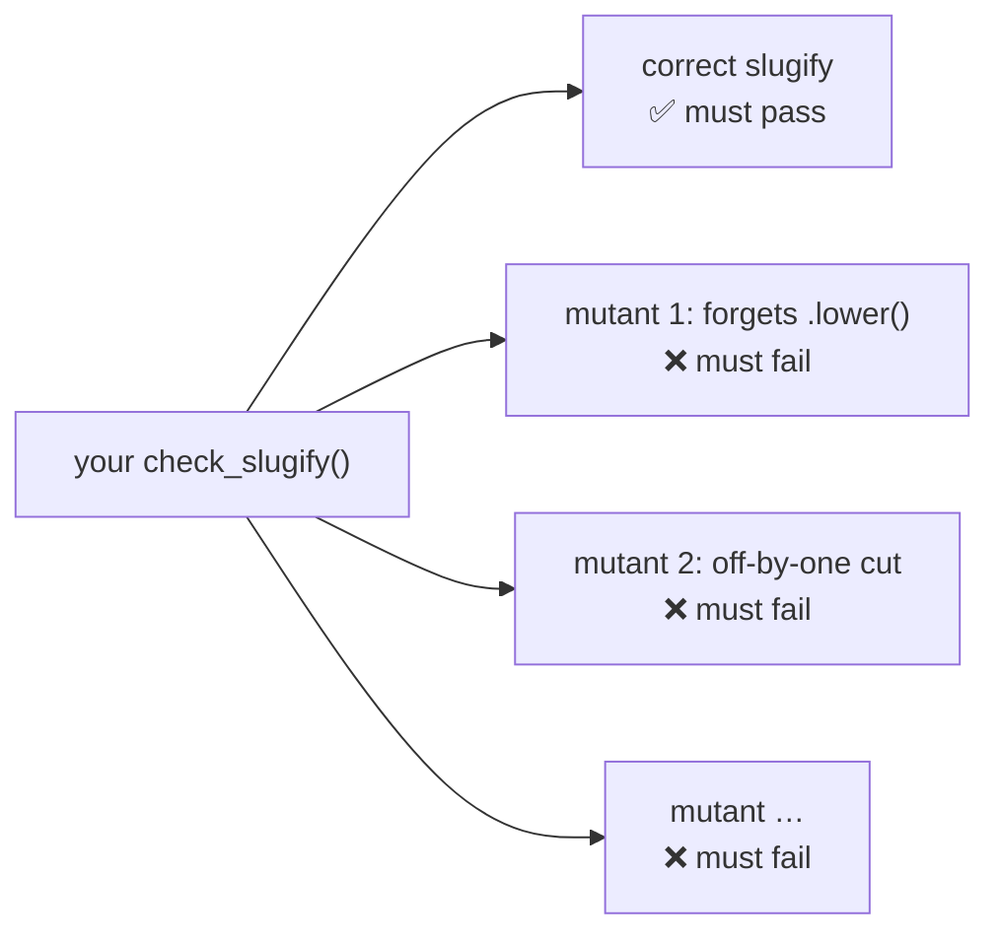

# Assignment 12 · Bug hunter tests

> **Lesson:** [11 · Testing with pytest](../../) · **Difficulty:** ⭐⭐⭐⭐☆ · **Time:** ~2.5 h

## Goal

This time the code is finished, and **you write the tests**. `exercise.py` contains three pieces of
working code: `slugify`, `parse_duration` and a shopping `Cart`. Your job is to write three check
functions that test them thoroughly.

How is that graded? The grader runs your checks twice:

1. against the **correct** code: your checks must pass;
2. against several **mutants**: copies of the code with one small, realistic bug planted in each (an
   off-by-one, a forgotten check, a wrong unit …). Every mutant must make your checks **fail**.



You don't know the mutants in advance (they are in `test_exercise.py`: **don't peek**). The only strategy
that works is the one from the lesson: test every rule in the specification, especially **boundaries**,
**error paths** and **special values**.

## The code under test (already written: do not change it)

**`slugify(text, max_length=40)`** turns a title into a URL part:

- lower-cases the text;
- replaces every **run** of characters that are not `a`–`z` or `0`–`9` with **one** dash;
- removes dashes at the start and end;
- cuts the result to at most `max_length` characters, and removes a dash left at the end by the cut;
- `max_length < 1` raises `ValueError`.

**`parse_duration(text)`** returns the number of seconds in a text like `"1h30m"`, `"45s"` or `"2h 5m 3s"`:

- units `h`, `m`, `s`, each **optional**, but in this order; spaces between the parts are allowed;
- at least one part must be present; anything else (empty text, unknown units, extra text) raises `ValueError`.

**`Cart`** is a shopping cart:

- `add(name, price, quantity=1)`: adding an existing name **increases** its quantity. `price <= 0` or
  `quantity < 1` raises `ValueError`;
- `remove(name)`: removes the item completely; an unknown name raises `KeyError`;
- `count()`: the total number of pieces (sum of all quantities);
- `total()`: the sum of `price * quantity`, rounded to 2 decimals. **From a sum of 100.00 upward**, 10 %
  is taken off.

## What to write

| Function | Gets | Does |
|---|---|---|
| `check_slugify(slugify)` | a slugify function | `assert`s everything the spec says |
| `check_parse_duration(parse_duration)` | a parse_duration function | same |
| `check_cart(Cart)` | a Cart **class** | creates fresh carts with `Cart()` and checks them |

Inside the checks, use `assert`, `pytest.raises` and `pytest.approx` exactly as in a normal test
function. Each check receives the code to test **as a parameter**: always call that parameter, never the
module-level `slugify` directly, or the mutants slip through.

```python
def check_slugify(slugify):
    assert slugify("Hello World") == "hello-world"
    ...
```

## Hints

<details>
<summary>Hint 1: think in bugs</summary>

For every rule in the specification, imagine the bug that breaks it, and write one assert that this bug
would fail. "Removes dashes at the start and end": what if it only removed them at the end? So test
`slugify("  Hello!  ")`. "Run of characters": what if each character became its own dash? So test two
spaces in a row.
</details>

<details>
<summary>Hint 2: boundaries</summary>

The discount starts **at** 100.00: test a cart just below, exactly at, and above it. `max_length`: test a
cut that lands right after a dash, and one that lands right at the end of a word.
</details>

<details>
<summary>Hint 3: errors</summary>

Every "raises" in the specification deserves a `with pytest.raises(...)`. And every rule about invalid
input ("anything else raises") deserves several different kinds of invalid input.
</details>

## Check your work

```bash
pytest intermediate/11-testing-with-pytest/assignments/12-bug-hunter-tests -v
```

A failing test names the mutant it is about, with a short description of the planted bug: a strong hint
for which test case is still missing.

## Done?

Compare with the [template solution](../../../../solutions/intermediate/11-testing-with-pytest/assignments/12-bug-hunter-tests/exercise.py),
then tick off assignment 12 in the [progress checklist](../../../../README.md#progress-checklist).
