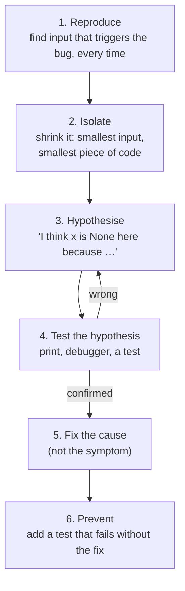
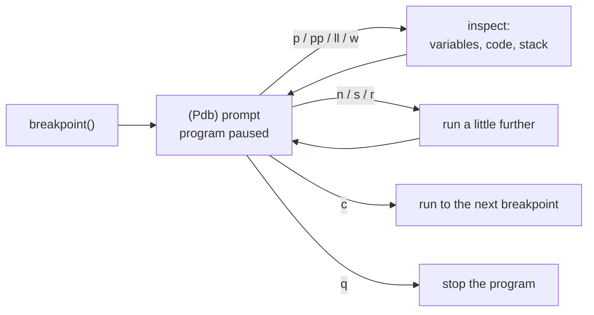
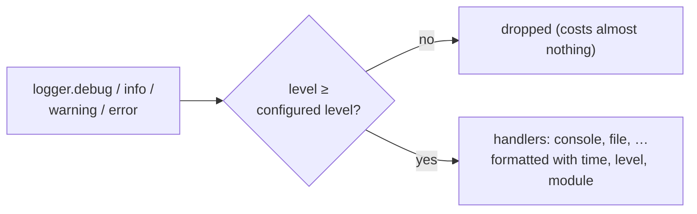

# Lesson 12 · Debugging

> **Level:** 🔵 Intermediate · **Time:** ~2.5 h · **Assignment:** [13 · Bug hunt](assignments/13-bug-hunt/)

Every program has bugs. What separates a frustrating afternoon from a ten-minute fix is not talent but
**method**: a calm, systematic way to go from "it doesn't work" to "this line, for this reason". This lesson
gives you that method, the tools that support it (the debugger `pdb`, `breakpoint()`, `logging`), and a
catalogue of the bugs that Python programmers make again and again, so you recognise them on sight.

## What you will learn

- a step-by-step debugging method that works for any bug
- reading tracebacks fully, including chained exceptions
- print debugging done well, with `f"{x=}"`
- `assert` for internal sanity checks
- the debugger: `breakpoint()`, the essential `pdb` commands, post-mortem debugging
- `logging` instead of `print`: levels, configuration, one logger per module
- the classic Python bugs and how to spot them

---

## 1. The method

Debugging is the scientific method applied to code. Resist the urge to change things at random until
the error goes away: that hides bugs instead of fixing them.



- **Reproduce.** A bug you cannot trigger reliably cannot be fixed reliably. Write the failing input down,
  ideally as a failing test (lesson 11).
- **Isolate.** Cut away everything that is not needed to trigger it. Half the input still fails? Halve again.
  This **bisection** finds the guilty part in a few steps, even in big data or long histories (`git bisect`
  does the same for commits).
- **Hypothesise and test.** Form one concrete, checkable guess at a time. "The list is empty when we reach
  line 40" can be checked; "something is wrong with the data" cannot.
- **Fix the cause.** If a value is `None` where it should not be, the fix is where it **became** `None`, not an
  `if x is not None` at the place where it crashed.
- **Prevent.** The test from step 1 now passes. Keep it: this bug can never come back unnoticed.

And when you are stuck: explain the problem, line by line, to someone else, or to a rubber duck on your
desk. Saying out loud what the code *should* do makes the place where it *doesn't* jump out. This really
works, and it is called **rubber duck debugging**.

## 2. Read the whole traceback

Beginner lesson 10 taught you to read a traceback from the bottom up. Two more things matter in larger programs.

**Your code vs library code.** Look for the last frame that is in **your** files. The bug is almost always
there, even if the exception is raised deep inside a library: you probably passed it something wrong.

**Chained exceptions.** When an exception occurs while handling another one, Python shows both:

```text
Traceback (most recent call last):
  File "config.py", line 8, in load
    return int(raw["port"])
KeyError: 'port'

During handling of the above exception, another exception occurred:

Traceback (most recent call last):
  ...
ValueError: config is incomplete
```

Read the **first** traceback too: it is the original cause. (`raise NewError(...) from error` prints
"The above exception was the direct cause of the following exception" instead, and `from None` hides the
original on purpose, as in lesson 08.)

## 3. Print debugging, done well

`print` is a perfectly good debugging tool, if you print the right things:

```python
total = 17
items = ["a", "b"]
print(f"{total=}, {items=}, {len(items)=}")
# total=17, items=['a', 'b'], len(items)=2
```

The `=` after an expression in an f-string prints the expression **and** its value (with `repr`, so you
see the quotes around strings and the difference between `"1"` and `1`). Print **types** when in doubt:
`print(f"{type(x)=}")`. And remove your debug prints before committing.

## 4. `assert` for internal checks

`assert condition, message` raises `AssertionError` when the condition is false. Use it to state things
that **must** be true if your own code is correct:

```python
def split_bill(total, people):
    shares = [round(total / people, 2)] * people
    shares[-1] = round(total - sum(shares[:-1]), 2)     # last person absorbs rounding
    assert abs(sum(shares) - total) < 0.01, f"{shares=} do not add up to {total=}"
    return shares
```

An assert makes a wrong assumption fail **loudly and early**, right where it went wrong, instead of three
functions later. But asserts are **not** for validating user input: `python -O` removes them all. Input
from outside gets a real `if ... raise ValueError(...)` (lesson 08).

## 5. The debugger

A debugger pauses your program at a line and lets you look around: inspect every variable, step through
the code line by line, and even run Python expressions in the middle of it. Python's built-in debugger is
**pdb**. Start it by writing `breakpoint()` where you want to stop:

```python
def average(numbers):
    breakpoint()                # execution pauses here
    return sum(numbers) / len(numbers)
```

```text
> average.py(3)average()
-> return sum(numbers) / len(numbers)
(Pdb) p numbers
[]
(Pdb) p len(numbers)
0
(Pdb) q
```

The essential commands:

| Command | Does |
|---|---|
| `p expr` / `pp expr` | print (pretty-print) any expression |
| `l` / `ll` | list the code around the current line / the whole function |
| `n` | **n**ext: run the current line, stop at the next one in this function |
| `s` | **s**tep **into** the function called on the current line |
| `r` | **r**eturn: run until the current function returns |
| `c` | **c**ontinue until the next breakpoint |
| `u` / `d` | move **u**p / **d**own the call stack (look at the caller's variables) |
| `b 42` | set a breakpoint at line 42 |
| `w` | **w**here am I: print the call stack |
| `q` | quit |



**Post-mortem debugging** starts the debugger at the moment of a crash, with all variables still there:

```bash
python -m pdb script.py           # run under pdb; on an exception, you land at the crash
```

```bash
pytest --pdb                      # open the debugger at the first failing test
```

Editors such as VS Code and PyCharm offer the same features graphically: click next to a line number to
set a breakpoint, then "Debug" instead of "Run". The concepts are identical.

## 6. `logging`: print for grown-up programs

Debug prints are temporary. But some information should **stay** in a program: which file was loaded, which
record was skipped and why, how long a step took. For that, use the `logging` module:

```python
import logging

logger = logging.getLogger(__name__)      # one logger per module, named after it

def load_orders(path):
    logger.info("loading orders from %s", path)
    orders = read(path)
    if not orders:
        logger.warning("no orders in %s", path)
    logger.debug("first order: %r", orders[:1])
    return orders
```

```python
# once, at the start of the program (e.g. in main):
logging.basicConfig(level=logging.INFO, format="%(asctime)s %(levelname)s %(name)s: %(message)s")
```

```text
2026-10-31 14:30:05,120 INFO orders: loading orders from orders.csv
2026-10-31 14:30:05,121 WARNING orders: no orders in orders.csv
```

Every message has a **level**. The configuration decides from which level up messages are shown:

| Level | For |
|---|---|
| `DEBUG` | details for diagnosing problems |
| `INFO` | confirmation that things work as expected |
| `WARNING` | something unexpected, but the program continues (the default threshold) |
| `ERROR` | a function could not do its job |
| `CRITICAL` | the program itself cannot continue |



Why not `print`?

- You can turn the noise **up** while debugging (`level=logging.DEBUG`) and **down** in production, without touching the code.
- Every message carries a timestamp, a level and the module it came from.
- Output can go to the console, a file, or a log server, configured in one place.
- Libraries log to their own named loggers, which you can silence individually.

Two habits: pass values as **arguments** (`logger.info("loaded %s", path)`) rather than f-strings, so the
text is only built if the message is actually shown; and inside `except` blocks, use `logger.exception("...")`,
which adds the full traceback. The Professional level covers logging configuration in depth.

## 7. The usual suspects

Most bugs are not exotic. These ones cause a large share of the bugs in everyday Python code, and you
have met all of them in this course:

| Bug | Symptom | Lesson |
|---|---|---|
| mutable default argument `def f(x=[])` | data "leaks" between calls | beginner 09 |
| aliasing: `b = a` for a list, `[[0] * 3] * 3` | changing one thing changes another | beginner 07 |
| changing a list while looping over it | items are skipped | intermediate 06 |
| off-by-one: `range(len(x) - 1)`, `<` vs `<=` | the first or last item is missing | intermediate 11 |
| a missing `return` in one branch | `None` appears from nowhere | beginner 09 |
| late binding in closures | all callbacks use the last value | intermediate 02 |
| comparing floats with `==` | equal-looking numbers are not equal | beginner 03 |
| `except Exception: pass` | errors vanish, results are silently wrong | beginner 10 |
| a file named like a module (`random.py`) | strange `AttributeError` on import | beginner 12 |
| integer vs true division (`//` vs `/`) | results are too small | beginner 03 |
| case-sensitive comparisons | `"Ada" != "ada"` | beginner 03 |

When something behaves strangely, run through this list first.

---

## Common mistakes

**Changing code at random until the error disappears.** The bug is still there, now hidden. Form a hypothesis first.

**Fixing the symptom.** An `if x is None: return` where it crashes, instead of finding out why `x` is `None`.

**Not reproducing first.** Without a reliable reproduction you cannot know whether your fix worked.

**Debug prints left in the code.** Use `logging.debug` for anything that should stay.

**`assert` for input validation.** `python -O` removes asserts. Raise real exceptions for bad input.

**Only reading the last line of a chained traceback.** The first exception is usually the real cause.

**Not adding a regression test.** The same bug will come back, and nobody will notice.

## Try it yourself

1. Put `breakpoint()` into a loop and use `p`, `n`, `c` and `ll`. Then try `u` inside a nested call.
2. Run a crashing script with `python -m pdb script.py` and inspect the variables at the crash.
3. Replace three debug `print`s in an old assignment with `logging.debug`, and switch them on and off with `basicConfig(level=...)`.
4. Make a failing test in this repository and run `pytest --pdb` on it.
5. Take the table in section 7 and write a three-line example of each bug. Can you predict the output?

## Summary

- Debug by **method**: reproduce, isolate, hypothesise, test, fix the cause, add a regression test.
- Read tracebacks fully: find the last frame in **your** code, and read chained exceptions from the first one.
- `print(f"{x=}")` for quick checks; `assert` for internal invariants (never for user input).
- `breakpoint()` opens **pdb**: `p`, `ll`, `n`, `s`, `c`, `u`, `w`, `q`. `python -m pdb` and `pytest --pdb` debug post-mortem.
- Use `logging` with one `getLogger(__name__)` per module and levels instead of permanent `print`s.

## Assignment

➡️ **[13 · Bug hunt](assignments/13-bug-hunt/)**: eleven functions, twelve bugs. Find them, fix them, and replace a print with logging.

---

<p align="center">
  <a href="../11-testing-with-pytest/">← Previous: 11 · Testing with pytest</a> · <a href="../README.md">Intermediate overview</a> · <a href="../13-command-line-programs/">Next: 13 · Command-line programs →</a>
</p>
