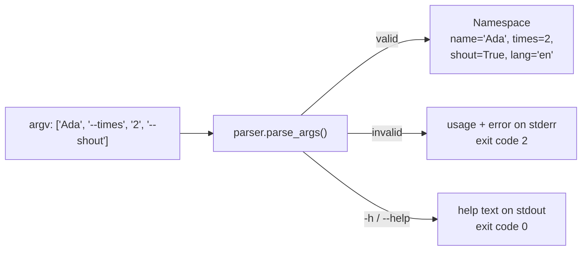
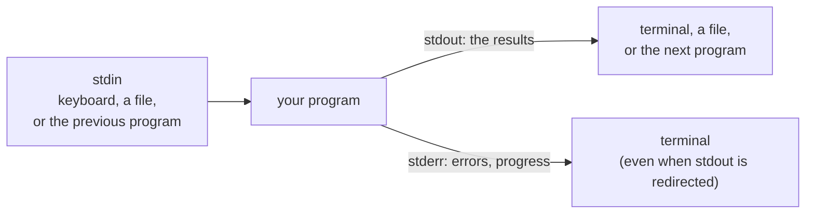
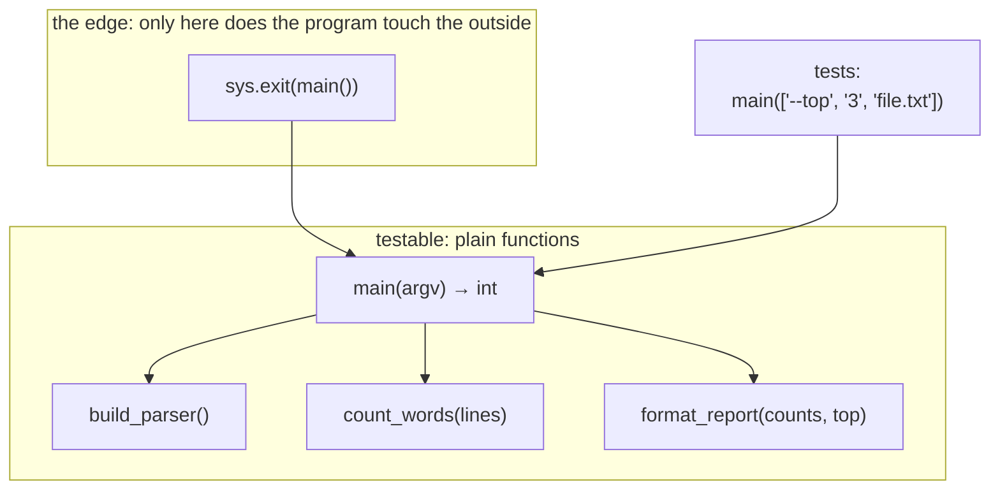

# Lesson 13 · Command-line programs

> **Level:** 🔵 Intermediate · **Time:** ~2.5 h · **Assignment:** [14 · Word stats CLI](assignments/14-word-stats-cli/)

`git`, `pip`, `pytest`, `python` itself: the tools developers use every day are command-line programs.
They take arguments, read input, write output, and report success or failure with an exit code, so they
can be combined with each other in scripts and pipelines. This lesson shows you how to write programs
that behave like real Unix tools, with `--help`, proper error messages and exit codes, and, just as
important, how to keep them **testable**.

## What you will learn

- what happens between typing a command and your code running: `sys.argv`
- `argparse`: positional arguments, options, flags, types, choices, defaults and automatic `--help`
- subcommands like `git commit` / `git push`
- standard input, output and error, and how pipes connect programs
- exit codes, and what `sys.exit` really does
- the testable `main(argv=None) -> int` pattern

---

## 1. `sys.argv`: the raw arguments

When you run

```bash
python greet.py Ada --shout
```

the shell splits the line into words, and Python puts them into the list `sys.argv`:

```python
# greet.py
import sys
print(sys.argv)          # → ['greet.py', 'Ada', '--shout']
```

`sys.argv[0]` is the script name; the rest are the arguments, **always as strings**. You could parse
them by hand, but then you would have to handle missing arguments, wrong types, `--help`, options in any
order, and error messages yourself. The standard library has a module for that.

## 2. `argparse`

```python
import argparse

parser = argparse.ArgumentParser(prog="greet", description="Greet someone.")
parser.add_argument("name", help="who to greet")                                    # positional
parser.add_argument("-n", "--times", type=int, default=1, help="how often (default: 1)")
parser.add_argument("--shout", action="store_true", help="use capital letters")      # a flag
parser.add_argument("--lang", choices=["en", "de"], default="en")

args = parser.parse_args(["Ada", "--times", "2", "--shout"])
args                     # → Namespace(name='Ada', times=2, shout=True, lang='en')
args.times + 1           # → 3      already converted to int
```



From those few lines, argparse generates all of this for free:

```text
$ python greet.py --help
usage: greet [-h] [-n TIMES] [--shout] [--lang {en,de}] name

Greet someone.

positional arguments:
  name                  who to greet

options:
  -h, --help            show this help message and exit
  -n TIMES, --times TIMES
                        how often (default: 1)
  --shout               use capital letters
  --lang {en,de}

$ python greet.py --times many Ada
usage: greet [-h] [-n TIMES] [--shout] [--lang {en,de}] name
greet: error: argument -n/--times: invalid int value: 'many'
```

The building blocks of `add_argument`:

| Argument | Meaning | Example |
|---|---|---|
| `"name"` | **positional**: required, identified by position | `greet Ada` |
| `"-n", "--times"` | **option**: optional, identified by name (short and long form) | `greet Ada -n 2` |
| `type=int` | convert the string; any function that takes a string works | `type=float`, `type=Path` |
| `default=1` | value when the option is missing | |
| `action="store_true"` | a **flag**: `True` if present, `False` otherwise | `--verbose` |
| `choices=[...]` | only these values are accepted | `--format json` |
| `nargs="*"` / `"+"` / `"?"` | zero or more / one or more / optional single value; you get a list | `files ...` |
| `required=True` | make an option mandatory (use sparingly; positionals are clearer) | |
| `help="..."` | text for `--help`; `%(default)s` inserts the default | |
| `action="version"` | prints `version=` and exits | `--version` |

For your own validation, a `type` function can raise `argparse.ArgumentTypeError`:

```python
def positive_int(text):
    value = int(text)                       # a ValueError here becomes "invalid positive_int value"
    if value < 1:
        raise argparse.ArgumentTypeError(f"must be at least 1, got {value}")
    return value

parser.add_argument("--top", type=positive_int, default=10)
```

## 3. Subcommands

Tools like `git` have **subcommands**, each with its own arguments: `git commit -m "..."`, `git push origin`.
argparse supports this with sub-parsers:

```python
parser = argparse.ArgumentParser(prog="todo")
sub = parser.add_subparsers(dest="command", required=True)

add = sub.add_parser("add", help="add a task")
add.add_argument("title")

done = sub.add_parser("done", help="mark a task as done")
done.add_argument("number", type=int)

parser.parse_args(["add", "Buy milk"])     # → Namespace(command='add', title='Buy milk')
parser.parse_args(["done", "3"])           # → Namespace(command='done', number=3)
```

`args.command` tells you which subcommand was used. The capstone of this level is built exactly like this.

## 4. stdin, stdout, stderr and pipes

Every program starts with three open streams:



- **stdout** is for the **result**: what another program might want to process.
- **stderr** is for **messages to the human**: errors, warnings, progress. `print(..., file=sys.stderr)`.
- **stdin** is the input. `sys.stdin` is a file object, so you can loop over it line by line.

Keeping results and messages apart is what makes **pipes** work:

```bash
cat book.txt | python wordstats.py --top 5 > top5.txt
```

Here `cat` writes the file to its stdout, which becomes the **stdin** of your program; its stdout goes into
`top5.txt`, while any error messages still appear in the terminal. A common convention: with no file
arguments (or the file name `-`), read from stdin.

```python
import sys

def read_lines(paths):
    if not paths:
        yield from sys.stdin                   # no files: read the pipe / keyboard
    for path in paths:
        with open(path, encoding="utf-8") as file:
            yield from file
```

## 5. Exit codes

When a program ends, it returns a number to whoever started it, the **exit code**. By convention:

| Code | Means |
|---|---|
| `0` | success |
| `1` | a general error (file not found, invalid data, …) |
| `2` | wrong usage: bad arguments (argparse uses this) |

The shell and other tools act on it: `&&` runs the next command only on success, CI marks a step as
failed when a command returns non-zero (that is how pytest failing turns a CI run red).

```bash
python wordstats.py missing.txt && echo "never printed"
```

```bash
echo $?              # macOS/Linux: the exit code of the last command (PowerShell: $LASTEXITCODE)
```

`sys.exit(code)` ends the program with that code. It works by raising the exception `SystemExit`, which
travels up the call stack like any exception (beginner lesson 10: it is not a subclass of `Exception`, so
`except Exception` does not swallow it). argparse calls `sys.exit(2)` on bad arguments and `sys.exit(0)`
after `--help`.

## 6. The testable `main`

Put all the work into a `main` function that **takes the argument list as a parameter** and **returns the
exit code**:

```python
def main(argv=None):
    parser = build_parser()
    args = parser.parse_args(argv)            # argv=None → argparse reads sys.argv[1:]
    try:
        lines = list(read_lines(args.files))
    except OSError as error:
        print(f"wordstats: error: {error}", file=sys.stderr)
        return 1
    print(format_report(count_words(lines), args.top))
    return 0


if __name__ == "__main__":
    sys.exit(main())
```



Why this shape?

- **Tests call `main([...])` directly** with any arguments, and check its return value and output (pytest's
  `capsys`), without starting a new process.
- `argv=None` makes `parse_args` fall back to the real `sys.argv[1:]` when the program runs for real.
- **Returning** the code instead of calling `sys.exit` deep inside keeps functions reusable: only the last
  line of the file decides that the process ends.
- The real work (`count_words`, `format_report`) lives in small pure functions that know nothing about
  the command line. You can test them, and reuse them in a web app, without changes.

This is the same "I/O at the edge" idea as in beginner lesson 04, one level up.

To make a tool installable as a real command (`wordstats` instead of `python wordstats.py`), you declare it
in `pyproject.toml`; the Professional level covers packaging.

---

## Common mistakes

**Errors on stdout.** They end up in the output file or the next program. Print them to `sys.stderr`.

**Exit code 0 after an error.** Scripts and CI think everything worked. Return 1 (or 2 for usage errors).

**Parsing `sys.argv` by hand.** You will reinvent `--help`, type conversion and error messages, badly. Use argparse.

**`sys.exit()` deep inside helper functions.** It makes them impossible to reuse and awkward to test. Raise exceptions, return codes from `main`.

**`main()` that reads `sys.argv` directly.** Tests cannot pass their own arguments. Accept `argv=None`.

**Forgetting that arguments are strings.** `"2" * 3` is `"222"`. Use `type=int`.

**`except Exception` around everything in `main`.** It hides bugs. Catch the specific errors you can report helpfully (`OSError`, `ValueError`).

## Try it yourself

1. Write a script that prints `sys.argv`. Run it with quoted arguments (`"two words"`) and with `*.py`. What does the shell do?
2. Build the `greet` parser from section 2 and look at `--help`. Add `--version`.
3. Make an option with `type=positive_int` and pass `0`, `-1` and `abc`. Compare the three error messages.
4. Pipe the output of one Python script into another: `python a.py | python b.py`. Print a message to stderr in `a.py`: where does it appear?
5. Run a command that fails, then check `echo $?` (or `$LASTEXITCODE` in PowerShell).

## Summary

- `sys.argv` holds the raw arguments as strings; **argparse** turns them into a typed `Namespace`, with `--help` and error messages for free.
- Positionals are required by position, options (`--name`) are optional; `type`, `default`, `choices`, `action="store_true"`, `nargs`; subcommands via `add_subparsers`.
- Results go to **stdout**, messages to **stderr**; read **stdin** when no files are given, so your program works in pipes.
- Exit code **0** = success, **1** = error, **2** = usage error. `sys.exit` raises `SystemExit`.
- Structure: `main(argv=None) -> int`, small pure functions for the work, and `sys.exit(main())` as the only line that ends the process.

## Assignment

➡️ **[14 · Word stats CLI](assignments/14-word-stats-cli/)**: a complete, tested command-line tool with options, stdin support, JSON output and exit codes.

---

<p align="center">
  <a href="../12-debugging/">← Previous: 12 · Debugging</a> · <a href="../README.md">Intermediate overview</a> · <a href="../capstone-task-tracker/">Next: 🏁 Capstone →</a>
</p>
